# FTDI/USB Logger

**Русский** · [English](#english)

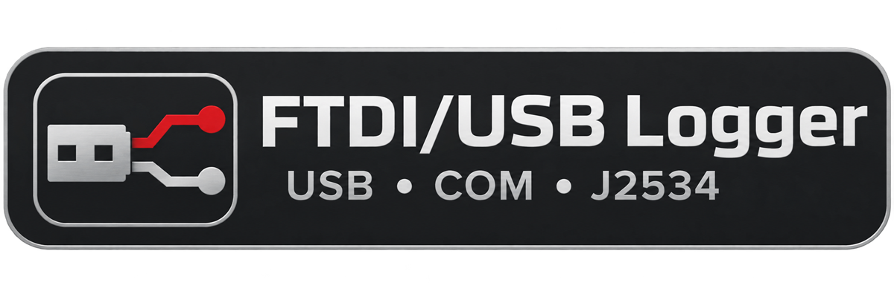

Стационарный логер обмена диагностического шнурка с ЭБУ: живой поток, шаги, таймлайн,
HEX-инспектор, скриншоты, отчёты, экспорт/импорт — и **универсальный захват** любых
USB/COM/J2534-устройств, а не только FTDI.


Проект вырос из консольного `logger.py` + Frida-агента: хуки перенесены и расширены,
разбор и интерфейс написаны заново. Цель — «одна кнопка» вместо ввода команд в консоль:
движок работает как локальный сервис, интерфейс открывается отдельным окном Edge
(`--app=`), шаг размечивается клавишей `F2`.

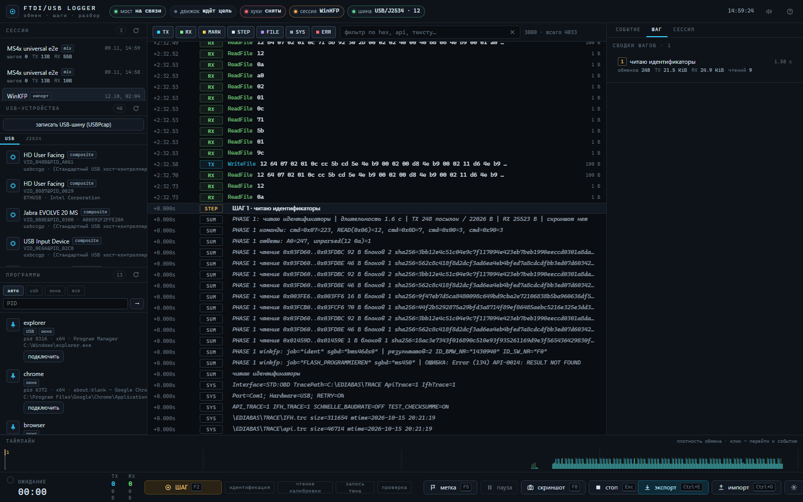

---

## Содержание

- [Возможности](#возможности)
- [Скриншоты](#скриншоты)
- [Архитектура](#архитектура)
- [Поддерживаемые транспорты](#поддерживаемые-транспорты)
- [Требования](#требования)
- [Быстрый старт](#быстрый-старт)
- [Как логировать](#как-логировать)
- [Новая сессия и смена шнурка](#новая-сессия-и-смена-шнурка)
- [Горячие клавиши](#горячие-клавиши)
- [Структура репозитория](#структура-репозитория)
- [HTTP/WS API (кратко)](#httpws-api-кратко)
- [Сессии и формат логов](#сессии-и-формат-логов)
- [Экспорт, импорт, переразбор](#экспорт-импорт-переразбор)
- [Тесты и приёмка](#тесты-и-приёмка)
- [Документация](#документация)
- [Ограничения](#ограничения)
- [Диагностика](#диагностика)
- [Приватность и безопасность](#приватность-и-безопасность)
- [Лицензия](#лицензия)

---

## Возможности

| Блок | Что умеет |
|---|---|
| **Живой поток** | виртуализированная лента на миллионы строк, фильтры по `TX/RX/MARK/STEP/FILE/SYS/ERR`, поиск по HEX/API/тексту, «хвост» большой сессии без зависаний |
| **Шаги** | `F2` — старт/стоп шага, **комбо пресетов действий** (Идентификация, Чтение/Запись калибровок и фулл флеш, Сброс ошибок/адаптаций, Верификация; свои названия добавляются автоматически), сводка (команды, ответы, чтения с SHA-256), скриншот, `# PHASE` в `raw.log` |
| **Инспектор** | HEX/ASCII-дамп, разбор KWP/DS2/ISOTP, свойства события, метаданные шага |
| **Таймлайн** | плотность обмена, переход к событию, маркеры шагов |
| **Универсальный захват** | FTDI D2XX, COM/VCP (включая overlapped-I/O и порт, открытый **до** attach), WinUSB, HID, libusb, J2534 PassThru, сырой USB через USBPcap |
| **Список программ** | режимы `авто / usb / окна / все`, бейджи `FTDI · J2534 · USB · окно`, ручной attach по PID |
| **Устройства** | панель USB-устройств (VID/PID, серийник, драйвер, COM, present), вкладка J2534-драйверов (PassThru 04.04, 32/64-бит) |
| **Новая сессия** | завершение текущей, полное пересканирование устройств/процессов, выбор адаптера и программы, ручной PID |
| **Отчёты** | `report.txt` + `report.md`, сводки шагов, экспорт ZIP / JSONL / CSV / Markdown, отправка на сервер |
| **Импорт** | старые `capture.log`/`logger.out` → сессия `imported`; переразбор (`reparse`) |
| **Скорости и тайминги** | в поток пишутся `FT_SetBaudRate`, `FT_SetLatencyTimer`, `FT_SetTimeouts`, `FT_SetDataCharacteristics`, `FT_SetFlowControl`, `COM SetCommState/SetCommTimeouts/SetupComm` (+ снимок текущих DCB/таймаутов для порта, открытого до attach), `J2534 config` (`DATA_RATE`, W1..W5, ISO15765_*); у каждого события есть `t` и `wall` — интервалы и смены скорости видно |
| **Надёжность** | watchdog «движок не отвечает», detach с бюджетом и принудительной остановкой, восстановление незакрытых сессий при старте |

---

## Скриншоты

| Поток и шаги | Инспектор события |
|---|---|
| 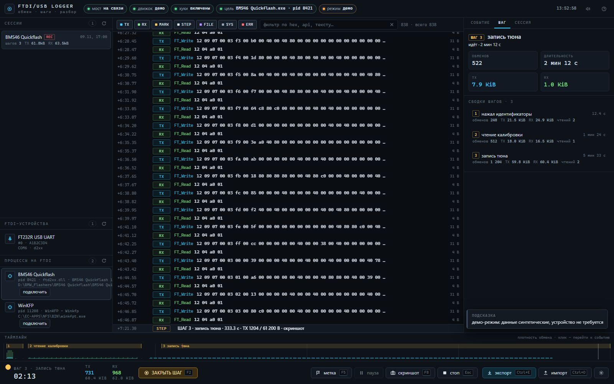 | 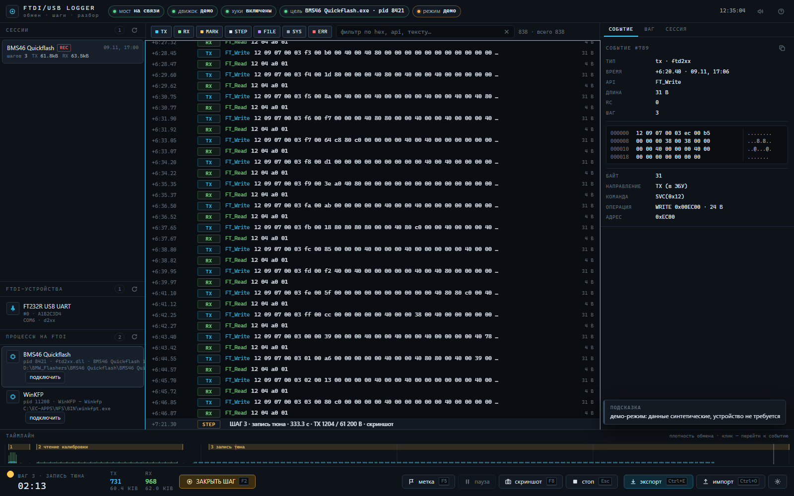 |

| Сводка шага | Экспорт |
|---|---|
| 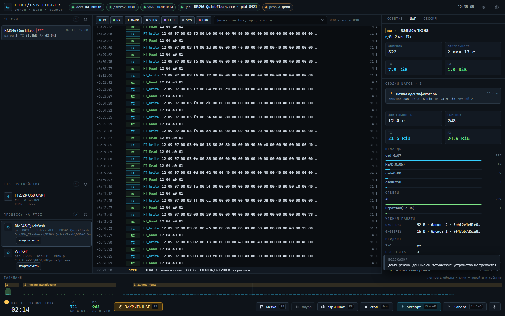 | 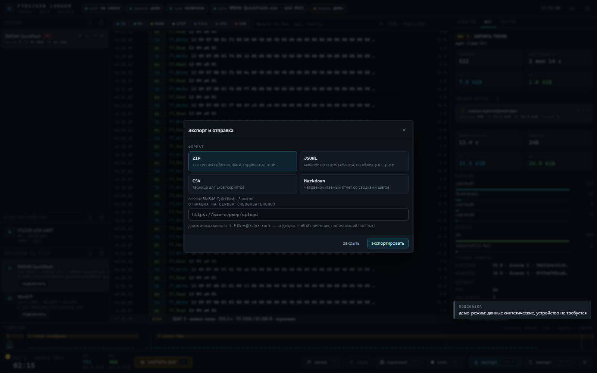 |

| Универсальный захват (USB + J2534) | Новая сессия |
|---|---|
| 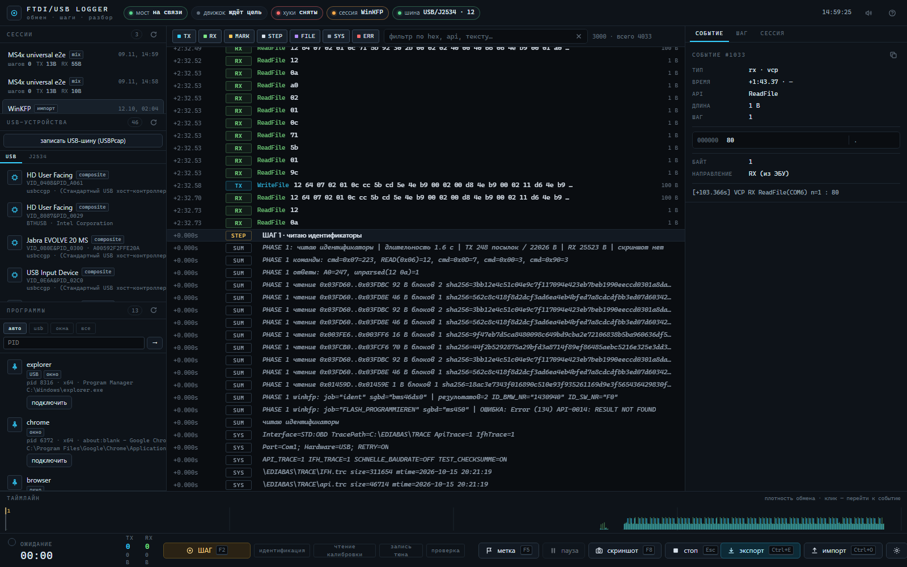 | 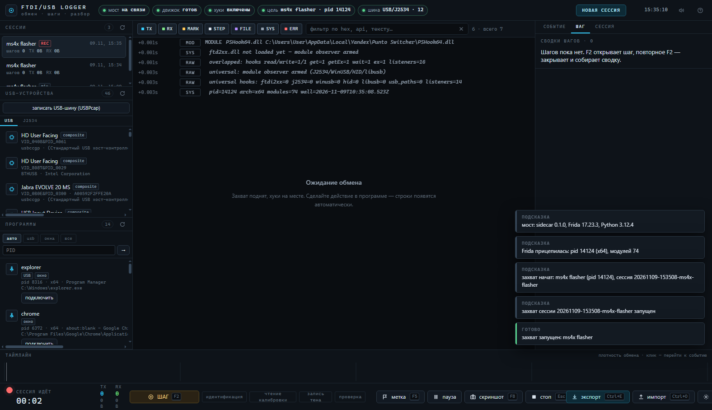 |

| Пресеты действий (комбо) |
|---|
| 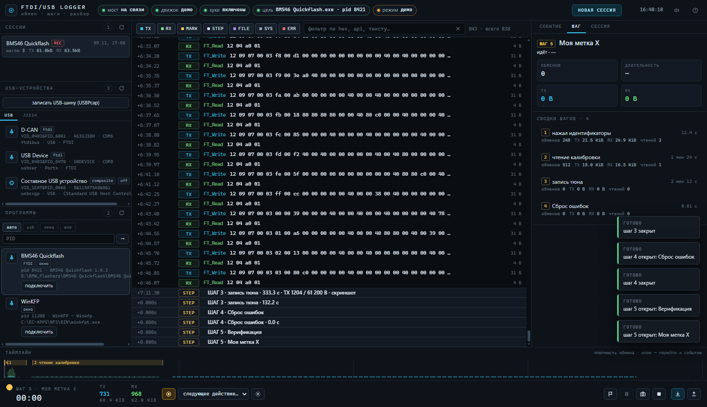 |

Демо без устройства: `ui/dist/index.html?demo=1` (или `/?demo=1` у запущенного движка).

---

## Архитектура

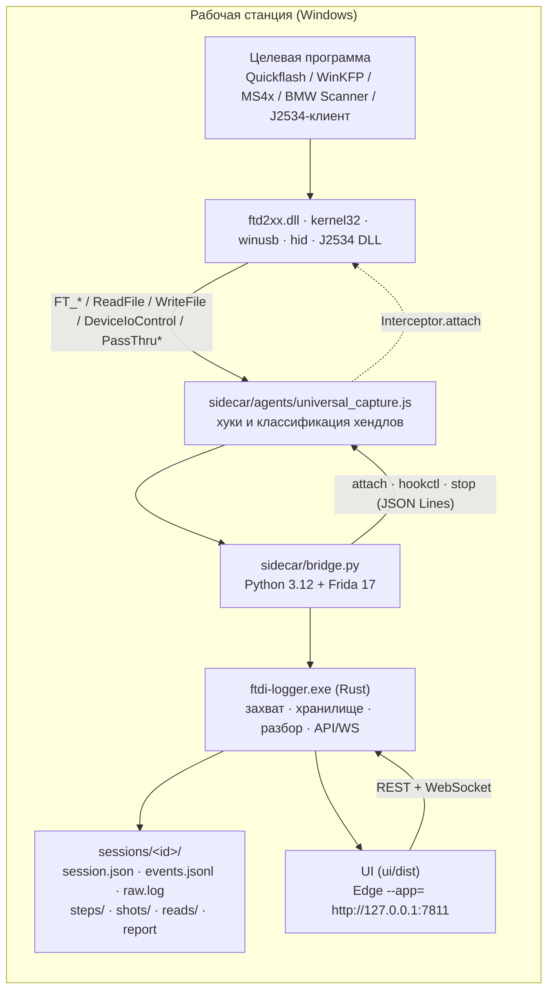

- **Движок** — один процесс `ftdi-logger.exe`: HTTP/WS на `127.0.0.1`, запись сессий,
  разбор строк, шаги, отчёты, скриншоты, импорт/экспорт. UI — статические файлы, которые он же и отдаёт.
- **Мост** — тонкий Python-sidecar: запускает Frida, загружает JS-агент, передаёт события
  построчно (JSON Lines), умеет `pause/resume`.
- **Агент** — все хуки: D2XX, VCP/COM, overlapped-I/O, WinUSB/HID/libusb, J2534, USB-пути,
  модульный observer для DLL, загруженных после attach.
- **Формат лога** совместим со старым `logger.py`: `raw.log` можно скормить старому
  `tools/legacy/parse_family.py` и наоборот — импортировать старые логи в новый UI.

---

## Поддерживаемые транспорты

| Устройство / API | Как ловится | Статус |
|---|---|---|
| FTDI D2XX (`ftd2xx.dll`) — Quickflash, ms41-studio, **BMW Scanner 1.4.0** (32-битный Delphi) | хуки `FT_*` (36 функций); внутренние USB-ioctl не дублируют TX/RX | ✅ проверено на живых программах |
| Виртуальный COM / VCP (WinKFP, EDIABAS, `.NET System.IO.Ports`) | `CreateFileW/A`, `ReadFile`, `WriteFile`, `GetOverlappedResult(Ex)`, `DeviceIoControl`; ленивая классификация уже открытого порта | ✅ включая overlapped-I/O |
| WinUSB (`winusb.dll`) | `WinUsb_ReadPipe/WritePipe/ControlTransfer` | ✅ |
| HID (`hid.dll`, `\\?\hid#…`) | `HidD_*`, `ReadFile/WriteFile/DeviceIoControl` по HID-путям | ✅ |
| libusb-1.0 | `libusb_bulk/interrupt/control_transfer` | ✅ |
| J2534 PassThru (Scanmatik SM2/SM3, CHIPSOFT, Tactrix OpenPort, VXDIAG, Bosch MDI, UCDS, EVC) | загрузка DLL по шаблонам + **все** экспорты `PassThru*` (open/connect/read/write/ioctl/filter/voltage/version) | ✅ на уровне сообщений: протокол, CAN ID (и `idlen=` — id остаётся в `hex`), `ExtraDataIndex`, payload, ISOTP-PCI, сервис KWP/UDS; вендорные протоколы без CAN-id (PCMflash `0x8003`) разбираются по префиксу длины; частичные результаты при `rc!=0` и нарушения контракта драйвера не теряются |
| **LAN** (J2534-по-IP, DoIP/ISO 13400, BMW ICOM/HSFZ, сетевые адаптеры) | хуки Winsock `ws2_32`: `connect/accept`, `send/recv`, `WSASend/WSARecv`, `sendto/recvfrom`, `WSAGetOverlappedResult` | ✅ обмен TCP/UDP целиком, включая overlapped; DoIP-заголовки, source/target address, UDS-сервис и NRC в инспекторе |
| Любой USB с проприетарным драйвером | сырой захват USBPcap → `USBRAW bus/dev/ep/transfer/…` | ⚠️ нужен установленный [USBPcap](https://desowin.org/usbpcap/) + права администратора; отдельная сессия — одновременно с захватом процесса пока не запускается |
| **J2534-прокси** (тот же обмен, но со стороны драйвера) | своя 32-битная DLL регистрируется отдельным J2534-устройством, форвардит вызовы в настоящий драйвер и пишет журнал вне процесса | ✅ второй канал к Frida: работает без инъекции, видит вендорные ординалы 1377–1379, журнал сводится в сессию и сверяется кадр-в-кадр |

В панели **USB-УСТРОЙСТВА** — все USB-устройства системы и зарегистрированные J2534-драйверы;
в шапке — индикатор `шина: USB/J2534 · N`. Список устройств обновляется каждые ~12 с даже
во время записи, поэтому замена шнурка видна без перезапуска.

---

## J2534 через прокси — второй канал захвата

Frida-агент видит вызовы **изнутри** процесса. Прокси-DLL видит их **на границе**
«приложение → драйвер»: приложение грузит нашу библиотеку как обычный J2534-драйвер,
она форвардит всё в настоящий и пишет свой журнал. Это второй, независимый канал —
он работает, даже когда внедриться в процесс не удаётся.

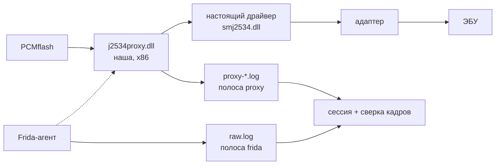

Включается в **Настройки → J2534**: переключатель регистрирует устройство
`Scanmatik - SM2 Proxy`, при необходимости переключает адаптер в PCMflash (прежний выбор
сохраняется и восстанавливается) и подхватывает журналы в открытую сессию. В сессии
появляются обе полосы: `raw.log` и `raw-proxy.log`, а отчёт показывает, сколько кадров
совпало, сколько потерял каждый канал.

**Видно, подхватился ли прокси** — без похода в журналы:

| Где | Что показывает |
|---|---|
| шапка приложения | пилюля `прокси`: «подхвачен: PCMflash.exe» (зелёная), «был подхвачен: …» (серая), «не подхвачен» (жёлтая); клик открывает настройки |
| настройки → J2534 | строка под переключателем: процесс и pid, «2876 вызовов · TX 1959 / RX 3917 · обмен 3 с назад», либо причина, почему никто не загрузил прокси |
| там же | выбор **какой шнурок проксировать** — список зарегистрированных J2534-драйверов с текущим выбранным |

Свежесть даёт файл `proxy-live-<pid>.state`, который DLL пишет рядом с журналом;
«подхвачен» движок подтверждает по живому процессу с тем же exe, а не по наличию файла.

**Если «не подхвачен», а адаптер выбран** — проверьте, чей файл лежит на месте прокси.
В настройках рядом с версией показаны издатель и разрядность DLL; на чужой файл горит
красная строка, а кнопка «Восстановить прокси» возвращает нашу DLL из эталонной копии.
Запущенный PCMflash новую DLL не увидит — его нужно перезапустить (кнопка
«Перезапустить PCMflash»). Движок делает то же автоматически при старте, если прокси
включён; подробности и границы автоматики — [docs/13-j2534-proxy.md](docs/13-j2534-proxy.md) §3.1.

Установщик ставит прокси сразу (галка «Установить J2534-прокси», запрос UAC) — но
**не** переключает адаптер в чужой программе: это всегда осознанное действие.
Подробности, формат журнала и откат — [docs/13-j2534-proxy.md](docs/13-j2534-proxy.md).

---

## Требования

| Компонент | Зачем | Как поставить |
|---|---|---|
| Windows 10/11 x64 | целевая ОС (Frida/FTD2XX, Edge) | — |
| Rust (cargo) | сборка движка | <https://rustup.rs> |
| Node.js 20+ и pnpm | сборка UI | `winget install OpenJS.NodeJS.LTS`, затем `npm i -g pnpm` |
| Python 3.12 + `frida>=17,<18` | мост к процессу | `py -3.12 -m pip install "frida>=17,<18"` |
| Драйвер FTDI (D2XX / VCP) | шнурок | с сайта FTDI; для WinKFP/EDIABAS — как раньше |
| Права администратора | WinKFP/EDIABAS и USBPcap цепляются к своим процессам | запуск логера «от имени администратора» |

> Windows обязательна: движок использует Win32 API (ToolHelp, SetupAPI, реестр, скриншоты),
> UI и sidecar кроссплатформенны, но продукт рассчитан на Windows-стенд.

---

## Быстрый старт

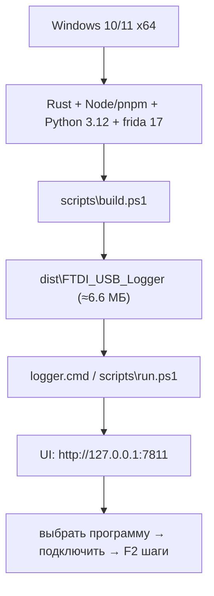

### Сборка

```powershell
# полная сборка: UI + движок + упаковка dist\FTDI_USB_Logger\
powershell -ExecutionPolicy Bypass -File scripts\build.ps1

# только движок (без UI)
powershell -ExecutionPolicy Bypass -File scripts\build.ps1 -SkipUi

# режим разработки: движок + vite dev с проксированием /api и /ws
powershell -ExecutionPolicy Bypass -File scripts\dev.ps1
```

Результат `dist\FTDI_USB_Logger\`:

| Внутри | Что это |
|---|---|
| `ftdi-logger.exe` | движок (release) |
| `ui\dist\` | собранный интерфейс (движок отдаёт его с `/`) |
| `sidecar\` | Python-мост `bridge.py` + Frida-агент `universal_capture.js` |
| `sessions\` | каталог сессий (пустой) |
| `logger.cmd` | запуск двойным кликом/с ярлыка, без висящей консоли |

### Запуск

```powershell
# из репозитория (dist, если собран; иначе release-бинарь движка)
powershell -ExecutionPolicy Bypass -File scripts\run.ps1

# как раньше: двойной клик по logger.cmd (или ярлык на рабочем столе)
```

Движок поднимает HTTP/WS на `http://127.0.0.1:7811` и сам открывает окно Edge в режиме `--app=`.
Порт можно поменять: `scripts\run.ps1 -Port 7812` (или `ftdi-logger.exe --port 7812`).

---

## Установка на другую машину (независимая сборка)

Приложение не требует установленных Python/Frida/Rust: в установщик и portable-версию
встроен Python 3.12 с Frida. Готовые сборки публикуются в **GitHub Releases**
(workflow `.github/workflows/release.yml`, тег `v*`) — оттуда `FTDI_USB_Logger_Setup.exe`
и portable ZIP можно скачать и установить без сборки из исходников.

**Скачать (без авторизации):**
[Установщик FTDI_USB_Logger_Setup.exe](https://github.com/Ydjin1984/ftdi-usb-logger/releases/latest/download/FTDI_USB_Logger_Setup.exe) ·
[Portable ZIP](https://github.com/Ydjin1984/ftdi-usb-logger/releases/latest/download/FTDI_USB_Logger_portable.zip) ·
[все релизы](https://github.com/Ydjin1984/ftdi-usb-logger/releases)

| Что | Где | Размер | Как ставится |
|---|---|---|---|
| **Установщик** | `FTDI_USB_Logger_Setup.exe` (GitHub Releases, `dist\`) | ≈43 МБ | запустить, разрешить UAC; per-user установка в `%LOCALAPPDATA%\FTDI_USB_Logger`, ярлыки на рабочем столе и в меню Пуск, запись в «Установка и удаление программ», uninstall |
| **Portable ZIP** | `FTDI_USB_Logger_portable.zip` (GitHub Releases, `build\`) | ≈64 МБ | распаковать куда угодно и запустить `FTDI_USB_Logger.exe`; ничего не устанавливается |
| Обычный dist | `dist\FTDI_USB_Logger\` | ≈7 МБ | для машины, где Python+Frida уже есть |

- **Независимый лаунчер** `FTDI_USB_Logger.exe` (`launcher/Launcher.cs`, сборка —
  `scripts/build-launcher.ps1`): показывает логотип **2 секунды**, затем поднимает движок и
  открывает окно журнала. Иконка — `assets/app.ico`, логотип `assets/splash.png` встроен
  в exe ресурсом; манифест требует права администратора.
- **Права администратора**: и `FTDI_USB_Logger.exe`, и `logger.cmd` всегда запрашивают UAC —
  движку нужны права для Frida-хуков и чтения чужих процессов. Само окно UI открывается
  уже без администратора (через Explorer).
- **Splash при старте**: логотип горит ровно 2 секунды (даже если движок поднялся раньше);
  если движок не ответил за 60 с — лаунчер покажет ошибку и подсказку про `logger.err.log`.
  Старый резервный путь без лаунчера: `scripts/splash.ps1`.
- **Иконка приложения**: `assets/app.ico` — в exe, на ярлыках и в панели задач
  (UI-окно получает favicon из `ui/public/favicon.png`).
- Установщик не подписан: при первом запуске Windows SmartScreen может показать
  «Неизвестный издатель» → «Подробнее» → «Выполнить всё равно». Для распространения нужен
  код-сертификат (не входит в репозиторий).
- Сессии и логи хранятся в каталоге установки (`sessions\`), при удалении можно сохранить их.

### Сборка установщика (Inno Setup)

```powershell
# 0) движок + UI + независимый лаунчер -> dist\FTDI_USB_Logger\ (включая FTDI_USB_Logger.exe)
pwsh -File scripts\build.ps1

# 1) portable: dist + встроенный Python + frida  -> build\FTDI_USB_Logger_portable.zip
pwsh -File scripts\build-portable.ps1

# 2) Setup.exe (Inno Setup 6, per-user установка) -> dist\FTDI_USB_Logger_Setup.exe
pwsh -File scripts\build-installer.ps1

# запасной путь без Inno Setup — 7-Zip SFX (хуже: нет мастера и иконки)
pwsh -File scripts\build-installer.ps1 -ForceSfx
```

Установщик — **Inno Setup 6** (`installer\ftdi-logger.iss`): мастер установки, иконка
приложения у Setup.exe, запись в «Установка и удаление программ», ярлыки на рабочем столе
и в меню «Пуск», штатный uninstall, закрытие запущенных процессов перед установкой.
Компилятор ищется в `%INNO_SETUP_DIR%`, `C:\Program Files (x86)\Inno Setup 6` и PATH;
если его нет — скрипт откатывается на 7-Zip SFX.

Для сборки нужны .NET Framework 4.x (csc для лаунчера), Inno Setup 6 и интернет
(первый раз скачивается embeddable Python, кешируется в `build\cache`);
7-Zip нужен только для запасного пути и portable-архива.

## Как логировать

1. Запустить целевую программу (Quickflash, WinKFP, MS4x Flasher, BMW Scanner, J2534-клиент — любую)
   и подключить адаптер.
2. В UI открыть «ПРОГРАММЫ»: список показывает процессы с окном, USB/FTDI/J2534-модулями
   и известные инструменты, с бейджами `FTDI`, `J2534`, `USB`, `окно`. Выбрать программу и нажать
   «подключить». Если её не видно — переключить фильтр на «окна»/«все» или ввести PID вручную.
3. `F2` — открыть шаг (название подставляется автоматически), повторный `F2` — закрыть шаг:
   сводка, скриншот и строки `# PHASE` в `raw.log`.
4. Работать с блоком как обычно: весь обмен FTDI/VCP/USB/J2534 и файловые операции пишутся в сессию.
5. `Esc` — остановить захват и закрыть сессию; отчёт и экспорт — из UI.

> Приложения, которые открывают порт **до** attach (MS4x Flasher, .NET SerialPort) поддерживаются:
> агент лениво классифицирует уже открытый хендл по `GetFinalPathNameByHandleW`, а overlapped-RX
> достаёт через `GetOverlappedResult`/`OVERLAPPED.Internal`.

---

## Новая сессия и смена шнурка

Кнопка **«НОВАЯ СЕССИЯ»** в шапке (или `Ctrl+Alt+N`):

1. Если идёт запись — подтверждение: текущая сессия сохраняется, захват останавливается.
2. Логер **заново сканирует** USB-устройства, J2534-драйверы и процессы (кэш сбрасывается).
3. Открывается окно выбора: адаптер (FTDI serial/COM) и программа (список `auto`) или ручной PID.
4. «начать сессию» — захват стартует заново, уже с новым шнурком/программой.

Если **целевая программа закрылась** — движок сам завершает сессию в течение ~1 с
(«захват остановлен, устройства освобождены»), а не продолжает показывать `REC`. Если движок
остановлен или перезапущен, UI через ~12 с показывает слой **«Движок не отвечает»**, а после
запуска `logger.cmd` страница переподключается сама. Принудительный `detach` не даёт мосту
держать сессию дольше 8 секунд.

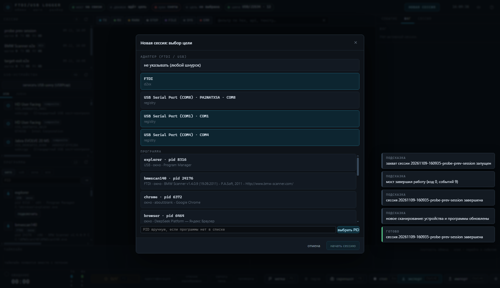

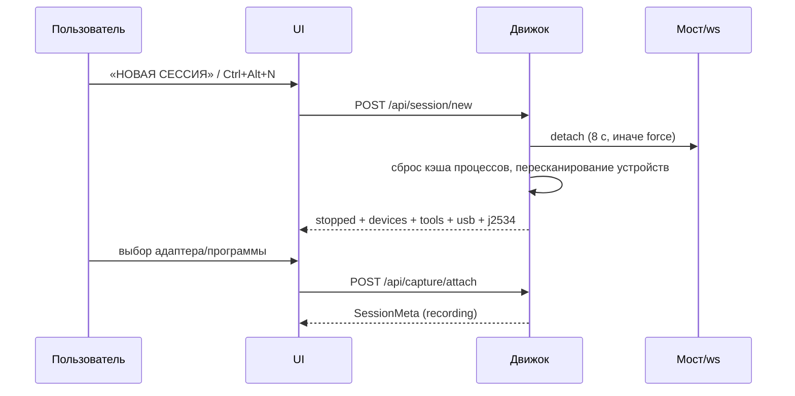

---

## Пресеты действий

Названия шагов больше не вводятся руками: на нижней панели — **комбо пресетов**. Выбрал пункт —
шаг с этим названием открылся (предыдущий автоматически закрылся со сводкой). Шестерёнка рядом —
редактор списка (добавить/удалить строки, вернуть стандартные).

Стандартный набор:

| # | Пресет |
|---|---|
| 1 | Идентификация |
| 2 | Чтение калибровок |
| 3 | Чтение фулл флеш |
| 4 | Запись калибровок |
| 5 | Запись фулл флеш |
| 6 | Сброс ошибок |
| 7 | Сброс адаптаций |
| 8 | Верификация |

- Пресеты хранятся в `localStorage` (`ftdi.quickTitles`) и переживают перезапуск.
- Ввели своё название вручную (`Shift+F2` или метка `F5`) — оно **автоматически сохраняется**
  в пресеты, чтобы потом не набирать снова.
- Список пресетов используется и для подсказок в диалогах шага/метки.

Кнопки нижней панели — только иконки; полное название и горячая клавиша появляются при
наведении (tooltip), поэтому при сужении окна они не наезжают друг на друга.

## Горячие клавиши

| Клавиша | Действие |
|---|---|
| `F2` | открыть/закрыть шаг (старт — с автоназванием, конец — сводка + скриншот) |
| `Shift+F2` | открыть шаг с названием вручную |
| `F1` | встроенная справка |
| `F5` | метка в потоке без шага (MARK) |
| `F6` | пауза/возобновление хуков (`hookctl pause/resume`) |
| `F8` | скриншот сейчас |
| `Esc` | остановить захват (detach) |
| `Ctrl+F` | поиск по потоку |
| `Ctrl+E` | экспорт сессии |
| `Ctrl+O` | импорт старого лога |
| `Ctrl+Alt+N` | **новая сессия** (пересканировать всё) |
| комбо на нижней панели | выбрать пресет — открыть шаг с нужным названием |
| `↑ ↓ PgUp PgDn Home End` | навигация по потоку |

Глобальных хоткеев нет — клавиши работают, когда окно логера в фокусе, чтобы не перехватывать
управление у целевой программы.

---

## Структура репозитория

| Путь | Что там |
|---|---|
| `engine/` | Rust-движок: `main/config/discovery/procscan/screenshot/frida`, `models/store/decode/api/report/import/ediabas/usbdevices/j2534/usbpcap`, интеграционные тесты |
| `ui/` | интерфейс (TypeScript + CSS, vite): поток, инспектор, таймлайн, панели, диалоги, CDP-проверки |
| `sidecar/` | `bridge.py` (JSON Lines) + `agents/universal_capture.js` (все хуки) и `ftdi_capture.js` (старый набор) |
| `proxy/` | 32-битная J2534-прокси (`j2534proxy.c`, `.def`, `version.rc`, `build.ps1`) — второй канал захвата, см. `docs/13` |
| `scripts/` | `build.ps1`, `run.ps1`, `dev.ps1` |
| `tests/e2e/` | `smoke.ps1`, `universal.ps1` (MS4x), `bmw-scanner.ps1`, `dummy_target.py`, edge-сценарии |
| `docs/` | контракты, архитектура, runbook, интерфейсы, edge-кейсы, smoke, ревью, разведка по универсальному захвату |
| `tools/legacy/` | исторические `parse_family.py`, `winkfp.py`, `attach_capture.py` — эталон разбора |
| `reference/` | golden-логи и ожидаемые артефакты для тестов |
| `sessions/` | сессии продукта (в git пусто, `.gitkeep`) |
| `assets/` | скриншоты для README |

---

## HTTP/WS API (кратко)

Всё слушает только `127.0.0.1`, CORS — точный localhost-origin.

| Метод / путь | Назначение |
|---|---|
| `GET /api/health` | версия, состояние моста, `capabilities` (ftd2xx, j2534, usbpcap) |
| `GET /api/sessions`, `GET /api/sessions/{id}` | список/детали сессий |
| `GET /api/sessions/{id}/events?from=&limit=&filter=` | страница событий |
| `GET /api/sessions/{id}/events/{seq}/decode` | разбор payload (KWP/DS2/ISOTP) |
| `POST /api/capture/attach` `{pid,label?,adapter?}` | подключиться к процессу |
| `POST /api/capture/detach` | остановить захват (с бюджетом 8 с + force) |
| `POST /api/session/new` | завершить текущую и пересканировать окружение |
| `GET /api/tools?mode=auto\|usb\|window\|all` | процессы-кандидаты |
| `GET /api/devices` · `GET /api/usb/devices` · `GET /api/j2534/drivers` | FTDI / USB / J2534 |
| `GET /api/j2534/proxy` · `POST /api/j2534/proxy` | состояние и действия J2534-прокси (`install/remove/enable/disable/select-adapter/restore-adapter/set-real/repair/restart-pcmflash`); ответ содержит живое состояние (`live`), список драйверов (`devices`) и признаки DLL (`dll.ours/company/arch`) |
| `POST /api/sessions/{id}/proxy/collect` | подхватить журналы прокси в открытую сессию сейчас |
| `POST /api/usbpcap/start` | сырой захват шины (нужен USBPcap) |
| `POST /api/sessions/{id}/step/start` · `step/end` · `mark` · `note` · `shot` | разметка сессии |
| `POST /api/sessions/{id}/reparse` | пересобрать отчёты из `events.jsonl` |
| `POST /api/import` · `POST /api/import/upload` | импорт старых логов |
| `GET /api/sessions/{id}/export?format=zip\|jsonl\|csv\|md` | экспорт |
| `WS /ws?session=` | живой поток событий |

Полные формы ответов и коды ошибок — [docs/02-architecture.md](docs/02-architecture.md).

---

## Сессии и формат логов

```
sessions/20261109-154706-bmw-scanner-e2e/
├── session.json        # метаданные: инструмент, pid, sha256 exe, счётчики, статус
├── events.jsonl        # события (kind, api, transport, direction, t, hex, meta)
├── events.idx          # индекс для быстрого поиска
├── raw.log             # лог в формате старого logger.py (импортируемый обратно)
├── raw-proxy.log       # второй канал: журнал J2534-прокси (если включён)
├── proxy.json          # сводка полосы прокси и сверка с основным каналом
├── steps/01.json …     # сводки шагов (команды, ответы, чтения, скриншот)
├── shots/              # PNG-скриншоты шагов
├── reads/              # дампы чтений с SHA-256
├── import/             # исходник импортированного лога
├── report.txt          # текстовый отчёт
└── report.md           # Markdown-отчёт
```

Пример `raw.log` (совместим со старым парсером):

```text
# capture start: label=BMW Scanner e2e
# tool: C:\BMWScan140\BMWScan140.exe
# exe: size=3009024 mtime=2011-09-20 02:11:16 sha256=7aebc4b7…
# wall(start)=2026-11-09 15:47:06
# host: user=User computer=DESKTOP-7MECFCS
[+3.947s] ftd2xx.dll hooks installed (36) at 0x10000000 C:\Windows\SYSTEM32\ftd2xx.dll
[+3.969s] FT_OpenEx('BMW Scanner V14x' flags=2) rc=0 handle=0xde5608
[+3.970s] FT_SetBaudRate(handle=0xde5608, 19200) rc=0
[+4.147s] RX ftd2xx FT_Read rc=0 want=1 n=1 : 12
[+4.637s] TX ftd2xx FT_Write rc=0 len=1 n=1 : b9
# MARK wall=… rel=+4.900s START 1: чтение идентификаторов
# PHASE …
# PHASE-JSON …
# totals: events=1094 tx=260/260 rx=758/758 steps=0
```

---

## Экспорт, импорт, переразбор

- **Экспорт** (`Ctrl+E`): ZIP сессии, JSONL событий, CSV, Markdown/текстовый отчёт;
  отправка на сервер по настраиваемому URL.
- **Импорт** (`Ctrl+O` или перетаскивание в окно): старый `capture.log`/`logger.out` →
  сессия `status:"imported"`, `transport:"import"`; исходник копируется в `sessions/<id>/import/`.
- **Переразбор**: `POST /api/sessions/{id}/reparse` — пересобрать сводки/отчёт из `events.jsonl`
  после правки названий шагов.

---

## Тесты и приёмка

| Что проверяется | Команда | Результат |
|---|---|---|
| Rust: unit + интеграционные | `cd engine; cargo test --all-targets` | 104 passed, 10 ignored |
| API end-to-end на реальном логе | `pwsh -File tests\e2e\smoke.ps1` | 14/14 |
| UI через CDP (поток, инспектор, сводка, экспорт, поиск, адаптив) | `node ui\tools\cdp-check.mjs "http://127.0.0.1:7811/?demo=1" ui\shots` | 14/14 demo, 15/15 live |
| Живой универсальный захват (MS4x Flasher, VCP+overlapped, UIA «Identify») | `pwsh -File tests\e2e\universal.ps1` | 10/10 |
| Живой захват BMW Scanner 1.4.0 (FTDI D2XX, 32-битная Delphi) | `pwsh -File tests\e2e\bmw-scanner.ps1 -StartApp` | 4/4 |
| Живой захват без железа (Frida → процесс → события → отчёт) | `python tests\e2e\dummy_target.py --seconds 30` + attach | ok |
| Приёмка собранного dist | [docs/06-smoke.md](docs/06-smoke.md) | — |
| Независимое ревью и найденные дефекты | [docs/07-review.md](docs/07-review.md) | — |

---

## Документация

| Документ | О чём |
|---|---|
| [docs/01-original-contracts.md](docs/01-original-contracts.md) | разведка старого логера: формат строк, поведение, артефакты |
| [docs/02-architecture.md](docs/02-architecture.md) | архитектура, контракты API, модель событий, §11 универсальный захват |
| [docs/03-runbook.md](docs/03-runbook.md) | установка, сборка, права, диагностика, замена шнурка |
| [docs/04-interfaces.md](docs/04-interfaces.md) | сигнатуры Rust-модулей |
| [docs/05-edge-cases.md](docs/05-edge-cases.md) | крайние случаи API/импорта/UI |
| [docs/06-smoke.md](docs/06-smoke.md) | приёмка собранного dist |
| [docs/07-review.md](docs/07-review.md) | ревью и исправленные дефекты |
| [docs/08-universal-research.md](docs/08-universal-research.md) | как MS4x/BMW Scanner/J2534 общаются с адаптером, что ловится хуками, а что нужно USBPcap |

---

## Ограничения

| Ограничение | Почему / что делать |
|---|---|
| Сводка шага считается сразу, без «settle»-паузы 1.6 с как в старом логере | хвостовые RX в последние миллисекунды могут не попасть в сводку шага; полный разбор — `raw.log` старым `parse_family.py` |
| `report.txt` — сводка шагов, а не полный разбор `parse_family` | полный анализ: `python tools/legacy/parse_family.py --log sessions/<id>/raw.log --gap 2.0` |
| Дублирование FT_* и внутренних USB-ioctl | подавлено на уровне агента, когда активны хуки `ftd2xx.dll`; при работе через WinUSB/HID видно USB-уровень |
| Сырой USB через USBPcap требует установленного драйвера и прав администратора | без него доступны API-хуки (FTDI/COM/WinUSB/HID/libusb/J2534/LAN); установка USBPcap требует перезагрузки |
| J2534 ловится на уровне сообщений PassThru (протокол/ID/payload), без разбора URB драйвера | если адаптер не открывается через `PassThru*`, нужен USBPcap |
| I/O напрямую через `ntdll!NtReadFile/NtDeviceIoControlFile` (минуя kernel32) не хукается | такие устройства — только сырой USBPcap; остальные пути (включая overlapped-`ReadFile` на USB-хендле и `DeviceIoControl`) покрыты |
| Поверх TCP/UDP известны только DoIP (ISO 13400) и порты-подсказки | HSFZ (ICOM, 6801) и J2534-по-IP видны как байтовый поток с адресами; разбор кадров — в инспекторе/экспорте |
| ISOTP: классификация PCI (SF/FF/CF/FC) и service id одиночного кадра | многокадровая сборка не выполняется — собирайте по кадрам в экспорте |
| J2534/TX-RX не сопоставляются в пары запрос-ответ автоматически | в сводке шага `cmd_hist`/`resp_hist` по протоколу/ID/сервису, полный обмен — в потоке |
| Один кадр в строке — не больше 16 КБ payload | крупные bulk-пакеты режутся на строки `part=i/n`; лимит события в движке — 64 КБ
| Захват «побайтовый» для D2XX-приложений вроде BMW Scanner | приложение вызывает `FT_Read/FT_Write` по 1 байту; логгер faithfully пишет каждый вызов; сборка кадров — через `parse_family`/будущий assembler |
| Глобальных горячих клавиш нет | F2/F5/F6/F8 работают в фокусе окна логера |
| Слушает только `127.0.0.1`, CORS — точный localhost-origin | удалённый доступ закрыт осознанно |
| EDIABAS-режим включается эвристикой (имя процесса или свежие трассы) | принудительно: `FTDI_LOGGER_EDIABAS=1`; пути INI/трасс — переменными `FTDI_LOGGER_EDIABAS_INI`, `_OBD_INI`, `_WINKFP_INI`, `_TRACE_DIR` |

---

## Диагностика

| Симптом | Куда смотреть |
|---|---|
| «мост недоступен» | `python sidecar\bridge.py --self-test`; python/frida у движка (runbook) |
| порт 7811 занят | `netstat -ano \| findstr :7811`, закрыть старый `ftdi-logger.exe` или задать `-Port` |
| устройство не видно | драйвер FTDI (D2XX/VCP); в логе ждать `MODULE + FTD2XX.DLL` / `FT_GetDeviceInfoDetail` |
| программа не в списке | переключить режим «окна»/«все» или ввести PID вручную; проверить `GET /api/tools?mode=all` |
| WinKFP/EDIABAS не логируется | инструмент запущен от админа → логер тоже от админа |
| адаптер по LAN не виден в потоке | в начале сессии должна быть строка `LAN module: ws2_32.dll … hooks=N`; если её нет — цель не загружала Winsock (или логер не от админа), проверьте `universal hooks: … lan=1` |
| UI показывает «Движок не отвечает» | движок остановлен/перезапускается; запустить `logger.cmd`, страница переподключится |
| «уже запущено» при повторном клике | штатно: `logger.cmd` открывает окно работающего экземпляра |
| продукт не поднялся | `dist\FTDI_USB_Logger\logger.err.log` + `netstat` по порту; полный разбор — runbook |

Полный порядок установки, проверки моста, прав администратора и разбор ошибок —
**[docs/03-runbook.md](docs/03-runbook.md)**.

---

## Приватность и безопасность

- Логер работает **локально**: HTTP/WS только на `127.0.0.1`, наружу ничего не отправляется,
  кроме явной команды «отправить на сервер» (если URL настроен).
- Сессии содержат трафик диагностики и могут содержать VIN/дампы ЭБУ — храните и передавайте
  их осознанно; каталог `sessions/` в репозиторий не попадает.
- Инструмент не модифицирует целевое приложение и не обходит его защиты: только перехват
  вызовов и запись. Приложение запускается пользователем и работает как обычно.
- Ответственность за применение — на владельце оборудования. Не используйте на чужих
  автомобилях/устройствах без разрешения.

---

## Лицензия

Лицензия в репозитории не задана (по умолчанию — все права у автора). Если планируете
распространять/форкать — добавьте LICENSE (например, MIT/Apache-2.0) и укажите здесь.

---

## English

**FTDI/USB Logger** is a desktop logger for the traffic between a diagnostic cable and an ECU:
a live stream, steps, a timeline, a HEX inspector, screenshots, reports, export/import — plus
**universal capture** of any USB/COM/J2534 device, not only FTDI.


The project grew out of a console `logger.py` plus a Frida agent: the hooks were ported and
extended, while parsing and the UI were rewritten. The goal is "one button" instead of typing
commands: the engine runs as a local service, the UI opens in its own Edge window (`--app=`),
and steps are marked with `F2`.

> **Interface language:** Russian (default) or English. Switch it with the **RU / EN** selector in
> the top bar; the choice is stored in `localStorage` and survives restarts. The installer is
> bilingual as well (Russian is the default wizard language).

### Features

| Area | What it does |
|---|---|
| **Live stream** | virtualized list for millions of rows, filters by `TX/RX/MARK/STEP/FILE/SYS/ERR`, HEX/API/text search, tail-first loading of large sessions |
| **Steps** | `F2` starts/stops a step, **action-preset combo** (Identification, Read/Write calibrations and full flash, Clear fault codes/adaptations, Verification; custom names are added automatically), summary (commands, responses, reads with SHA-256), screenshot, `# PHASE` in `raw.log` |
| **Inspector** | HEX/ASCII dump, KWP/DS2/ISOTP decoding, event properties, step metadata |
| **Timeline** | exchange density, jump to an event, step markers |
| **Universal capture** | FTDI D2XX, COM/VCP (including overlapped I/O and a port opened **before** attach), WinUSB, HID, libusb, J2534 PassThru, raw USB through USBPcap |
| **Program list** | modes `auto / usb / window / all`, badges `FTDI · J2534 · USB · window`, manual attach by PID |
| **Devices** | USB device panel (VID/PID, serial, driver, COM, present), J2534 driver tab (PassThru 04.04, 32/64-bit) |
| **New session** | finish the current one, fully rescan devices/processes, pick an adapter and a program, enter a PID manually |
| **Reports** | `report.txt` + `report.md`, step summaries, export to ZIP / JSONL / CSV / Markdown, upload to a server |
| **Import** | old `capture.log`/`logger.out` files become an `imported` session; reparse is supported |
| **Rates and timing** | `FT_SetBaudRate`, `FT_SetLatencyTimer`, `FT_SetTimeouts`, `FT_SetDataCharacteristics`, `FT_SetFlowControl`, `COM SetCommState/SetCommTimeouts/SetupComm` (with a snapshot of the current DCB/timeouts for a port opened before attach), `J2534 config` (`DATA_RATE`, W1..W5, ISO15765_*) are all recorded; every event has `t` and `wall` |
| **Reliability** | "engine is not responding" watchdog, detach with a budget and a forced stop, recovery of unfinished sessions on startup |

### Architecture

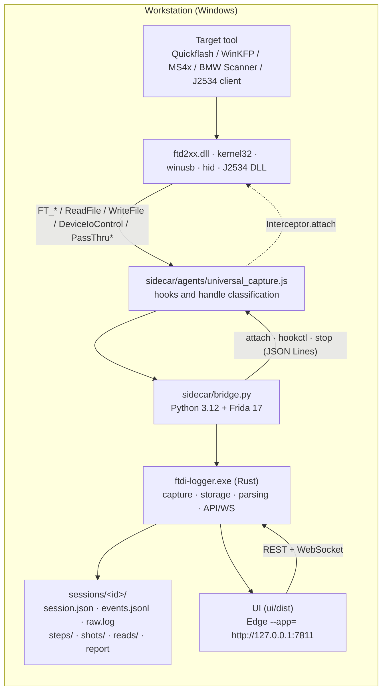

- **Engine** — a single `ftdi-logger.exe` process: HTTP/WS on `127.0.0.1`, session recording,
  line parsing, steps, reports, screenshots, import/export. The UI is static files served by the engine.
- **Bridge** — a thin Python sidecar: starts Frida, loads the JS agent, streams events line by line
  (JSON Lines) and supports `pause/resume`.
- **Agent** — every hook: D2XX, VCP/COM, overlapped I/O, WinUSB/HID/libusb, J2534, USB paths,
  and a module observer for DLLs loaded after attach.
- **Log format** is compatible with the old `logger.py`: `raw.log` can be fed to
  `tools/legacy/parse_family.py`, and old logs can be imported into the new UI.

### Supported transports

| Device / API | How it is captured | Status |
|---|---|---|
| FTDI D2XX (`ftd2xx.dll`) — Quickflash, ms41-studio, **BMW Scanner 1.4.0** (32-bit Delphi) | `FT_*` hooks (36 functions); internal USB ioctls do not duplicate TX/RX | ✅ verified on live tools |
| Virtual COM / VCP (WinKFP, EDIABAS, `.NET System.IO.Ports`) | `CreateFileW/A`, `ReadFile`, `WriteFile`, `GetOverlappedResult(Ex)`, `DeviceIoControl`; lazy classification of an already-open port | ✅ including overlapped I/O |
| WinUSB (`winusb.dll`) | `WinUsb_ReadPipe/WritePipe/ControlTransfer` | ✅ |
| HID (`hid.dll`, `\\?\hid#…`) | `HidD_*`, `ReadFile/WriteFile/DeviceIoControl` on HID paths | ✅ |
| libusb-1.0 | `libusb_bulk/interrupt/control_transfer` | ✅ |
| J2534 PassThru (Scanmatik SM2/SM3, CHIPSOFT, Tactrix OpenPort, VXDIAG, Bosch MDI, UCDS, EVC) | DLL loading by patterns + **all** `PassThru*` exports (open/connect/read/write/ioctl/filter/voltage/version) | ✅ at message level: protocol, CAN ID, payload, ISOTP PCI, KWP/UDS service; vendor protocols without a CAN ID (PCMflash `0x8003`) are parsed by length prefix |
| **LAN** (J2534-over-IP, DoIP/ISO 13400, BMW ICOM/HSFZ, network adapters) | Winsock hooks `ws2_32`: `connect/accept`, `send/recv`, `WSASend/WSARecv`, `sendto/recvfrom`, `WSAGetOverlappedResult` | ✅ full TCP/UDP exchange, including overlapped; DoIP headers, source/target address, UDS service and NRC in the inspector |
| Any USB device with a proprietary driver | raw USBPcap capture → `USBRAW bus/dev/ep/transfer/…` | ⚠️ requires [USBPcap](https://desowin.org/usbpcap/) and administrator rights |
| **J2534 proxy** (the same exchange, seen from the driver side) | our own 32-bit DLL registers as a separate J2534 device, forwards calls to the real driver and writes a log outside the process | ✅ second channel next to Frida: works without injection, sees vendor ordinals 1377–1379, its log is merged into the session and cross-checked frame by frame |

The **USB DEVICES** panel lists every USB device and registered J2534 driver; the header shows a
`bus: USB/J2534 · N` indicator. The device list refreshes every ~12 s even while recording, so a
cable swap is visible without a restart.

### J2534 proxy — the second capture channel

Enable it in **Settings → J2534**: the switch registers the `Scanmatik - SM2 Proxy` device,
optionally switches PCMflash to it (the previous choice is saved and restored) and pulls the
proxy logs into the open session. The session then carries both lanes, `raw.log` and
`raw-proxy.log`, and the report shows how many frames matched and what each channel lost.

**You can see whether the proxy is picked up** without opening logs: the header carries a
`proxy` pill (“picked up: PCMflash.exe” in green, “was picked up: …” in grey, “not picked up”
in yellow — click opens settings), and Settings → J2534 shows the process, its PID and the
counters (“2876 calls · TX 1959 / RX 3917 · last exchange 3 s ago”) or the reason nobody
loaded it. The same panel holds the **which cable to proxy** selector built from the
registered J2534 drivers, with the current one selected. Freshness comes from
`proxy-live-<pid>.state` next to the log; “picked up” is confirmed by a live process with the
same exe, not by the file simply existing.

The installer ships the proxy (a checked “Install the J2534 proxy” task, UAC prompt) but never
switches adapters in another application by itself. See
[docs/13-j2534-proxy.md](docs/13-j2534-proxy.md) (Russian).

### Requirements

| Component | Why | How to install |
|---|---|---|
| Windows 10/11 x64 | target OS (Frida/FTD2XX, Edge) | — |
| Rust (cargo) | build the engine | <https://rustup.rs> |
| Node.js 20+ and pnpm | build the UI | `winget install OpenJS.NodeJS.LTS`, then `npm i -g pnpm` |
| Python 3.12 + `frida>=17,<18` | process bridge | `py -3.12 -m pip install "frida>=17,<18"` |
| FTDI driver (D2XX / VCP) | the cable | from the FTDI site; for WinKFP/EDIABAS as before |
| Administrator rights | WinKFP/EDIABAS and USBPcap attach to their processes | start the logger "as administrator" |

> Windows is mandatory: the engine uses Win32 APIs (ToolHelp, SetupAPI, registry, screenshots).
> The UI and the sidecar are cross-platform, but the product targets a Windows bench.

### Quick start

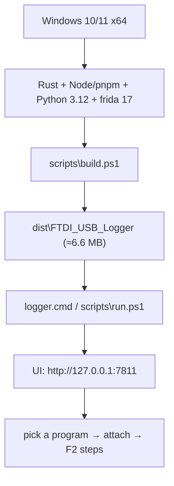

#### Build

```powershell
# full build: UI + engine + dist\FTDI_USB_Logger\
powershell -ExecutionPolicy Bypass -File scripts\build.ps1

# engine only (no UI)
powershell -ExecutionPolicy Bypass -File scripts\build.ps1 -SkipUi

# development mode: engine + vite dev proxying /api and /ws
powershell -ExecutionPolicy Bypass -File scripts\dev.ps1
```

Result in `dist\FTDI_USB_Logger\`:

| Inside | What it is |
|---|---|
| `ftdi-logger.exe` | the engine (release) |
| `ui\dist\` | the built interface (served by the engine at `/`) |
| `sidecar\` | Python bridge `bridge.py` + Frida agent `universal_capture.js` |
| `sessions\` | session directory (empty) |
| `logger.cmd` | double-click launcher without a hanging console |

#### Run

```powershell
# from the repository (dist if built, otherwise the release engine binary)
powershell -ExecutionPolicy Bypass -File scripts\run.ps1

# as before: double-click logger.cmd (or a desktop shortcut)
```

The engine binds HTTP/WS on `http://127.0.0.1:7811` and opens an Edge `--app=` window itself.
Change the port with `scripts\run.ps1 -Port 7812` (or `ftdi-logger.exe --port 7812`).

### Installing on another machine (standalone build)

The application does not need Python/Frida/Rust installed: the installer and the portable build
embed Python 3.12 with Frida. Ready builds are published in **GitHub Releases** (workflow
`.github/workflows/release.yml`, tag `v*`) — download `FTDI_USB_Logger_Setup.exe` and the
portable ZIP from there and install without building from source.

**Download (no authentication):**
[FTDI_USB_Logger_Setup.exe](https://github.com/Ydjin1984/ftdi-usb-logger/releases/latest/download/FTDI_USB_Logger_Setup.exe) ·
[portable ZIP](https://github.com/Ydjin1984/ftdi-usb-logger/releases/latest/download/FTDI_USB_Logger_portable.zip) ·
[all releases](https://github.com/Ydjin1984/ftdi-usb-logger/releases)

| What | Where | Size | How it installs |
|---|---|---|---|
| **Installer** | `FTDI_USB_Logger_Setup.exe` (GitHub Releases, `dist\`) | ≈43 MB | run it, allow UAC; per-user install into `%LOCALAPPDATA%\FTDI_USB_Logger`, desktop and Start menu shortcuts, an entry in "Apps & features", uninstaller |
| **Portable ZIP** | `FTDI_USB_Logger_portable.zip` (GitHub Releases, `build\`) | ≈64 MB | unpack anywhere and run `FTDI_USB_Logger.exe`; nothing is installed |
| Plain dist | `dist\FTDI_USB_Logger\` | ≈7 MB | for machines that already have Python + Frida |

- **Standalone launcher** `FTDI_USB_Logger.exe` (`launcher/Launcher.cs`, built by
  `scripts/build-launcher.ps1`): shows the logo for **2 seconds**, then starts the engine and opens
  the journal window. The icon is `assets/app.ico`, the logo `assets/splash.png` is embedded as an
  exe resource; the manifest requires administrator rights.
- **Administrator rights**: both `FTDI_USB_Logger.exe` and `logger.cmd` always ask for UAC —
  the engine needs rights for Frida hooks and reading other processes. The UI window itself opens
  without administrator rights (through Explorer).
- **Splash on start**: the logo stays for exactly 2 seconds (even if the engine is up earlier);
  if the engine does not answer within 60 s, the launcher shows an error and points to
  `logger.err.log`. The old fallback without the launcher is `scripts/splash.ps1`.
- **Application icon**: `assets/app.ico` — in the exe, on shortcuts and in the taskbar
  (the UI window gets its favicon from `ui/public/favicon.png`).
- The installer is unsigned: on first launch SmartScreen may show "Unknown publisher" →
  "More info" → "Run anyway". Distribution needs a code-signing certificate (not in the repository).
- Sessions and logs live in the installation directory (`sessions\`); keep them when uninstalling.

#### Building the installer (Inno Setup)

```powershell
# 0) engine + UI + standalone launcher -> dist\FTDI_USB_Logger\ (including FTDI_USB_Logger.exe)
pwsh -File scripts\build.ps1

# 1) portable: dist + embedded Python + frida -> build\FTDI_USB_Logger_portable.zip
pwsh -File scripts\build-portable.ps1

# 2) Setup.exe (Inno Setup 6, per-user install) -> dist\FTDI_USB_Logger_Setup.exe
pwsh -File scripts\build-installer.ps1

# fallback without Inno Setup — 7-Zip SFX (worse: no wizard, no icon)
pwsh -File scripts\build-installer.ps1 -ForceSfx
```

The installer is **Inno Setup 6** (`installer\ftdi-logger.iss`): setup wizard, application icon
for Setup.exe, an entry in "Apps & features", desktop and Start menu shortcuts, a proper uninstaller,
and it closes running processes before installing. **The wizard is bilingual: Russian (default) and
English** — Inno picks the language from the system, and the user can change it on the first page.
The compiler is looked up in `%INNO_SETUP_DIR%`, `C:\Program Files (x86)\Inno Setup 6` and PATH;
if it is missing, the script falls back to 7-Zip SFX.

Building needs .NET Framework 4.x (csc for the launcher), Inno Setup 6 and internet access
(embeddable Python is downloaded once and cached in `build\cache`); 7-Zip is only needed for the
fallback and the portable archive.

### How to log

1. Start the target tool (Quickflash, WinKFP, MS4x Flasher, BMW Scanner, any J2534 client) and
   connect the adapter.
2. In the UI open **PROGRAMS**: the list shows processes with a window, USB/FTDI/J2534 modules and
   known tools, with `FTDI`, `J2534`, `USB`, `window` badges. Pick the tool and press **attach**.
   If it is not listed, switch the filter to "windows"/"all" or enter a PID manually.
3. `F2` opens a step (the name is suggested automatically); `F2` again closes it: summary,
   screenshot and `# PHASE` lines in `raw.log`.
4. Work with the unit as usual: all FTDI/VCP/USB/J2534 traffic and file operations are recorded.
5. `Esc` stops the capture and closes the session; reports and export are available from the UI.

> Tools that open the port **before** attach (MS4x Flasher, .NET SerialPort) are supported: the
> agent lazily classifies an already-open handle via `GetFinalPathNameByHandleW` and also picks up
> overlapped RX through `GetOverlappedResult`/`OVERLAPPED.Internal`.

### New session and cable swap

The **NEW SESSION** button in the header (or `Ctrl+Alt+N`):

1. If recording is active, it asks for confirmation: the current session is saved, capture stops.
2. The logger **rescans** USB devices, J2534 drivers and processes (the cache is dropped).
3. A picker opens: adapter (FTDI serial/COM) and program (the `auto` list) or a manual PID.
4. "start session" — capture starts again, already with the new cable/program.

If the **target tool exits**, the engine finishes the session within ~1 s ("capture stopped,
devices released") instead of showing `REC` forever. If the engine is stopped or restarted, the UI
shows the **"Engine is not responding"** layer after ~12 s, and the page reconnects by itself once
`logger.cmd` is started again. A forced `detach` never lets the bridge hold a session longer than 8 s.

### Action presets

Step names are no longer typed by hand: the bottom bar has a **preset combo**. Pick an item and the
step opens with that name (the previous one closes with a summary automatically). The gear next to it
edits the list (add/remove lines, restore the defaults).

Default set: Identification, Read calibrations, Read full flash, Write calibrations, Write full flash,
Clear fault codes, Reset adaptations, Verification.

- Presets live in `localStorage` (`ftdi.quickTitles`) and survive restarts.
- A name typed manually (`Shift+F2` or a mark `F5`) is **saved automatically** as a preset.
- The list is also used for suggestions in the step and mark dialogs.
- The bottom-bar buttons are icon-only; the full name and hotkey appear in a tooltip, so they do not
  overlap when the window is narrow.

### Hotkeys

| Key | Action |
|---|---|
| `F2` | open/close a step (start with an automatic name, end with a summary + screenshot) |
| `Shift+F2` | open a step with a manual name |
| `F1` | built-in help |
| `F5` | mark in the stream without a step (MARK) |
| `F6` | pause/resume hooks (`hookctl pause/resume`) |
| `F8` | screenshot now |
| `Esc` | stop capture (detach) |
| `Ctrl+F` | search the stream |
| `Ctrl+E` | export the session |
| `Ctrl+O` | import an old log |
| `Ctrl+Alt+N` | **new session** (rescan everything) |
| bottom-bar combo | pick a preset — open a step with that name |
| `↑ ↓ PgUp PgDn Home End` | navigate the stream |

There are no global hotkeys — they work while the logger window is focused, so they never steal
input from the target tool.

### Repository layout

| Path | Contents |
|---|---|
| `engine/` | Rust engine: `main/config/discovery/procscan/screenshot/frida`, `models/store/decode/api/report/import/ediabas/usbdevices/j2534/usbpcap`, integration tests |
| `ui/` | interface (TypeScript + CSS, vite): stream, inspector, timeline, panels, dialogs, CDP checks |
| `sidecar/` | `bridge.py` (JSON Lines) + `agents/universal_capture.js` (all hooks) and `ftdi_capture.js` (legacy set) |
| `scripts/` | `build.ps1`, `run.ps1`, `dev.ps1` |
| `tests/e2e/` | `smoke.ps1`, `universal.ps1` (MS4x), `bmw-scanner.ps1`, `dummy_target.py`, edge scenarios |
| `docs/` | contracts, architecture, runbook, interfaces, edge cases, smoke, review, universal-capture research |
| `tools/legacy/` | historical `parse_family.py`, `winkfp.py`, `attach_capture.py` — the parsing reference |
| `reference/` | golden logs and expected artifacts for tests |
| `sessions/` | product sessions (empty in git, `.gitkeep`) |
| `assets/` | screenshots for the README |

### HTTP/WS API (brief)

Everything listens on `127.0.0.1` only; CORS allows the exact localhost origin.

| Method / path | Purpose |
|---|---|
| `GET /api/health` | version, bridge state, `capabilities` (ftd2xx, j2534, usbpcap) |
| `GET /api/sessions`, `GET /api/sessions/{id}` | list/details of sessions |
| `GET /api/sessions/{id}/events?from=&limit=&filter=` | page of events |
| `GET /api/sessions/{id}/events/{seq}/decode` | decode the payload (KWP/DS2/ISOTP) |
| `POST /api/capture/attach` `{pid,label?,adapter?}` | attach to a process |
| `POST /api/capture/detach` | stop capture (8 s budget + force) |
| `POST /api/session/new` | finish the current session and rescan the environment |
| `GET /api/tools?mode=auto\|usb\|window\|all` | candidate processes |
| `GET /api/devices` · `GET /api/usb/devices` · `GET /api/j2534/drivers` | FTDI / USB / J2534 |
| `POST /api/usbpcap/start` | raw bus capture (needs USBPcap) |
| `POST /api/sessions/{id}/step/start` · `step/end` · `mark` · `note` · `shot` | session annotation |
| `POST /api/sessions/{id}/reparse` | rebuild reports from `events.jsonl` |
| `POST /api/import` · `POST /api/import/upload` | import old logs |
| `GET /api/sessions/{id}/export?format=zip\|jsonl\|csv\|md` | export |
| `WS /ws?session=` | live event stream |

Full response shapes and error codes are in [docs/02-architecture.md](docs/02-architecture.md).

### Sessions and log format

```
sessions/20261109-154706-bmw-scanner-e2e/
├── session.json        # metadata: tool, pid, exe sha256, counters, status
├── events.jsonl        # events (kind, api, transport, direction, t, hex, meta)
├── events.idx          # fast lookup index
├── raw.log             # log in the old logger.py format (re-importable)
├── steps/01.json …     # step summaries (commands, responses, reads, screenshot)
├── shots/              # PNG screenshots of steps
├── reads/              # read dumps with SHA-256
├── import/             # source of an imported log
├── report.txt          # text report
└── report.md           # Markdown report
```

Example `raw.log` (compatible with the old parser):

```text
# capture start: label=BMW Scanner e2e
# tool: C:\BMWScan140\BMWScan140.exe
# exe: size=3009024 mtime=2011-09-20 02:11:16 sha256=7aebc4b7…
# wall(start)=2026-11-09 15:47:06
# host: user=User computer=DESKTOP-7MECFCS
[+3.947s] ftd2xx.dll hooks installed (36) at 0x10000000 C:\Windows\SYSTEM32\ftd2xx.dll
[+3.969s] FT_OpenEx('BMW Scanner V14x' flags=2) rc=0 handle=0xde5608
[+3.970s] FT_SetBaudRate(handle=0xde5608, 19200) rc=0
[+4.147s] RX ftd2xx FT_Read rc=0 want=1 n=1 : 12
[+4.637s] TX ftd2xx FT_Write rc=0 len=1 n=1 : b9
# MARK wall=… rel=+4.900s START 1: reading identifiers
# PHASE …
# PHASE-JSON …
# totals: events=1094 tx=260/260 rx=758/758 steps=0
```

### Export, import, reparse

- **Export** (`Ctrl+E`): session ZIP, event JSONL, CSV, Markdown/text report; upload to a server by
  a configurable URL.
- **Import** (`Ctrl+O` or drag-and-drop into the window): an old `capture.log`/`logger.out` becomes
  a session with `status:"imported"`, `transport:"import"`; the source is copied to
  `sessions/<id>/import/`.
- **Reparse**: `POST /api/sessions/{id}/reparse` — rebuild summaries/report from `events.jsonl`
  after editing step names.

### Tests and acceptance

| What is checked | Command | Result |
|---|---|---|
| Rust: unit + integration | `cd engine; cargo test --all-targets` | 104 passed, 10 ignored |
| API end-to-end on a real log | `pwsh -File tests\e2e\smoke.ps1` | 14/14 |
| UI through CDP (stream, inspector, summary, export, search, responsive) | `node ui\tools\cdp-check.mjs "http://127.0.0.1:7811/?demo=1" ui\shots` | 14/14 demo, 15/15 live |
| Live universal capture (MS4x Flasher, VCP+overlapped, UIA "Identify") | `pwsh -File tests\e2e\universal.ps1` | 10/10 |
| Live BMW Scanner 1.4.0 capture (FTDI D2XX, 32-bit Delphi) | `pwsh -File tests\e2e\bmw-scanner.ps1 -StartApp` | 4/4 |
| Live capture without hardware (Frida → process → events → report) | `python tests\e2e\dummy_target.py --seconds 30` + attach | ok |
| Acceptance of the built dist | [docs/06-smoke.md](docs/06-smoke.md) | — |
| Independent review and found defects | [docs/07-review.md](docs/07-review.md) | — |

### Documentation

| Document | About |
|---|---|
| [docs/01-original-contracts.md](docs/01-original-contracts.md) | research of the old logger: line format, behaviour, artifacts |
| [docs/02-architecture.md](docs/02-architecture.md) | architecture, API contracts, event model, §11 universal capture |
| [docs/03-runbook.md](docs/03-runbook.md) | installation, build, rights, diagnostics, cable swap |
| [docs/04-interfaces.md](docs/04-interfaces.md) | Rust module signatures |
| [docs/05-edge-cases.md](docs/05-edge-cases.md) | API/import/UI edge cases |
| [docs/06-smoke.md](docs/06-smoke.md) | acceptance of the built dist |
| [docs/07-review.md](docs/07-review.md) | review and fixed defects |
| [docs/08-universal-research.md](docs/08-universal-research.md) | how MS4x/BMW Scanner/J2534 talk to the adapter, what hooks catch and what needs USBPcap |

### Limitations

| Limitation | Why / what to do |
|---|---|
| The step summary is computed immediately, without the 1.6 s settle pause of the old logger | trailing RX in the last milliseconds may miss the step summary; use `raw.log` with the old `parse_family.py` for a full parse |
| `report.txt` is a step summary, not a full `parse_family` analysis | full analysis: `python tools/legacy/parse_family.py --log sessions/<id>/raw.log --gap 2.0` |
| FT_* and internal USB ioctls could duplicate | suppressed in the agent while `ftd2xx.dll` hooks are active; through WinUSB/HID the USB level is visible |
| Raw USB through USBPcap needs the driver and administrator rights | without it, API hooks (FTDI/COM/WinUSB/HID/libusb/J2534/LAN) are available; installing USBPcap needs a reboot |
| J2534 is captured at the PassThru message level (protocol/ID/payload), without driver URB parsing | if the adapter does not open through `PassThru*`, use USBPcap |
| I/O straight through `ntdll!NtReadFile/NtDeviceIoControlFile` (bypassing kernel32) is not hooked | such devices need raw USBPcap; other paths (including overlapped `ReadFile` on a USB handle and `DeviceIoControl`) are covered |
| Over TCP/UDP only DoIP (ISO 13400) and port hints are recognised | HSFZ (ICOM, 6801) and J2534-over-IP are visible as a byte stream with addresses; frame parsing is in the inspector/export |
| ISOTP: PCI classification (SF/FF/CF/FC) and the service id of a single frame | multi-frame reassembly is not performed — collect frames in the export |
| J2534/TX-RX are not paired request-response automatically | the step summary has `cmd_hist`/`resp_hist` by protocol/ID/service; the full exchange is in the stream |
| One line holds at most 16 KB of payload | large bulk packets are split into `part=i/n` lines; the engine event limit is 64 KB |
| Capture is "byte-by-byte" for D2XX tools like BMW Scanner | the tool calls `FT_Read/FT_Write` one byte at a time; the logger faithfully records every call; frame assembly is done by `parse_family`/a future assembler |
| No global hotkeys | F2/F5/F6/F8 work while the logger window is focused |
| Listens on `127.0.0.1` only, CORS is the exact localhost origin | remote access is intentionally closed |
| EDIABAS mode is enabled by a heuristic (process name or fresh traces) | force it with `FTDI_LOGGER_EDIABAS=1`; INI/trace paths via `FTDI_LOGGER_EDIABAS_INI`, `_OBD_INI`, `_WINKFP_INI`, `_TRACE_DIR` |

### Diagnostics

| Symptom | Where to look |
|---|---|
| "bridge unavailable" | `python sidecar\bridge.py --self-test`; python/frida of the engine (runbook) |
| port 7811 is busy | `netstat -ano \| findstr :7811`, close the old `ftdi-logger.exe` or set `-Port` |
| the device is not visible | FTDI driver (D2XX/VCP); wait for `MODULE + FTD2XX.DLL` / `FT_GetDeviceInfoDetail` in the log |
| the tool is not listed | switch to the "windows"/"all" mode or enter a PID manually; check `GET /api/tools?mode=all` |
| WinKFP/EDIABAS is not logged | the tool runs as administrator → the logger must too |
| a LAN adapter is not visible in the stream | the session start should contain `LAN module: ws2_32.dll … hooks=N`; if not, the target did not load Winsock (or the logger is not elevated), check `universal hooks: … lan=1` |
| the UI shows "Engine is not responding" | the engine is stopped/restarting; start `logger.cmd`, the page reconnects |
| "already running" on a second click | by design: `logger.cmd` focuses the window of the running instance |
| the product does not start | `dist\FTDI_USB_Logger\logger.err.log` + `netstat` for the port; see the runbook |

The full order of installation, bridge checks, administrator rights and error analysis is in
**[docs/03-runbook.md](docs/03-runbook.md)**.

### Privacy and security

- The logger works **locally**: HTTP/WS only on `127.0.0.1`; nothing leaves the machine except an
  explicit "upload to server" command (when a URL is configured).
- Sessions contain diagnostic traffic and may contain VINs/ECU dumps — store and share them
  consciously; the `sessions/` directory never goes into the repository.
- The tool does not modify the target application and does not bypass its protections: it only
  intercepts calls and records them. The application is started by the user and works as usual.
- Responsibility for use lies with the equipment owner. Do not use it on third-party
  vehicles/devices without permission.

### License

No license is set in the repository (by default all rights remain with the author). If you plan to
distribute/fork it, add a LICENSE (e.g. MIT/Apache-2.0) and mention it here.

---

<sub>Проект использует [Frida](https://frida.re), [Rust](https://www.rust-lang.org), [axum](https://github.com/tokio-rs/axum), [Vite](https://vitejs.dev). Старый логер и `parse_family.py` сохранены в `tools/legacy/` как эталон разбора.</sub>


