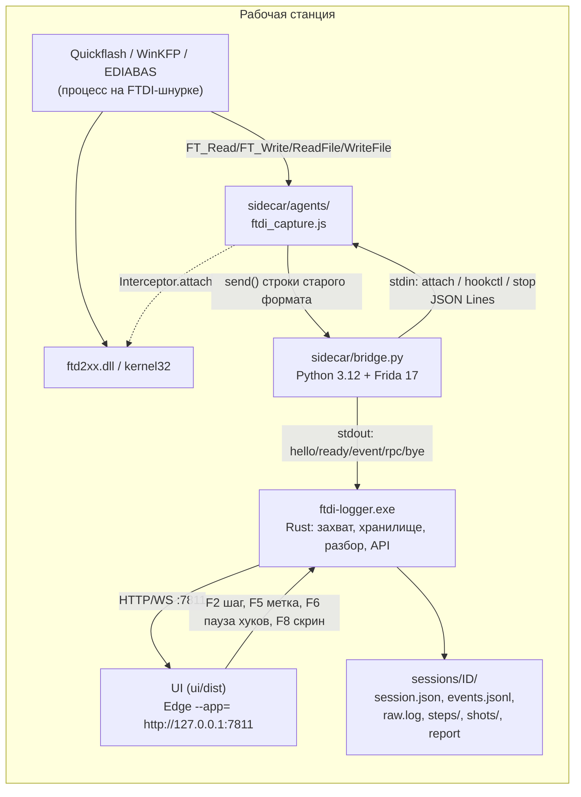
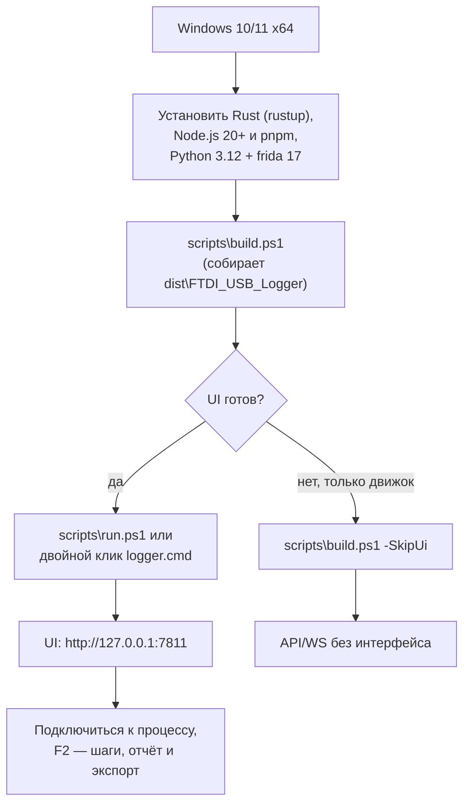

# FTDI/USB Logger

Стационарный логер обмена FTDI-шнурка с ЭБУ: живой поток, шаги, таймлайн, инспектор,
скриншоты, отчёты и импорт старых логов. Заменяет консольный `logger.py` из
`E:\Replica\work\orig-capture\`: Frida-хуки перенесены без изменений, разбор и интерфейс — новые.

Движок — один локальный сервис `ftdi-logger.exe` (Rust), интерфейс открывается в окне Edge
в режиме `--app=` (как обычное десктоп-приложение), мост к Frida — тонкий Python-sidecar.
Без консоли и без ручного ввода команд: шаг открывается одной клавишей.

## Как это устроено



## Как выглядит


Демо без устройства и движка: откройте `ui/dist/index.html?demo=1` (или `/ ?demo=1` у запущенного
движка) — интерфейс наполнится синтетической сессией BMS46: поток, три шага, сводки, скриншот.

## Быстрый старт



### 1. Требования

| Компонент | Зачем | Как поставить |
|---|---|---|
| Windows 10/11 x64 | целевая ОС (Frida/FTD2XX, Edge) | — |
| Rust (cargo) | сборка движка | <https://rustup.rs> |
| Node.js 20+ и pnpm | сборка UI | `winget install OpenJS.NodeJS.LTS`, затем `npm install -g pnpm` |
| Python 3.12 + `frida>=17,<18` | мост к процессу | см. [docs/03-runbook.md](docs/03-runbook.md) |
| Драйвер FTDI (D2XX / VCP) | шнурок | с сайта FTDI; для WinKFP/EDIABAS — как раньше |
| Права администратора | WinKFP/EDIABAS цепляются к своему процессу | запуск логера «от имени администратора» |

### 2. Сборка

```powershell
# полная сборка: UI + движок + упаковка dist\FTDI_USB_Logger\
powershell -ExecutionPolicy Bypass -File scripts\build.ps1

# только движок (пока UI ещё не готов / не нужен)
powershell -ExecutionPolicy Bypass -File scripts\build.ps1 -SkipUi
```

Результат `dist\FTDI_USB_Logger\`:

| Внутри | Что это |
|---|---|
| `ftdi-logger.exe` | движок (release) |
| `ui\dist\` | собранный интерфейс (движок отдаёт его с `/`) |
| `sidecar\` | Python-мост `bridge.py` + Frida-агент |
| `sessions\` | каталог сессий (создаётся пустым) |
| `logger.cmd` | запуск двойным кликом/с ярлыка, без висящей консоли |

### 3. Запуск

```powershell
# из репозитория (dist, если собран; иначе release-бинарь движка)
powershell -ExecutionPolicy Bypass -File scripts\run.ps1

# как раньше: двойной клик по logger.cmd (или ярлык на рабочем столе)
```

Движок поднимает HTTP/WS на `http://127.0.0.1:7811` и сам открывает окно Edge в режиме `--app=`.
Порт можно поменять: `scripts\run.ps1 -Port 7812` (или `ftdi-logger.exe --port 7812`).

## Как логировать

1. Запустить целевой инструмент (Quickflash / WinKFP / EDIABAS) и подключить шнурок.
2. В UI выбрать процесс-цель (у него загружен `ftd2xx.dll`) и нажать «Подключиться» — мост
   прицепится, загрузит Frida-агент и начнёт писать поток.
3. `F2` — открыть шаг (название подставляется автоматически), повторный `F2` — закрыть шаг:
   появится сводка, скриншот и строки `# PHASE` в `raw.log`.
4. Работать с блоком как обычно: весь обмен FTDI/VCP/файлы пишется в сессию.
5. `Esc` — остановить захват и закрыть сессию; отчёт и экспорт — из UI.

### Горячие клавиши

| Клавиша | Действие |
|---|---|
| `F2` | открыть/закрыть шаг (старт — с автоназванием, конец — сводка + скриншот) |
| `Shift+F2` | открыть шаг с названием вручную (диалог) |
| `F1` | встроенная справка: порядок работы, горячие клавиши, что делать если запись не идёт |
| `F5` | метка в потоке без шага (MARK) |
| `F6` | пауза/возобновление хуков (`hookctl pause/resume`) — на время критичных операций |
| `F8` | скриншот сейчас (вне закрытия шага) |
| `Esc` | остановить захват (detach) и закрыть сессию |
| `Ctrl+F` | поиск по потоку |
| `Ctrl+E` | экспорт сессии (ZIP / JSONL / CSV / Markdown) и отправка на сервер |
| `Ctrl+O` | импорт старого лога для переразбора |
| `↑ ↓ PgUp PgDn Home End` | навигация по потоку (выбранная строка видна в инспекторе) |
| `Ctrl+O` | импорт старого лога |

## Структура репозитория

| Путь | Что там |
|---|---|
| `engine/` | Rust-движок: `main/config/discovery/procscan/screenshot/frida`, `models/store/decode/api/report/import/ediabas`, тесты |
| `ui/` | интерфейс (TypeScript + CSS, vite); сборка в `ui/dist` |
| `sidecar/` | `bridge.py` (мост к Frida, JSON Lines) + `agents/ftdi_capture.js` (все хуки) |
| `scripts/` | `build.ps1`, `run.ps1`, `dev.ps1` |
| `docs/` | `01-original-contracts.md` (разведка старого логера), `02-architecture.md` (контракты), `03-runbook.md` (эксплуатация), `04-interfaces.md` (сигнатуры Rust) |
| `tools/legacy/` | исторические `parse_family.py`, `winkfp.py`, `attach_capture.py`, `snap.ps1` — эталон, из нового UI не запускается |
| `sessions/` | сессии продукта: `session.json`, `events.jsonl`, `raw.log`, `steps/`, `shots/`, `reads/`, `report.txt` |
| `dist/` | результат сборки (в git не нужен) |
| `reference/` | референсные материалы/логи для сверки |

## Экспорт, импорт, отчёты

* **Экспорт** (`Ctrl+E`): ZIP сессии, JSONL событий, CSV, Markdown/текстовый отчёт; отправка на
  сервер по настраиваемому URL.
* **Импорт** (`Ctrl+O` или перетаскивание в окно): старый `capture.log`/`logger.out` →
  сессия `status:"imported"`, `transport:"import"`; исходник копируется в `sessions/<id>/import/`.
* **Переразбор**: `POST /api/sessions/{id}/reparse` — пересобрать сводки/отчёт из `events.jsonl`
  после правки названий шагов.

## Перенос данных из старого логера (`E:\Replica\work\orig-capture`)

| Что переносим | Как |
|---|---|
| отснятые логи `capture-live.log`, `session-*/capture.log`, `logger.out` | импорт в UI (`Ctrl+O`) или `POST /api/import {"path":"…"}`; исходник сохраняется в сессии |
| эталонные скрипты разбора/запуска | уже скопированы в `tools/legacy/` (см. [README](tools/legacy/README.md)) |
| Frida-агент `ftdi_capture_blocks.js` | перенесён в `sidecar/agents/ftdi_capture.js` (все хуки и формат строк сохранены) |
| старые сессии/скриншоты как файлы | вручную положить рядом/в `reference/logs`, продукт их не изменяет |
| идея/поведение старого UI-флоу | `docs/01-original-contracts.md` |

> Старые логи **не копируются** в репозиторий (большие): их место — `reference/logs/` или импорт
> в `sessions/`. Сравнение разбора — через `tools/legacy/parse_family.py`.

## Ограничения (осознанные)

| Ограничение | Почему / что делать |
|---|---|
| Сводка шага считается сразу, без «settle»-паузы 1.6 с как в старом логере | хвостовые RX, пришедшие в последние миллисекунды, могут не попасть в сводку шага. Для старых отчётов — полный разбор `raw.log` старым парсером (ниже). |
| `report.txt` — сводка шагов, а не полный разбор `parse_family` | полный анализ (телеграммы, эхо, потоки чтения, `tx/rx-stream.bin`) — `python tools/legacy/parse_family.py --log sessions/<id>/raw.log --gap 2.0`; `raw.log` пишется байт-в-байт в формате старого логера (`# MARK`/`# PHASE`/`# PHASE-JSON`) и импортируется обратно. |
| Отдельной команды «посчитать хеши файлов сейчас» нет | хеши попадают в сводку для файлов, которые приложение реально открывало/писало. Программно: `POST /api/sessions/{id}/files` (событий в поток не пишет). |
| Захват USB-уровня (USBPcap/WinUSB) не ведётся | хук ставится на `ftd2xx.dll` и COM/kernel32; для трафика ниже D2XX нужен отдельный USB-сниффер. |
| Глобальных горячих клавиш нет | F2/F5/F6/F8 работают, когда окно логера в фокусе — чтобы не перехватывать клавиши у Quickflash/WinKFP. |
| Слушает только `127.0.0.1`, CORS — только точный localhost-origin | удалённый доступ и сторонние origin закрыты осознанно. |
| EDIABAS-режим включается эвристикой: имя процесса (`winkfp/inpa/tool32/nfs/ediabas`) или свежие трассы (mtime ≤ 10 мин) | принудительно: переменная `FTDI_LOGGER_EDIABAS=1`; пути INI/трасс переопределяются `FTDI_LOGGER_EDIABAS_INI`, `_OBD_INI`, `_WINKFP_INI`, `_TRACE_DIR`. |

## Проверки

| Что проверяется | Команда |
|---|---|
| Rust: unit + интеграционные (60+) | `cd engine; cargo test --all-targets` |
| API end-to-end на реальном логе (14 проверок) | `pwsh -File tests\e2e\smoke.ps1` |
| UI через CDP: поток, инспектор, сводка, экспорт, поиск, адаптив (15 проверок) | `node ui\tools\cdp-check.mjs "http://127.0.0.1:7811/?demo=1" ui\shots` |
| Живой захват без железа (Frida → процесс → события → отчёт) | `python tests\e2e\dummy_target.py --seconds 30` + attach в UI |
| Приёмка собранного dist | [docs/06-smoke.md](docs/06-smoke.md) |
| Независимое ревью и найденные дефекты | [docs/07-review.md](docs/07-review.md) |
| Крайние случаи API/импорта/UI | [docs/05-edge-cases.md](docs/05-edge-cases.md) (если отчёт есть) |

## Разработка

```powershell
powershell -ExecutionPolicy Bypass -File scripts\dev.ps1
```

Поднимает движок (`cargo run`, порт 7811) и `vite dev` для UI; vite проксирует `/api` и `/ws`
на движок (настройка — в `ui/vite.config.ts`). Подробности — в [docs/03-runbook.md](docs/03-runbook.md).

## Диагностика (кратко)

| Симптом | Куда смотреть |
|---|---|
| «мост недоступен» в UI | python/frida у движка: `python sidecar\bridge.py --self-test`; в runbook — `--python` |
| порт 7811 занят | `netstat -ano \| findstr :7811`, закрыть старый `ftdi-logger.exe` или `-Port` |
| устройство не видно | драйвер FTDI (D2XX/VCP), в логе ждать `MODULE + FTD2XX.DLL`/`FT_GetDeviceInfoDetail` |
| WinKFP/EDIABAS не логируется | инструмент запущен от админа → логер тоже запускать от админа |
| второй двойной клик «ничего не делает» | штатно: `logger.cmd` пишет «уже запущено» и открывает окно работающего экземпляра |
| продукт не поднялся, окно быстро закрылось | `logger.cmd` держит 15 с хвост `dist\FTDI_USB_Logger\logger.err.log` и `netstat` по порту |
| продукт не собран при двойном клике | `logger.cmd` подскажет команду сборки; полный разбор — runbook |

Полный порядок установки, проверки моста, прав администратора и разбор ошибок —
**[docs/03-runbook.md](docs/03-runbook.md)**.

