# FTDI/USB Logger

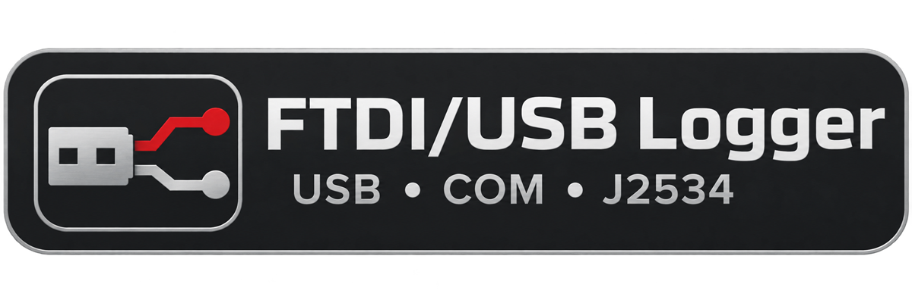

Стационарный логер обмена диагностического шнурка с ЭБУ: живой поток, шаги, таймлайн,
HEX-инспектор, скриншоты, отчёты, экспорт/импорт — и **универсальный захват** любых
USB/COM/J2534-устройств, а не только FTDI.


Проект вырос из консольного `logger.py` + Frida-агента: хуки перенесены и расширены,
разбор и интерфейс написаны заново. Цель — «одна кнопка» вместо ввода команд в консоль:
движок работает как локальный сервис, интерфейс открывается отдельным окном Edge
(`--app=`), шаг размечивается клавишей `F2`.

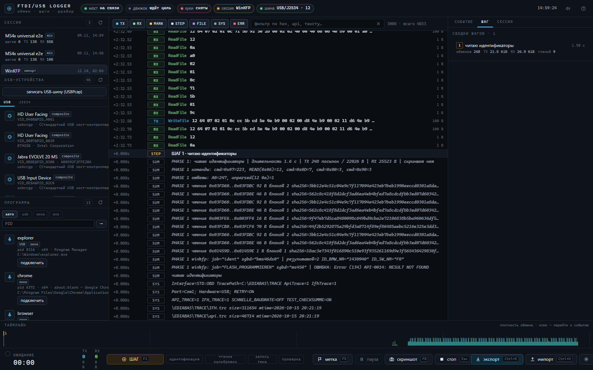

---

## Содержание

- [Возможности](#возможности)
- [Скриншоты](#скриншоты)
- [Архитектура](#архитектура)
- [Поддерживаемые транспорты](#поддерживаемые-транспорты)
- [Требования](#требования)
- [Быстрый старт](#быстрый-старт)
- [Как логировать](#как-логировать)
- [Новая сессия и смена шнурка](#новая-сессия-и-смена-шнурка)
- [Горячие клавиши](#горячие-клавиши)
- [Структура репозитория](#структура-репозитория)
- [HTTP/WS API (кратко)](#httpws-api-кратко)
- [Сессии и формат логов](#сессии-и-формат-логов)
- [Экспорт, импорт, переразбор](#экспорт-импорт-переразбор)
- [Тесты и приёмка](#тесты-и-приёмка)
- [Документация](#документация)
- [Ограничения](#ограничения)
- [Диагностика](#диагностика)
- [Приватность и безопасность](#приватность-и-безопасность)
- [Лицензия](#лицензия)

---

## Возможности

| Блок | Что умеет |
|---|---|
| **Живой поток** | виртуализированная лента на миллионы строк, фильтры по `TX/RX/MARK/STEP/FILE/SYS/ERR`, поиск по HEX/API/тексту, «хвост» большой сессии без зависаний |
| **Шаги** | `F2` — старт/стоп шага, **комбо пресетов действий** (Идентификация, Чтение/Запись калибровок и фулл флеш, Сброс ошибок/адаптаций, Верификация; свои названия добавляются автоматически), сводка (команды, ответы, чтения с SHA-256), скриншот, `# PHASE` в `raw.log` |
| **Инспектор** | HEX/ASCII-дамп, разбор KWP/DS2/ISOTP, свойства события, метаданные шага |
| **Таймлайн** | плотность обмена, переход к событию, маркеры шагов |
| **Универсальный захват** | FTDI D2XX, COM/VCP (включая overlapped-I/O и порт, открытый **до** attach), WinUSB, HID, libusb, J2534 PassThru, сырой USB через USBPcap |
| **Список программ** | режимы `авто / usb / окна / все`, бейджи `FTDI · J2534 · USB · окно`, ручной attach по PID |
| **Устройства** | панель USB-устройств (VID/PID, серийник, драйвер, COM, present), вкладка J2534-драйверов (PassThru 04.04, 32/64-бит) |
| **Новая сессия** | завершение текущей, полное пересканирование устройств/процессов, выбор адаптера и программы, ручной PID |
| **Отчёты** | `report.txt` + `report.md`, сводки шагов, экспорт ZIP / JSONL / CSV / Markdown, отправка на сервер |
| **Импорт** | старые `capture.log`/`logger.out` → сессия `imported`; переразбор (`reparse`) |
| **Скорости и тайминги** | в поток пишутся `FT_SetBaudRate`, `FT_SetLatencyTimer`, `FT_SetTimeouts`, `FT_SetDataCharacteristics`, `FT_SetFlowControl`, `COM SetCommState/SetCommTimeouts/SetupComm` (+ снимок текущих DCB/таймаутов для порта, открытого до attach), `J2534 config` (`DATA_RATE`, W1..W5, ISO15765_*); у каждого события есть `t` и `wall` — интервалы и смены скорости видно |
| **Надёжность** | watchdog «движок не отвечает», detach с бюджетом и принудительной остановкой, восстановление незакрытых сессий при старте |

---

## Скриншоты

| Поток и шаги | Инспектор события |
|---|---|
| 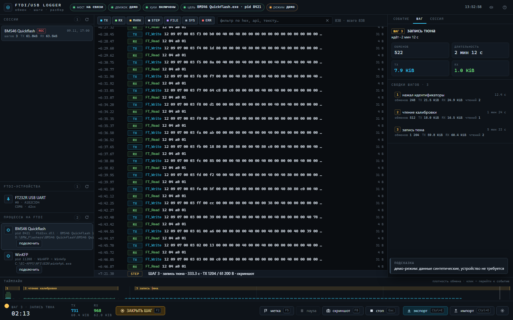 | 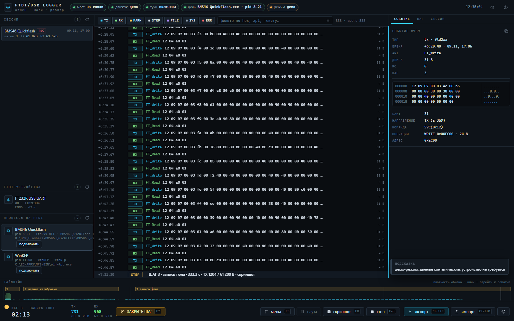 |

| Сводка шага | Экспорт |
|---|---|
| 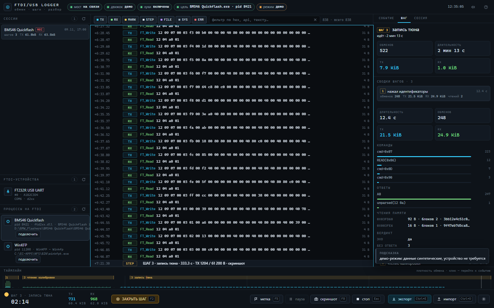 | 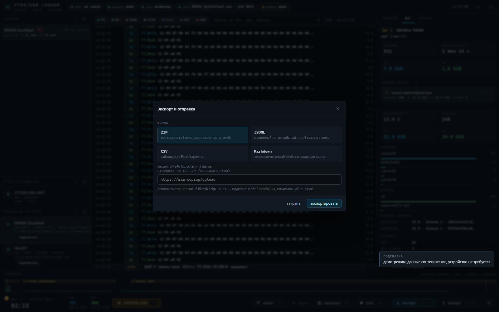 |

'| Универсальный захват (USB + J2534) | Новая сессия |
|---|---|
| 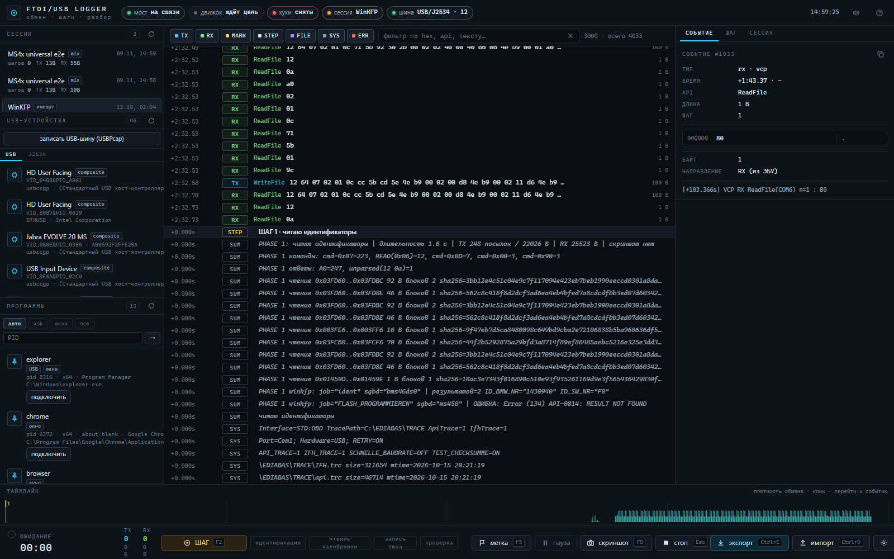 | 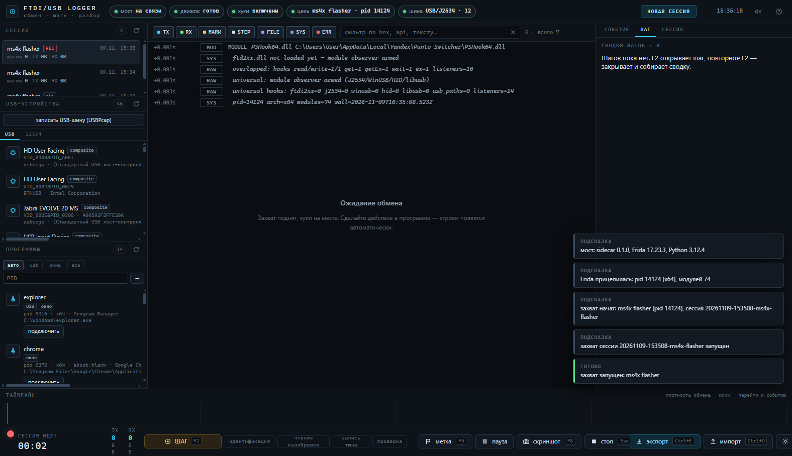 |

| Пресеты действий (комбо) |
|---|
| 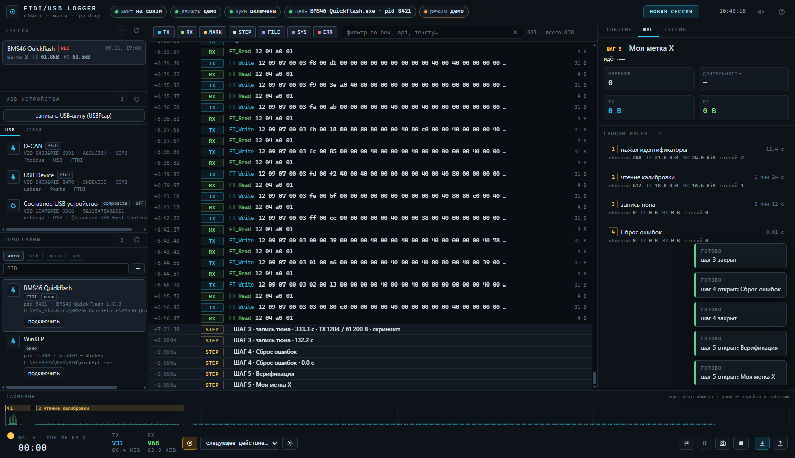 |'

Демо без устройства: `ui/dist/index.html?demo=1` (или `/?demo=1` у запущенного движка).

---

## Архитектура

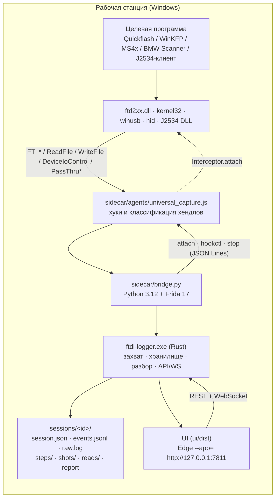

- **Движок** — один процесс `ftdi-logger.exe`: HTTP/WS на `127.0.0.1`, запись сессий,
  разбор строк, шаги, отчёты, скриншоты, импорт/экспорт. UI — статические файлы, которые он же и отдаёт.
- **Мост** — тонкий Python-sidecar: запускает Frida, загружает JS-агент, передаёт события
  построчно (JSON Lines), умеет `pause/resume`.
- **Агент** — все хуки: D2XX, VCP/COM, overlapped-I/O, WinUSB/HID/libusb, J2534, USB-пути,
  модульный observer для DLL, загруженных после attach.
- **Формат лога** совместим со старым `logger.py`: `raw.log` можно скормить старому
  `tools/legacy/parse_family.py` и наоборот — импортировать старые логи в новый UI.

---

## Поддерживаемые транспорты

| Устройство / API | Как ловится | Статус |
|---|---|---|
| FTDI D2XX (`ftd2xx.dll`) — Quickflash, ms41-studio, **BMW Scanner 1.4.0** (32-битный Delphi) | хуки `FT_*` (36 функций); внутренние USB-ioctl не дублируют TX/RX | ✅ проверено на живых программах |
| Виртуальный COM / VCP (WinKFP, EDIABAS, `.NET System.IO.Ports`) | `CreateFileW/A`, `ReadFile`, `WriteFile`, `GetOverlappedResult(Ex)`, `DeviceIoControl`; ленивая классификация уже открытого порта | ✅ включая overlapped-I/O |
| WinUSB (`winusb.dll`) | `WinUsb_ReadPipe/WritePipe/ControlTransfer` | ✅ |
| HID (`hid.dll`, `\\?\hid#…`) | `HidD_*`, `ReadFile/WriteFile/DeviceIoControl` по HID-путям | ✅ |
| libusb-1.0 | `libusb_bulk/interrupt/control_transfer` | ✅ |
| J2534 PassThru (Scanmatik SM2/SM3, CHIPSOFT, Tactrix OpenPort, VXDIAG, Bosch MDI, UCDS, EVC) | загрузка DLL по шаблонам + `PassThruOpen/Connect/ReadMsgs/WriteMsgs/Ioctl/…` | ✅ на уровне сообщений: протокол, CAN ID, payload, ISOTP-PCI |
| Любой USB с проприетарным драйвером | сырой захват USBPcap → `USBRAW bus/dev/ep/transfer/…` | ⚠️ нужен установленный [USBPcap](https://desowin.org/usbpcap/) + права администратора |

В панели **USB-УСТРОЙСТВА** — все USB-устройства системы и зарегистрированные J2534-драйверы;
в шапке — индикатор `шина: USB/J2534 · N`. Список устройств обновляется каждые ~12 с даже
во время записи, поэтому замена шнурка видна без перезапуска.

---

## Требования

| Компонент | Зачем | Как поставить |
|---|---|---|
| Windows 10/11 x64 | целевая ОС (Frida/FTD2XX, Edge) | — |
| Rust (cargo) | сборка движка | <https://rustup.rs> |
| Node.js 20+ и pnpm | сборка UI | `winget install OpenJS.NodeJS.LTS`, затем `npm i -g pnpm` |
| Python 3.12 + `frida>=17,<18` | мост к процессу | `py -3.12 -m pip install "frida>=17,<18"` |
| Драйвер FTDI (D2XX / VCP) | шнурок | с сайта FTDI; для WinKFP/EDIABAS — как раньше |
| Права администратора | WinKFP/EDIABAS и USBPcap цепляются к своим процессам | запуск логера «от имени администратора» |

> Windows обязательна: движок использует Win32 API (ToolHelp, SetupAPI, реестр, скриншоты),
> UI и sidecar кроссплатформенны, но продукт рассчитан на Windows-стенд.

---

## Быстрый старт

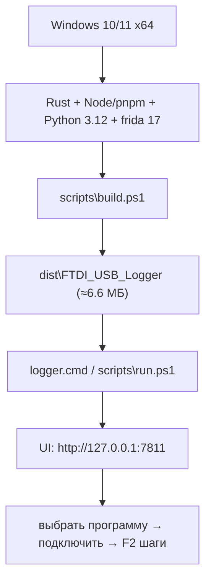

### Сборка

```powershell
# полная сборка: UI + движок + упаковка dist\FTDI_USB_Logger\
powershell -ExecutionPolicy Bypass -File scripts\build.ps1

# только движок (без UI)
powershell -ExecutionPolicy Bypass -File scripts\build.ps1 -SkipUi

# режим разработки: движок + vite dev с проксированием /api и /ws
powershell -ExecutionPolicy Bypass -File scripts\dev.ps1
```

Результат `dist\FTDI_USB_Logger\`:

| Внутри | Что это |
|---|---|
| `ftdi-logger.exe` | движок (release) |
| `ui\dist\` | собранный интерфейс (движок отдаёт его с `/`) |
| `sidecar\` | Python-мост `bridge.py` + Frida-агент `universal_capture.js` |
| `sessions\` | каталог сессий (пустой) |
| `logger.cmd` | запуск двойным кликом/с ярлыка, без висящей консоли |

### Запуск

```powershell
# из репозитория (dist, если собран; иначе release-бинарь движка)
powershell -ExecutionPolicy Bypass -File scripts\run.ps1

# как раньше: двойной клик по logger.cmd (или ярлык на рабочем столе)
```

Движок поднимает HTTP/WS на `http://127.0.0.1:7811` и сам открывает окно Edge в режиме `--app=`.
Порт можно поменять: `scripts\run.ps1 -Port 7812` (или `ftdi-logger.exe --port 7812`).

---

## Установка на другую машину (независимая сборка)

Приложение не требует установленных Python/Frida/Rust: в установщик и portable-версию
встроен Python 3.12 с Frida.

| Что | Где | Размер | Как ставится |
|---|---|---|---|
| **Установщик** | `dist\FTDI_USB_Logger_Setup.exe` | ≈43 МБ | per-user, без администратора: `%LOCALAPPDATA%\FTDI_USB_Logger`, ярлыки на рабочем столе и в меню Пуск, запись в «Установка и удаление программ», uninstall |
| **Portable ZIP** | `build\FTDI_USB_Logger_portable.zip` | ≈64 МБ | распаковать куда угодно и запустить `logger.cmd`; ничего не устанавливается |
| Обычный dist | `dist\FTDI_USB_Logger\` | ≈7 МБ | для машины, где Python+Frida уже есть |

- **Splash при старте**: логотип из `assets/splash.png` показывается, пока движок поднимается,
  и закрывается сам, когда `/api/health` ответил. Скрипт — `scripts/splash.ps1`.
- **Иконка приложения**: `assets/app.ico` — на ярлыках и в панели задач (UI-окно получает
  favicon из `ui/public/favicon.png`).
- Установщик не подписан: при первом запуске Windows SmartScreen может показать
  «Неизвестный издатель» → «Подробнее» → «Выполнить всё равно». Для распространения нужен
  код-сертификат (не входит в репозиторий).
- Сессии и логи хранятся в каталоге установки (`sessions\`), при удалении можно сохранить их.

### Сборка установщика

```powershell
# 1) portable: dist + встроенный Python + frida  → build\FTDI_USB_Logger_portable.zip
powershell -ExecutionPolicy Bypass -File scripts\build-portable.ps1

# 2) setup.exe (7-Zip SFX, per-user установка)   → dist\FTDI_USB_Logger_Setup.exe
powershell -ExecutionPolicy Bypass -File scripts\build-installer.ps1
```

Для сборки нужны 7-Zip и интернет (первый раз скачивается embeddable Python, кешируется
в `build\cache`). Установка/удаление: `scripts\installer\install.cmd|ps1`, `uninstall.cmd|ps1`.

## Как логировать

1. Запустить целевую программу (Quickflash, WinKFP, MS4x Flasher, BMW Scanner, J2534-клиент — любую)
   и подключить адаптер.
2. В UI открыть «ПРОГРАММЫ»: список показывает процессы с окном, USB/FTDI/J2534-модулями
   и известные инструменты, с бейджами `FTDI`, `J2534`, `USB`, `окно`. Выбрать программу и нажать
   «подключить». Если её не видно — переключить фильтр на «окна»/«все» или ввести PID вручную.
3. `F2` — открыть шаг (название подставляется автоматически), повторный `F2` — закрыть шаг:
   сводка, скриншот и строки `# PHASE` в `raw.log`.
4. Работать с блоком как обычно: весь обмен FTDI/VCP/USB/J2534 и файловые операции пишутся в сессию.
5. `Esc` — остановить захват и закрыть сессию; отчёт и экспорт — из UI.

> Приложения, которые открывают порт **до** attach (MS4x Flasher, .NET SerialPort) поддерживаются:
> агент лениво классифицирует уже открытый хендл по `GetFinalPathNameByHandleW`, а overlapped-RX
> достаёт через `GetOverlappedResult`/`OVERLAPPED.Internal`.

---

## Новая сессия и смена шнурка

Кнопка **«НОВАЯ СЕССИЯ»** в шапке (или `Ctrl+Alt+N`):

1. Если идёт запись — подтверждение: текущая сессия сохраняется, захват останавливается.
2. Логер **заново сканирует** USB-устройства, J2534-драйверы и процессы (кэш сбрасывается).
3. Открывается окно выбора: адаптер (FTDI serial/COM) и программа (список `auto`) или ручной PID.
4. «начать сессию» — захват стартует заново, уже с новым шнурком/программой.

Если **целевая программа закрылась** — движок сам завершает сессию в течение ~1 с
(«захват остановлен, устройства освобождены»), а не продолжает показывать `REC`. Если движок
остановлен или перезапущен, UI через ~12 с показывает слой **«Движок не отвечает»**, а после
запуска `logger.cmd` страница переподключается сама. Принудительный `detach` не даёт мосту
держать сессию дольше 8 секунд.

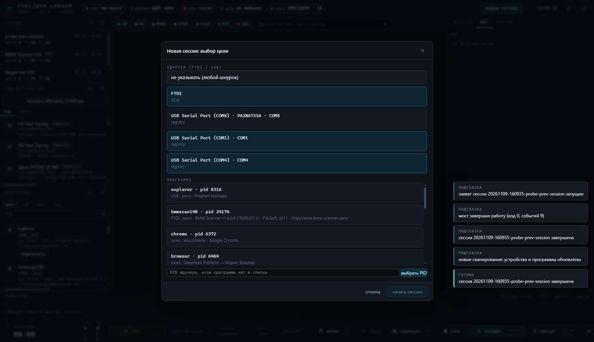

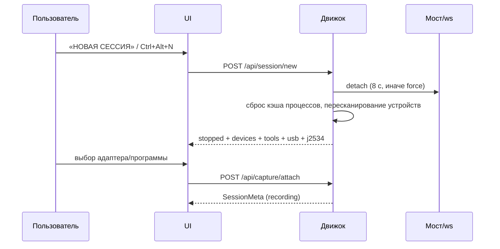

---

'## Пресеты действий

Названия шагов больше не вводятся руками: на нижней панели — **комбо пресетов**. Выбрал пункт —
шаг с этим названием открылся (предыдущий автоматически закрылся со сводкой). Шестерёнка рядом —
редактор списка (добавить/удалить строки, вернуть стандартные).

Стандартный набор:

| # | Пресет |
|---|---|
| 1 | Идентификация |
| 2 | Чтение калибровок |
| 3 | Чтение фулл флеш |
| 4 | Запись калибровок |
| 5 | Запись фулл флеш |
| 6 | Сброс ошибок |
| 7 | Сброс адаптаций |
| 8 | Верификация |

- Пресеты хранятся в `localStorage` (`ftdi.quickTitles`) и переживают перезапуск.
- Ввели своё название вручную (`Shift+F2` или метка `F5`) — оно **автоматически сохраняется**
  в пресеты, чтобы потом не набирать снова.
- Список пресетов используется и для подсказок в диалогах шага/метки.

Кнопки нижней панели — только иконки; полное название и горячая клавиша появляются при
наведении (tooltip), поэтому при сужении окна они не наезжают друг на друга.

## Горячие клавиши'

| Клавиша | Действие |
|---|---|
| `F2` | открыть/закрыть шаг (старт — с автоназванием, конец — сводка + скриншот) |
| `Shift+F2` | открыть шаг с названием вручную |
| `F1` | встроенная справка |
| `F5` | метка в потоке без шага (MARK) |
| `F6` | пауза/возобновление хуков (`hookctl pause/resume`) |
| `F8` | скриншот сейчас |
| `Esc` | остановить захват (detach) |
| `Ctrl+F` | поиск по потоку |
| `Ctrl+E` | экспорт сессии |
| `Ctrl+O` | импорт старого лога |
| `Ctrl+Alt+N` | **новая сессия** (пересканировать всё) |
| комбо на нижней панели | выбрать пресет — открыть шаг с нужным названием |
| `↑ ↓ PgUp PgDn Home End` | навигация по потоку |

Глобальных хоткеев нет — клавиши работают, когда окно логера в фокусе, чтобы не перехватывать
управление у целевой программы.

---

## Структура репозитория

| Путь | Что там |
|---|---|
| `engine/` | Rust-движок: `main/config/discovery/procscan/screenshot/frida`, `models/store/decode/api/report/import/ediabas/usbdevices/j2534/usbpcap`, интеграционные тесты |
| `ui/` | интерфейс (TypeScript + CSS, vite): поток, инспектор, таймлайн, панели, диалоги, CDP-проверки |
| `sidecar/` | `bridge.py` (JSON Lines) + `agents/universal_capture.js` (все хуки) и `ftdi_capture.js` (старый набор) |
| `scripts/` | `build.ps1`, `run.ps1`, `dev.ps1` |
| `tests/e2e/` | `smoke.ps1`, `universal.ps1` (MS4x), `bmw-scanner.ps1`, `dummy_target.py`, edge-сценарии |
| `docs/` | контракты, архитектура, runbook, интерфейсы, edge-кейсы, smoke, ревью, разведка по универсальному захвату |
| `tools/legacy/` | исторические `parse_family.py`, `winkfp.py`, `attach_capture.py` — эталон разбора |
| `reference/` | golden-логи и ожидаемые артефакты для тестов |
| `sessions/` | сессии продукта (в git пусто, `.gitkeep`) |
| `assets/` | скриншоты для README |

---

## HTTP/WS API (кратко)

Всё слушает только `127.0.0.1`, CORS — точный localhost-origin.

| Метод / путь | Назначение |
|---|---|
| `GET /api/health` | версия, состояние моста, `capabilities` (ftd2xx, j2534, usbpcap) |
| `GET /api/sessions`, `GET /api/sessions/{id}` | список/детали сессий |
| `GET /api/sessions/{id}/events?from=&limit=&filter=` | страница событий |
| `GET /api/sessions/{id}/events/{seq}/decode` | разбор payload (KWP/DS2/ISOTP) |
| `POST /api/capture/attach` `{pid,label?,adapter?}` | подключиться к процессу |
| `POST /api/capture/detach` | остановить захват (с бюджетом 8 с + force) |
| `POST /api/session/new` | завершить текущую и пересканировать окружение |
| `GET /api/tools?mode=auto\|usb\|window\|all` | процессы-кандидаты |
| `GET /api/devices` · `GET /api/usb/devices` · `GET /api/j2534/drivers` | FTDI / USB / J2534 |
| `POST /api/usbpcap/start` | сырой захват шины (нужен USBPcap) |
| `POST /api/sessions/{id}/step/start` · `step/end` · `mark` · `note` · `shot` | разметка сессии |
| `POST /api/sessions/{id}/reparse` | пересобрать отчёты из `events.jsonl` |
| `POST /api/import` · `POST /api/import/upload` | импорт старых логов |
| `GET /api/sessions/{id}/export?format=zip\|jsonl\|csv\|md` | экспорт |
| `WS /ws?session=` | живой поток событий |

Полные формы ответов и коды ошибок — [docs/02-architecture.md](docs/02-architecture.md).

---

## Сессии и формат логов

```
sessions/20261109-154706-bmw-scanner-e2e/
├── session.json        # метаданные: инструмент, pid, sha256 exe, счётчики, статус
├── events.jsonl        # события (kind, api, transport, direction, t, hex, meta)
├── events.idx          # индекс для быстрого поиска
├── raw.log             # лог в формате старого logger.py (импортируемый обратно)
├── steps/01.json …     # сводки шагов (команды, ответы, чтения, скриншот)
├── shots/              # PNG-скриншоты шагов
├── reads/              # дампы чтений с SHA-256
├── import/             # исходник импортированного лога
├── report.txt          # текстовый отчёт
└── report.md           # Markdown-отчёт
```

Пример `raw.log` (совместим со старым парсером):

```text
# capture start: label=BMW Scanner e2e
# tool: C:\BMWScan140\BMWScan140.exe
# exe: size=3009024 mtime=2011-09-20 02:11:16 sha256=7aebc4b7…
# wall(start)=2026-11-09 15:47:06
# host: user=User computer=DESKTOP-7MECFCS
[+3.947s] ftd2xx.dll hooks installed (36) at 0x10000000 C:\Windows\SYSTEM32\ftd2xx.dll
[+3.969s] FT_OpenEx('BMW Scanner V14x' flags=2) rc=0 handle=0xde5608
[+3.970s] FT_SetBaudRate(handle=0xde5608, 19200) rc=0
[+4.147s] RX ftd2xx FT_Read rc=0 want=1 n=1 : 12
[+4.637s] TX ftd2xx FT_Write rc=0 len=1 n=1 : b9
# MARK wall=… rel=+4.900s START 1: чтение идентификаторов
# PHASE …
# PHASE-JSON …
# totals: events=1094 tx=260/260 rx=758/758 steps=0
```

---

## Экспорт, импорт, переразбор

- **Экспорт** (`Ctrl+E`): ZIP сессии, JSONL событий, CSV, Markdown/текстовый отчёт;
  отправка на сервер по настраиваемому URL.
- **Импорт** (`Ctrl+O` или перетаскивание в окно): старый `capture.log`/`logger.out` →
  сессия `status:"imported"`, `transport:"import"`; исходник копируется в `sessions/<id>/import/`.
- **Переразбор**: `POST /api/sessions/{id}/reparse` — пересобрать сводки/отчёт из `events.jsonl`
  после правки названий шагов.

---

## Тесты и приёмка

| Что проверяется | Команда | Результат |
|---|---|---|
| Rust: unit + интеграционные | `cd engine; cargo test --all-targets` | 104 passed, 10 ignored |
| API end-to-end на реальном логе | `pwsh -File tests\e2e\smoke.ps1` | 14/14 |
| UI через CDP (поток, инспектор, сводка, экспорт, поиск, адаптив) | `node ui\tools\cdp-check.mjs "http://127.0.0.1:7811/?demo=1" ui\shots` | 14/14 demo, 15/15 live |
| Живой универсальный захват (MS4x Flasher, VCP+overlapped, UIA «Identify») | `pwsh -File tests\e2e\universal.ps1` | 10/10 |
| Живой захват BMW Scanner 1.4.0 (FTDI D2XX, 32-битная Delphi) | `pwsh -File tests\e2e\bmw-scanner.ps1 -StartApp` | 4/4 |
| Живой захват без железа (Frida → процесс → события → отчёт) | `python tests\e2e\dummy_target.py --seconds 30` + attach | ok |
| Приёмка собранного dist | [docs/06-smoke.md](docs/06-smoke.md) | — |
| Независимое ревью и найденные дефекты | [docs/07-review.md](docs/07-review.md) | — |

---

## Документация

| Документ | О чём |
|---|---|
| [docs/01-original-contracts.md](docs/01-original-contracts.md) | разведка старого логера: формат строк, поведение, артефакты |
| [docs/02-architecture.md](docs/02-architecture.md) | архитектура, контракты API, модель событий, §11 универсальный захват |
| [docs/03-runbook.md](docs/03-runbook.md) | установка, сборка, права, диагностика, замена шнурка |
| [docs/04-interfaces.md](docs/04-interfaces.md) | сигнатуры Rust-модулей |
| [docs/05-edge-cases.md](docs/05-edge-cases.md) | крайние случаи API/импорта/UI |
| [docs/06-smoke.md](docs/06-smoke.md) | приёмка собранного dist |
| [docs/07-review.md](docs/07-review.md) | ревью и исправленные дефекты |
| [docs/08-universal-research.md](docs/08-universal-research.md) | как MS4x/BMW Scanner/J2534 общаются с адаптером, что ловится хуками, а что нужно USBPcap |

---

## Ограничения

| Ограничение | Почему / что делать |
|---|---|
| Сводка шага считается сразу, без «settle»-паузы 1.6 с как в старом логере | хвостовые RX в последние миллисекунды могут не попасть в сводку шага; полный разбор — `raw.log` старым `parse_family.py` |
| `report.txt` — сводка шагов, а не полный разбор `parse_family` | полный анализ: `python tools/legacy/parse_family.py --log sessions/<id>/raw.log --gap 2.0` |
| Дублирование FT_* и внутренних USB-ioctl | подавлено на уровне агента, когда активны хуки `ftd2xx.dll`; при работе через WinUSB/HID видно USB-уровень |
| Сырой USB через USBPcap требует установленного драйвера и прав администратора | без него доступны API-хуки (FTDI/COM/WinUSB/HID/libusb/J2534); установка USBPcap требует перезагрузки |
| J2534 ловится на уровне сообщений PassThru (протокол/ID/payload), без разбора URB драйвера | если адаптер не открывается через `PassThru*`, нужен USBPcap |
| ISOTP: классификация PCI (SF/FF/CF/FC) и service id одиночного кадра | многокадровая сборка не выполняется — собирайте по кадрам в экспорте |
| J2534/TX-RX не сопоставляются в пары запрос-ответ автоматически | в сводке шага `cmd_hist`/`resp_hist` по CAN ID, полный обмен — в потоке |
| Захват «побайтовый» для D2XX-приложений вроде BMW Scanner | приложение вызывает `FT_Read/FT_Write` по 1 байту; логгер faithfully пишет каждый вызов; сборка кадров — через `parse_family`/будущий assembler |
| Глобальных горячих клавиш нет | F2/F5/F6/F8 работают в фокусе окна логера |
| Слушает только `127.0.0.1`, CORS — точный localhost-origin | удалённый доступ закрыт осознанно |
| EDIABAS-режим включается эвристикой (имя процесса или свежие трассы) | принудительно: `FTDI_LOGGER_EDIABAS=1`; пути INI/трасс — переменными `FTDI_LOGGER_EDIABAS_INI`, `_OBD_INI`, `_WINKFP_INI`, `_TRACE_DIR` |

---

## Диагностика

| Симптом | Куда смотреть |
|---|---|
| «мост недоступен» | `python sidecar\bridge.py --self-test`; python/frida у движка (runbook) |
| порт 7811 занят | `netstat -ano \| findstr :7811`, закрыть старый `ftdi-logger.exe` или задать `-Port` |
| устройство не видно | драйвер FTDI (D2XX/VCP); в логе ждать `MODULE + FTD2XX.DLL` / `FT_GetDeviceInfoDetail` |
| программа не в списке | переключить режим «окна»/«все» или ввести PID вручную; проверить `GET /api/tools?mode=all` |
| WinKFP/EDIABAS не логируется | инструмент запущен от админа → логер тоже от админа |
| UI показывает «Движок не отвечает» | движок остановлен/перезапускается; запустить `logger.cmd`, страница переподключится |
| «уже запущено» при повторном клике | штатно: `logger.cmd` открывает окно работающего экземпляра |
| продукт не поднялся | `dist\FTDI_USB_Logger\logger.err.log` + `netstat` по порту; полный разбор — runbook |

Полный порядок установки, проверки моста, прав администратора и разбор ошибок —
**[docs/03-runbook.md](docs/03-runbook.md)**.

---

## Приватность и безопасность

- Логер работает **локально**: HTTP/WS только на `127.0.0.1`, наружу ничего не отправляется,
  кроме явной команды «отправить на сервер» (если URL настроен).
- Сессии содержат трафик диагностики и могут содержать VIN/дампы ЭБУ — храните и передавайте
  их осознанно; каталог `sessions/` в репозиторий не попадает.
- Инструмент не модифицирует целевое приложение и не обходит его защиты: только перехват
  вызовов и запись. Приложение запускается пользователем и работает как обычно.
- Ответственность за применение — на владельце оборудования. Не используйте на чужих
  автомобилях/устройствах без разрешения.

---

## Лицензия

Лицензия в репозитории не задана (по умолчанию — все права у автора). Если планируете
распространять/форкать — добавьте LICENSE (например, MIT/Apache-2.0) и укажите здесь.

---

<sub>Проект использует [Frida](https://frida.re), [Rust](https://www.rust-lang.org), [axum](https://github.com/tokio-rs/axum), [Vite](https://vitejs.dev). Старый логер и `parse_family.py` сохранены в `tools/legacy/` как эталон разбора.</sub>


