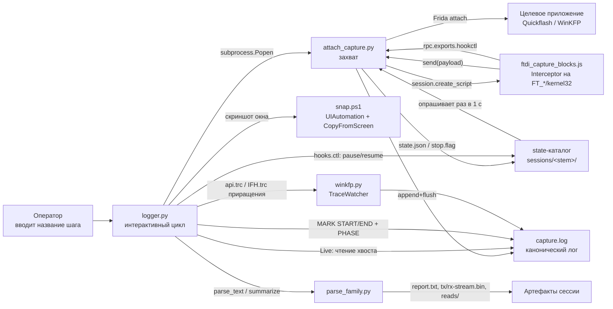
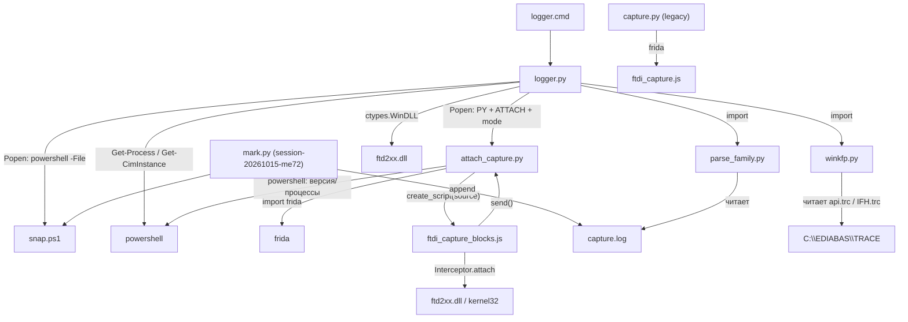
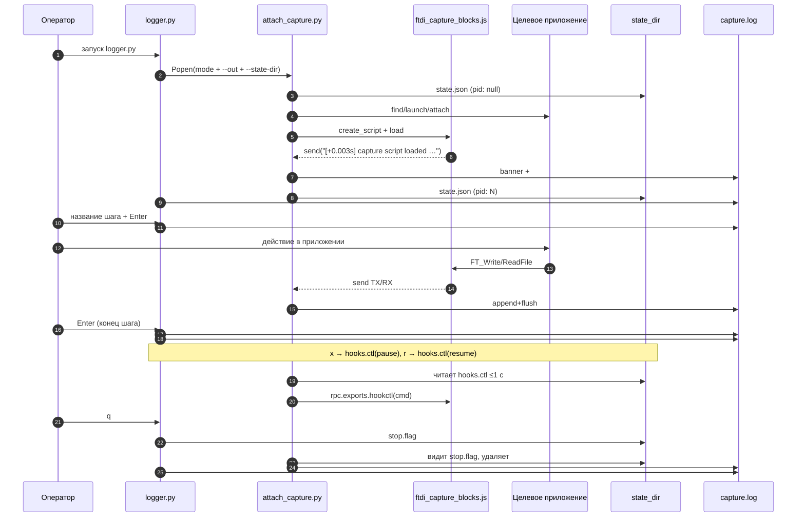
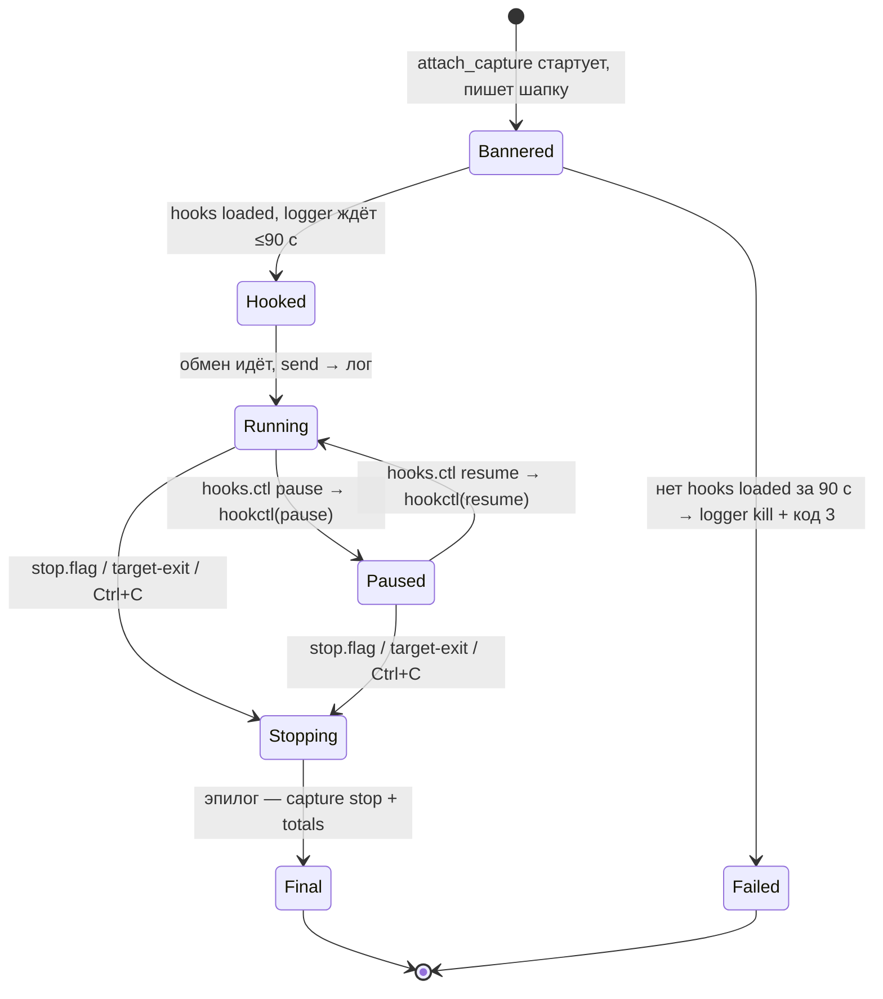
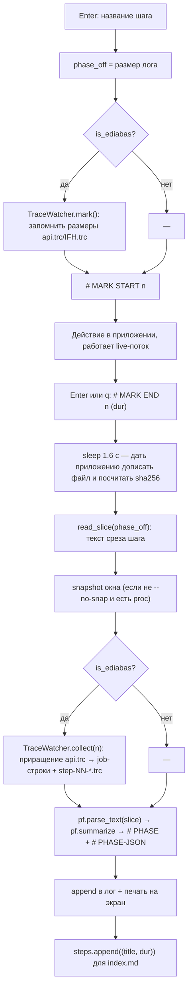
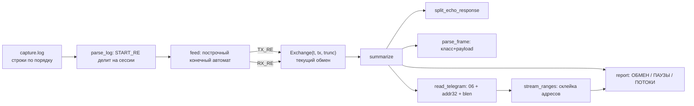
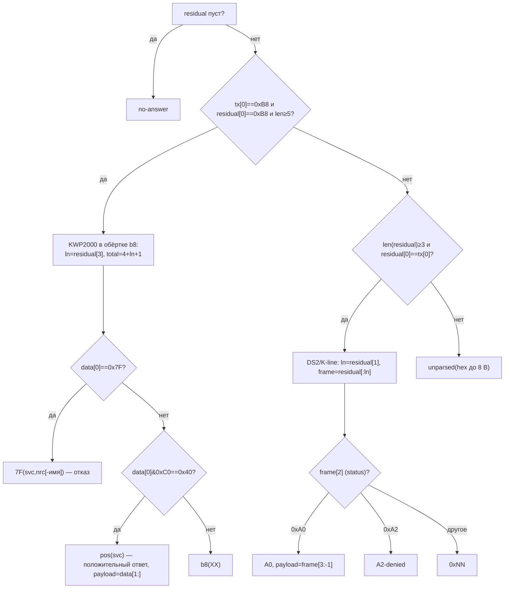
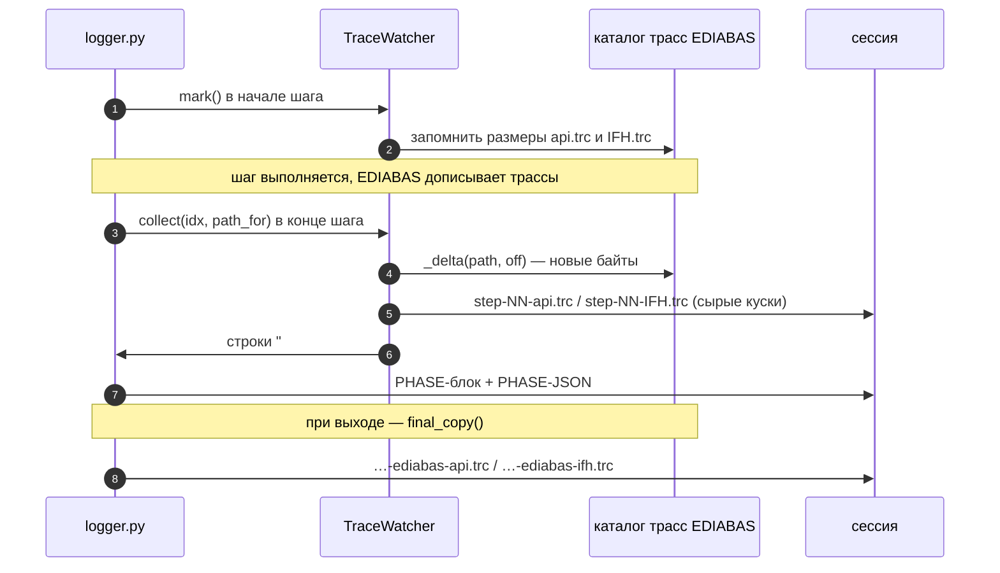
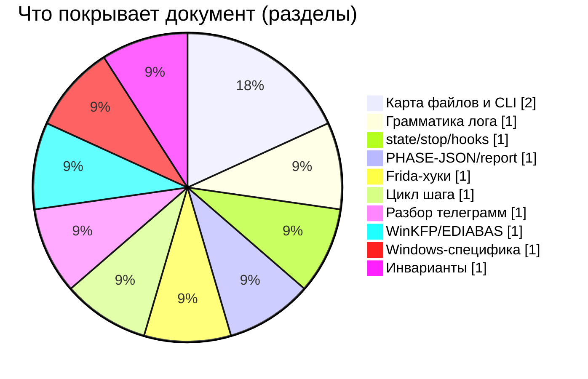

# Исходные контракты старого логера (`orig-capture`) — карта для переноса

Документ фиксирует поведение старого логера из `E:\Replica\work\orig-capture` (снимок на 2026-11-09) как набор контрактов: форматы строк лога, CLI, служебные файлы, JSON-схемы, Frida-хуки, правила разбора и Windows-зависимости. Цель — перенести поведение в `D:\FTDI_USB_Logger` без потери совместимости с уже снятыми сессиями.

> Всё, что ниже, снято с исходников (`logger.py` 984 стр., `attach_capture.py` 405, `ftdi_capture_blocks.js` 366, `winkfp.py` 285, `parse_family.py` 521, `capture.py` 89, `LOGGER.md` 229) и подтверждено дословными фрагментами реальных логов из `sessions\`, `_winkfp_e2e\proj\` и корня проекта `E:\Replica\*.log` (каталоги `sessions\<сессия>\` хранят только `state.json`, сами логи лежат в корне проекта — это задокументировано в [LOGGER.md](E:/Replica/work/orig-capture/LOGGER.md)).

## 0. Обзор: что происходит во время сессии



Три источника данных в одном логе: (1) байтовый поток TX/RX от Frida, (2) подписанные шаги оператора (`# MARK`, `# PHASE`, `# PHASE-JSON`), (3) служебные факты хоста/окружения (шапка, `# hb`, `# license-gate`, `# filehash`, `# totals`).

## 1. Карта файлов и ролей

### 1.1. Таблица ролей

| Файл | Строк | Роль | Кто импортирует / вызывает |
|---|---:|---|---|
| [logger.py](E:/Replica/work/orig-capture/logger.py) | 984 | Интерактивный логер: выбор шнурка/процесса, запуск захвата, живой поток, шаги, сводки, скриншоты, финальный разбор, индекс сессий | Точка входа (`logger.cmd`, `python logger.py`) |
| [attach_capture.py](E:/Replica/work/orig-capture/attach_capture.py) | 405 | Захват: найти/запустить/приаттачиться к процессу, повесить Frida-скрипт, писать канонический лог, `state.json`, `stop.flag`, `hooks.ctl` | Запускается `logger.py` как дочерний процесс; может запускаться руками |
| [ftdi_capture_blocks.js](E:/Replica/work/orig-capture/ftdi_capture_blocks.js) | 366 | Frida-хуки: все `FT_*` из `ftd2xx.dll`, fallback `kernel32` (COM), файловые операции; `rpc.exports.hookctl` | Загружается `attach_capture.py` через `create_script` |
| [parse_family.py](E:/Replica/work/orig-capture/parse_family.py) | 521 | Разбор лога: телеграммы, эхо/класс ответа, KWP2000, потоки чтения, отчёт, `tx/rx-stream.bin`, `reads/` | `import parse_family as pf` в `logger.py`; CLI |
| [winkfp.py](E:/Replica/work/orig-capture/winkfp.py) | 285 | WinKFP/EDIABAS: пути, факты INI, `is_ediabas`, разбор `api.trc`, `TraceWatcher` (трассы по шагам) | `import winkfp as wk` в `logger.py` |
| [capture.py](E:/Replica/work/orig-capture/capture.py) | 89 | Легаси-захват с жёстко прописанными путями (`lex66`, старый `ftdi_capture.js`), без шагов | Самостоятельно; логером не используется |
| [logger.cmd](E:/Replica/work/orig-capture/logger.cmd) | 8 | Обёртка: `python.exe logger.py %*`, `pause` при `errorlevel 1` | Пользователь |
| [LOGGER.md](E:/Replica/work/orig-capture/LOGGER.md) | 229 | Руководство оператора: режимы, WinKFP, лицензионный гейт, A/B паузы хуков | — |
| [snap.ps1](E:/Replica/work/orig-capture/snap.ps1) | 17 | Скриншот окна процесса через UIAutomation (`-ProcName`, `-Out`) | `logger.py` (`screenshot()`), `mark.py` |
| `ftdi_capture.js` | 266 | Предыдущая версия хуков (без файловых операций и `.0pa/.prg`), её использовал `capture.py` | `capture.py` |
| `session-20261015-me72/mark.py` | 63 | Внешняя метка `# MARK wall=… rel=… <текст>` (+`--snap`) | Ручной режим |
| `sessions/index.md` | — | Индекс сессий: по строке на сессию — дата, блок, число шагов, папка (дописывается `logger.py`) | |
| `sessions/<stem>/` | — | Служебный каталог: `state.json`, `stop.flag`, `hooks.ctl` | `attach_capture.py`, `logger.py` |
| `_winkfp_e2e/proj/` | — | Сквозной тест WinKFP: `logger.out`, `capture.log`, `trace/`, `*-report.txt`, `*-step-NN-*.trc`, `*-reads/` | Тест |

### 1.2. Импорты и вызовы



Ключевые факты связности, которые нельзя потерять:

- `logger.py` не грузит Frida сам: он только спавнит `attach_capture.py` (`ATTACH = <HERE>/attach_capture.py`, `JS = <HERE>/ftdi_capture_blocks.js`), ждёт в логе строку `# hooks loaded` до 90 с и передаёт режим одним из наборов: `--attach <PID>`, либо `--find --wait 600`, либо `--launch --attach-delay 12.0`.
- `logger.py` — единственный писатель `# MARK`, `# PHASE`, `# PHASE-JSON`, `# filehash`-«догоняющих» строк не пишет (их пишет `attach_capture.py` после `FILE close`).
- `parse_family.py` не зависит от `logger.py` (обратная зависимость), поэтому разбор можно гонять отдельно по любому логу.
- `sessions\<stem>\state.json` — единственный якорь времени (`t0_epoch`) для внешних инструментов вроде `mark.py`.

## 2. CLI-контракты

### 2.1. `logger.py` — 15 флагов

| Флаг | Тип / default | Что делает | Наблюдаемый эффект |
|---|---|---|---|
| `--block` | str, `""` | Имя блока/прошивальщика | Идёт в `stem` сессии, `--label` захвата, шапку лога, поиск exe (`resolve_exe`) |
| `--exe` | str, `""` | Путь к exe **или папке** с exe | Из папки берётся самый большой `*.exe`; имя процесса = basename |
| `--reuse` | str, `""` | Путь к уже идущему `capture.log`; свой захват не поднимается | `log_path = abspath(--reuse)`, `session_dir = dirname(log_path)` |
| `--attach` | int, `0` (`metavar=PID`) | Прицепиться к уже запущенному процессу | Передаётся дочернему как `--attach PID`; отключает интерактивный выбор |
| `--proc` | str, `""` | Имя процесса для скриншотов (`Get-Process -Name`) | `proc_base = splitext(proc_name)[0]` — `.exe` отрезается |
| `--session-dir` | str, `""` | Папка сессии | Лог = `<session-dir>/capture.log` (без префикса сессии) |
| `--project-dir` | str, `PROJECT_DIR` = `E:\Replica` | Корень проекта | Лог = `<project-dir>/<stem>.log`, артефакты получают префикс `<stem>-` |
| `--adapter` | str, `""` | Описание/серийник шнурка | Строка `# adapter:` в шапке |
| `--ecu` | str, `""` | ЭБУ на стенде | Строка `# ecu:` в шапке |
| `--no-capture` | flag | Не поднимать захват | Никакого `attach_capture`; при пустых `--block/--exe/--reuse/--attach` требует `--reuse`, иначе код 2 |
| `--no-launch` | flag | Только прицепиться, приложение не стартовать | Дочернему: `--find --wait 600` |
| `--no-snap` | flag | Не снимать скриншоты | `png = None`, в шапке `# PHASE … скриншот нет` |
| `--no-parse` | flag | Не прогонять финальный разбор | Нет `report.txt`, нет сводки `посылок=…` |
| `--no-io-hooks` | flag | Сразу снять хуки I/O | После старта вызывает `hooks_ctl("pause")`: только подписи шагов, без байтов/файлов |
| `--trace-dir` | str, `""` | Каталог трасс EDIABAS | Иначе — `TracePath` из `ediabas.ini`, иначе `C:\EDIABAS\TRACE` |

Порядок решения (важно для совместимости):

1. Нет `--block/--exe/--reuse/--attach` → интерактивный `pick_target()`: список D2XX-шнурков → выбор → поиск процессов до 180 с (опрос каждые 5 с) → выбор процесса; далее `args.attach/block/exe/proc/adapter` заполняются автоматически.
2. `resolve_exe(block, exe)` — сначала известные пути (`KNOWN_BLOCKS`: winkfp/ediabas/inpa/tool32/ncsexpert), затем `--exe` (файл или самый большой `.exe` в папке), затем поиск по `D:\BMW_Flashers`, затем `E:\Replica\soft` (порядок важен: рабочая установка раньше архива).
3. Запрет: `не --reuse и не --no-capture и нет exe и --attach <= 0` → `return 2`.
4. `stem = "<slug(block|proc_name)>-capture-<YYYYmmdd-HHMMSS>"`.
5. `state_dir` **всегда** `<HERE>/sessions/<stem>` (даже при `--reuse/--session-dir`).

Коды возврата `logger.py`: `0` — норма; `2` — аргументы/поиск exe; `3` — захват не поднялся за 90 с (дочерний убит через `terminate`).

### 2.2. `attach_capture.py` — 17 флагов

| Флаг | Тип / default | Что делает |
|---|---|---|
| `--exe` | str, `""` | Путь к приложению (шапка, спавн, Popen, имя процесса) |
| `--proc` | str, `""` | Имя процесса; default — basename `--exe` |
| `--script` | str, `<HERE>/ftdi_capture_blocks.js` | Frida-скрипт хуков |
| `--out` | str, `""` | Файл лога; default `<HERE>/sessions/<YYYYmmdd-HHMMSS>-<slug(label)>/capture.log` |
| `--label` | str, `""` | Метка сессии; default — имя exe без расширения |
| `--adapter` | str, `""` | В шапку `# adapter:` |
| `--ecu` | str, `""` | В шапку `# ecu:` |
| `--note` | str, `""` | В шапку `# note:` |
| `--state-dir` | str, `""` | Куда писать `state.json/stop.flag/hooks.ctl`; default — каталог лога |
| `--launch` | flag | Запустить приложение и прицепиться; если уже запущено — attach к нему |
| `--find` | flag | Ждать/найти запущенный процесс (`--wait`) |
| `--wait` | float, `0.0` (`metavar=SEC`) | Сколько ждать появления процесса при `--find` (опрос 2 с) |
| `--attach` | int, `None` (`metavar=PID`) | Прицепиться к PID |
| `--attach-delay` | float, `0.0` (`metavar=SEC`) | С `--launch`: пауза после старта перед хуками (приложение «палит» ранний attach) |
| `--spawn` | flag | Frida-spawn приложения (если уже запущен — `return 2`) |
| `--list` | flag | Только показать процессы (`pid= path= cmd=`), выйти `0` |
| `--script-check` | flag | Dry-run хука на `C:\Windows\System32\notepad.exe`, критерий `msgs>0 и errors==0`, иначе `return 2` |

Режимы взаимоисключающие по приоритету: `--attach` → `--spawn` → `--launch` → `--find`. Коды: `0` норма, `1` процесс не найден (`--find` без `--wait` или таймаут), `2` нет `--exe/--proc` или `--spawn` при уже запущенном, `2` провал `--script-check`.

Команда, которой `logger.py` поднимает захват (дословно по коду):

```text
<PY> <HERE>\attach_capture.py
    (--attach PID | --find --wait 600 | --launch --attach-delay 12.0)
    --exe <exe> --script <HERE>\ftdi_capture_blocks.js
    --out <log_path> --state-dir <sessions/stem> --label <block|proc>
    [--adapter ...] [--ecu ...] --note "интерактивная сессия логера"
```

`cwd = session_dir`, `stdout=DEVNULL`, `stderr=STDOUT`, на Windows `creationflags=0x00000008` (`DETACHED_PROCESS`).

## 3. Грамматика строк лога

Лог — UTF-8, построчный, **append + flush на каждой строке**. Два производителя: Python (`# …`, без префикса времени) и Frida-скрипт (`[+<sec>s] …`). Есть **два разных нуля времени**: `[+X.XXXs]` считается от `Date.now()` в момент загрузки JS-скрипта, `rel=+X.XXXs` в `state.json`-зависимых строках — от `t0 = time.time()` в Python. Они не совпадают, склеивать по ним нельзя.

### 3.1. Служебные строки шапки (`attach_capture.py → Session.banner`)

| Строка (шаблон) | Пример дословно |
|---|---|
| `=` × 74 | `==========================================================================` |
| `# capture start: label=<label>` | `# capture start: label=BMS46 Quickflash` |
| `# tool: <exe>` | `# tool: D:\BMW_Flashers\BMS46 Quickflash\BMS46 Quickflash.exe` |
| `# exe: size=<n> mtime=<local>` | `# exe: size=7899128 mtime=2026-10-13 09:12:09` |
| `# exe: sha256=<hex>` | `# exe: sha256=a675257fa47712f3eab191da13f061c44fe9d709dfbbe65a6934482ab5c0ede9` |
| `# exe: version=<desc \| company \| filever \| prodver>` | `# exe: version=BMS46 Quickflash \| Bimmer Tuning Tools \| 1.06 \| 1.06` |
| `# ftd2xx: <version FTD2XX.DLL>` | `# ftd2xx: FTD2XX Dynamic Library \| Future Technology Devices International Ltd. \| 3.2.21.1 \| 2.12.36.20` |
| `# app-dir: <dir>` | `# app-dir: D:\BMW_Flashers\BMS46 Quickflash` |
| `# wall(start)=<local>` | `# wall(start)=2026-10-16 11:54:52` |
| `# host: user=<USERNAME> computer=<COMPUTERNAME>` | `# host: user=User computer=DESKTOP-7MECFCS` |
| `# adapter: <adapter \| placeholder>` | `# adapter: D-CAN A63UJ38H` / `# adapter: FTDI ?` |
| `# ecu: <ecu \| placeholder>` | `# ecu: (см. ident-телеграмму ниже)` |
| `# note: <note \| ->` | `# note: интерактивная сессия логера` |
| `# script: <path>` | `# script: E:\Replica\work\orig-capture\ftdi_capture_blocks.js` |
| `# log: <path>` | `# log: E:\Replica\BMS46-Quickflash-capture-20261016-115450.log` |
| `# attached pid=<pid>` | `# attached pid=3708` |
| `# cmdline=<CommandLine>` | `# cmdline="D:\BMW_Flashers\BMS46 Quickflash\BMS46 Quickflash.exe" ` |
| `# hooks loaded` | `# hooks loaded` |
| `# resumed` | `# resumed` (только при spawn) |

Легаси-шапка `capture.py` (для чтения старых логов): `=` × 70, `# capture start` **без** label, `# time=<local>`, `# spawned pid=<n>` / `# attaching to pid=<n>`, `# resumed`, `# attached (process already running)`, `# session detached (target gone)`, `# interrupted by user`. `parse_family.START_RE` понимает обе шапки.

### 3.2. Потоковые события Frida (`ftdi_capture_blocks.js`, префикс `[+<s>s]`)

| Шаблон | Пример дословно |
|---|---|
| `[+<t>s] TX ftd2xx FT_Write rc=<i> len=<n> n=<n> : <hex>` | `[+14.375s] TX ftd2xx FT_Write rc=0 len=4 n=4 : 12 04 00 16` |
| `[+<t>s] RX ftd2xx FT_Read rc=<i> want=<n> n=<n> : <hex>` | `[+14.537s] RX ftd2xx FT_Read rc=0 want=4 n=4 : 12 04 00 16` |
| `[+<t>s] VCP TX WriteFile(<COMx>) rc=<i> n=<n> ovl=<0\|1> : <hex>` | `[+70.537s] VCP TX WriteFile(COM6) n=4 : 12 04 0d 1b` |
| `[+<t>s] VCP RX ReadFile(<COMx>) rc=<i> n=<n> ovl=<0\|1> : <hex>` | `[+70.543s] VCP RX ReadFile(COM6) n=4 : 12 04 0d 1b` |
| `[+<t>s] VCP CreateFileW(<path>) handle=<h> invalid=<bool>` | `[+67.539s] VCP CreateFileW(COM6) handle=0x2b4 invalid=false` |
| `[+<t>s] VCP CloseHandle(<COMx>)` | — (в выборке не встретилось, формат из кода) |
| `[+<t>s] FILE open <path> access=0x<hex> handle=<h>` | `[+112.653s] FILE open E:\Replica\WBAAL30070JJ41294_BMS46_1430940_partial_logger.bin access=0x80 handle=0xffffffffffffffff` |
| `[+<t>s] FILE write <path> n=<n> total=<n>` | `[+112.794s] FILE write E:\Replica\WBAAL30070JJ41294_BMS46_1430940_partial_logger.bin n=32768 total=32768` |
| `[+<t>s] FILE close <path> bytes=<n> writes=<n>` | `[+112.795s] FILE close E:\Replica\WBAAL30070JJ41294_BMS46_1430940_partial_logger.bin bytes=32768 writes=1` |
| `[+<t>s] MODULE(now) <name>  <path> base=<addr>` | `[+0.000s] MODULE(now) FTD2XX.DLL  C:\Windows\SYSTEM32\FTD2XX.DLL base=0x7ffe91520000` |
| `[+<t>s] MODULE + <name>  <path> base=<addr>` | `[+0.002s] MODULE + FTD2XX.DLL  C:\Windows\SYSTEM32\FTD2XX.DLL base=0x7ffe91520000` |
| `[+<t>s] ftd2xx.dll hooks installed (<n>) at <base> <path>` | `[+0.003s] ftd2xx.dll hooks installed (36) at 0x7ffe91520000 C:\Windows\SYSTEM32\FTD2XX.DLL` |
| `[+<t>s] ftd2xx.dll not loaded yet — module observer armed` | `[+0.001s] ftd2xx.dll not loaded yet — module observer armed` |
| `[+<t>s] ftd2xx.dll not loaded — polling` | (ветка без `attachModuleObserver`) |
| `[+<t>s] capture script loaded: pid=<pid> arch=<x64> modules=<n> wall=<ISO>Z` | `[+0.003s] capture script loaded: pid=3708 arch=x64 modules=115 wall=2026-10-16T06:54:52.931Z` |
| `[+<t>s] FT_Open(idx=<n>) rc=<i> handle=<h>` | `[+0.087s] FT_Open(idx=0) rc=3 handle=0x0` |
| `[+<t>s] FT_CreateDeviceInfoList rc=<i> devices=<n>` | `[+0.087s] FT_CreateDeviceInfoList rc=0 devices=1` |
| `[+<t>s] FT_GetDeviceInfo(handle=<h>) rc=<i> serial="<s>" desc="<s>"` | `[+2.852s] FT_GetDeviceInfo rc=0 serial="A50285BI" desc="FT232R USB UART"` |
| `[+<t>s] FT_GetDeviceInfoDetail idx=<n> rc=<i> flags=<n> type=<n> serial="<s>" desc="<s>"` | формат из кода (в выборке нет) |
| `[+<t>s] FT_GetComPortNumber rc=<i> com=<n>` | формат из кода |
| `[+<t>s] FT_SetBaudRate(handle=<h>, <baud>) rc=<i>` | формат из кода |
| `[+<t>s] FT_SetLatencyTimer(handle=<h>, <ms>ms) rc=<i>` | формат из кода |
| `[+<t>s] FT_SetTimeouts(handle=<h>, rd=<n> wr=<n>) rc=<i>` | формат из кода |
| `[+<t>s] FT_Purge(handle=<h>, mask=<n>) rc=<i>` | формат из кода |
| `[+<t>s] FT_SetBitMode(handle=<h>, mask=<n> mode=<n>) rc=<i>` | формат из кода |
| `[+<t>s] FT_SetDataCharacteristics(handle=<h>, wl=<n> sb=<n> parity=<n>) rc=<i>` | формат из кода |
| `[+<t>s] FT_SetFlowControl(handle=<h>, flags=<n>) rc=<i>` | формат из кода |
| `[+<t>s] FT_GetQueueStatus(handle=<h>) q=<n> rc=<i>` | формат из кода |
| `[+<t>s] <FT_Close\|FT_ResetDevice\|FT_ResetPort\|FT_CyclePort>(handle=<h>) rc=<i>` | формат из кода |
| `[+<t>s] <NAME>(handle=<h>) rc=<i>` | generic-ветка для остальных `WANTED` |
| `[+<t>s] FT_EE_UARead rc=<i> want=<n> got=<n> : <hex ≤128 B>` | формат из кода |
| `[+<t>s] hook fail <name>: <err>` / `enumerateExports fail: <err>` | формат из кода |
| внутри hex-дампа: `<read-error Error: …>` | `[+59.929s] TX ftd2xx FT_Write rc=0 len=4960320 n=4 : <read-error Error: access violation accessing 0x4>` (легаси `ftdi_capture.js`) |
| `[script-error] <description>` (+ `stack`) | из `attach_capture.Session.on_message` при `message.type == "error"` |
| `[<mtype>] <message>` | прочие типы сообщений Frida |

Поток ошибок/шума, который **скрывается на экране** (`logger.Live`, но **остаётся в файле**): `POLL_RE = FT_Open(idx=\d+) rc=3 | FT_CreateDeviceInfoList rc=0 devices=` и `QUIET_CFG_RE = FT_GetQueueStatus | FT_Open(idx=\d+) rc=3`; `rc=3` = `FT_DEVICE_NOT_OPENED` — это «нет кабеля» опрос.

Только на экран (в файл **не пишется**) логер печатает склейку побайтовых VCP-чтений WinKFP:

```text
[+70.604s] VCP RX ReadFile(COM6) одиночные байты n=32 : 12 4c a0 01 45 9a ff ff ff ff ff ff ff ff ff ff ff ff ff ff ff ff ff ff ff ff ff ff ff ff ff ff
```

### 3.3. Строки шагов и меток (`logger.py`)

| Шаблон | Пример дословно |
|---|---|
| `# MARK wall=<local> START <idx>: <title>` | `# MARK wall=2026-10-16 11:55:05 START 1: id` |
| `# MARK wall=<local> END <idx>: <title> (<dur> с)` | `# MARK wall=2026-10-16 11:55:12 END 1: id (6.5 с)` |
| `# MARK wall=<local> <title>` (команда `mark …`) | формат из кода (`logger.py`, ветка `title.lower().startswith("mark ")`), в выборке такой строки нет |
| `# MARK wall=<local> rel=+<s>s <text>` (внешний `mark.py`) | `# MARK wall=2026-10-15 13:09:16 rel=+121.182s adapter: FT232R-compatible on COM1 …` (реальная строка из `session-20261015-me72/capture.log:2231`, многострочный текст метки сокращён) |
| `# PHASE <idx>: <title> \| длительность <d> с \| TX <n> посылок / <n> B \| RX <n> B \| скриншот <path\|нет>` | `# PHASE 1: id \| длительность 6.5 с \| TX 3 посылок / 17 B \| RX 156 B \| скриншот E:\Replica\BMS46-Quickflash-capture-20261016-115450-phase-01-id.png` |
| `# PHASE <idx>   команды: <key=n, …>` \| `… нет` | `# PHASE 1   команды: cmd=0x00=1, cmd=0x0D=1, READ(0x06)=1` |
| `# PHASE <idx>   ответы: <class=n, …>` \| `… нет` | `# PHASE 1   ответы: A0=3` |
| `# PHASE <idx>   чтение 0x<addr6>..0x<addr6> <n> B блоков <k> sha256=<hex>` | `# PHASE 1   чтение 0x03FD60..0x03FD6D 13 B блоков 1 sha256=b35bf6a7244fdf6a1022d6fd84796afea4490f67ae345c0b8b80bb307b368233` |
| `# PHASE <idx>   чтения: нет` | `# PHASE 8   чтения: нет` |
| `# PHASE <idx>   файл: <path> bytes=<n> writes=<k>` | `# PHASE 2   файл: E:\Replica\WBAAL30070JJ41294_BMS46_1430940_partial_logger.bin bytes=32768 writes=1` |
| `# PHASE <idx>   файл-хеш: size=<n> sha256=<hex> <path>` | `# PHASE 2   файл-хеш: size=32768 sha256=b42e76f3e1bc6cd58f81d0236e137c02cb15edfabe6dbf9a85d636050fb4f04e E:\Replica\WBAAL30070JJ41294_BMS46_1430940_partial_logger.bin` |
| `# PHASE <idx>   winkfp: job="<job>" sgbd="<sgbd>" …` | `# PHASE 1   winkfp: job="ident" sgbd="bms46ds0" \| результатов=2 ID_BMW_NR="1430940" ID_SW_NR="F0"` |
| `# PHASE-JSON <json одной строкой>` | см. §5 |
| `# логер: hooks <pause\|resume> wall=<local>` | формат из кода (`logger.hooks_ctl`); в выборке есть только парная строка захвата: `# hookctl: pause по запросу логера +4.794s -> paused` |
| `# hookctl: <pause\|resume> по запросу логера +<s>s -> <paused\|resumed>` | `# hookctl: pause по запросу логера +4.794s -> paused` |

> **Ловушка переноса №1.** `parse_family.MARK_RE` требует `rel=+…s`: `^# MARK wall=(.+?) rel=\+([\d.]+)s\s+(.*)$`. Значит `# MARK`, которые пишет сам логер (`START/END` без `rel=`), **в разборе не видны** — в `report.txt` у таких сессий `mark=0` (подтверждено: `WinKFP-capture-20261016-115344-report.txt`, шапка «mark=0», хотя `# MARK START 1` в логе есть). Совместимость с внешним `mark.py` при этом сохраняется.

### 3.4. Служебные строки окружения и финала

| Шаблон | Пример дословно |
|---|---|
| `# EDIABAS.INI: Interface=%s TracePath=%s ApiTrace=%s IfhTrace=%s` | `# EDIABAS.INI: Interface=STD:OBD TracePath=C:\EDIABAS\TRACE ApiTrace=1 IfhTrace=1` |
| `# EDIABAS OBD.INI [OBD]: <активные строки секции>` | `# EDIABAS OBD.INI [OBD]: Port=Com1; Hardware=USB; RETRY=ON` |
| `# WinKFP ini: API_TRACE=%s IFH_TRACE=%s SCHNELLE_BAUDRATE=%s TEST_CHECKSUMME=%s` | `# WinKFP ini: API_TRACE=1 IFH_TRACE=1 SCHNELLE_BAUDRATE=OFF TEST_CHECKSUMME=ON` |
| `# EDIABAS trace <path> size=<n> mtime=<local>` | `# EDIABAS trace C:\EDIABAS\TRACE\IFH.trc size=311654 mtime=2026-10-15 20:21:19` |
| `# EDIABAS trace (после сессии) <path> size=… mtime=…` | `# EDIABAS trace (после сессии) C:\EDIABAS\TRACE\api.trc size=46714 mtime=2026-10-15 20:21:19` |
| `# license-gate: ProxyEnable=%s ProxyServer=%s активатор=<жив\|НЕТ>` | `# license-gate: ProxyEnable=1 ProxyServer=127.0.0.1:8888 активатор=жив` |
| `# license-gate: ok: accts через активатор (%s)` | `# license-gate: ok: accts через активатор (http://127.0.0.1:8888/)` |
| `# license-gate: ok: checker напрямую` | `# license-gate: ok: checker напрямую` |
| `# license-gate: ВНИМАНИЕ: …` | `# license-gate: ВНИМАНИЕ: прокси-активатор выключен — сервер активации (Cloudflare) приложению недоступен, прошивка может не пойти` |
| `# hb wall=<local> rel=+<s>s msgs=<n>` | `# hb wall=2026-10-16 11:55:07 rel=+17.237s msgs=296` |
| `# filehash <path> size=<n> sha256=<hex\|err:…\|missing>` | `# filehash E:\Replica\WBAAL30070JJ41294_BMS46_1430940_partial_logger.bin size=32768 sha256=b42e76f3e1bc6cd58f81d0236e137c02cb15edfabe6dbf9a85d636050fb4f04e` |
| `# capture stop: reason=<target-exit\|stop-flag\|user-stop> wall=<local> rel=+<s>s` | `# capture stop: reason=stop-flag wall=2026-10-16 12:12:19 rel=+1048.820s` |
| `# totals: lines=<msgs> tx=<n> rx=<n> errors=<n> file-closes=<n>` | `# totals: lines=31635 tx=3657 rx=10869 errors=0 file-closes=97` |
| `=` × 74 (эпилог) | `==========================================================================` |

Счётчики в `# totals` считаются по **строкам сообщений**, а не по байтам: `tx/rx` инкрементируются при `match(TX_RE/RX_RE)` (`^\[[+][\d.]+s\] TX ` / `RX `), `file-closes` — по `FILE_CLOSE_RE` (строка `FILE close <path> bytes=N writes=M`, причём `FILE write` исключён проверкой `not FILE_WRITE_RE.match`).

### 3.5. Формальные регулярки разбора (дословно из `parse_family.py`)

```python
TX_FT_RE  = r"^\[\+([\d.]+)s\] TX ftd2xx FT_Write rc=(-?\d+) len=(\d+) n=(\d+) : ([0-9a-f ]*)$"
RX_FT_RE  = r"^\[\+([\d.]+)s\] RX ftd2xx FT_Read rc=(-?\d+) want=(\d+) n=(\d+) : ([0-9a-f ]*)$"
TX_VCP_RE = r"^\[\+([\d.]+)s\] VCP TX WriteFile\(([^)]+)\)(?: rc=-?\d+)? n=(\d+)(?: ovl=\d+)? : ([0-9a-f ]*)$"
RX_VCP_RE = r"^\[\+([\d.]+)s\] VCP RX ReadFile\(([^)]+)\)(?: rc=-?\d+)? n=(\d+)(?: ovl=\d+)? : ([0-9a-f ]*)$"
MARK_RE      = r"^# MARK wall=(.+?) rel=\+([\d.]+)s\s+(.*)$"
FILE_OPEN_RE = r"^\[\+([\d.]+)s\] FILE open (.+?) access=(0x[0-9a-f]+) handle=(.+)$"
FILE_CLOSE_RE= r"^\[\+([\d.]+)s\] FILE close (.+?) bytes=(\d+) writes=(\d+)$"
FILEHASH_RE  = r"^# filehash (.+?) size=(-?\d+) sha256=(.+)$"
START_RE     = r"^# capture start(?::\s*label=(.*?))?\s*(\(attach\))?\s*$"
TIME_RE      = r"^# (wall\(start\)|time=)(.*)$"
PHASE_RE     = r"^#\s*(PHASE[^\n]*)$"
CFG_RE       = r"^\[\+([\d.]+)s\] ((?:FT_Set|FT_Purge|FT_Open|FT_Close|FT_Reset|FT_Cycle|FT_GetDeviceInfo|FT_GetComPortNumber|FT_CreateDeviceInfoList|FT_ListDevices|FT_EE_|MODULE).*)$"
ERROR_RE     = r"script-error|<read-error"
PARITY_RE    = r"frame|parity|overrun"   (re.I)
```

Следствия, важные для нового движка: строка `VCP … одиночные байты …` не матчится ни одним RX-регэкспом (только экран); `# module …` — мёртвая ветка (`feed` проверяет `line.startswith("# module ")`, а хуки пишут `MODULE`); `PARITY_RE` помечает как «ошибку» любую строку со словом `frame`, поэтому сырые `frame`-сообщения скрипта попадают в счётчик ошибок сессии.

## 4. `state.json`, `stop.flag`, `hooks.ctl`

### 4.1. Где лежат

| Файл | Каталог | Кто пишет | Кто читает |
|---|---|---|---|
| `state.json` | `state_dir` = `--state-dir` (по умолчанию каталог лога); `logger.py` всегда передаёт `<HERE>/sessions/<stem>` | `attach_capture.py` (дважды: до attach с `pid: null`, затем с реальным `pid`) | `mark.py`, внешние скрипты, `logger.hooks_ctl` (проверка существования) |
| `stop.flag` | тот же `state_dir` | `logger.py` (при выходе), человек, любой процесс | `attach_capture.py` (опрос раз в 1 с) — и удаляет |
| `hooks.ctl` | тот же `state_dir` | `logger.py` (`hooks_ctl`) | `attach_capture.py` (опрос раз в 1 с) — и удаляет |

### 4.2. Поля `state.json`

| Поле | Тип | Инвариант |
|---|---|---|
| `t0_epoch` | float | `time.time()` в момент создания `Session`; якорь для `rel=+…s` у внешних инструментов |
| `t0_wall` | str | `"%Y-%m-%d %H:%M:%S"` локального времени; совпадает с `t0_epoch` |
| `log` | str | путь к логу (тот, куда пишет захват); по нему `mark.py` дописывает `# MARK` |
| `label` | str | метка сессии (`--label` / имя exe без расширения) |
| `exe` | str | путь к приложению |
| `proc` | str | имя процесса (для `Get-Process`) |
| `pid` | int \| null | `null` только в первой записи, до выбора/получения PID |

Дословный пример (сессия из `sessions\`, лог которой лежит в корне проекта):

```json
{
 "t0_epoch": 1794207399.4987836,
 "t0_wall": "2026-11-09 11:56:40",
 "log": "E:\\Replica\\python-capture-20261109-115639.log",
 "label": "python",
 "exe": "C:\\Users\\User\\AppData\\Local\\Programs\\Python\\Python312\\python.exe",
 "proc": "python.exe",
 "pid": 12056
}
```

Вариант «старой» схемы (`session-20261015-me72/state.json`, без `exe/proc`) — читатели обязаны терпеть отсутствие полей:

```json
{"t0_epoch": 1792051635.7811153, "t0_wall": "2026-10-15 13:07:15",
 "log": "E:\\Replica\\work\\orig-capture\\session-20261015-me72\\capture.log",
 "label": "me72-bench", "pid": 2296}
```

### 4.3. `stop.flag` и `hooks.ctl`

| Файл | Содержимое | Семантика |
|---|---|---|
| `stop.flag` | `stop\n` (содержимое не проверяется — важен факт существования) | Грациозная остановка: `attach_capture` выставляет `reason="stop-flag"`, удаляет флаг, выходит из цикла, пишет эпилог (`# capture stop:` + `# totals:`) и `=`×74 |
| `hooks.ctl` | `pause\n` / `resume\n` (читается `strip().lower()`) | Управление хуками: `pause` → `script.exports_sync.hookctl("pause")`, ответ `paused`; `resume` → `resumed`. Файл удаляется после чтения. Неизвестные значения молча игнорируются |

Инварианты:

- `logger.py`, завершаясь, пишет `stop.flag` и ждёт появления `# capture stop:` **до 25 с**; не дождавшись — `child.terminate()` (тогда эпилога в логе может не быть).
- `hooks_ctl` у логера отказывает, если захват не «свой»: `child is None и нет state.json` → текст «захват не наш (--reuse/--no-capture) — команда некому адресоваться». Это наблюдалось в `_winkfp_e2e\proj\logger.out` (сессия `--reuse`).
- Пауза хуков снимает **только** `InvocationListener`-ы (байты и файлы не пишутся); наблюдатель модулей и канал `send` продолжают жить, поэтому `# hookctl: ПАУЗА …` и `# hookctl: возобновление …` остаются в логе.
- `# hb` пишется каждые 15 с (`HB_SECONDS = 15.0`) — доказательство живости захвата даже при нулевом обмене.
- На Windows `hooks.ctl`/`stop.flag` — файлы в `state_dir`, поэтому два логера на один `state_dir` конфликтуют (каталог уникален по `stem` с точностью до секунды).



Схема состояний захвата:



## 5. `PHASE-JSON` и `report.txt`

### 5.1. Блок шага: порядок строк

Блок целиком формируется `logger.phase_end_report(slice_text, title, idx, dur, png, extra_lines, extra_json)` и дописывается в лог одной пачкой после `# MARK … END`:

1. `# PHASE <idx>: <title> | длительность <d> с | TX <n> посылок / <n> B | RX <n> B | скриншот <png|нет>`
2. `# PHASE <idx>   команды: <k=v, …>` или `… нет`
3. `# PHASE <idx>   ответы: <class=n, …>` или `… нет`
4. либо N строк `# PHASE <idx>   чтение …`, либо одна `# PHASE <idx>   чтения: нет`
5. `# PHASE <idx>   файл: …` для каждой **закрытой** файловой операции (kind=`close`)
6. `# PHASE <idx>   файл-хеш: …` для каждого `# filehash` в срезе
7. `extra_lines` (WinKFP: `# PHASE <idx>   winkfp: …`)
8. `# PHASE-JSON <json>` — **всегда последняя строка блока**

### 5.2. Схема `PHASE-JSON`

| Ключ | Тип | Источник / инвариант |
|---|---|---|
| `idx` | int | Номер шага, с 1, монотонно |
| `title` | str | Введённый оператором текст **как есть** (не slug) |
| `dur` | float | `round(time.time()-t0, 3)` секунды |
| `exchanges` | int | Число TX-посылок в срезе (`len(sess.exchanges)`) |
| `tx_bytes` | int | `sum(len(tx))` |
| `rx_bytes` | int | `sum(len(rx))` по всем RX-чанкам |
| `cmd_hist` | object[str,int] | Гистограмма классов TX: `READ(0x06)` или `SVC(..)`/`cmd=0xNN` |
| `resp_hist` | object[str,int] | Гистограмма классов ответа: `A0`, `A2-denied`, `pos(..)`, `7F(..)`, `no-answer`, `unparsed(..)` … |
| `reads[].start` | int | Адрес начала потока чтения (big-endian `tx[3:7]`) |
| `reads[].len` | int | Длина собранного потока в байтах |
| `reads[].blocks` | int | Число кадров, склеенных в поток (соседние адреса) |
| `reads[].sha256` | str | SHA-256 байтов потока |
| `filehash[].path` | str | Путь из `# filehash` |
| `filehash[].size` | int | Размер (`-1` если файла нет) |
| `filehash[].sha256` | str | Хеш, либо `err:…`/`missing` |
| `png` | str \| null | Абсолютный путь скриншота шага, `null` при `--no-snap`/без `proc` |
| `winkfp_jobs[]` | array (опционально) | Только EDIABAS-ветка, см. §9 |

Пример №1 — обычный шаг Quickflash (последний шаг сессии `BMS46-Quickflash-capture-20261016-115450`):

```json
{"idx": 8, "title": "Claer All Adapts", "dur": 12.323, "exchanges": 1, "tx_bytes": 6, "rx_bytes": 10, "cmd_hist": {"cmd=0x43": 1}, "resp_hist": {"A0": 1}, "reads": [], "filehash": [], "png": "E:\\Replica\\BMS46-Quickflash-capture-20261016-115450-phase-08-Claer-All-Adapts.png"}
```

Пример №2 — шаг WinKFP с job'ами EDIABAS (дословно из `_winkfp_e2e\proj\logger.out`):

```json
{"idx": 1, "title": "читаю идентификаторы", "dur": 1.583, "exchanges": 248, "tx_bytes": 22026, "rx_bytes": 25523, "cmd_hist": {"cmd=0x0D": 7, "READ(0x06)": 12, "cmd=0x00": 3, "cmd=0x90": 3, "cmd=0x07": 223}, "resp_hist": {"A0": 247, "unparsed(12 0a)": 1}, "reads": [{"start": 261472, "len": 92, "blocks": 2, "sha256": "3bb12e4c51c04e9c7f117094e423eb7beb1990eeccd0301a8da7bc289ae8b27f"}, {"start": 16358, "len": 16, "blocks": 1, "sha256": "9f47eb7d5ca8480098c649bd9cba2e72106838b5ba960636df5204947d7dbb3e"}], "filehash": [], "png": null, "winkfp_jobs": [{"sgbd": "bms46ds0", "job": "ident", "args": [], "errors": [], "results": {"ID_BMW_NR": "\"1430940\"", "ID_SW_NR": "\"F0\""}, "results_total": 2}, {"sgbd": "ms450", "job": "FLASH_PROGRAMMIEREN", "args": [], "errors": ["Error (134) API-0014: RESULT NOT FOUND"], "results": {}, "results_total": 0}]}
```

(в примере №2 список `reads` сокращён для читаемости — в реальной строке 9 элементов; порядок ключей сохраняется как в коде, JSON пишется `json.dumps(..., ensure_ascii=False)` без `sort_keys`, поэтому порядок ключей — часть формата, но не смысла.)

### 5.3. `report.txt`

Пишется `parse_family.report(sess, gap=0.5, reads_dir=<stem>-reads, show_all=False)` при выходе (`--no-parse` отключает). Порядок блоков жёсткий:

```text
================================================================================================
СЕССИЯ <label>                   start=<stamp>   обменов=<n>   mark=<n>   файлов=<n>   ошибок=<n>
  <строки # PHASE … из лога, как есть>
------------------------------------------------------------------------------------------------
МОДУЛИ:                (только если есть "# module " — сейчас мёртвая ветка)
------------------------------------------------------------------------------------------------
КОНФИГУРАЦИЯ ПОРТА:    (CFG_RE, кроме FT_Open/CreateDeviceInfoList/GetQueueStatus/Close)
------------------------------------------------------------------------------------------------
ФАЙЛЫ:                 (+<t>s open|close …; затем HASH size=… sha256=… path)
------------------------------------------------------------------------------------------------
ОШИБКИ/АНОМАЛИИ В ЛОГЕ (N):   (первые 25 строк)
------------------------------------------------------------------------------------------------
ОБМЕН (по TX-посылкам; одинаковые подряд склеены xN):
  [+    70.537s]  cmd=0x0D 0d 1b                   echo=y -> A0 payload=72B 01 45 9a ff ff ff … (72 B)
  [+    70.742s]  READ 0x03FD60 +46                echo=y -> A0 payload=46B 20 2c a2 95 0c 10 … (46 B)
  ВНИМАНИЕ: усечённых дампов: N (len > выведено)     (если есть)
  ВНИМАНИЕ: VCP-чтений без счётчика байт (overlapped, n=0): N — в разбор не взяты
  ~~~~ MARK: <текст>                                (метки по порядку, до первой посылки)
  ИТОГО: посылок=<n>  TX=<n>B  RX=<n>B
------------------------------------------------------------------------------------------------
ПАУЗЫ >= 0.50s (границы фаз — здесь обычно действия оператора):
  [+   71.265s .. +  100.675s   29.41s  MARK: <если метка внутри>
------------------------------------------------------------------------------------------------
ПОТОКИ ЧТЕНИЯ (cmd 0x06; в порядке времени, повторные проходы — отдельно):
  0x03FD60..0x03FDBC       92 B  блоков=2      sha256=3bb12e4c…
  темп: медиана 175 мс/блок, всего 33.6 с, 15 Б/с
------------------------------------------------------------------------------------------------
НЕСООТВЕТСТВИЯ ДЛИНЫ В ЧТЕНИЯХ:   (первые 20)
```

Форматы строк отчёта (важно сохранить при переносе): `"  +%10.3fs  %-32s %s%s"` для обмена, `"  +%9.3fs  %-5s %s"` для файлов, `"  HASH   size=%-9d sha256=%s  %s"`, `"  0x%06X..0x%06X  %7d B  блоков=%-5d  sha256=%s"`, `"  темп: медиана %.0f мс/блок, всего %.1f с, %.0f Б/с"`.

Побочные артефакты разбора (`parse_family.main` / CLI, а не `report()`): `tx-stream.bin`, `rx-stream.bin` и `stream-index.tsv` с шапкой `dir\trel_time\tchunk_len\tstream_offset\ttruncated`; файлы чтений `reads/AAAAAA-RRRRRR.bin` (повторный одинаковый диапазон → суффикс `-s2`, `-s3`, …).

## 6. Frida-хуки: что перехватывается и что уходит в Python

### 6.1. D2XX (`ftd2xx.dll`) — список `WANTED` (38 имён, 36 реально ставится)

`FT_Open, FT_OpenEx, FT_Close, FT_Read, FT_Write, FT_SetBaudRate, FT_SetDataCharacteristics, FT_SetFlowControl, FT_SetDtr, FT_ClrDtr, FT_SetRts, FT_ClrRts, FT_SetLatencyTimer, FT_SetTimeouts, FT_SetBitMode, FT_Purge, FT_ResetDevice, FT_GetQueueStatus, FT_SetChars, FT_SetDeadmanTimeout, FT_CyclePort, FT_ResetPort, FT_CreateDeviceInfoList, FT_GetDeviceInfoDetail, FT_ListDevices, FT_GetDeviceInfoList, FT_GetDeviceInfo, FT_EE_Read, FT_EE_UARead, FT_EE_UASize, FT_EE_Program, FT_GetDriverVersion, FT_GetLibraryVersion, FT_GetVIDPID, FT_SetVIDPID, FT_GetComPortNumber, FT_SetUSBParameters, FT_SetEventNotification`

В логах — `ftd2xx.dll hooks installed (36)`: два имени из списка в FTD2XX.DLL 3.2.21.1 не экспортируются, какие именно — **не установлено** (см. §11).

| Хук | Аргументы (по коду) | Что испускается |
|---|---|---|
| `FT_Write` | `args[1]=buf, args[2]=len, args[3]=*written` | `TX ftd2xx FT_Write rc=<ret> len=<len> n=<*written> : <hex ≤16384>` |
| `FT_Read` | `args[1]=buf, args[2]=len, args[3]=*got` | `RX ftd2xx FT_Read rc=<ret> want=<len> n=<got> : <hex ≤n>` — **только при `n>0`** |
| `FT_Open` / `FT_OpenEx` | `Open: args[0]=idx, args[1]=*handle`; `Ex: args[0]=name, args[1]=flags, args[2]=*handle` | `FT_Open(idx=N) rc=… handle=…` / `FT_OpenEx('NAME' flags=N) rc=… handle=…` |
| `FT_CreateDeviceInfoList` | `args[0]=*num` | `FT_CreateDeviceInfoList rc=… devices=<num>` |
| `FT_GetDeviceInfoDetail` | `idx, flags, type, …, serial=args[5], desc=args[6]` | `FT_GetDeviceInfoDetail idx=… rc=… flags=… type=… serial="…" desc="…"` |
| `FT_ListDevices` | — | `FT_ListDevices rc=…` |
| `FT_EE_UARead` | `buf, len, pgot` | `FT_EE_UARead rc=… want=… got=… : <hex ≤128>` |
| `FT_GetComPortNumber` | `pn=args[1]` | `FT_GetComPortNumber rc=… com=<n>` |
| `FT_GetDeviceInfo` | `serial=args[3], desc=args[4]` | `FT_GetDeviceInfo(handle=…) rc=… serial="…" desc="…"` |
| `FT_SetBaudRate/SetLatencyTimer/SetTimeouts/Purge/SetBitMode/SetDataCharacteristics/SetFlowControl` | параметры соответствующего вызова | `<NAME>(handle=…, <параметры>) rc=…` |
| `FT_GetQueueStatus` | `pq=args[1]` | `FT_GetQueueStatus(handle=…) q=<n> rc=…` |
| `FT_Close/FT_ResetDevice/FT_ResetPort/FT_CyclePort` | `handle=args[0]` | `<NAME>(handle=…) rc=…` |
| остальные из `WANTED` | `handle=args[0]` | `<NAME>(handle=…) rc=…` |

### 6.2. Fallback VCP (`kernel32`) и файловые операции

| Хук | Что делает |
|---|---|
| `CreateFileW` | путь `args[0].readUtf16String()`, access `args[1]`; COM-путь → `VCP CreateFileW(COMx) handle=… invalid=<ret == -1>` и регистрация в `comHandles`; файл с расширением из `FILE_RE` → `FILE open <path> access=0x… handle=…` и запись в `fileHandles` |
| `CreateFileA` | то же для ANSI (`readCString`) — EDIABAS старый C-код может открывать порт A-вызовом |
| `WriteFile` | для COM: `VCP TX WriteFile(COMx) rc=… n=<*written> ovl=<0\|1> : hex`; для файла: `FILE write <path> n=… total=…` |
| `ReadFile` | для COM: `VCP RX ReadFile(COMx) rc=… n=<*read> ovl=<0\|1> : hex`; если `n==0` и overlapped — печатается **запрошенный** размер (`ln = ovl ? len : 0`) |
| `CloseHandle` | `VCP CloseHandle(COMx)` и/или `FILE close <path> bytes=<всего> writes=<число>` + удаление из таблиц |

`FILE_RE = /\.(bin|csv|cal|hex|0pa|0da|0ka|dat|his|prg|ipo|da2|eng|bsu)$/i` — покрывает Quickflash (`.bin/.csv/.cal/.hex`) и WinKFP/NFS (`.0pa/.0da/.0ka` программы, `.ipo` PABD, `.prg` SGBD, `.dat/.his/.da2/.eng/.bsu` таблицы).
`hexDump` ограничен `MAXDUMP = 16384` байт (для EEPROM — 128), формат — нижний hex, пары через пробел, `trim()`; при ошибке чтения памяти возвращается `<read-error …>` **внутрь** строки hex.

### 6.3. Наблюдатель модулей

`MODULE(now)` — при загрузке скрипта для модулей, матчащих `/ftd2xx|ftdib|ftser|hook|quickflash|clrjit|FTD2XX_NET/i`; `MODULE +` — через `Process.attachModuleObserver` (паттерн `/ftd2xx|ftdibus|ftdiport|ftser|hook|quickflash|\.net|clrjit/i`). Хук `ftd2xx.dll` ставится либо сразу (если загружен), либо по наблюдателю, либо поллингом `setInterval(400 ms)`.

### 6.4. Канал сообщений

Frida 17: `console.log` **не** пробрасывается в хост, поэтому всё идёт через `send()`:

```js
function log(msg) { send('[' + ts() + '] ' + msg); }   // payload — обычная строка
```

`attach_capture.Session.on_message`:

| `message.type` | Обработка |
|---|---|
| `"send"` | `payload = str(message["payload"])`; `msgs += 1`; `TX_RE/RX_RE` → `tx/rx += 1`; **append строки как есть**; `FILE_CLOSE_RE` → `files += 1` и `hash_q.put(<path>)` (поток хеширования через 1.2 с выдаст `# filehash`) |
| `"error"` | `errors += 1`; `[script-error] <description>` + опционально `stack` |
| иной | `[<mtype>] <message>` |

Сообщения — **не JSON**, а плоский текст; новый движок должен либо сохранить этот текстовый протокол (для чтения старых логов и тестов), либо ввести типизированный канал, но не ломать парсеры `attach_capture`/`parse_family`.

### 6.5. `rpc.exports`

Реализован **ровно один** экспорт:

```js
rpc.exports = {
  hookctl: function (cmd) {           // cmd: 'pause' | 'resume'
    if (cmd === 'pause')  { pauseHooks();  return 'paused';  }
    if (cmd === 'resume') { resumeHooks(); return 'resumed'; }
    return 'unknown';
  }
};
```

`mark`, `pause`, `resume`, `status` как **RPC-экспортов нет**. Метки пишет Python (`logger.py` дописывает `# MARK` в файл; внешний `mark.py` тоже пишет в файл). Пауза/возврат вызывается из Python через `script.exports_sync.hookctl(cmd)` по файлу `hooks.ctl`. «Статус» нигде не экспортируется — статус восстанавливается из строк `hookctl: ПАУЗА/возобновление` в логе и из отсутствия/наличия TX/RX.

## 7. Интерактивный цикл шага

### 7.1. Клавиши и команды в приглашении `[шаг N] что делаешь? `

| Ввод | Что происходит |
|---|---|
| `<текст>` + Enter | Открывается шаг: `phase_off = os.path.getsize(log)`, `trace.mark()` (если EDIABAS), `# MARK … START N: <текст>`, печать «ШАГ N ОТКРЫТ», ожидание Enter/q с живым статусом |
| просто Enter (пустая строка) | Игнорируется (`if not title: continue`) |
| `q`, `quit`, `выход`, `exit` | Выход из цикла; если нажато **внутри шага** — сначала пишется `# MARK END` + `# PHASE` этого шага, затем выход |
| `h`, `?`, `help` | Печать 5 строк помощи, остаёмся в цикле |
| `x`, `pause`, `пауза` | `hooks_ctl("pause")`: пишет `hooks.ctl`, `# логер: hooks pause wall=…`; пауза 1.2 с; сообщение «хуки сняты — повтори операцию в приложении; 'r' вернёт хуки» |
| `r`, `resume`, `вернуть` | `hooks_ctl("resume")` + пауза 1.2 с |
| `s` | Немедленный скриншот: `shot-<две цифры>.png` (`int(time.time() % 1000)`), печать пути |
| `f` | `pf.parse_log(log_path)[0]` → печать «файловые операции: N; хешей: M» и последние 10 хешей `size=%-9d %s  %s` |
| `p` | Полный разбор «на сейчас» в `<stem>-report-so-far.txt` (через `pf.parse_log` + `pf.report` для каждой сессии с обменами) |
| `mark <текст>` | Свободная метка без шага: `# MARK wall=<local> <текст>` (берётся `title[5:]`) |

Внутри шага Enter/q читает `wait_enter_live`: в TTY — через `msvcrt.kbhit()/getch()`, Enter (`\r`/`\n`) → `enter`, `q` → `q`, опрос каждые 0.08 с с `live.drain()` и `status_fn()`; не-TTY — блокирующий `input()`, значения `q/quit/выход` → `q`, иначе `enter`.

Статусная строка шага (перерисовка `\r`):

```text
  [шаг 1] 12.4 с | TX=248 (+5) RX=612 (+8) | Enter — конец, q — стоп   
```

при снятых хуках добавляется ` | ХУКИ СНЯТЫ`.

### 7.2. Как считается сводка шага



Существенные детали контракта:

- Сводка считается **только по срезу шага** (`phase_off`…EOF), а не по всему логу — это позволяет накладывать шаги на один и тот же обмен.
- Порог отображения счётчиков в статусе — **строки** TX/RX, не байты; `+N` — дельта с начала шага (`live.tx - tx0`).
- `sleep 1.6 s` после `END` — обязательная пауза: без неё не будет кэш-хешей файлов и запоздавших RX.
- Если в названии шага есть `запис|прошив|write|flash|erase` (регистронезависимо) и хуки не сняты, печатается подсказка про `x` (A/B-проверка «мешает ли инструментирование»), и это **не** влияет на лог-контракт.
- `q` внутри шага не теряет сводку: `# MARK END` и `# PHASE` пишутся до выхода (проверка `if key == "q": break` стоит **после** записи блока).

### 7.3. Финальный эпилог `q`

1. `ediabas_lines()` дописываются с заменой `# EDIABAS trace` → `# EDIABAS trace (после сессии)`.
2. Если дочерний захват жив — `stop.flag`, ожидание `# capture stop:` ≤25 с, иначе `terminate()`.
3. `live.stop` + `drain`, `trace.final_copy()` → `<stem>-ediabas-api.trc`, `<stem>-ediabas-ifh.trc`, печать `summary_line()`.
4. `--no-parse` не задан → `parse_log` + `report` → `<stem>-report.txt`, печать `посылок=%d TX=%dB RX=%dB; чтений=%d; файлов=%d`.
5. Дописывается строка в `sessions/index.md`: `| YYYY-MM-DD HH:MM | <block|proc> | шагов: N | <session_dir> |`.
6. Печать `сессия: …`, `лог: …`, списка шагов с длительностями.

## 8. Правила разбора телеграмм (`parse_family.py`)

### 8.1. Конвейер



> **Ловушка переноса №2.** Разбор идёт **по порядку строк**, а не по таймстемпам. Причина задокументирована в шапке модуля: приложение ставит следующую посылку в лог одновременно с дочитыванием предыдущего ответа, поэтому склейка «RX между двумя TX» по времени даёт сдвиг на один обмен. Любая «оптимизация» с сортировкой по времени сломает пары TX↔RX.

### 8.2. Склейка обмена и эхо

Правило простое и обязательное:

$$\text{echo}=\begin{cases}\text{«y»}, & rx.\text{startswith}(tx)\ \land\ tx\neq\varnothing\\ \text{«n»}, & \text{иначе}\end{cases}\qquad residual = rx[\,len(tx){:}\,]$$

`Exchange` = `(tx_t, tx, tx_trunc, rx_chunks[], rx_t, rx_trunc)`; `rx = b"".join(rx_chunks)`. RX-чанки копятся в текущий `Exchange` до следующего TX. `trunc = len(hex) < заявленного n/want` (усечённый дамп).

### 8.3. Классификация кадра (`parse_frame`)



Классы ответа, которые попадают в `resp_hist`/`# PHASE … ответы:`: `no-answer`, `A0`, `A2-denied`, `0xNN`, `short-frame(len=N)`, `unparsed(…)`, `b8(XX)`, `b8-short(len=N)`, `b8-empty`, `7F(svc,nrc[-имя])`, `7F-short`, `pos(svc)`.

KWP NRC (используется в имени класса): `10 generalReject, 11 serviceNotSupported, 12 subFunctionNotSupported, 13 badLength, 21 busyRepeat, 22 conditionsNotCorrect, 31 requestOutOfRange, 33 securityAccessDenied, 35 invalidKey, 78 responsePending`. Подписи TX (`tx_summary`): для `b8`-кадров — `SVC(ss)` или `SVC(ss,sub)` для сервисов `10,27,30,31,3E,85`; иначе `cmd=0x<tx[2]>`; иначе hex.

### 8.4. Потоки чтения и эвристики

| Правило | Реализация | Следствие |
|---|---|---|
| Телеграмма чтения | `len(tx) >= 9 and tx[2] == 0x06` → `addr = int.from_bytes(tx[3:7], "big")`, `blen = tx[7]` | Это «семейная» команда `12 <len> 06 <addr32> <blen> <cks>`; подтверждена на BMS46 |
| Склейка потока | `stream_ranges`: если `out[-1].start + len(out[-1].bytes) == addr`, байты дописываются и `blocks += 1`, иначе новый поток | Повторный проход тех же адресов позже = **новый** поток (Read Tune, затем Read Full) |
| Направление payload | payload берётся из `parse_frame`, а не из RX целиком | Эхо и заголовки в поток не попадают |
| Несоответствие длины | `blen != len(payload)` → строка в «НЕСООТВЕТСТВИЯ ДЛИНЫ В ЧТЕНИЯХ» | Диагностика усечённых/overlapped чтений |
| Overlapped | `VCP RX … n=0` → `data=b""`, `rx_trunc=True`, `ovl_zero += 1` | Байты недостоверны, в разбор не идут, в отчёт — предупреждение |
| Паузы (gap) | `gap` = порог (CLI `--gap`, default `0.5`; логер вызывает `report(..., gap=0.5)`); пауза фиксируется при `e.tx_t - prev_t >= gap` | Блок «ПАУЗЫ >= 0.50s» — кандидаты в границы действий оператора |
| Марки | Метки сортируются по `rel`, привязываются к первой посылке с `tx_t >= mark_t`; оставшиеся печатаются «после последней посылки» | Метки **без** `rel=` (формат логера) сюда не попадают (см. ловушку №1) |
| Склейка одинаковых | В отчёте подряд идущие одинаковые `(shape, ответ)` сжимаются в `xN`, кроме READ-посылок и режима `--all` | Экономит отчёт на 36 000 строк (так у BMS46: `tx=3657 rx=10869`) |
| Темп | Медиана положительных дельт `< 5 c` между READ-событиями; `span = t_last - t_first`; `Б/с = total_bytes/span` | При `len(read_events) > 2` |
| Усечения | `trunc_n` — число обменов с `tx_trunc/rx_trunc` | Отдельная строка «усечённых дампов: N» |

CLI `parse_family.py`: `--log` (default `<HERE>/capture.log`), `--gap` (float, `0.5`), `--all`, `--no-dump`, `--no-reads`; побочные файлы — `tx-stream.bin`/`rx-stream.bin`/`stream-index.tsv` и `reads/`.

## 9. Ветка WinKFP / EDIABAS

### 9.1. Распознавание и пути

| Сущность | Значение (константы `winkfp.py`) |
|---|---|
| exe | `C:\EC-APPS\NFS\BIN\winkfpt.exe` |
| INI WinKFP | `C:\EC-APPS\NFS\BIN\Winkfpt.ini` (`API_TRACE`, `IFH_TRACE`, `SCHNELLE_BAUDRATE`, `TEST_CHECKSUMME`) |
| INI EDIABAS | `C:\EDIABAS\Bin\ediabas.ini` (`Interface`, `TracePath`, `TraceSize`, `ApiTrace`, `IfhTrace`) |
| INI OBD | `C:\EDIABAS\Bin\obd.ini` (секция `[OBD]`: `Port`, `Hardware`) |
| Трассы | `C:\EDIABAS\TRACE\api.trc`, `IFH.trc` (+ `IFHn.trc` для шапки) |
| Алиасы блока | `winkfp, winkfpt, winkfpt.exe, win-kfp, win kfp, nfs, kfp` |
| EDIABAS-приложения | basename начинается с `winkfp, inpa, tool32, ncsexp, ediabas, nfs` |

INI читаются как `latin-1` (ANSI), комментарии `;`/`#`, ключ ищется case-insensitive по первому `key=value`. `ediabas_lines()` пишет в лог 4–6 строк окружения (`# EDIABAS.INI:`, `# EDIABAS OBD.INI [OBD]:`, `# WinKFP ini:`, `# EDIABAS trace …`), `tracing_problem()` предупреждает, если `ApiTrace=0`/`IfhTrace=0` (job-уровня не будет).

### 9.2. `parse_api_trc`

Конечный автомат по строкам `api.trc`:

```mermaid
flowchart LR
    A["строка 'Job'"] --> B["новый job {sgbd:'', job:'', args:[], results:{}, errors:[]}"]
    B --> C["режим job: строки в кавычках"]
    C --> D["1-я → sgbd<br/>2-я → job<br/>далее → args[]"]
    D --> E["'Results' / 'Ergebnis' → режим results"]
    E --> F["NAME = VALUE → results.setdefault(NAME, VALUE)<br/>кроме OBJECT/JOBNAME/VARIANTE/JOBSTATUS/SAETZE/SETZE"]
    F --> G["'Error (NN) …' / 'Fehler (NN) …' → errors[] (дедуп подряд), режим сброс"]
    G --> H["'Initialization' / 'End' / 'Ende' → режим сброс"]
```



`format_job()` печатает `job="…" sgbd="…" [args="…","…"]` + `ОШИБКА: …` + `результатов=N k=v …` (до 10 результатов, дальше `…+M`). В `PHASE-JSON` результаты обрезаются до **12** элементов, но `results_total` — полное число.

### 9.3. `TraceWatcher` — трассы по шагам



Инварианты:

- `_delta(path, off)`: если `os.path.getsize(path) < off` — трасса **ротировалась** (`TraceSize`), читаем с начала; иначе с `off`.
- Сырые куски трасс сохраняются в сессию на каждом шаге (`path_for("step-%02d-%s" % (idx, basename))` → например `WinKFP-capture-20261016-115344-step-01-api.trc`, `…-step-01-IFH.trc`).
- При выходе `final_copy()` пишет `ediabas-api.trc` / `ediabas-ifh.trc` (basename в нижнем регистре), потому что окно `TraceSize` ограничено и копия — единственный способ сохранить историю.
- Итог по job'ам: `summary_line()` → `WinKFP/EDIABAS: job'ов за сессию N, с ошибками M`; в `logger.out` эта строка идёт после `# capture stop:`.
- Наблюдаемое на e2e-сессии (`_winkfp_e2e\proj\logger.out`): 248 посылок, 12 READ-потоков, job `ident` (sgbd `bms46ds0`) с `ID_BMW_NR="1430940"`, `ID_SW_NR="F0"` и ошибка `Error (134) API-0014: RESULT NOT FOUND` у `FLASH_PROGRAMMIEREN`/`ms450`.
- Кто снимает трассы: только если `is_ediabas(exe|block|proc)`; иначе `trace=None` и шаг не содержит `winkfp:`-строк.
- `--trace-dir` переопределяет `TracePath`; при отсутствии каталога — предупреждение «job-уровень не снимется».

### 9.4. Ограничения ветки (из `LOGGER.md`, проверены практикой)

- COM-порт занимает **одна** программа: перед WinKFP закрыть Quickflash (и наоборот).
- Если WinKFP запущен от администратора — логер тоже должен быть от администратора (иначе Frida не приаттачится к процессу с более высокими правами).
- WinKFP читает ответ **по байту** — в файле лога это строка на байт (`VCP RX ReadFile(COM6) n=1 : 12`), на экране склеивается (см. §3.2); разбор берёт побайтовые строки как есть.
- Overlapped-чтения EDIABAS (`rc=997 n=0 ovl=1`) не дают содержимого: доверять можно только посчитанным байтам.

## 10. Windows-специфика (то, что нельзя «просто перенести» на другой ОС)

| Область | Контракт | Где |
|---|---|---|
| Пути | `E:\Replica` (PROJECT_DIR), `D:\BMW_Flashers`, `E:\Replica\soft` (BROWSER_ROOTS), `C:\EC-APPS\NFS\BIN`, `C:\EDIABAS\Bin`, `C:\EDIABAS\TRACE`, `C:\Windows\System32\FTD2XX.DLL`, `C:\Windows\System32\notepad.exe` | `logger.py`, `winkfp.py`, `attach_capture.py` |
| D2XX | `ctypes.WinDLL("ftd2xx.dll")`, структура `FTDEV {Flags,Type,ID,LocId,Serial[16],Desc[64],ftHandle}`; `FT_CreateDeviceInfoList`/`FT_GetDeviceInfoList` | `logger.ftdi_devices` |
| Процессы | `Get-Process` (модуль `ftd2xx*`), `Get-CimInstance Win32_Process -Filter "Name='…'"`; известные VCP-имена `winkfpt, inpa, tool32, ncsx, ediabas` | `logger.py`, `attach_capture.py` |
| Консоль | `SetConsoleMode(handle, mode \| 0x0004)` (ANSI), `SetConsoleWindowInfo` + `SetConsoleScreenBufferSize` (120×45, буфер 3000) | `logger.enable_ansi`, `setup_console` |
| Клавиатура | `msvcrt.kbhit()/getch()`, `b"\r"/b"\n"`, `b"q"` | `logger.wait_enter_live` |
| Скриншоты | `powershell -File snap.ps1 -ProcName <name> -Out <png>`: UIAutomation `AutomationElement.RootElement.FindFirst(Children, ProcessId==pid)`, `BoundingRectangle`, `Graphics.CopyFromScreen`, PNG; при отсутствии процесса/окна — `exit 1` и текст в stdout, логер вернёт `FAIL: <текст>` | `snap.ps1`, `logger.screenshot` |
| Реестр | `winreg.HKEY_CURRENT_USER\Software\Microsoft\Windows\CurrentVersion\Internet Settings`: `ProxyEnable`, `ProxyServer` | `logger.license_gate_lines` |
| Прокси | `[System.Net.WebRequest]::DefaultWebProxy.GetProxy([uri]"…")` через `powershell -NoProfile -NonInteractive -Command`; активатор жив, если открыты `127.0.0.1:8888` и `127.0.0.1:9222` (CDP Chrome) | `logger._proxy_routes`, `_activator_alive` |
| Лицензионный гейт (BTT) | Проверка `accts.bimmertuningtools.com` (должен идти через `127.0.0.1:8888`) и `checker.bimmertuningtools.com` (должен идти **напрямую**, прокси не умеет POST). Симптомы деградации на проводе: нет авторизации `90 42 4D 57`, повторы `07 0F 00 00 00 00`, ответ `A2`, в окне `E1`; лечение — `ProxyOverride="<local>;checker.bimmertuningtools.com"` | `logger.license_gate_lines`, `LOGGER.md` |
| Запуск дочернего захвата | `subprocess.Popen(..., creationflags=0x00000008)` (`DETACHED_PROCESS`), `stdout=DEVNULL`, `stderr=STDOUT`, `cwd=session_dir` | `logger.main` |
| Убийство процессов | `taskkill /PID <pid> /F` (dry-run `--script-check`) | `attach_capture.run_script_check` |
| Кодировки | логи и JSON — UTF-8; INI EDIABAS — `latin-1`; `logger.cmd` — ANSI/cp866 (в нём зашит путь `C:\Users\User\AppData\Local\Programs\Python\Python312\python.exe`, текст сообщения об ошибке в cp866) | все |
| Время | все `wall=` — локальное время хоста (`time.strftime("%Y-%m-%d %H:%M:%S")`), `[+t]s` — от загрузки JS, `rel=` — от `t0` Python; «capture script loaded … wall=<ISO>Z» — UTC | §3 |
| Права | Frida не аттачится к процессу с более высокими правами → логер и приложение должны быть в одном elevation-режиме | `LOGGER.md` |
| COM/VCP | `CreateFileA/W` на `COM\d+`; `OBD.INI [OBD] Port=Com1` должен совпадать с реальным портом шнурка | §6.2, `LOGGER.md` |

## 11. Инварианты, которые нельзя потерять при переносе

- [x] **Два независимых нуля времени**: `[+Xs]` (JS) и `rel=+Xs` (Python `t0_epoch`); `wall=` — локальное время. Смешивать нельзя.
- [x] **`# MARK` логера не имеет `rel=`** — старый `parse_family` такие метки игнорирует; при переносе нужно либо сохранить оба формата, либо научить парсер обоим и не потерять совместимость с внешним `mark.py`.
- [x] **Порядок строк = порядок событий**: TX начинает `Exchange`, RX дописывается в текущий; эхо — точный префикс RX, равный TX.
- [x] **`state.json` пишется дважды** (сначала `pid: null`, затем реальный PID) и является единственным якорем `t0` для внешних инструментов; `stop.flag` проверяется по факту существования, а не по содержимому; `hooks.ctl` удаляется после чтения.
- [x] **`# PHASE-JSON` — всегда последняя строка блока шага**, пишется `ensure_ascii=False` (кириллица в `title` остаётся кириллицей), `reads`/`filehash`/`png` — часть контракта.
- [x] **Сводка шага считается по срезу файла** (`phase_off`…EOF), после `sleep 1.6 s`; `report.txt` — по всему логу, `gap=0.5`.
- [x] **Счётчики `# totals` — по строкам сообщений**, а не по байтам; `file-closes` — только `FILE close`.
- [x] **Frida-канал — плоский текст**, не JSON; `rpc.exports` содержит только `hookctl(pause|resume)`, метки/статус живут на стороне Python.
- [x] **Пауза снимает только байтовые/файловые хуки**, а не канал сообщений и не наблюдатель модулей.
- [x] **Overlapped `n=0` нельзя интерпретировать как данные** — в разбор идут только посчитанные байты, счётчик `ovl_zero`.
- [x] **WinKFP-ветка аддитивна**: при `is_ediabas` добавляются строки `# PHASE … winkfp:` и ключ `winkfp_jobs`; без EDIABAS лог и JSON выглядят иначе только отсутствием этих строк.
- [x] **Побочные артефакты — часть контракта**: `<stem>.log`, `<stem>-report.txt`, `<stem>-reads/`, `*-phase-NN-<slug>.png`, `*-step-NN-api.trc`, `*-ediabas-*.trc`, `sessions/<stem>/state.json`, `sessions/index.md`.

### 11.1. Что осталось непроверенным (честный список)

| Вопрос | Статус |
|---|---|
| Какие именно 2 из 38 `WANTED`-экспортов не ставятся (в логах «36») | Не установлено: список приходит из `enumerateExports` FTD2XX.DLL 3.2.21.1, точные имена не логируются |
| Живой прогон WinKFP-ветки с самим `winkfpt.exe` | По `LOGGER.md` — «ещё впереди». `_winkfp_e2e/test_winkfp.py` — реплей: берёт 4000 строк `capture-live.log` начиная с `VCP CreateFileW(COM6)`, кладёт в `_winkfp_e2e/proj/capture.log`, копирует реальные `api.trc/IFH.trc` в `proj/trace` и гоняет `logger.py --reuse` (поэтому в этом логе нет `# exe:`-строк шапки) |
| Ветка `# module …` в `parse_family.feed` | Ни один текущий скрипт таких строк не пишет — вероятно, мёртвая; сохранять не обязательно, но удалять без проверки старых логов рискованно |
| Поведение вне Windows | Не поддерживается: `ctypes.windll`, `msvcrt`, `winreg`, PowerShell, UIAutomation |
| Состояние каталогов `sessions/<сессия>/` | Хранят только `state.json`; сами логи и артефакты — в корне проекта (`E:\Replica`), см. `sessions/index.md` |

## 12. Источники и способ проверки

- Исходники прочитаны целиком: `logger.py` (984), `attach_capture.py` (405), `ftdi_capture_blocks.js` (366), `parse_family.py` (521), `winkfp.py` (285), `capture.py` (89), `LOGGER.md` (229), `logger.cmd`, `snap.ps1`, `session-20261015-me72/mark.py`.
- Дословные примеры взяты из: `_winkfp_e2e\proj\logger.out`, `_winkfp_e2e\proj\capture.log`, `_winkfp_e2e\proj\WinKFP-capture-20261016-115344-report.txt`, `_winkfp_e2e\pause_test.log`, `sessions\*\state.json` (23 шт. в 25 каталогах; у двух WinKFP-сессий `state.json` нет), `sessions\index.md`, а также логи сессий из `sessions/index.md`, лежащие в корне проекта: `BMS46-Quickflash-capture-20261016-115450.log` (+`-report.txt`), `python-capture-20261109-115639.log`, `session-20261015-me72/state.json`, `session-20261014/capture.log`.
- Дополнительно: `_winkfp_e2e/test_winkfp.py` (механика реплея WinKFP), `_winkfp_e2e/test_hookctl.py`, `capture-live.log` (старый формат без шапки).
- Метод: чтение файлов построчными окнами; выборка примеров — `Select-String`/`Get-Content -TotalCount/-Tail` по реальным логам; сверка форматов с регэкспами `parse_family.py` и строковыми шаблонами `logger.py`/`attach_capture.py`/`ftdi_capture_blocks.js`.


