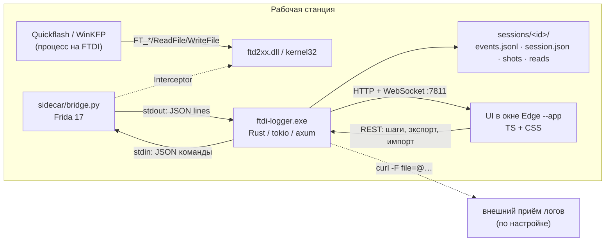

# Архитектура: FTDI/USB Logger (новый движок + интерфейс)

Документ фиксирует контракты между модулями. Менять его можно только вместе с кодом.

## 1. Что строим

Старый логер (`E:\Replica\work\orig-capture\logger.py`, Frida-агент `ftdi_capture_blocks.js`,
`winkfp.py`, `parse_family.py`) — консольный: шаг открывается через ввод строки в терминал,
сводка печатается в консоль, разбор — отдельным скриптом постфактум. Новый продукт:

* **`ftdi-logger.exe`** — постоянный локальный сервис (Rust). Держит устройства, процессы,
  захват, хранилище сессий, разбор и отчёты. Работает без консоли.
* **UI** (TypeScript + CSS, собирается в статику и вшивается в exe) — стационарный интерфейс:
  живой поток, таймлайн, разметка шагов кнопками/хоткеями, инспектор, галерея скриншотов,
  графики, экспорт/отправка, переразбор старых логов. Открывается в окне Edge в режиме
  `--app=` (хромeless), внешне — обычное десктоп-приложение.
* **Sidecar** (Python + Frida) — тонкий мост: прицепиться к процессу, загрузить JS-агент,
  гонять строки захвата в движок, принимать команды `pause/resume`. Вся логика разбора — в Rust.

Почему так: Frida-хуки уже проверены на живых блоках (BMS46/ME7.2/WinKFP) — их не переписываем;
Python нужен только потому, что `frida`-bindings зрелее всего в Python. Всё остальное — Rust,
чтобы поток шёл без потерь и тормозов консольного перерисовывания.

## 2. Компоненты и потоки данных



Поток одного события:

1. Frida-агент ловит вызов, формирует **каноническую текстовую строку** (как в старом логе).
2. `bridge.py` отправляет `{"type":"event","line":"[+70.537s] VCP TX WriteFile(COM6) n=4 : 12 04 0d 1b","wall":"…"}`.
3. Движок парсит строку `decode::parse_capture_line`, присваивает `seq`, пишет в `events.jsonl`
   (append + flush раз в 50 мс), кладёт в память кольцевой буфер и рассылает подписчикам WS батчами.
4. UI рисует строку в виртуализированном списке, обновляет счётчики шага и графики.

**Важно:** формат текстовых строк не меняем — он же используется для импорта старых логов и
для обратной совместимости с `parse_family.py`.

## 3. Модель данных

### 3.1 Event (одна запись потока)

```rust
pub struct Event {
    pub seq: u64,                  // монотонный номер в сессии
    pub t: f64,                    // секунды от якоря t0 (как "+70.537s")
    pub wall: String,              // RFC3339 UTC
    pub kind: EventKind,           // tx | rx | mark | step_start | step_end | file
                                   // | file_hash | sys | module | vcp | note | shot
                                   // | summary | error | raw
    pub transport: Transport,      // ftd2xx | vcp | file | app | none
    pub api: String,               // FT_Write, FT_Read, WriteFile, MARK, FILE …
    pub direction: Option<Direction>, // tx | rx
    pub len: u32,                  // длина полезной нагрузки в байтах
    pub hex: String,               // полная нагрузка, байты через пробел (может быть "")
    pub text: Option<String>,      // короткий предпросмотр/декод
    pub rc: Option<i32>,           // код возврата API, если есть
    pub step: Option<u32>,         // номер открытого шага на момент события
    pub raw: String,               // исходная строка; в JSONL только при kind=raw
    pub meta: serde_json::Value,   // расширения: com, handle, checksum, sgbd, job …
}
```

`EventKind` в JSON — `snake_case`. `step_start`/`step_end` несут `meta.title`, `meta.duration_ms`,
`meta.summary` (см. 3.3).

### 3.2 Session

```rust
pub struct SessionMeta {
    pub id: String,            // "20261109-120013-BMS46"
    pub started_at: String,    // RFC3339
    pub ended_at: Option<String>,
    pub label: String,         // имя блока/инструмента
    pub tool_path: Option<String>,
    pub tool_sha256: Option<String>,
    pub tool_version: Option<String>,
    pub pid: Option<u32>,
    pub process: Option<String>,
    pub transport: String,     // ftd2xx | vcp | mixed | import
    pub adapter: Option<AdapterInfo>,
    pub host: String,
    pub counts: SessionCounts, // events, tx, rx, tx_bytes, rx_bytes, steps, files, errors
    pub tags: Vec<String>,
    pub notes: Vec<Note>,
    pub status: String,        // recording | finished | imported | aborted
    pub engine_version: String,
    pub dir: String,           // абсолютный путь каталога сессии
}
```

### 3.3 Step (шаг) и его сводка

Шаг — пара событий `step_start` + `step_end` с общим `step` (1-based). Сводка считается
**на закрытии шага** движком (`decode::summarize_step`) и дублируется в:
* `meta.summary` события `step_end`;
* `steps/<NN>.json`;
* строки `# PHASE`/`# PHASE-JSON` в `raw.log`/`report.txt` (совместимость со старым форматом).

Формат сводки — надмножество старого `PHASE-JSON`:

```json
{"idx":1,"title":"читаю идентификаторы","dur":1.583,"exchanges":248,
 "tx_bytes":22026,"rx_bytes":25523,
 "cmd_hist":{"cmd=0x07":223,"READ(0x06)":12},
 "resp_hist":{"A0":247,"unparsed(12 0a)":1},
 "net_hist":{"TCP 45.132.18.119:80":21},"net_tx":0,"net_rx":21,
 "reads":[{"start":261472,"len":92,"blocks":2,"sha256":"…"}],
 "filehash":[{"path":"…","size":65536,"sha256":"…"}],
 "png":"shots/03-step-3.png",
 "winkfp_jobs":[{"sgbd":"bms46ds0","job":"ident","results":{…},"errors":[]}],
 "verdict":{"denied":0,"no_answer":3,"echo":true}}
```

### 3.4 Discovery-модели

```rust
pub struct FtdiDevice { pub index: u32, pub serial: String, pub description: String,
    pub flags: u32, pub dev_type: u32, pub vendor_id: u16, pub product_id: u16,
    pub com_port: Option<u32>, pub source: String /* d2xx | registry */ }

pub struct ToolProcess { pub pid: u32, pub name: String, pub exe: String,
    pub has_ftd2xx: bool, pub known_tool: Option<String>,
    pub started_at: Option<String>, pub window_title: Option<String> }
```

## 4. Хранилище

```
<root>/sessions/
  index.json                  — массив SessionMeta (атомарная перезапись)
  index.md                    — человекочитаемый индекс (совместимость)
  <session-id>/
    session.json              — SessionMeta
    state.json                — якорь t0: {t0_epoch,t0_wall,log,label,exe,proc,pid} (совместимость)
    events.jsonl              — канонические события, append-only
    raw.log                   — тот же поток в старом текстовом формате (+ MARK/PHASE)
    steps/<NN>.json           — сводки шагов
    shots/<NN>-step-NN.png    — скриншоты шага
    reads/<AAAAAA>-<RRRRRR>.bin — собранные чтения памяти (из READ-потоков)
    files/<sha256>-<name>     — зафиксированные файлы
    report.txt / report.md    — финальный разбор
    operations.json           — операции: клик → вызовы → сигналы → итог (docs/16)
    seedkeys.jsonl            — полные пары seed→key (чувствительно, docs/16 §5)
    scope/                    — кадры осциллографа и анализ сигналов (docs/14, docs/16)
      analysis.json           — события PWM/питания, покрытие, пропуски
    export/                   — то, что собрал пользователь
```

Правила:
* `raw.log` начинается баннером старого логера (`# capture start: label=…`, `# tool:`, `# exe: size/sha256`, `# wall(start)`, `# host`), шаги пишутся как `# MARK … START/END N: имя`, сводка — блоком `# PHASE …` и последней строкой `# PHASE-JSON {…}`, в конце сессии — `# totals: …`. Поэтому `raw.log` импортируется обратно и читается старым `parse_family.py`;
* `events.jsonl` пишется одной задачей-писателем (mpsc), батчами, `flush` не реже 50 мс;
* размер события ограничен 64 КиБ (длинные дампы режем, `meta.truncated=true`);
* при аварийном завершении сессия остаётся валидной: недостающие `step_end` восстанавливаются
  при следующем открытии (`store::repair`), в `session.json` ставится `status:"aborted"`;
* старые логи импортируются в ту же схему (`status:"imported"`, `transport:"import"`),
  исходный файл копируется в `import/<исходное-имя>`.

## 5. Протокол sidecar (Rust ↔ Python), JSON Lines

stdin/stdout, по одному JSON-объекту на строку, UTF-8, без BOM. Движок запускает:
`python -u sidecar/bridge.py` с `CREATE_NO_WINDOW`, рабочий каталог = корень репозитория.

**Движок → sidecar:**

```json
{"cmd":"attach","pid":1234,"script":"sidecar/agents/ftdi_capture.js","label":"BMS46"}
{"cmd":"hookctl","value":"pause"}          // pause | resume
{"cmd":"mark","action":"start","title":"нажал идентификаторы","ts":1234.5}
{"cmd":"mark","action":"end","ts":1240.0}
{"cmd":"note","text":"после цикла питания"}
{"cmd":"stop"}                             // грациозно: детач, bye, exit 0
```

**sidecar → движок:**

```json
{"type":"hello","bridge":"0.1.0","frida":"17.23.3","python":"3.12.4"}
{"type":"ready","pid":1234,"arch":"x64","modules":321,"script":"ftdi_capture.js"}
{"type":"event","line":"[+70.537s] VCP TX WriteFile(COM6) n=4 : 12 04 0d 1b","wall":"2026-11-09T12:00:13.123Z"}
{"type":"rpc","name":"hookctl","result":"paused"}
{"type":"log","level":"info","msg":"скрипт загружен"}
{"type":"error","fatal":true,"msg":"process not found"}
{"type":"bye","code":0,"events":1234}
```

Правила:
* `type:"event"` — единственный высокочастотный тип; строка `line` без перевода строки.
* sidecar завершает работу по `{"cmd":"stop"}`, по EOF на stdin или по смерти родителя.
* при фатальной ошибке — `{"type":"error","fatal":true}` и выход с кодом 2.
* Frida 17: `recv()` одноразовый → управление только через `rpc.exports` (уже так в старом агенте).
* если Python/Frida не найдены, движок работает в режиме «только разбор/импорт» и честно
  показывает это в UI (красный статус «мост недоступен»), а не падает.

## 6. HTTP/WebSocket API

База: `http://127.0.0.1:7811` (порт можно переопределить `--port`). Все ответы — JSON, кроме `report` (text) и `file` (бинарь). В коде роутера axum 0.7 параметры записаны как `:id`/`:seq`; в таблице — документарная запись `{id}`.
Статика UI отдаётся с `/` (вшита в бинарь через `include_dir`-подобную схему: см. `ui/dist`).

| Метод | Путь | Назначение |
|---|---|---|
| GET | `/api/health` | версия, аптайм, режим (мост доступен/нет), активная сессия |
| GET | `/api/devices` | список FTDI-шнурков (D2XX + реестр) |
| GET | `/api/tools` | процессы-кандидаты (с `ftd2xx.dll`, известные VCP-инструменты) |
| GET | `/api/tools/{pid}/detail` | exe, версия, sha256, окно, загруженные модули |
| POST | `/api/capture/attach` | `{pid, label?, adapter?}` → создаёт сессию, цепляется |
| POST | `/api/capture/detach` | остановить захват, закрыть сессию, отчёт |
| POST | `/api/capture/hookctl` | `{value:"pause"\|"resume"}` |
| GET | `/api/capture/status` | текущий захват: recording/bridge/hooks/target/counts/step |
| POST | `/api/sessions/{id}/step/start` | `{title}` → `step_start` |
| POST | `/api/sessions/{id}/step/end` | закрыть шаг + сводка + скриншот |
| POST | `/api/sessions/{id}/mark` | метка без шага `{title}` |
| POST | `/api/sessions/{id}/note` | заметка к сессии |
| POST | `/api/sessions/{id}/shot` | скриншот сейчас |
| POST | `/api/sessions/{id}/files` | снять хеши файлов по путям |
| GET | `/api/sessions` | список сессий (мета) |
| GET | `/api/sessions/{id}` | мета + шаги |
| GET | `/api/sessions/{id}/events` | страница потока: `from,to,limit` |
| GET | `/api/sessions/{id}/events/{seq}/decode` | KWP-разбор нагрузки события (инспектор) |
| GET | `/api/sessions/{id}/file/{*path}` | файл внутри каталога сессии (скриншоты, reads) |
| GET | `/api/sessions/{id}/events/{seq}/context` | окно ±N вокруг события |
| GET | `/api/sessions/{id}/steps/{n}` | сводка шага |
| GET | `/api/sessions/{id}/report?format=txt\|md` | отчёт как `text/plain` / `text/markdown` |
| GET | `/api/sessions/{id}/operations` | операции и сигналы стенда; старые сессии считаются на первом запросе (docs/16) |
| POST | `/api/sessions/{id}/reparse` | переразбор: сводки, `operations.json`, `scope/analysis.json`, отчёт |
| POST | `/api/sessions/{id}/export` | `{format:"zip"\|"jsonl"\|"csv"\|"md"}` → путь |
| POST | `/api/sessions/{id}/share` | `{url}` → `curl -F file=@zip` |
| POST | `/api/import` | `{path}` → импорт старого лога или ZIP-экспорта сессии, возвращает `{session_id}` |
| POST | `/api/import/upload?name=<имя>` | тело = сырые байты (браузер не отдаёт путь); `.zip` — экспорт сессии; → `{session_id}` |
| DELETE | `/api/sessions/{id}` | удалить сессию (с подтверждением на клиенте) |
| GET | `/ws` | WebSocket: подписка на живой поток |

**WebSocket.** Клиент после подключения отправляет
`{"op":"subscribe","session":"<id>","since":0}`; сервер шлёт:

```json
{"type":"hello","server_version":"0.1.0","active_session":"<id|null>"}
{"type":"batch","session":"<id>","events":[…],"counts":{…}}
{"type":"status","session":"<id|null>","target":{…},"hooks":"on|paused|off","recording":true}
{"type":"step","action":"start|end","step":{…}}
{"type":"toast","level":"warn|error|info","text":"…"}
```

Батчи ≤ 256 событий или 32 КиБ, отправка не чаще 20 раз/с (коалесценция). При отставании
клиента сервер рвёт подписку и UI догружает пропуск через `GET /events?from=`.

## 7. Интерфейс (стационарный)

Один экран, три колонки + транспортная панель. Тёмная «лабораторная» тема, моноширинный
шрифт для данных, плотная сетка, без декоративных градиентов.

```
┌──────────────────────────────────────────────────────────────────────────────┐
│  FTDI/USB LOGGER   ● мост: ок   ● шнурок: FT232R A1B2   ● цель: BMS46 (pid 1)│
├──────────────┬──────────────────────────────────────────┬────────────────────┤
│ СЕССИИ       │  ПОТОК                                  │ ИНСПЕКТОР          │
│  • текущая   │  фильтры: [TX][RX][MARK][FILE][SYS]  поиск│  шаг: 3 «запись»  │
│  • 16:25 BMS │  ── step 3: write tune ────────────────  │  длительность 333s │
│  • 15:41 ME72│  +70.537  TX  VCP WriteFile  n=4  12 04  │  TX 1204 / 61 200B │
│  • импорт…   │  +70.543  RX  VCP ReadFile   n=4  …      │  RX 61 800B        │
│              │  …                                        │  команды ▁▃▅▂      │
│  УСТРОЙСТВА  │  [панель виртуализированных строк]        │  чтения 0x8000…    │
│  • FT232R    │                                          │  [скриншот шага]   │
│  ПРОЦЕССЫ    │                                          │  [HEX/ASCII]       │
├──────────────┴──────────────────────────────────────────┴────────────────────┤
│ ТАЙМЛАЙН  ▁▂▃▅▇▅▃▂▁  [шаг1][шаг2][шаг3……]  ◀ ▶  масштаб  ● записи 1:23:44  │
│ [F2 ШАГ] [F5 МЕТКА] [F6 ПАУЗА ХУКОВ] [F8 СКРИНШОТ] [ESC СТОП]    [ЭКСПОРТ] │
└──────────────────────────────────────────────────────────────────────────────┘
```

Обязательные возможности:
* **Шаг одной клавишей.** `F2` открывает шаг с автоподставленным названием (из шаблона блока
  или последнего шага), повторный `F2` — закрывает и показывает сводку. Название можно
  отредактировать в инспекторе после закрытия (пишется в журнал правок).
* **Живые счётчики и графики** — TX/RX байт/с, гистограмма команд шага, полоса таймлайна.
* **Инспектор** — клик по событию: HEX/ASCII, декод KWP, «найти такие же», контекст ±20.
* **Скриншоты** — автоматически на закрытии шага (окно целевого процесса) и по `F8`;
  галерея с зумом.
* **Экспорт/отправка** — ZIP сессии, JSONL, CSV, Markdown-отчёт; копирование пути;
  отправка на сервер по настраиваемому URL; всё без консоли.
* **Импорт/переразбор** — перетаскивание старого `capture.log`/`logger.out` в окно.
* **Звук** — короткие сигналы старта/стопа шага (WebAudio, отключаемо).
* **Горячие клавиши** — F2/F5/F6/F8/Esc, Ctrl+F, Ctrl+E (экспорт), Ctrl+O (импорт).
* **Совместимость** — кнопка «открыть старый лог как текст», `raw.log` в формате старого логера.

## 8. Разбор (Rust `decode`)

* `parse_capture_line(&str) -> Option<Event>` — грамматика старого лога:
  `[+T s] VCP TX WriteFile(COM6) rc=0 n=4 ovl=0 : 12 04 0d 1b`,
  `[+T s] TX ftd2xx FT_Write rc=0 len=16 n=16 : …`,
  `[+T s] RX ftd2xx FT_Read rc=0 want=64 n=16 : …`,
  `[+T s] FILE open/write/close/hash …`,
  `[+T s] MODULE ± …`, `[+T s] VCP CreateFileW(COM6) …`, `[+T s] FT_*…`, `# MARK …`.
* Телеграммы: эхо-байт, `A0`-ответ, `7F svc nrc`, `READ 0xADDR +N`, одиночные RX-байты
  склеиваются в телеграмму (как в старом логере — «одиночные байты n=32»).
* Сводка шага: гистограммы команд/ответов, сборка потоков чтения (start/len/sha256),
  файлы и хеши, вердикт (denied/no_answer/echo).
* `ediabas` — разбор `api.trc` (job/sgbd/results/errors) и факты INI; используется, если
  сессия WinKFP/EDIABAS.
* Старый `parse_family.py` остаётся в `tools/` как эталон; `decode` обязан воспроизводить его
  ключевые выводы на реальных логах (проверка — тест на `reference/logs/`).

## 9. Потоки и производительность

* tokio runtime; отдельные задачи: writer, WS-broadcast, discovery (опрос 2 с), screenshot.
* Кольцевой буфер последних 200 000 событий в памяти (≈40 МБ) для мгновенной прокрутки;
  всё остальное — из jsonl с индексом смещений (`events.idx`, каждые 1000 строк) для seek.
* UI: виртуализированный список (окно 500 строк), батч-анимация через `requestAnimationFrame`,
  никакой перерисовки всего DOM; графики на canvas.
* Цель: 5 000 событий/с без потерь, открытие 100-мегабайтной сессии < 1 с (по индексу).

## 10. Границы работ и файлы

| Область | Файлы | Владелец |
|---|---|---|
| Движок: запуск, конфиг, discovery, процессы, скриншоты, Frida-мост | `engine/src/{main,config,discovery,procscan,screenshot,frida}.rs` | boba |
| Движок: модели, хранилище, разбор, API, отчёты, импорт | `engine/src/{models,store,decode,api,report,import,ediabas}.rs`, `engine/tests/` | ded-bekend |
| Sidecar: мост и JS-агент | `sidecar/**` | zhoporuk |
| UI: разметка, стили, логика | `ui/**` | lead |
| Скрипты сборки/запуска, упаковка, README | `scripts/**`, `README.md`, `docs/03-runbook.md` | zhoporuk |
| Разведка старого логера | `docs/01-original-contracts.md` | biba |


## 11. Универсальный захват: USB / COM / J2534

Цель: логер не привязан к Quickflash. Он цепляется к **любому** процессу и пишет обмен
с любым устройством, которое приложение использует: FTDI D2XX, виртуальный COM,
WinUSB/HID/libusb, J2534 PassThru (Scanmatik SM2/SM3, CHIPSOFT, Tactrix OpenPort, VXDIAG,
Bosch MDI, UCDS и т.д.).

### 11.1 Выбор цели

`ToolProcess` (см. §3.4) получает признаки: `has_ftd2xx`, `has_j2534`, `has_usb`,
`window_title`, `capabilities[] = ftd2xx|j2534|usb|window`, `modules_denied`, `arch`.
`GET /api/tools?mode=auto|usb|window|all`:
* `auto` — процессы с окном **или** USB/COM/J2534-модулями **или** известные инструменты;
* `usb` — только с признаками USB/FTDI/J2534 (без «пустых» окон);
* `window` — только процессы с видимым окном;
* `all` — все процессы пользователя (страховка: если драйвер не виден, цепляемся вручную).

`modules_denied=true` → UI показывает предупреждение «запустите логер от администратора».

### 11.2 USB-устройства и J2534-драйверы

* `GET /api/usb/devices` → `UsbDevice[]`: `id, vid, pid, serial, description, friendly_name,
  manufacturer, service, class_name, com_port, present, interfaces[], kind`
  (источник: SetupAPI `GUID_DEVINTERFACE_USB_DEVICE` + реестр `Enum\USB`, COM-порт из
  `Device Parameters\PortName`; `kind = ftdi|serial|hid|usb|composite`).
* `GET /api/j2534/drivers` → `J2534Driver[]`: `registry_key, name, vendor, dll, dll_present, version`
  (источник: `HKLM\SOFTWARE\WOW6432Node\PassThruSupport.04.04` и 64-битная ветка).
* `GET /api/health` дополняется `capabilities: EnvCapabilities`:
  `{process_scan, usb_enum, ftd2xx, j2534: <кол-во>, usbpcap, usbpcap_devices[]}`.

### 11.3 Грамматика новых строк захвата

Формат тот же — `[+<t>s] <текст>`; метка времени теперь берётся с QPC и несёт
**шесть** знаков после точки (`[+31.907431s]`), старые три знака читаются
по-прежнему. Полный контракт (кто пишет, кто читает, что обязано попасть в
`meta`) — [11-capture-grammar.md](11-capture-grammar.md); ниже — сводка.

```
[+1.200000s] J2534 open name="Scanmatik - SM2 USB" vendor="Scanmatik" dll="smj2534.dll" dev=1 rc=0 th=8120
[+1.250000s] J2534 connect-enter dev=1 proto=0x8003 flags=0x0 baud=500000 th=8120
[+1.307431s] J2534 connect dev=1 ch=1 proto=0x8003 flags=0x0 baud=500000 rc=0 gen=1 th=8120 dur=57431
[+2.100000s] J2534 call ch=1 call=1247 op=ReadMsgs n_in=10 n_out=3 rc=0 th=8120 dur=20134
[+2.101000s] J2534 RX ch=1 call=1247 i=1/3 n_in=10 n_out=1 th=8120 ts=0 rxs=0x0 proto=ISO15765 id=0x7E8 svc=0x50 len=8 dur=20134 rc=0 : 06 50 03 00 00 00 00 00
[+2.102000s] J2534 RX ch=1 call=1247 i=2/3 ts=0 rxs=0x2 proto=0x8003 sof=1 len=0
[+2.150000s] J2534 TX ch=1 call=1246 i=1/1 n_in=1 n_out=1 th=8120 ts=0 flags=0x0 proto=0x8003 svc=0x27 len=4 dur=812 rc=0 : 00 02 27 7f
[+2.200000s] J2534 rx-empty ch=1 n=10 timeout_ms=20 last_rc=0x11
[+2.210000s] J2534 tx-err-stat ch=1 n=5 last_rc=0x10
[+2.220000s] J2534 chan-miss ch=1 gen=2 first_op=filter th=8120
[+2.300000s] J2534 filter ch=1 call=90 type=0x0001 (PASS_FILTER) rc=0 th=8120 dur=410 mask=ffffffff pattern=000007e0 flow=- mask_proto=0x8003 mask_flags=0x0 pattern_proto=0x8003 pattern_flags=0x0 proto=ISO15765 flags=0x0 id=0x1
[+2.310000s] J2534 ioctl ch=1 call=88 id=0x0005 (FAST_INIT) rc=0 th=8120 dur=1520 in_proto=0x8003 in_rxs=0x0 in_flags=0x0 in_ts=0 in_edi=0 in_size=6 in=0002277f out_proto=0x8003 out_rxs=0x0 out_flags=0x0 out_ts=0 out_edi=0 out_size=3 out=0003677f34
[+2.320000s] J2534 version fw="FW:1060 HW:02 SN:A62122" dll="1.0.0.120" api="04.04" rc=0
[+2.400000s] J2534 voltage dev=1 pin=12 5000 mV rc=0
[+3.100000s] J2534 disconnect ch=1 rc=0
[+4.000000s] FILE read h=0xe10 off=0x1F0000 len=0x1000 total=0x400000
[+4.050000s] USB open path="\\?\hid#vid_046d&pid_c52b" kind=hid handle=0x2b4
[+4.100000s] USB close path="\\?\hid#vid_046d&pid_c52b" bytes=64 writes=3 reads=1
[+4.200000s] WINUSB TX pipe=0x01 len=8 : 12 04 0d 1b
[+4.300000s] HID TX report=0x02 len=9 : ...
[+4.400000s] LIBUSB TX ep=0x01 len=8 : ...
```

Ключи вызова J2534 (новые в 0.3.3):

| Ключ | Смысл |
|---|---|
| `call` | сквозной номер вызова `PassThru*` в сессии; связывает строку `call` с её сообщениями |
| `i` | индекс сообщения в пачке, `k/N` (`1/1` — одно сообщение) |
| `n_in` | сколько элементов запрошено на входе вызова |
| `n_out` | сколько вернул драйвер на выходе |
| `dur` (`duration`) | длительность вызова в **микросекундах** |
| `th` | id потока, в котором был вызов |
| `ts` | `Timestamp` из `PASSTHRU_MSG` — время драйвера, не время лога |
| `sof` | маркер начала сообщения (`START_OF_MESSAGE`) |

Когда сообщений нет, их несколько или вызов завершился ошибкой — пишется
отдельная строка `J2534 call` с общими полями (`call`, `op`, `n_in`, `n_out`,
`dur`, `th`), а на сообщениях остаются только `call` и `i`. Одно сообщение —
все общие поля прямо на строке `TX`/`RX`. Вход `connect` пишется до вызова
(`connect-enter`), исход — после; `gen` растёт только после успешного
`connect` и вместе с `pid | module_load_id | ch` образует ключ канала.
`chan-miss` фиксирует операцию, пришедшую на канал в неизвестной генерации.

Маппинг `transport`: `FT_*`→`ftd2xx`, `VCP`→`vcp`, `J2534`→`j2534`,
`USB/WINUSB/HID/LIBUSB`→`usb`, `LAN`→`lan` (§11.6).
`EventKind`: `tx`/`rx` для обмена, `usb` для open/close, `sys` для open/connect/disconnect.

Особенности J2534 (после разбора лога PCMflash):

* Хукаются **все** экспорты `PassThru*` (не фиксированный список): у вендоров разный
  набор, а пропущенная функция — дырка в логе (`PassThruConnect`, `PassThruStopMsgFilter`,
  `PassThruSetConfig`). Неизвестные пишутся generic-строкой
  `J2534 PassThruXxx args=[…] rc=…`.
* Вендорные протоколы (`proto=0x8003` у PCMflash/Scanmatik) не имеют CAN-id, зато
  несут 2-байтовый BE-префикс длины: агент находит сервисный байт и добавляет `svc=0xNN`.
  Payload при этом остаётся байт-в-байт.
* `RX … rxs=0x2 len=0` — это `RX_STATUS`/`START_OF_MESSAGE`, а не ответ. Такая строка
  пишется коротко, с `sof=1`, **без** секции `: hex`, в счётчик полезных сообщений не
  входит, иначе один ответ считался дважды. В режиме `compact` SOF построчно не
  пишется вовсе — только агрегат `rx-sof-stat ch=… n=…` и счётчик `rx_sof`.
* Ошибки `PassThruReadMsgs`/`WriteMsgs` пишутся строкой `J2534 rx-error|tx-error … rc=0x…`.
  Штатные `ERR_BUFFER_EMPTY 0x10` / `ERR_TIMEOUT 0x11` — это опрос, а не сбой: отдельными
  строками они **подавляются**, но не теряются — свёрнуты в `rx-empty`/`tx-err-stat`
  (`ch`, `n`, `timeout_ms`, `last_rc`, при наличии `call`) и учтены в `# counters`.
* `ioctl` пишет имя операции из таблицы `PT_IOCTL_NAMES` — `id=0x0005 (FAST_INIT)`, —
  и буферы целиком: `in=`/`out=` слитным hex. Для `FAST_INIT` это разложенные
  `PASSTHRU_MSG` (04.04), поэтому видны и заголовок (`in_proto`, `in_rxs`, `in_size`,
  `in_edi`), и `Data`. Для 05.00 и неизвестного `id` структура не декодируется:
  `in_ptr/out_ptr` и `dec=0`.
* `filter` пишет `type=0x0001 (PASS_FILTER)` вместе с `mask=`/`pattern=` слитным hex,
  `flow=-` при `pFlowControlMsg = NULL` и `proto`/`flags` из `pPatternMsg`.
* `FILE read` — короткая форма `h=… off=… len=… total=…` (не более 4096 строк на
  сессию, дальше только агрегат в `# counters`); старая форма
  `FILE read <path> offset=… n=… len=…` продолжает читаться.
* Служебные строки шапки: `# api:` (`api`, `dll`, `ver`, `path`, `pid`, `bits`,
  `dec`), `# hooks` (`mod`, `base`, `load`, `exports`, `attached`, `dup`, `failed`)
  и итоговый `# counters` (`dropped_events`, `truncated_payloads`, `decode_errors`,
  `rx_sof`, `calls`).
* ABI подтверждается до разбора структур: `PT_MSG_SIZE = 4152` (24 + `Data[4128]`)
  верен только для 04.04. Если DLL зарегистрирована лишь в ветке `PassThruSupport.05.00`
  либо версия не прочитана и DLL есть в обеих ветках, вызовы и сырые указатели
  по-прежнему регистрируются, но структура не декодируется — `dec=0`.
* Два режима сбора: `full` — каждый вызов, каждый элемент массива сообщений, SOF
  отдельной строкой; `compact` — пустые опросы агрегируются по `ch`, `rc`,
  `timeout`, SOF идёт в счётчик. Режим выбирается при старте агента и виден в
  баннере `# agent: … mode=…`.

### 11.4 Разбор

`decode::parse_capture_line` понимает новые префиксы; для J2534 кладёт в `meta`:
`{channel, protocol, can_id, flags, rxs, svc, svc_resp}` плюс поля вызова
`{call, i, n_in, n_out, dur, th, ts, sof}` (см. §11.3), и `text` вида `ISO15765 0x7E0`.
Ключ гистограммы шага — `{proto} {can_id} {cmd|resp} 0xNN {ServiceName}`; если сервис
не читается (многофреймовый ISO-TP), остаётся `{proto} {can_id}`.
Инспектор дополнительно декодирует CAN/ISOTP: длина кадра, PCI-тип (SF/FF/CF/FC),
service id для KWP/UDS. Для USB open/close `meta`: `{path, kind, device}`.

### 11.5 Сырой захват шины (USBPcap)

Если установлен USBPcap (драйвер + `USBPcapCMD.exe`), доступен режим «сырой USB»:
движок запускает `USBPcapCMD` на выбранном корневом хабе, разбирает pcap-поток
(USBPcap header + URB payload) и пишет события `kind=usb`, `transport=usb`,
`meta={urb_type, endpoint, transfer, bus, device, address}`. Требует прав администратора
и установленного драйвера; при отсутствии — UI показывает подсказку и режим недоступен.
Эта функция не заменяет хуки: она нужна для устройств, которые приложение открывает
через собственный драйвер (без WinUSB/HID/FTDI/J2534 API).

### 11.6 LAN: J2534-по-IP, DoIP, ICOM/HSFZ

Сетевые адаптеры и диагностика «по воздуху»: агент хукает Winsock (`ws2_32.dll`) —
`socket`, `connect`, `closesocket`, `send`/`recv`, `sendto`/`recvfrom`,
`WSASend`/`WSARecv`, `WSARecvFrom`, `WSAGetOverlappedResult`.

```
[+7.000s] LAN CONNECT tcp fd=0x1a4 local=192.168.1.5:50123 remote=192.168.1.10:13400 rc=0
[+7.050s] LAN TX tcp local=192.168.1.5:50123 remote=192.168.1.10:13400 len=16 : 02 fd 80 01 …
[+7.090s] LAN RX tcp local=192.168.1.5:50123 remote=192.168.1.10:13400 len=11 : 02 fd 80 01 …
[+7.400s] LAN TX udp local=192.168.1.5:50124 remote=192.168.1.255:13400 len=8 : 02 fd 00 01 …
[+7.500s] LAN CLOSE tcp fd=0x1a4 local=… remote=… bytes=27 reads=1 writes=1 rc=0
[+7.600s] LAN ERR tcp fd=0x1a4 op=WSARecv rc=-1 wsa=10054
```

* `meta` события: `{l4, local, remote, protocol}`; `protocol` — подсказка
  (`DoIP` по заголовку `02 FD` или порту 13400, `HSFZ` по 6801, `J2534-IP` по 7777/7778,
  иначе `TCP`/`UDP`).
* Блокирующий обмен пишется на выходе из вызова (там известно реальное число байт),
  overlapped — по `WSAGetOverlappedResult` либо подметанием `WSAOVERLAPPED.Internal`
  (клиенты на completion-routine, как .NET `Socket`).
* DoIP (ISO 13400-2) разбирается в инспекторе: тип сообщения, source/target address,
  UDS-сервис и NRC внутри `0x8001 diagnostic message`; в сводке шага — ключи
  `DoIP UDS cmd 0x22 ReadDataByIdentifier`.
* Ограничение: если приложение читает данные через overlapped-`WSARecv` с APC и вообще
  не вызывает `WSAGetOverlappedResult`, байты забирает подметание раз в 200 мс —
  граница кадра в этом случае определяется по следующему вызову, а не по завершению.

### 11.7 Слепые зоны драйверов и что с ними сделано

| Слепая зона | Симптом в живом логе | Решение |
|---|---|---|
| overlapped-`ReadFile` на USB-хендле | `USB close … bytes=0` при реальном трафике; 4 МБ чтения флеша PCMflash не попали в лог | `ovlEmit` отдаёт RX для `kind=usb`, `ovlSweep` добирает APC-завершения, `USB close` считает `reads` |
| крупный bulk-пакет > 16 КБ | хвост пакета молча терялся (`MAXDUMP` на строку) | `emitUsbTransfer` режет пакет на части `part=i/n` |
| `CreateFileA` поверх `CreateFileW` | одно открытие писало 2–3 строки `USB open`/`FILE open` | дедуп по (handle, path) |
| фиксированный список `PassThru*` | `J2534 connect` отсутствовал, хотя канал работал | обход всех экспортов `PassThru*` |

Остаётся известная зона: I/O через `ntdll!NtDeviceIoControlFile`/`NtReadFile` напрямую
(минуя kernel32) хуками не покрыт — для таких устройств используйте сырой USBPcap (§11.5).


### Скорости и тайминги в логе

| Транспорт | Что пишется | Формат строки |
|---|---|---|
| FTDI D2XX | смена baud, латентности, таймаутов, формата, flow control, bit mode | `FT_SetBaudRate(handle=…, 19200) rc=0`, `FT_SetLatencyTimer(handle=…, 16ms)`, `FT_SetTimeouts(handle=…, rd=800 wr=800)` |
| COM / VCP | `SetCommState`, `SetCommTimeouts`, `SetupComm`, `SetCommMask`, `EscapeCommFunction`; для порта, открытого до attach — снимок текущих DCB/таймаутов при первом I/O | `COM SetCommState(COM8) baud=19200 data=8 parity=NONE stop=1 flow=RTS_CTS rc=0`; `COM state(COM1) baud=9600 parity=EVEN …`; `COM timeouts(COM1) read_total_const=1000 …` |
| J2534 PassThru | SET_CONFIG: `DATA_RATE`, W1..W5, P1..P4, ISO15765_BS/STMIN и др. | `J2534 config ch=1 DATA_RATE=500000 W1=0 rc=0` |

У каждого события есть `t` (секунды от якоря) и `wall` (RFC3339) — по ним считаются интервалы
между посылками и моменты смены скорости. События имеют `kind:"sys"`, `api` = имя вызова,
`meta` = распарсенные параметры (`baud`, `data`, `parity`, `stop`, `flow`, `read_total_const`, …).
