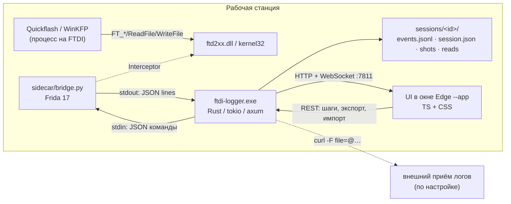

# Архитектура: FTDI/USB Logger (новый движок + интерфейс)

Документ фиксирует контракты между модулями. Менять его можно только вместе с кодом.

## 1. Что строим

Старый логер (`E:\Replica\work\orig-capture\logger.py`, Frida-агент `ftdi_capture_blocks.js`,
`winkfp.py`, `parse_family.py`) — консольный: шаг открывается через ввод строки в терминал,
сводка печатается в консоль, разбор — отдельным скриптом постфактум. Новый продукт:

* **`ftdi-logger.exe`** — постоянный локальный сервис (Rust). Держит устройства, процессы,
  захват, хранилище сессий, разбор и отчёты. Работает без консоли.
* **UI** (TypeScript + CSS, собирается в статику и вшивается в exe) — стационарный интерфейс:
  живой поток, таймлайн, разметка шагов кнопками/хоткеями, инспектор, галерея скриншотов,
  графики, экспорт/отправка, переразбор старых логов. Открывается в окне Edge в режиме
  `--app=` (хромeless), внешне — обычное десктоп-приложение.
* **Sidecar** (Python + Frida) — тонкий мост: прицепиться к процессу, загрузить JS-агент,
  гонять строки захвата в движок, принимать команды `pause/resume`. Вся логика разбора — в Rust.

Почему так: Frida-хуки уже проверены на живых блоках (BMS46/ME7.2/WinKFP) — их не переписываем;
Python нужен только потому, что `frida`-bindings зрелее всего в Python. Всё остальное — Rust,
чтобы поток шёл без потерь и тормозов консольного перерисовывания.

## 2. Компоненты и потоки данных



Поток одного события:

1. Frida-агент ловит вызов, формирует **каноническую текстовую строку** (как в старом логе).
2. `bridge.py` отправляет `{"type":"event","line":"[+70.537s] VCP TX WriteFile(COM6) n=4 : 12 04 0d 1b","wall":"…"}`.
3. Движок парсит строку `decode::parse_capture_line`, присваивает `seq`, пишет в `events.jsonl`
   (append + flush раз в 50 мс), кладёт в память кольцевой буфер и рассылает подписчикам WS батчами.
4. UI рисует строку в виртуализированном списке, обновляет счётчики шага и графики.

**Важно:** формат текстовых строк не меняем — он же используется для импорта старых логов и
для обратной совместимости с `parse_family.py`.

## 3. Модель данных

### 3.1 Event (одна запись потока)

```rust
pub struct Event {
    pub seq: u64,                  // монотонный номер в сессии
    pub t: f64,                    // секунды от якоря t0 (как "+70.537s")
    pub wall: String,              // RFC3339 UTC
    pub kind: EventKind,           // tx | rx | mark | step_start | step_end | file
                                   // | file_hash | sys | module | vcp | note | shot
                                   // | summary | error | raw
    pub transport: Transport,      // ftd2xx | vcp | file | app | none
    pub api: String,               // FT_Write, FT_Read, WriteFile, MARK, FILE …
    pub direction: Option<Direction>, // tx | rx
    pub len: u32,                  // длина полезной нагрузки в байтах
    pub hex: String,               // полная нагрузка, байты через пробел (может быть "")
    pub text: Option<String>,      // короткий предпросмотр/декод
    pub rc: Option<i32>,           // код возврата API, если есть
    pub step: Option<u32>,         // номер открытого шага на момент события
    pub raw: String,               // исходная строка (для экспорта/совместимости)
    pub meta: serde_json::Value,   // расширения: com, handle, checksum, sgbd, job …
}
```

`EventKind` в JSON — `snake_case`. `step_start`/`step_end` несут `meta.title`, `meta.duration_ms`,
`meta.summary` (см. 3.3).

### 3.2 Session

```rust
pub struct SessionMeta {
    pub id: String,            // "20261109-120013-BMS46"
    pub started_at: String,    // RFC3339
    pub ended_at: Option<String>,
    pub label: String,         // имя блока/инструмента
    pub tool_path: Option<String>,
    pub tool_sha256: Option<String>,
    pub tool_version: Option<String>,
    pub pid: Option<u32>,
    pub process: Option<String>,
    pub transport: String,     // ftd2xx | vcp | mixed | import
    pub adapter: Option<AdapterInfo>,
    pub host: String,
    pub counts: SessionCounts, // events, tx, rx, tx_bytes, rx_bytes, steps, files, errors
    pub tags: Vec<String>,
    pub notes: Vec<Note>,
    pub status: String,        // recording | finished | imported | aborted
    pub engine_version: String,
    pub dir: String,           // абсолютный путь каталога сессии
}
```

### 3.3 Step (шаг) и его сводка

Шаг — пара событий `step_start` + `step_end` с общим `step` (1-based). Сводка считается
**на закрытии шага** движком (`decode::summarize_step`) и дублируется в:
* `meta.summary` события `step_end`;
* `steps/<NN>.json`;
* строки `# PHASE`/`# PHASE-JSON` в `raw.log`/`report.txt` (совместимость со старым форматом).

Формат сводки — надмножество старого `PHASE-JSON`:

```json
{"idx":1,"title":"читаю идентификаторы","dur":1.583,"exchanges":248,
 "tx_bytes":22026,"rx_bytes":25523,
 "cmd_hist":{"cmd=0x07":223,"READ(0x06)":12},
 "resp_hist":{"A0":247,"unparsed(12 0a)":1},
 "reads":[{"start":261472,"len":92,"blocks":2,"sha256":"…"}],
 "filehash":[{"path":"…","size":65536,"sha256":"…"}],
 "png":"shots/03-step-3.png",
 "winkfp_jobs":[{"sgbd":"bms46ds0","job":"ident","results":{…},"errors":[]}],
 "verdict":{"denied":0,"no_answer":3,"echo":true}}
```

### 3.4 Discovery-модели

```rust
pub struct FtdiDevice { pub index: u32, pub serial: String, pub description: String,
    pub flags: u32, pub dev_type: u32, pub vendor_id: u16, pub product_id: u16,
    pub com_port: Option<u32>, pub source: String /* d2xx | registry */ }

pub struct ToolProcess { pub pid: u32, pub name: String, pub exe: String,
    pub has_ftd2xx: bool, pub known_tool: Option<String>,
    pub started_at: Option<String>, pub window_title: Option<String> }
```

## 4. Хранилище

```
<root>/sessions/
  index.json                  — массив SessionMeta (атомарная перезапись)
  index.md                    — человекочитаемый индекс (совместимость)
  <session-id>/
    session.json              — SessionMeta
    state.json                — якорь t0: {t0_epoch,t0_wall,log,label,exe,proc,pid} (совместимость)
    events.jsonl              — канонические события, append-only
    raw.log                   — тот же поток в старом текстовом формате (+ MARK/PHASE)
    steps/<NN>.json           — сводки шагов
    shots/<NN>-step-NN.png    — скриншоты шага
    reads/<AAAAAA>-<RRRRRR>.bin — собранные чтения памяти (из READ-потоков)
    files/<sha256>-<name>     — зафиксированные файлы
    report.txt / report.md    — финальный разбор
    export/                   — то, что собрал пользователь
```

Правила:
* `raw.log` начинается баннером старого логера (`# capture start: label=…`, `# tool:`, `# exe: size/sha256`, `# wall(start)`, `# host`), шаги пишутся как `# MARK … START/END N: имя`, сводка — блоком `# PHASE …` и последней строкой `# PHASE-JSON {…}`, в конце сессии — `# totals: …`. Поэтому `raw.log` импортируется обратно и читается старым `parse_family.py`;
* `events.jsonl` пишется одной задачей-писателем (mpsc), батчами, `flush` не реже 50 мс;
* размер события ограничен 64 КиБ (длинные дампы режем, `meta.truncated=true`);
* при аварийном завершении сессия остаётся валидной: недостающие `step_end` восстанавливаются
  при следующем открытии (`store::repair`), в `session.json` ставится `status:"aborted"`;
* старые логи импортируются в ту же схему (`status:"imported"`, `transport:"import"`),
  исходный файл копируется в `import/<исходное-имя>`.

## 5. Протокол sidecar (Rust ↔ Python), JSON Lines

stdin/stdout, по одному JSON-объекту на строку, UTF-8, без BOM. Движок запускает:
`python -u sidecar/bridge.py` с `CREATE_NO_WINDOW`, рабочий каталог = корень репозитория.

**Движок → sidecar:**

```json
{"cmd":"attach","pid":1234,"script":"sidecar/agents/ftdi_capture.js","label":"BMS46"}
{"cmd":"hookctl","value":"pause"}          // pause | resume
{"cmd":"mark","action":"start","title":"нажал идентификаторы","ts":1234.5}
{"cmd":"mark","action":"end","ts":1240.0}
{"cmd":"note","text":"после цикла питания"}
{"cmd":"stop"}                             // грациозно: детач, bye, exit 0
```

**sidecar → движок:**

```json
{"type":"hello","bridge":"0.1.0","frida":"17.23.3","python":"3.12.4"}
{"type":"ready","pid":1234,"arch":"x64","modules":321,"script":"ftdi_capture.js"}
{"type":"event","line":"[+70.537s] VCP TX WriteFile(COM6) n=4 : 12 04 0d 1b","wall":"2026-11-09T12:00:13.123Z"}
{"type":"rpc","name":"hookctl","result":"paused"}
{"type":"log","level":"info","msg":"скрипт загружен"}
{"type":"error","fatal":true,"msg":"process not found"}
{"type":"bye","code":0,"events":1234}
```

Правила:
* `type:"event"` — единственный высокочастотный тип; строка `line` без перевода строки.
* sidecar завершает работу по `{"cmd":"stop"}`, по EOF на stdin или по смерти родителя.
* при фатальной ошибке — `{"type":"error","fatal":true}` и выход с кодом 2.
* Frida 17: `recv()` одноразовый → управление только через `rpc.exports` (уже так в старом агенте).
* если Python/Frida не найдены, движок работает в режиме «только разбор/импорт» и честно
  показывает это в UI (красный статус «мост недоступен»), а не падает.

## 6. HTTP/WebSocket API

База: `http://127.0.0.1:7811` (порт можно переопределить `--port`). Все ответы — JSON, кроме `report` (text) и `file` (бинарь). В коде роутера axum 0.7 параметры записаны как `:id`/`:seq`; в таблице — документарная запись `{id}`.
Статика UI отдаётся с `/` (вшита в бинарь через `include_dir`-подобную схему: см. `ui/dist`).

| Метод | Путь | Назначение |
|---|---|---|
| GET | `/api/health` | версия, аптайм, режим (мост доступен/нет), активная сессия |
| GET | `/api/devices` | список FTDI-шнурков (D2XX + реестр) |
| GET | `/api/tools` | процессы-кандидаты (с `ftd2xx.dll`, известные VCP-инструменты) |
| GET | `/api/tools/{pid}/detail` | exe, версия, sha256, окно, загруженные модули |
| POST | `/api/capture/attach` | `{pid, label?, adapter?}` → создаёт сессию, цепляется |
| POST | `/api/capture/detach` | остановить захват, закрыть сессию, отчёт |
| POST | `/api/capture/hookctl` | `{value:"pause"\|"resume"}` |
| GET | `/api/capture/status` | текущий захват: recording/bridge/hooks/target/counts/step |
| POST | `/api/sessions/{id}/step/start` | `{title}` → `step_start` |
| POST | `/api/sessions/{id}/step/end` | закрыть шаг + сводка + скриншот |
| POST | `/api/sessions/{id}/mark` | метка без шага `{title}` |
| POST | `/api/sessions/{id}/note` | заметка к сессии |
| POST | `/api/sessions/{id}/shot` | скриншот сейчас |
| POST | `/api/sessions/{id}/files` | снять хеши файлов по путям |
| GET | `/api/sessions` | список сессий (мета) |
| GET | `/api/sessions/{id}` | мета + шаги |
| GET | `/api/sessions/{id}/events` | страница потока: `from,to,limit` |
| GET | `/api/sessions/{id}/events/{seq}/decode` | KWP-разбор нагрузки события (инспектор) |
| GET | `/api/sessions/{id}/file/{*path}` | файл внутри каталога сессии (скриншоты, reads) |
| GET | `/api/sessions/{id}/events/{seq}/context` | окно ±N вокруг события |
| GET | `/api/sessions/{id}/steps/{n}` | сводка шага |
| GET | `/api/sessions/{id}/report?format=txt\|md` | отчёт как `text/plain` / `text/markdown` |
| POST | `/api/sessions/{id}/reparse` | переразбор (пересобрать сводки/отчёт) |
| POST | `/api/sessions/{id}/export` | `{format:"zip"\|"jsonl"\|"csv"\|"md"}` → путь |
| POST | `/api/sessions/{id}/share` | `{url}` → `curl -F file=@zip` |
| POST | `/api/import` | `{path}` → импорт старого лога, возвращает `{session_id}` |
| POST | `/api/import/upload?name=<имя>` | тело = сырые байты лога (браузер не отдаёт путь); → `{session_id}` |
| DELETE | `/api/sessions/{id}` | удалить сессию (с подтверждением на клиенте) |
| GET | `/ws` | WebSocket: подписка на живой поток |

**WebSocket.** Клиент после подключения отправляет
`{"op":"subscribe","session":"<id>","since":0}`; сервер шлёт:

```json
{"type":"hello","server_version":"0.1.0","active_session":"<id|null>"}
{"type":"batch","session":"<id>","events":[…],"counts":{…}}
{"type":"status","session":"<id|null>","target":{…},"hooks":"on|paused|off","recording":true}
{"type":"step","action":"start|end","step":{…}}
{"type":"toast","level":"warn|error|info","text":"…"}
```

Батчи ≤ 256 событий или 32 КиБ, отправка не чаще 20 раз/с (коалесценция). При отставании
клиента сервер рвёт подписку и UI догружает пропуск через `GET /events?from=`.

## 7. Интерфейс (стационарный)

Один экран, три колонки + транспортная панель. Тёмная «лабораторная» тема, моноширинный
шрифт для данных, плотная сетка, без декоративных градиентов.

```
┌──────────────────────────────────────────────────────────────────────────────┐
│  FTDI/USB LOGGER   ● мост: ок   ● шнурок: FT232R A1B2   ● цель: BMS46 (pid 1)│
├──────────────┬──────────────────────────────────────────┬────────────────────┤
│ СЕССИИ       │  ПОТОК                                  │ ИНСПЕКТОР          │
│  • текущая   │  фильтры: [TX][RX][MARK][FILE][SYS]  поиск│  шаг: 3 «запись»  │
│  • 16:25 BMS │  ── step 3: write tune ────────────────  │  длительность 333s │
│  • 15:41 ME72│  +70.537  TX  VCP WriteFile  n=4  12 04  │  TX 1204 / 61 200B │
│  • импорт…   │  +70.543  RX  VCP ReadFile   n=4  …      │  RX 61 800B        │
│              │  …                                        │  команды ▁▃▅▂      │
│  УСТРОЙСТВА  │  [панель виртуализированных строк]        │  чтения 0x8000…    │
│  • FT232R    │                                          │  [скриншот шага]   │
│  ПРОЦЕССЫ    │                                          │  [HEX/ASCII]       │
├──────────────┴──────────────────────────────────────────┴────────────────────┤
│ ТАЙМЛАЙН  ▁▂▃▅▇▅▃▂▁  [шаг1][шаг2][шаг3……]  ◀ ▶  масштаб  ● записи 1:23:44  │
│ [F2 ШАГ] [F5 МЕТКА] [F6 ПАУЗА ХУКОВ] [F8 СКРИНШОТ] [ESC СТОП]    [ЭКСПОРТ] │
└──────────────────────────────────────────────────────────────────────────────┘
```

Обязательные возможности:
* **Шаг одной клавишей.** `F2` открывает шаг с автоподставленным названием (из шаблона блока
  или последнего шага), повторный `F2` — закрывает и показывает сводку. Название можно
  отредактировать в инспекторе после закрытия (пишется в журнал правок).
* **Живые счётчики и графики** — TX/RX байт/с, гистограмма команд шага, полоса таймлайна.
* **Инспектор** — клик по событию: HEX/ASCII, декод KWP, «найти такие же», контекст ±20.
* **Скриншоты** — автоматически на закрытии шага (окно целевого процесса) и по `F8`;
  галерея с зумом.
* **Экспорт/отправка** — ZIP сессии, JSONL, CSV, Markdown-отчёт; копирование пути;
  отправка на сервер по настраиваемому URL; всё без консоли.
* **Импорт/переразбор** — перетаскивание старого `capture.log`/`logger.out` в окно.
* **Звук** — короткие сигналы старта/стопа шага (WebAudio, отключаемо).
* **Горячие клавиши** — F2/F5/F6/F8/Esc, Ctrl+F, Ctrl+E (экспорт), Ctrl+O (импорт).
* **Совместимость** — кнопка «открыть старый лог как текст», `raw.log` в формате старого логера.

## 8. Разбор (Rust `decode`)

* `parse_capture_line(&str) -> Option<Event>` — грамматика старого лога:
  `[+T s] VCP TX WriteFile(COM6) rc=0 n=4 ovl=0 : 12 04 0d 1b`,
  `[+T s] TX ftd2xx FT_Write rc=0 len=16 n=16 : …`,
  `[+T s] RX ftd2xx FT_Read rc=0 want=64 n=16 : …`,
  `[+T s] FILE open/write/close/hash …`,
  `[+T s] MODULE ± …`, `[+T s] VCP CreateFileW(COM6) …`, `[+T s] FT_*…`, `# MARK …`.
* Телеграммы: эхо-байт, `A0`-ответ, `7F svc nrc`, `READ 0xADDR +N`, одиночные RX-байты
  склеиваются в телеграмму (как в старом логере — «одиночные байты n=32»).
* Сводка шага: гистограммы команд/ответов, сборка потоков чтения (start/len/sha256),
  файлы и хеши, вердикт (denied/no_answer/echo).
* `ediabas` — разбор `api.trc` (job/sgbd/results/errors) и факты INI; используется, если
  сессия WinKFP/EDIABAS.
* Старый `parse_family.py` остаётся в `tools/` как эталон; `decode` обязан воспроизводить его
  ключевые выводы на реальных логах (проверка — тест на `reference/logs/`).

## 9. Потоки и производительность

* tokio runtime; отдельные задачи: writer, WS-broadcast, discovery (опрос 2 с), screenshot.
* Кольцевой буфер последних 200 000 событий в памяти (≈40 МБ) для мгновенной прокрутки;
  всё остальное — из jsonl с индексом смещений (`events.idx`, каждые 1000 строк) для seek.
* UI: виртуализированный список (окно 500 строк), батч-анимация через `requestAnimationFrame`,
  никакой перерисовки всего DOM; графики на canvas.
* Цель: 5 000 событий/с без потерь, открытие 100-мегабайтной сессии < 1 с (по индексу).

## 10. Границы работ и файлы

| Область | Файлы | Владелец |
|---|---|---|
| Движок: запуск, конфиг, discovery, процессы, скриншоты, Frida-мост | `engine/src/{main,config,discovery,procscan,screenshot,frida}.rs` | boba |
| Движок: модели, хранилище, разбор, API, отчёты, импорт | `engine/src/{models,store,decode,api,report,import,ediabas}.rs`, `engine/tests/` | ded-bekend |
| Sidecar: мост и JS-агент | `sidecar/**` | zhoporuk |
| UI: разметка, стили, логика | `ui/**` | lead |
| Скрипты сборки/запуска, упаковка, README | `scripts/**`, `README.md`, `docs/03-runbook.md` | zhoporuk |
| Разведка старого логера | `docs/01-original-contracts.md` | biba |


## 11. Универсальный захват: USB / COM / J2534

Цель: логер не привязан к Quickflash. Он цепляется к **любому** процессу и пишет обмен
с любым устройством, которое приложение использует: FTDI D2XX, виртуальный COM,
WinUSB/HID/libusb, J2534 PassThru (Scanmatik SM2/SM3, CHIPSOFT, Tactrix OpenPort, VXDIAG,
Bosch MDI, UCDS и т.д.).

### 11.1 Выбор цели

`ToolProcess` (см. §3.4) получает признаки: `has_ftd2xx`, `has_j2534`, `has_usb`,
`window_title`, `capabilities[] = ftd2xx|j2534|usb|window`, `modules_denied`, `arch`.
`GET /api/tools?mode=auto|usb|window|all`:
* `auto` — процессы с окном **или** USB/COM/J2534-модулями **или** известные инструменты;
* `usb` — только с признаками USB/FTDI/J2534 (без «пустых» окон);
* `window` — только процессы с видимым окном;
* `all` — все процессы пользователя (страховка: если драйвер не виден, цепляемся вручную).

`modules_denied=true` → UI показывает предупреждение «запустите логер от администратора».

### 11.2 USB-устройства и J2534-драйверы

* `GET /api/usb/devices` → `UsbDevice[]`: `id, vid, pid, serial, description, friendly_name,
  manufacturer, service, class_name, com_port, present, interfaces[], kind`
  (источник: SetupAPI `GUID_DEVINTERFACE_USB_DEVICE` + реестр `Enum\USB`, COM-порт из
  `Device Parameters\PortName`; `kind = ftdi|serial|hid|usb|composite`).
* `GET /api/j2534/drivers` → `J2534Driver[]`: `registry_key, name, vendor, dll, dll_present, version`
  (источник: `HKLM\SOFTWARE\WOW6432Node\PassThruSupport.04.04` и 64-битная ветка).
* `GET /api/health` дополняется `capabilities: EnvCapabilities`:
  `{process_scan, usb_enum, ftd2xx, j2534: <кол-во>, usbpcap, usbpcap_devices[]}`.

### 11.3 Грамматика новых строк захвата

Формат тот же — `[+<t>s] <текст>` (совместим со старым логом), новые префиксы:

```
[+1.234s] J2534 open name="Scanmatik - SM2 USB" vendor="Scanmatik" dll="smj2534.dll" rc=0
[+1.300s] J2534 connect dev=1 ch=1 proto=ISO15765 flags=0x0 baud=500000 rc=0
[+2.100s] J2534 TX ch=1 proto=ISO15765 id=0x7E0 flags=0x0 len=8 : 02 10 03 00 00 00 00 00
[+2.150s] J2534 RX ch=1 proto=ISO15765 id=0x7E8 rxs=0x0 len=8 : 06 50 03 00 00 00 00 00
[+3.000s] J2534 ioctl ch=1 id=0x0701 rc=0
[+3.100s] J2534 disconnect ch=1 rc=0
[+4.000s] USB open path="\\?\hid#vid_046d&pid_c52b" kind=hid handle=0x2b4
[+4.100s] USB close path="\\?\hid#vid_046d&pid_c52b" bytes=64 writes=3
[+4.200s] WINUSB TX pipe=0x01 len=8 : 12 04 0d 1b
[+4.250s] WINUSB RX pipe=0x81 len=64 : ...
[+4.300s] HID TX report=0x02 len=9 : ...
[+4.350s] HID RX report=0x01 len=9 : ...
[+4.400s] LIBUSB TX ep=0x01 len=8 : ...
[+4.450s] LIBUSB RX ep=0x81 len=8 : ...
```

Маппинг `transport`: `FT_*`→`ftd2xx`, `VCP`→`vcp`, `J2534`→`j2534`, `USB/WINUSB/HID/LIBUSB`→`usb`.
`EventKind`: `tx`/`rx` для обмена, `usb` для open/close, `sys` для open/connect/disconnect.

### 11.4 Разбор

`decode::parse_capture_line` понимает новые префиксы; для J2534 кладёт в `meta`:
`{channel, protocol, can_id, flags, rxs}` и `text` вида `ISO15765 0x7E0: 02 10 03`.
Инспектор дополнительно декодирует CAN/ISOTP: длина кадра, PCI-тип (SF/FF/CF/FC),
service id для KWP/UDS. Для USB open/close `meta`: `{path, kind, device}`.

### 11.5 Сырой захват шины (USBPcap)

Если установлен USBPcap (драйвер + `USBPcapCMD.exe`), доступен режим «сырой USB»:
движок запускает `USBPcapCMD` на выбранном корневом хабе, разбирает pcap-поток
(USBPcap header + URB payload) и пишет события `kind=usb`, `transport=usb`,
`meta={urb_type, endpoint, transfer, bus, device, address}`. Требует прав администратора
и установленного драйвера; при отсутствии — UI показывает подсказку и режим недоступен.
Эта функция не заменяет хуки: она нужна для устройств, которые приложение открывает
через собственный драйвер (без WinUSB/HID/FTDI/J2534 API).

