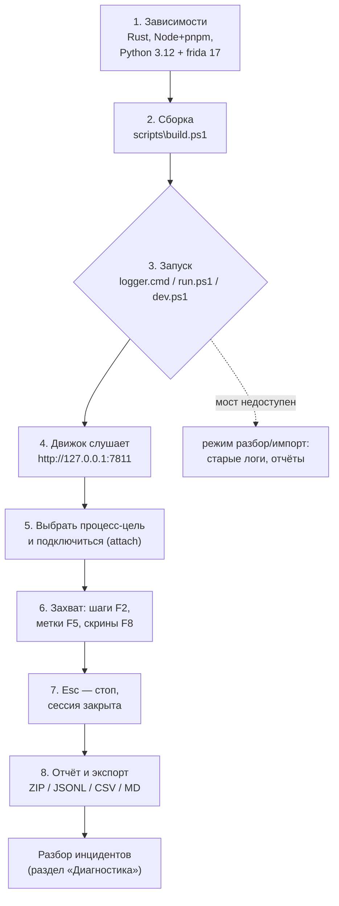
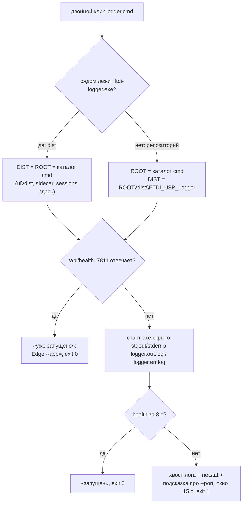
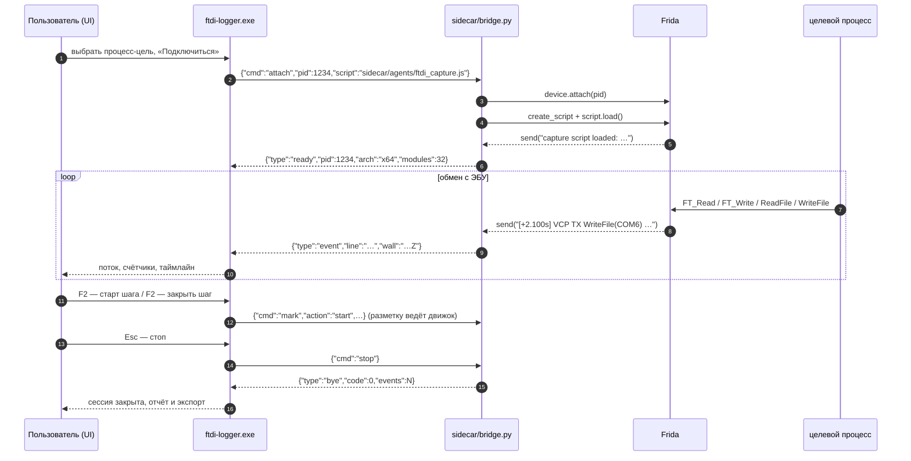
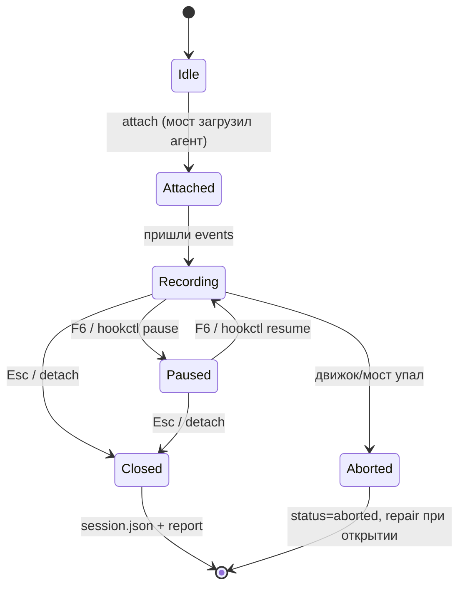

# Runbook: установка, запуск и эксплуатация FTDI/USB Logger

Пошаговое руководство для рабочей станции с FTDI-шнурком: как поставить зависимости, собрать,
запустить, подключиться к блоку, снять сессию и что делать, когда что-то не работает.
Контракты компонентов — в [02-architecture.md](02-architecture.md) и [04-interfaces.md](04-interfaces.md).

## Карта эксплуатации



## 1. Зависимости

| Что | Проверка | Установка |
|---|---|---|
| Windows 10/11 x64 | `[Environment]::OSVersion.Version` | — |
| Rust / cargo | `cargo --version` | <https://rustup.rs> (`rustup-init.exe`, потом перезапустить терминал) |
| Node.js 20+ | `node --version` | `winget install OpenJS.NodeJS.LTS` |
| pnpm | `pnpm --version` | `npm install -g pnpm` |
| Python 3.12 | `py -3.12 --version` | <https://www.python.org/downloads/> |
| frida 17 | `python -c "import frida; print(frida.__version__)"` | `...\Python312\python.exe -m pip install -r sidecar\requirements.txt` |
| Драйвер FTDI | Диспетчер устройств → «Порты (COM и LPT)» / USB | с сайта FTDI: D2XX и/или VCP |
| Права администратора | нужны для WinKFP/EDIABAS | запуск логера «от имени администратора» |

> `build.ps1` сам находит `python.exe` (сначала `Python312` в `%LOCALAPPDATA%`, затем 313/311 и
> `python.exe` из PATH) и предупреждает, если в нём нет `frida`. Движок при старте выбирает
> `python.exe` по тому же правилу; переопределить можно флагом `--python`.

## 2. Сборка

```powershell
# полная: UI + движок + упаковка dist\FTDI_USB_Logger\
powershell -ExecutionPolicy Bypass -File scripts\build.ps1

# только движок, без UI (пока UI не готов или не нужен)
powershell -ExecutionPolicy Bypass -File scripts\build.ps1 -SkipUi

# пересборка без повторного pnpm install
powershell -ExecutionPolicy Bypass -File scripts\build.ps1 -SkipInstall
```

| Флаг | Что делает |
|---|---|
| `-SkipUi` | не ставить/не собирать UI; если есть старый `ui\dist` — копирует его с предупреждением |
| `-SkipInstall` | пропустить `pnpm -C ui install` (использовать текущие `ui\node_modules`) |

Что делает скрипт по шагам: проверяет исходники → `pnpm -C ui install` → `pnpm -C ui build`
(ищет `ui\dist\index.html`) → `cargo build --release` → чистит и собирает
`dist\FTDI_USB_Logger\` (`ftdi-logger.exe`, `ui\dist`, `sidecar\`, `sessions\`, `logger.cmd`).

Успешный хвост вывода выглядит так:

```
==> Движок: cargo build --release
    Finished `release` profile [optimized] target(s) in 42.97s
==> Проверяю python + frida для моста
python:  C:\Users\User\AppData\Local\Programs\Python\Python312\python.exe
frida:   17.23.3
==> Собираю dist
  + ftdi-logger.exe
  + ui\dist
  + sidecar\
  + logger.cmd
==> Готово
каталог: D:\FTDI_USB_Logger\dist\FTDI_USB_Logger  (6.1 МБ)
```

Размер dist зависит от релизной сборки: на приёмке 09.11.2026 было **6 268 130 Б (5,98 МиБ)**,
`ftdi-logger.exe` — 6 107 648 Б. Цифра в выводе `build.ps1` — фактическая для текущей сборки.

Частые ошибки сборки:

| Сообщение | Причина | Решение |
|---|---|---|
| `UI не готов: нет ui\package.json` | UI ещё не написан/не склонирован | `-SkipUi` или дождаться UI-части |
| `pnpm не найден в PATH` | нет pnpm | `npm install -g pnpm`, новый терминал |
| `cargo не найден в PATH` | нет Rust | <https://rustup.rs>, новый терминал |
| `pnpm -C ui build` с кодом ≠0 | ошибка TypeScript/vite | смотреть вывод сборки UI, чинить в `ui/` |
| `нет frida` (предупреждение) | frida не в выбранном python | `python.exe -m pip install -r sidecar\requirements.txt` |

## 3. Запуск

| Способ | Команда | Когда |
|---|---|---|
| как продукт (без консоли) | двойной клик `logger.cmd` (в корне или в `dist\FTDI_USB_Logger\`) | ежедневная работа, ярлык на рабочем столе |
| из репозитория | `powershell -ExecutionPolicy Bypass -File scripts\run.ps1` | нужен видимый лог движка; dist или release-бинарь |
| порт/опции | `scripts\run.ps1 -Port 7812 -NoOpen` | порт 7811 занят, не открывать окно |
| разработка | `powershell -ExecutionPolicy Bypass -File scripts\dev.ps1` | движок `cargo run` + `vite dev` для UI |

`logger.cmd` — один и тот же файл в обеих раскладках, он сам определяет, где лежит продукт:



Поведение launcher'а:

* в `dist` `--root` = каталог продукта, exe найден рядом с `logger.cmd`; в репозитории exe берётся
  из `dist\FTDI_USB_Logger\`;
* **повторный запуск** при работающем экземпляре не плодит процессы: печатает «уже запущено»,
  открывает окно через `msedge --app=http://127.0.0.1:7811/` и выходит 0;
* stdout/stderr движка пишутся в `logger.out.log` / `logger.err.log` рядом с exe — если движок
  не поднялся, в консоль выводятся хвосты логов, `netstat -ano` по порту и подсказка, как сменить
  порт; консоль держится 15 с, код выхода 1;
* если `dist` не собран — подсказка `scripts\build.ps1` (`-SkipUi`) и 12 с;
* для отладки: `FTDI_LOGGER_PORT` (другой порт) и `FTDI_LOGGER_NO_OPEN=1` (не открывать окно).

`run.ps1` при отсутствии dist берёт `engine\target\release\ftdi-logger.exe` и работает от корня
репозитория.

Флаги движка (см. `engine/src/config.rs`):

| Флаг | Смысл |
|---|---|
| `--root <dir>` | корень установки (где `ui/`, `sidecar/`, `sessions/`); по умолчанию ищется вверх от exe/cwd |
| `--port <u16>` | порт HTTP/WS, по умолчанию `7811` |
| `--no-open` | не открывать окно Edge при старте |
| `--python <exe>` | конкретный `python.exe` с frida |
| `--sidecar <path>` | путь к `sidecar/bridge.py` |
| `--script <path>` | путь к `sidecar/agents/ftdi_capture.js` |
| `--log-level <lvl>` | `error|warn|info|debug|trace` |
| `--no-bridge` | работать без моста: разбор/импорт, без захвата |

## 4. Захват сессии



Жизненный цикл сессии:



### Горячие клавиши

| Клавиша | Действие |
|---|---|
| `F2` | открыть/закрыть шаг (название — из шаблона блока или последнего шага) |
| `F5` | метка в потоке (MARK) |
| `F6` | пауза/возобновление хуков (`hookctl pause` / `resume`) |
| `F8` | скриншот окна цели сейчас |
| `Esc` | остановить захват и закрыть сессию |
| `Ctrl+F` | поиск по потоку (фильтры TX/RX/MARK/FILE/SYS) |
| `Ctrl+E` | экспорт: ZIP / JSONL / CSV / Markdown |
| `Ctrl+O` | импорт старого лога (`capture.log` / `logger.out`) |

## 5. Мост (sidecar) — проверка без устройства

Мост можно проверить, не подключая FTDI и не запуская Quickflash:

```powershell
python sidecar\bridge.py --self-test
```

Ожидаемо: 23 JSON-строки — `hello`, `ready`, 20 `event` и `bye`, код выхода 0:

```json
{"type":"hello","bridge":"0.1.0","frida":"17.23.3","python":"3.12.4"}
{"type":"ready","pid":4321,"arch":"x64","modules":31,"script":"ftdi_capture.js"}
{"type":"event","line":"[+0.100s] TX ftd2xx FT_Write rc=0 len=4 n=4 : 12 04 0d 1b","wall":"2026-11-09T07:13:22.063Z"}
…
{"type":"bye","code":0,"events":20}
```

Строки `event.line` — валидная грамматика старого лога (TX/RX/VCP/FILE/MARK), поэтому тот же
self-test прогоняется старым парсером и не должен давать ошибок разбора:

```powershell
python tools\legacy\parse_family.py --log <лог-из-self-test> --no-dump --no-reads
# в отчёте: СЕССИЯ … обменов=2 mark=1 файлов=2 ошибок=0
```

Проверка настоящей Frida без устройства (attach к любому своему процессу) описана в
[sidecar/README.md](../sidecar/README.md): там же таблица команд/ответов и коды ошибок.

## 6. Экспорт, импорт, перенос старых данных

```powershell
# импорт старого лога через CLI-подобный вызов API (движок запущен)
curl.exe -s -X POST http://127.0.0.1:7811/api/import -H "Content-Type: application/json" `
  -d '{"path":"E:\\Replica\\work\\orig-capture\\capture-live.log"}'
```

| Задача | Действие |
|---|---|
| импорт старого лога | UI: `Ctrl+O` или перетащить файл; API `POST /api/import` |
| переразбор сессии | API `POST /api/sessions/{id}/reparse` (после правки названий шагов) |
| экспорт | UI: `Ctrl+E`; API `POST /api/sessions/{id}/export {"format":"zip"}` |
| старые логи как референс | положить в `reference/logs/` (в git не попадают) |
| эталонные скрипты старого логера | `tools/legacy/` — только чтение/сверка |

Файлы сессии (что где искать при разборе):

| Путь | Содержимое |
|---|---|
| `sessions/<id>/session.json` | мета: инструмент, pid, транспорт, счётчики, заметки |
| `sessions/<id>/events.jsonl` | канонические события (основа для переразбора) |
| `sessions/<id>/raw.log` | тот же поток в старом текстовом формате + `# MARK` / `# PHASE` |
| `sessions/<id>/steps/NN.json` | сводки шагов (гистограммы, чтения, файлы, вердикт) |
| `sessions/<id>/shots/` | скриншоты шагов |
| `sessions/<id>/report.txt` / `.md` | финальный отчёт |

## 7. Диагностика

### Порт 7811 занят

```powershell
netstat -ano | findstr :7811
taskkill /PID <PID> /F          # если это зависший старый ftdi-logger.exe
powershell -ExecutionPolicy Bypass -File scripts\run.ps1 -Port 7812
```

В движке ошибка выглядит как `не удалось занять порт 7811`; при запуске через `logger.cmd`
пользователь видит её без консоли: launcher показывает хвост `dist\FTDI_USB_Logger\logger.err.log`,
кто слушает порт (`netstat -ano`), подсказку про `--port` и держит окно 15 с.

Повторный двойной клик при работающем продукте — это не ошибка: launcher отвечает «уже запущено»
и открывает окно существующего экземпляра (exit 0). UI с другим портом открывается по адресу
`http://127.0.0.1:<порт>/`.

### Мост недоступен (UI: красный статус)

Проверять по порядку:

1. `python -c "import frida; print(frida.__version__)"` — если ошибка, поставить
   `python.exe -m pip install -r sidecar\requirements.txt`.
2. `python sidecar\bridge.py --self-test` — должен дать 23 строки и код 0.
3. Тот ли python у движка: `ftdi-logger.exe --python "C:\...\Python312\python.exe"`.
   Движок по умолчанию ищет `Python312` в `%LOCALAPPDATA%`, затем 313/311, затем PATH.
4. Запущен ли `sidecar\bridge.py` вообще: в `dist\FTDI_USB_Logger\sidecar\` он должен быть.
5. Если ничего не помогает — работайте в режиме разбор/импорт (`--no-bridge`): захват недоступен,
   но старые логи, отчёты и экспорт работают.

| Сообщение моста | Причина | Решение |
|---|---|---|
| `frida не установлена` | frida нет в выбранном python | pip install в правильный python |
| `attach pid=… ProcessNotFound` | процесс закрылся/не тот pid | обновить список процессов в UI |
| `attach pid=… PermissionDenied` | цель под администратором | запустить логер от администратора |
| `hookctl: мост не подключён` | pause/resume до attach | сначала подключиться |
| `неизвестная команда` | движок новее моста | обновить `sidecar/bridge.py` из репозитория |

### Устройство не видно

| Проверка | Ожидаемо |
|---|---|
| Диспетчер устройств → «Порты (COM и LPT)» / USB | есть FT232R (VCP) или устройство FTDI |
| `Get-PnpDevice -Class Ports \| Format-Table` | виден COM-порт шнурка |
| В потоке захвата после attach | `MODULE + FTD2XX.DLL`, `FT_CreateDeviceInfoList rc=0 devices=…`, `FT_GetDeviceInfoDetail … serial="…"` |
| `FT_CreateDeviceInfoList rc=0 devices=0` | D2XX не видит устройство: другой шнурок/драйвер/порт |
| нет ни одной `FT_*`-строки | процесс не грузит `ftd2xx.dll` или открыл порт до attach |

Важно: если цель открыла шнурок **до** attach, успешные `FT_Open`/`FT_GetDeviceInfo` в лог не
попадут — видно только последующие чтения/записи. Подключайтесь к процессу до старта операции
или сразу после запуска инструмента (агент сам ждёт загрузки `ftd2xx.dll` через module observer).

### WinKFP / EDIABAS не логируется

* Запускайте логер **от имени администратора** — иначе Frida получит `PermissionDenied` на
  процесс, поднятый с повышенными правами.
* WinKFP/EDIABAS ходят через VCP (`CreateFileA("COM6")`, `ReadFile/WriteFile` с overlapped-I/O):
  в логе будут `VCP CreateFileW/…`, `VCP TX/RX … ovl=1`.
* Если обмен идёт, а строк нет — проверьте `F6` (хуки не на паузе) и что attach выполнен
  именно к тому процессу (в UI видно pid и имя).

### Прочее

| Симптом | Решение |
|---|---|
| двойной клик по `logger.cmd` — подсказка вместо запуска | `dist` не собран: `scripts\build.ps1` (или `-SkipUi`) |
| второй двойной клик «ничего не делает» | это штатно: launcher пишет «уже запущено» и открывает окно существующего экземпляра |
| продукт не поднялся, окно закрывается | launcher 15 с держит хвост `logger.out.log`/`logger.err.log`; дальше — раздел «Порт 7811 занят» |
| окно Edge не открылось | открыть вручную `http://127.0.0.1:7811/`; проверить `--no-open` |
| сыпятся `<read-error Error: access violation …>` | штатно: агент не смог прочитать чужой буфер, событие помечено, захват продолжается |
| сессия оборвалась | откройте её снова: движок восстановит недостающие `step_end`, `status:"aborted"` |

## 8. Проверки после изменений

```powershell
# 1. мост и формат строк (без устройства)
python sidecar\bridge.py --self-test

# 2. сборка без UI до конца (наличие Rust)
powershell -ExecutionPolicy Bypass -File scripts\build.ps1 -SkipUi

# 3. движок собирается в release
cargo build --release --manifest-path engine\Cargo.toml
```

- [ ] `--self-test` даёт 23 JSON-строки, `hello`/`ready`/20 `event`/`bye`
- [ ] `build.ps1 -SkipUi` завершается кодом 0 и создаёт `dist\FTDI_USB_Logger\`
- [ ] `cargo build --release` без ошибок
- [ ] изменённые документы/контракты согласованы с `docs/02-architecture.md`
## Замена шнурка/адаптера на ходу

1. Нажать **«НОВАЯ СЕССИЯ»** в шапке (`Ctrl+Alt+N`).
2. Если шла запись — подтвердить завершение: сессия сохранится, capture остановится.
3. Откроется окно выбора: список FTDI-адаптеров (serial/COM) и процессов (режим auto) уже
   пересканирован. Выбрать новый адаптер и/или программу, нажать «начать сессию».
4. Если нужного устройства/программы нет — переключить фильтр в панели «ПРОГРАММЫ» на
   «все»/«окна» или ввести PID вручную; для диагностики: `GET /api/session/new` возвращает
   актуальные `devices`, `usb_devices`, `j2534_drivers`, `tools`.
