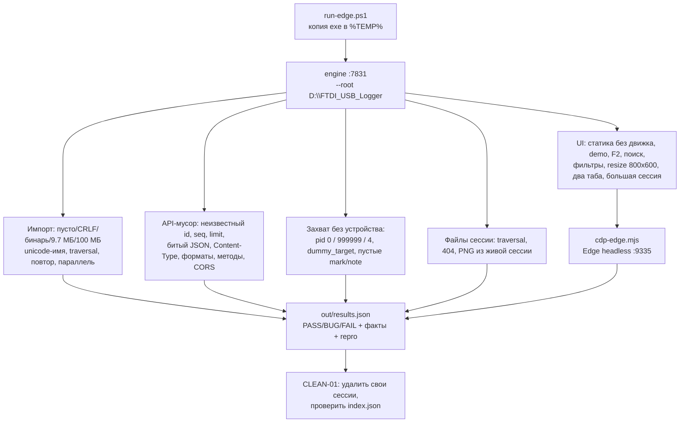
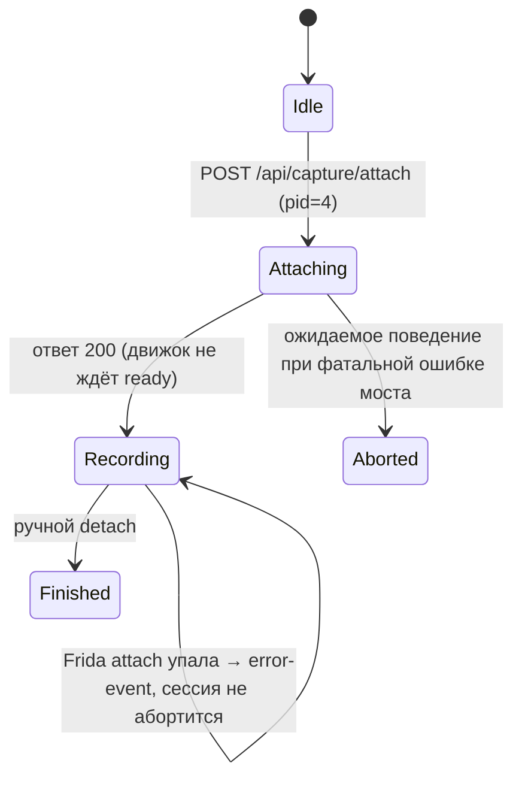

# 05. Крайние случаи: edge-тесты движка и UI

Жёсткая проверка крайних случаев FTDI/USB Logger: импорт мусора и больших логов, мусорные
запросы API, захват без устройства, файлы сессии, длинный поток и UI без движка.
В `engine/src`, `ui/src`, `sidecar` ничего не менялось — только тесты (`tests/e2e/edge/`) и этот отчёт.

> **Итог: 70 кейсов, 61 PASS, 9 BUG-строк (7 разных дефектов: 3 важных, 4 мелочи), 0 FAIL.**
> Блокеров на финальной сборке нет: единственный блокер (id-траверсал в `session_file`) был найден
> в первой версии, исправлен Lead'ом и перепроверен — PASS.

| Параметр | Значение |
|---|---|
| Дата прогона | 2026-11-09 13:27 |
| Движок | `engine\target\debug\ftdi-logger.exe`, сборка 2026-11-09 13:17:21 (debug) |
| Порт движка | 7831 (изолированно от рабочих экземпляров) |
| UI | `ui/dist`, статика на `python http.server` :8101, CDP :9335, Edge headless |
| Запуск | `pwsh -File tests\e2e\edge\run-edge.ps1` |
| Результат | `tests/e2e/edge/out/results.json` (+ `results.csv`, `summary.txt`, `ui-results.json`) |

## 1. Обзор проверки



## 2. Что именно проверялось

| Блок | Кейсов | Кейсы |
|---|---|---|
| Импорт старых логов | 13 | IMP-01…11, RAW-01, DEC-01 |
| API: мусорные запросы | 21 | API-01…17, CORS-01…04 |
| Захват без устройства | 18 | CAP-01…18 |
| Файлы сессии | 7 | FILE-01…07 |
| Долгий поток 100 МБ | 1 | BIG-01 |
| UI (CDP) | 9 | UI-01…08 + UI-05b |
| Чистка/инфраструктура | 1 | CLEAN-01 |

## 3. Бывший блокер: произвольное чтение файлов через `:id` (исправлен)

Первая версия движка (сборка до 13:10) отдавала любой локальный файл через
`GET /api/sessions/{id}/file/*path`, если подставить абсолютный путь или `..` в **сегмент `:id`**
(а не в `*path`). Штатные попытки из ТЗ (`/file/../../engine/Cargo.toml`, `/file/..%2f..%2fetc`)
резались 400 — дыра была именно через `:id`.

| Проверка | Факт до фикса | Факт после фикса | Вердикт |
|---|---|---|---|
| `GET /api/sessions/C:%5CWindows/file/win.ini` | 200 `text/plain`, содержимое `C:\Windows\win.ini` | 404 `{"error":"сессия C:\\Windows не найдена"}` | PASS |
| `GET /api/sessions/C:%2FWindows/file/win.ini` | 200 | 404 | PASS |
| `GET /api/sessions/../file/engine/Cargo.toml` | 200 `[package] name = "ftdi-logger"` | 404 | PASS |
| `GET /api/sessions/D:%5CFTDI_USB_Logger/file/README.md` | 200, README | 404 | PASS |
| `GET /api/sessions/<реальная>/file/shots/01-step-01.png` | 200 image/png | 200 image/png (не сломали) | PASS |

Причина: `session_file()` брал `:id` из URL и вызывал `store.dir_for(id) = sessions_root.join(id)`;
для `C:\Windows` `Path::join` уходит в абсолютный путь, а проверка `canonical.starts_with(base)`
сравнивала файл с тем же (атакующим) `base`. Исправлено: `id` резолвится только через
`SessionStore::get` (существующий id из индекса), затем `dir_for(meta.id)`; регрессия —
`engine/tests/api_smoke.rs`. Других мест, где `Path(id)` попадает в `dir_for/join`, в `api.rs`
не осталось (проверено grep по `engine/src`).

## 4. Проверка исправлений, сделанных по ходу тестирования

Все исправления подтверждены на финальной сборке `engine\target\debug\ftdi-logger.exe`
от 2026-11-09 13:17:21; штатная отдача файлов сессии не задета (FILE-05: PNG 200).

| # | Исправление | Кейсы | Факт (сборка 13:17) | Вердикт |
|---|---|---|---|---|| 1 | `session_file`: id-траверсал (только id из индекса) | FILE-07 | statuses=404/404/404, утечек нет | **PASS** |
| 2 | Строгий CORS: host ровно 127.0.0.1/localhost/[::1], userinfo запрещён | CORS-01…04 | preflight HTTP 200 ACAO='', GET HTTP 200 ACAO='' — злой origin отбит; preflight HTTP 200, ACAO='http://127.0.0.1:55095' | **PASS** |
| 3 | `store.rs`: убран дедуп подряд идущих строк `raw.log` | RAW-01 | events=4033, raw.log строк=4033 (совпадают), session=winkfp-20261109-132256 | **PASS** |
| 4 | `decode.rs`: паника `frame[2]` при `ln=2` сужена до `ln>=3` | DEC-01 | seq=0 hex='12 04', decode HTTP 200, health=200 | **PASS** |
| 5 | `raw.log` живого захвата: `# MARK … START/END N: имя`, блок `# PHASE`, последняя строка `# PHASE-JSON` | CAP-18 | MARK START=True, MARK END=True, PHASE=True, PHASE-JSON=True, последняя строка начинается с '# PHASE-JSON'; всего строк=14 | **PASS** |

## 5. Найденные дефекты (9 BUG-строк = 7 разных дефектов)

| # | Приоритет | Кейсы | Дефект | Ожидание | Вердикт |
|---|---|---|---|---|---|
| B1 | **важно** | API-01 | Несуществующий `session_id` → HTTP 500 вместо 404 (6 ручек) | 404 + `{"error":…}` | BUG |
| B2 | **важно** | CAP-05 | `attach` к pid=4 возвращает 200 и оставляет сессию в `recording` с мёртвым мостом (висяк) | 4xx/5xx или self-abort сессии | BUG |
| B3 | **важно** | UI-01 | UI без движка — пустой экран без ошибки (сообщение пишется в удалённый `#boot`) | Понятный экран ошибки + кнопки | BUG |
| B4 | мелочь | IMP-06 | Имя сессии при `upload` = `ftdi-import-<pid>-<uuid>-…`, юникод → `_` | label = имя загруженного файла | BUG |
| B5 | мелочь | CAP-02 | `hookctl` до `attach` → HTTP 500 вместо 4xx | 409 + `{"error":…}` | BUG |
| B6 | мелочь | API-12 | `DELETE` несуществующей сессии → 200 `{"ok":true}` | 404 | BUG |
| B7 | мелочь | API-07, API-09, API-15 | Ошибки разбора тела/запроса — `text/plain`, а не `{"error":…}` | 4xx + `{"error":…}` | BUG ×3 |

### B1. Несуществующий session_id → 500 (важно)

Факт: `GET /api/sessions/edge-no-such-session`, `/events`, `/report`, `/steps/1`,
`/events/0/decode` и `POST /reparse` вернули **500** `{"error":"сессия edge-no-such-session не найдена"}`
(API-01). Ожидание по `docs/02-architecture.md` §6: 404.

```bash
curl -i http://127.0.0.1:7831/api/sessions/edge-no-such-session
curl -i http://127.0.0.1:7831/api/sessions/edge-no-such-session/events
curl -i -X POST http://127.0.0.1:7831/api/sessions/edge-no-such-session/reparse -d '{}'
```

Причина: `st.store.reader(&id)?` в обработчиках; `SessionStore::reader` возвращает `anyhow::Error`,
а `AppError::from(anyhow::Error)` всегда даёт `INTERNAL_SERVER_ERROR`. Лечение: `store.get(id)`
до `reader` и `AppError::not_found(...)` (или typed-error в `reader`). Задевает `session_detail`,
`session_events`, `event_decode`, `event_context`, `step_detail`, `session_report`,
`session_reparse`, `session_export`, `session_share`.

### B2. attach pid=4: 200 + «висящая» recording-сессия (важно)

CAP-05: `POST /api/capture/attach {"pid":4,"label":"edge-system"}` → **HTTP 200**, сессия
`…-edge-system`, `status=recording`; через 4 с `GET /api/capture/status`:
`recording=true, bridge=false, hooks=off`; повторный `attach` → 409 «сессия уже идёт».
`detach` вручную закрывает сессию как `finished` (CAP-07), скриншот без окна даёт понятную
ошибку (CAP-06). То есть пользователь видит успешный старт захвата, которого нет.



Воспроизведение:

```bash
curl -X POST http://127.0.0.1:7831/api/capture/attach -H "Content-Type: application/json" -d "{\"pid\":4}"
curl http://127.0.0.1:7831/api/capture/status
# повторно: attach → 409 «сессия уже идёт»
```

Причина: `CaptureManager::attach` создаёт сессию и возвращает `Ok(meta)` сразу после записи
`{"cmd":"attach"}` в sidecar, не дожидаясь `ready`; фатальная ошибка Frida приходит
асинхронно (`BridgeMsg::Error{fatal:true}`) и пишется только error-событием/тостом, но
`shared.active` не очищается и `status` сессии не меняется. Лечение: дождаться `ready` или
фатальной ошибки с таймаутом до 200; при `fatal` — `abort` сессии (`status="aborted"`) и
`clear_shared`, вернуть код ошибки вызывающему.

### B3. UI без движка: пустой экран вместо ошибки (важно)

UI-01: статика `ui/dist` на `python -m http.server 8101`, движок не запущен. Через 3.5 с:
`#boot` в DOM отсутствует, `#app` виден, панели пустые, текста ошибки и кнопок «повторить
подключение»/«демо-режим» нет. Скриншот: `tests/e2e/edge/out/ui-01-no-engine.png`.

Причина: `ui/src/main.ts` вызывает `build()` (внутри `boot.remove()`) до `await store.init()`;
при ошибке `showBootError()` пишет сообщение и кнопки в уже откреплённый `#boot-text` —
в DOM они не попадают. Плюс `bootError` для 404 от `http.server` содержит весь HTML-текст
404-страницы, а не короткое сообщение. Лечение: не удалять `#boot` до успешного `init()`
(или рендерить ошибку внутрь `#app`/пересоздавать boot); ошибку `res.ok` приводить к
короткому тексту.

Воспроизведение:

```bash
python -m http.server 8101 --bind 127.0.0.1 --directory ui/dist
# движок НЕ запущен; открыть http://127.0.0.1:8101/ в Edge
# ожидание: экран ошибки; факт: пустой каркас UI
```

### B4. Имя сессии при upload: течёт temp-путь/PID/UUID, юникод режется (мелочь)

IMP-06: upload `name=лог с пробелами — 测试-файл.log` → label
`ftdi-import-<enginePid>-<uuid>-____________________-____`,
id `ftdi-import-<enginePid>-<uuid>-20261109-131956` (IMP-05/06).
Причина: `import_upload` пишет тело во временный файл `ftdi-import-<pid>-<uuid>-<safe_name>`
и вызывает `import_legacy_log(store, &tmp, None)`; метка берётся из `file_stem()` временного
файла. `safe_upload_name` заменяет все не-ASCII символы на `_`. Лечение: передавать исходное
имя как `label`; для имени копии достаточно убрать разделители пути, сохранив UTF-8.

### B5. hookctl до attach → 500 (мелочь)

CAP-02: `POST /api/capture/hookctl {"value":"pause"}` без активной сессии → **500**
`{"error":"мост не запущен — управление хуками недоступно"}`. Ожидание: 409/400 с
`{"error":…}`. Причина: `capture_hookctl` использует `st.capture.hookctl(...).await?`
без маппинга в конфликт, `anyhow` → 500.

### B6. DELETE несуществующей сессии → 200 (мелочь)

API-12: `DELETE /api/sessions/edge-no-such-session` → 200 `{"ok":true}`.
Ожидание: 404. Причина: `SessionStore::delete` не проверяет наличие сессии (удаляет каталог,
если он есть, и фильтрует индекс, всегда возвращая `Ok`). Попутно перезаписывает `index.json`.

### B7. Ошибки разбора запроса — text/plain вместо JSON (мелочь)

| Кейс | Запрос | Факт |
|---|---|---|
| API-07 | `POST /api/capture/attach` с `{"pid":123,` | 400 `text/plain: Failed to parse the request body as JSON…` |
| API-09 | тот же запрос с `Content-Type: text/plain` | 415 `text/plain: Expected request with Content-Type: application/json` |
| API-15 | `GET /events?limit=abc` | 400 `text/plain: Failed to deserialize query string…` |

Ожидание (docs/02 §6): «Все ответы — JSON», ошибки 4xx/5xx + `{"error": …}`.
Причина: rejections экстракторов axum (`Json`, `Query`, `Path`) отдаются как plain text.
Лечение: кастомные `FromRequest`/`FromRequestParts` или `handle_rejection`, приводящие
любой 4xx/5xx к `{"error": "…"}`.

## 6. Долгий поток: импорт 100 МБ и UI на большой сессии

Лог: `E:\Replica\MS45-Quickflash-capture-20261103-122230.log` (100 091 109 B, 1 914 832 строки),
копия в `%TEMP%` и `POST /api/import/upload`. Движок — debug-сборка, поэтому абсолютные числа
ниже относятся к debug, не к release.

| Метрика | Значение | Вывод |
|---|---|---|
| Импорт upload → 200 | 114093 мс | укладывается в минуты; таймаут 600 с не достигнут |
| Событий в сессии | 1914832 | все строки лога разобраны |
| RSS движка (пик) | 1781 МБ | пик на разборе+записи JSONL, затем сбрасывается |
| `GET /api/health` во время импорта | max 41 мс | HTTP не блокируется импортом |
| `GET /events?limit=1000` (хвост) | 96 мс | чтение по `events.idx`, без пересчёта потока |
| Report на большой сессии | 20 мс | отчёт собирается по шагам, не по 1.9M событий |
| UI: открытие сессии | 552 мс | грузится хвост 3000 событий |
| UI: прокрутка вверх (loadOlder ×3) | 1210/1209/1221 мс | 3 подгрузки по 3000 без зависаний |
| UI: простой eval после прокрутки | 1,0,1 мс | вкладка отзывчива |
| JS-исключения в UI | 0 | — |

Факты целиком:

- `BIG-01`: upload=114093 мс, событий=1914832, RSS peak=1781 МБ (после 27 МБ), health max=41 мс (fails=0), report=200 за 20 мс, events(1000)=200 за 96 мс, session=ms45-20261109-132314
- `UI-08`: открытие=552 мс, total=1914832, events=3000, firstSeq=1911832/1914831, hasMoreBefore=true, прокрутки=[{"ms":1210,"events":6000,"first":1908832,"rows":50},{"ms":1209,"events":9000,"first":1905832,"rows":50},{"ms":1221,"events":12000,"first":1902832,"rows":50}], eval(ms)=[1,0,1], exceptions=0

Диск: `sessions/<id>/events.jsonl` ≈ 437 МБ, `raw.log` ≈ 75 МБ, `import/<исходник>` 100 МБ;
после прогона сессия удалена (CLEAN-01), пик занятости ≈ 1.5 ГБ.

## 7. Наблюдения и риски (не классифицированы как дефекты)

| Наблюдение | Кейс | Что значит |
|---|---|---|
| Бинарный мусор 1 МБ импортируется без ошибки: 4077 событий `kind=raw` | IMP-03 | нет детекта «это не текстовый лог»; raw-fallback сохраняет любые строки — можно засорить список. Рекомендация: предупреждение или 4xx при доле непарсимых строк выше порога |
| Пустой файл: upload → 400, а `POST /api/import {"path":…}` → 200 и пустая сессия | IMP-01/IMP-11 | разное поведение двух импортов; стоит согласовать |
| `limit=0` клампится к 1, `limit=1000000` — к 10000 | API-04/05 | контракт не документирует кламп; UI никогда не шлёт 0 |
| `mark` с пустым title и `note` с пустым текстом принимаются (200) | CAP-14/15 | серверной валидации нет; UI такие значения не отправляет. Через API возможны мусорные события |
| `step/start` при уже открытом шаге автоматически закрывает предыдущий | проба вручную | ожидаемое поведение, дублей `steps/NN.json` нет |
| Два таба с одной сессией: обе вкладки получают WS-подписку, total одинаковый | UI-07 | регрессий нет |
| Все фильтры в ноль: пустое состояние, `canvas=0px` | UI-05 | без падений/отрицательных высот |
| Resize 800×600: `scrollWidth=800` | UI-06 | горизонтального скролла нет |
| CORS: `127.0.0.1.evil.com`, `localhost.evil.com`, userinfo — без ACAO; легальные origin — с ACAO | CORS-01…04 | строгий предикат работает |
| Во время импорта движок отвечает на `/api/health` (max 41 мс), UI не падает | BIG-01/UI-08 | блокировки UI на 100 МБ логе не видно |

### Что проверено «вручную» сверх автотестов

- `step/start` + `step/end` в живой сессии (dummy_target): сводка `steps/01.json`, скриншот
  при наличии окна; без окна — понятная ошибка (CAP-06).
- `raw.log` живого захвата: `# MARK … START/END N: имя`, блок `# PHASE …`, последняя строка
  `# PHASE-JSON {…}` (CAP-18).
- Импорт `raw.log` обратно: `raw.log` строится из `ev.to_legacy_line()`, поэтому импорт
  идемпотентен по числу событий (RAW-01: 4033 = 4033).

## 8. Чистка и состояние sessions/

`CLEAN-01` — **PASS**: удалено=17/17, сбоев=0; базовых потеряно=0 (мог удалить другой агент); лишние в списке=0 (могут быть чужими — общий sessions/); каталоги без меты=0; indexOk=True

- Тестовый прогон сам удаляет созданные им сессии (и `export/`, `shots/`, `import/` внутри них):
  17/17 удалены, `sessions/index.json` валиден, каталогов-сирот нет.
- Сессии, созданные другими агентами/до прогона, не трогались (baseline в начале прогона),
  «базовых потеряно=0».
- Движок после прогона остановлен; sidecar/статика/Edge/dummy-цели погашены.
- Ручная чистка не требуется: на момент отчёта тестовых сессий этого прогона в `sessions/` нет.
  В каталоге могут оставаться сессии других тестов (например `*-raw-live`, `winkfp-*` от
  параллельных агентов) — это не мусор этого прогона.

## 9. Как воспроизвести

Требования: Windows x64, собранный `engine\target\debug\ftdi-logger.exe` (debug), Node.js 22+
(глобальный `WebSocket`), Edge (`C:\Program Files (x86)\Microsoft\Edge\Application\msedge.exe`),
Python 3.12 с `frida` (для live-capture кейсов), свободные порты 7831/8101/9335.
Для BIG-01 — файл `E:\Replica\MS45-Quickflash-capture-20261103-122230.log`.

```powershell
# всё: API + импорт 100 МБ + UI (≈6 минут; 70 кейсов)
pwsh -File tests\e2e\edge\run-edge.ps1

# быстрее: без 100 МБ и без UI
pwsh -File tests\e2e\edge\run-edge.ps1 -SkipBig -SkipUi

# оставить движок после прогона (порт 7831) для ручной проверки
pwsh -File tests\e2e\edge\run-edge.ps1 -KeepEngine -SkipBig

# только UI-часть, против уже запущенного движка и статики
python -m http.server 8101 --bind 127.0.0.1 --directory ui\dist
node tests\e2e\edge\cdp-edge.mjs `
  --static http://127.0.0.1:8101/ `
  --engine http://127.0.0.1:7831/ `
  --out tests\e2e\edge\out `
  --cdp-port 9335 `
  --known-session winkfp-20261109-122608

# пересобрать этот отчёт из results.json
pwsh -File tests\e2e\edge\make-report.ps1
```

| Путь | Что это |
|---|---|
| `tests/e2e/edge/run-edge.ps1` | основной прогон: engine → импорт/API/захват/файлы/100 МБ → UI → чистка |
| `tests/e2e/edge/cdp-edge.mjs` | UI-проверки через CDP (Edge headless), без внешних зависимостей |
| `tests/e2e/edge/make-report.ps1` | генератор этого отчёта из `out/results.json` |
| `tests/e2e/edge/out/results.json` | машинный результат (все кейсы, факты, repro, вердикты) |
| `tests/e2e/edge/out/results.csv` | то же в CSV |
| `tests/e2e/edge/out/summary.txt` | краткий итог и список BUG |
| `tests/e2e/edge/out/ui-*.png` | скриншоты UI-кейсов (01 — пустой экран без движка, 08 — большая сессия) |
| `tests/e2e/edge/out/engine.err.log`, `engine-exit-code.txt` | диагностика, если движок умер (INFRA-01) |

Особенности раннера:

- движок запускается **из уникальной копии** exe в `%TEMP%` (не из `target\debug`):
  на общей машине параллельные агенты убивают процессы по имени `ftdi-logger.exe` и
  пересобирают target; копия это переживает. `-UseOriginalExe` — запускать оригинал.
- после каждой секции проверяется «движок жив»; внешнее убийство фиксируется как `INFRA-01`
  (FAIL), а не как десятки ложных BUG с HTTP 0.
- все созданные сессии удаляются в конце; `-NoCleanup` — оставить, `-KeepEngine` — оставить движок.

## 10. Ограничения прогона

- **Нет реального FTDI-обмена.** Живой захват проверен на `tests/e2e/dummy_target.py`
  (грузит `FTD2XX.DLL`, делает `FT_CreateDeviceInfoList`/`FT_ListDevices`) и на окно-независимой
  цели `pythonw`. Реальный Quickflash/WinKFP с записью/чтением ЭБУ не воспроизводился.
- **pid=4 (System)** — поведение Frida на этой машине/Windows; на другой сборке Frida текст
  ошибки может быть иным, но дефект B2 (200 + висяк) воспроизводится здесь детерминированно.
- UI-тесты — Edge headless через CDP; проверяются DOM-состояния/состояние store/скриншоты,
  визуальный дизайн и доступность не оценивались.
- Числа BIG-01 — debug-сборка; release может быть заметно быстрее.
- BIG-01 опционально пропускается, если нет `E:\Replica\MS45-….log` (`-SkipBig`).
- `sessions/` — общий каталог: параллельные агенты могут добавить свои сессии во время прогона;
  baseline фиксируется в начале, чужие сессии не удаляются.
- Пропускная способность/потери WS при 100 МБ живого потока не проверялись (нужен реальный
  источник событий); на импорте WS не задействован.

## 11. Полная таблица кейсов
### Импорт старых логов (IMP/RAW/DEC), 13 кейсов

| # | Кейс | Ожидание | Факт | Вердикт | Как воспроизвести |
|---|---|---|---|---|---|
| IMP-01 | Импорт пустого файла (0 байт, upload) | 4xx + JSON {error} | HTTP 400, {"error":"пустое тело запроса: ожидаются байты старого лога"} | **PASS** | curl -X POST 'http://127.0.0.1:7831/api/import/upload?name=edge-empty.log' --data-binary @empty.log -H 'Content-Type: application/octet-stream' |
| IMP-02 | Импорт файла из одних переводов строк (4000 B) | 4xx или 200 с 0 событий; без 5xx | HTTP 200, session_id=ftdi-import-26020-f99684d3-5346-4691-a7c7-d8788ca32464-edge-newlines-20261109-132238, событий=0, report HTTP 200 (780 B) | **PASS** | curl -X POST 'http://127.0.0.1:7831/api/import/upload?name=edge-newlines.log' --data-binary @edge-newlines.log |
| IMP-03 | Импорт бинарного мусора (1 МБ случайных байт) | 4xx или сессия без падения; никаких 5xx | HTTP 200, сессия ftdi-import-26020-407682d4-63b2-4a56-b8d2-6721a7b5ea98-edge-binary-20261109-132238, событий=4077 (бинарные строки ушли в kind=raw), report=200; валидации на бинарь нет — наблюдение | **PASS** | curl -X POST 'http://127.0.0.1:7831/api/import/upload?name=edge-binary.log' --data-binary @edge-binary.log |
| IMP-04 | Импорт реального лога ~9.7 МБ (upload) | 200, >10000 событий, <60 c | HTTP 200 за 7169 мс, событий=125023, RSS движка=15 МБ, session_id=winkfp-20261109-132239 | **PASS** | curl -X POST 'http://127.0.0.1:7831/api/import/upload?name=edge-medium-7mb.log' --data-binary @edge-medium-7mb.log |
| IMP-05 | Имя файла с юникодом и пробелами | 200; сессия открывается | HTTP 200, session_id=ftdi-import-26020-2692da33-faa1-4d81-8eae-3d6e50f782fa-20261109-132246, label=ftdi-import-26020-2692da33-faa1-4d81-8eae-3d6e50f782fa-____________________-____ | **PASS** | curl -X POST 'http://127.0.0.1:7831/api/import/upload?name=%D0%BB%D0%BE%D0%B3%20...' --data-binary @edge-newlines.log |
| IMP-06 | Имя сессии соответствует загруженному файлу | label = имя файла (юникод сохранён) | label='ftdi-import-26020-2692da33-faa1-4d81-8eae-3d6e50f782fa-____________________-____', id='ftdi-import-26020-2692da33-faa1-4d81-8eae-3d6e50f782fa-20261109-132246' — течёт имя временного файла/PID/UUID, юникод заменён на '_' | **BUG** | импорт upload с name='лог с пробелами — 测试-файл.log' → GET /api/sessions/{id} |
| IMP-07 | Path traversal в query name импорта | нет файлов вне каталога сессии/root; 4xx или безопасный sanitize | ../../evil.log -> HTTP 200; ..\..\evil.log -> HTTP 200; ..\..\..\evil-win.log -> HTTP 200; файлов вне sessions/root не появилось (траверсал не сработал) | **PASS** | curl -X POST 'http://127.0.0.1:7831/api/import/upload?name=..%2F..%2Fevil.log' --data-binary @edge-newlines.log |
| IMP-08 | Повторный импорт одного и того же файла | оба импорта 200, id разные, обе сессии валидны | id1=winkfp-20261109-132246, id2=winkfp-20261109-132247, событий 4033=4033, обе в списке | **PASS** | дважды POST /api/import/upload?name=edge-repeat.log с одним и тем же логом |
| IMP-09 | Два параллельных импорта upload | оба 200, id разные, index.json валиден, движок жив | par1=winkfp-20261109-132248 (7569 мс), par2=winkfp-20261109-132248-2 (336 мс), новых сессий=2, index.json OK, health=200 | **PASS** | одновременно два curl POST /api/import/upload (9.7 МБ и 312 КБ) |
| IMP-10 | POST /api/import с несуществующим путём | 404 + JSON {error} | HTTP 404, {"error":"лог не найден: D:\\nope\\nope-1026634997.log"} | **PASS** | curl -X POST http://127.0.0.1:7831/api/import -d '{"path":"D:\\nope\\nope.log"}' |
| IMP-11 | POST /api/import файла 0 байт (path, не upload) | не 5xx; поведение согласовано с upload | HTTP 200 (создана пустая сессия edge-empty-20261109-132256) — расхождение с upload (там 400) | **PASS** | curl -X POST http://127.0.0.1:7831/api/import -d '{"path":"<edge-empty.log>"}' |
| RAW-01 | raw.log: строк ровно столько же, сколько событий (без дедупа) | raw.log non-empty lines == counts.events | events=4033, raw.log строк=4033 (совпадают), session=winkfp-20261109-132256 | **PASS** | импорт reference/logs/winkfp-e2e-capture.log → сравнить wc -l sessions/<id>/raw.log и counts.events |
| DEC-01 | decode события с 2-байтовым кадром не паникует | 200 + JSON, движок жив | seq=0 hex='12 04', decode HTTP 200, health=200 | **PASS** | импорт лога со строкой 'n=2 : 12 04', затем GET /api/sessions/<id>/events/<seq>/decode |

### API: мусорные запросы и контракт ошибок (API/CORS), 21 кейс

| # | Кейс | Ожидание | Факт | Вердикт | Как воспроизвести |
|---|---|---|---|---|---|
| API-01 | Несуществующий session_id (6 ручек) | 404 + JSON {error} на всех | ожидался 404 везде; факт: /api/sessions/edge-no-such-session=500; /api/sessions/edge-no-such-session/events=500; /api/sessions/edge-no-such-session/report=500; /api/sessions/edge-no-such-session/steps/1=500; /api/sessions/edge-no-such-session/events/0/decode=500; /api/sessions/edge-no-such-session/reparse=500 | **BUG** | curl 'http://127.0.0.1:7831/api/sessions/edge-no-such'  (и /events, /report, /steps/1, /events/0/decode) |
| API-02 | seq вне диапазона: decode и context | 404 + JSON {error} | decode/context = 404: {"error":"событие seq=99999999 не найдено"} / {"error":"событие seq=99999999 не найдено"} | **PASS** | curl 'http://127.0.0.1:7831/api/sessions/winkfp-20261109-132239/events/99999999/decode' |
| API-03 | from > to в /events | 200 + пустой массив events | HTTP 200, events=[], total=125023 | **PASS** | curl 'http://127.0.0.1:7831/api/sessions/winkfp-20261109-132239/events?from=100000&to=1' |
| API-04 | limit=0 | не 5xx; документированный кламп (>=1) | HTTP 200, событий=1 (clamp(0,1,10000)) | **PASS** | curl 'http://127.0.0.1:7831/api/sessions/winkfp-20261109-132239/events?limit=0' |
| API-05 | limit=1000000 (сверх капа) | 200, не больше 10000 событий | HTTP 200, событий=10000 (кап 10000) | **PASS** | curl 'http://127.0.0.1:7831/api/sessions/winkfp-20261109-132239/events?limit=1000000' |
| API-06 | kinds=чепуха | 200 + пустой список events | HTTP 200, events=[], total=125023 | **PASS** | curl 'http://127.0.0.1:7831/api/sessions/winkfp-20261109-132239/events?kinds=chepuxa' |
| API-07 | Битый JSON в body (attach) | 4xx + JSON {error} | HTTP 400 ct=text/plain; charset=utf-8, body=Failed to parse the request body as JSON: EOF while parsing a value at line 1 column 11 — ошибка не в формате {error} | **BUG** | curl -X POST http://127.0.0.1:7831/api/capture/attach -H 'Content-Type: application/json' --data '{"pid":123,' |
| API-08 | Лишние поля в JSON (attach) | лишние поля игнорируются, 409 'процесс не найден' | HTTP 409, {"error":"процесс pid=999999 не найден — запустите инструмент и повторите attach"} | **PASS** | curl -X POST http://127.0.0.1:7831/api/capture/attach -d '{"pid":999999,"bogus":1,"label":"x"}' |
| API-09 | Не тот Content-Type (attach text/plain) | 415 + JSON {error} | HTTP 415, но тело не JSON: ct=text/plain; charset=utf-8 body=Expected request with `Content-Type: application/json` | **BUG** | curl -X POST http://127.0.0.1:7831/api/capture/attach -H 'Content-Type: text/plain' -d 'pid=123' |
| API-10 | Неверный format в export | 400 + JSON {error} | HTTP 400, {"error":"неизвестный формат экспорта: rar (zip\|jsonl\|csv\|md)"} | **PASS** | curl -X POST http://127.0.0.1:7831/api/sessions/winkfp-20261109-132239/export -d '{"format":"rar"}' |
| API-11 | Неверный format в report | 400 + JSON {error} | HTTP 400, {"error":"неизвестный формат отчёта: xml (txt\|md)"} | **PASS** | curl 'http://127.0.0.1:7831/api/sessions/winkfp-20261109-132239/report?format=xml' |
| API-12 | DELETE несуществующей сессии | 404 + JSON {error} | HTTP 200 {"ok":true} — удаление несуществующей сессии считается успехом | **BUG** | curl -X DELETE 'http://127.0.0.1:7831/api/sessions/edge-no-such-session' |
| API-13 | Неверный метод (GET /api/capture/attach) | 405 Method Not Allowed | HTTP 405 (тело пустое: 0 B) | **PASS** | curl -i 'http://127.0.0.1:7831/api/capture/attach' |
| API-14 | Неизвестная ручка API | 404 + JSON {error} | HTTP 404, {"error":"неизвестная ручка API"} | **PASS** | curl 'http://127.0.0.1:7831/api/nope' |
| API-15 | Невалидный query (limit=abc) | 400 + JSON {error} | HTTP 400 ct=text/plain; charset=utf-8, body=Failed to deserialize query string: invalid digit found in string — не {error} | **BUG** | curl 'http://127.0.0.1:7831/api/sessions/winkfp-20261109-132239/events?limit=abc' |
| API-16 | Report отдаётся как text/plain | 200 + text/plain; charset=utf-8 | HTTP 200, ct=text/plain; charset=utf-8, 2957 B | **PASS** | curl -i 'http://127.0.0.1:7831/api/sessions/winkfp-20261109-122608/report' |
| API-17 | Экспорт ZIP и JSONL | 200 + path существует и не пуст | zip=export-20261109-132302.zip 141993B, jsonl=export-20261109-132302.jsonl 1164715B | **PASS** | curl -X POST http://127.0.0.1:7831/api/sessions/winkfp-20261109-122608/export -d '{"format":"zip"}' |
| CORS-01 | CORS: злой Origin http://127.0.0.1.evil.com | нет Access-Control-Allow-Origin (preflight и GET) | preflight HTTP 200 ACAO='', GET HTTP 200 ACAO='' — злой origin отбит | **PASS** | curl -X OPTIONS -H 'Origin: http://127.0.0.1.evil.com' -H 'Access-Control-Request-Method: GET' http://127.0.0.1:7831/api/health |
| CORS-02 | CORS: легальный Origin http://127.0.0.1:55095 | ACAO = origin | preflight HTTP 200, ACAO='http://127.0.0.1:55095' | **PASS** | curl -X OPTIONS -H 'Origin: http://127.0.0.1:55095' ... http://127.0.0.1:7831/api/health |
| CORS-03 | CORS: userinfo в Origin (http://user@127.0.0.1:1234) | нет ACAO | HTTP 200, ACAO пуст — userinfo-origin отбит | **PASS** | curl -X OPTIONS -H 'Origin: http://user@127.0.0.1:1234' ... http://127.0.0.1:7831/api/health |
| CORS-04 | CORS: localhost и [::1] | ACAO для localhost:*, без ACAO для localhost.evil | localhost ACAO='http://localhost:55095', localhost.evil ACAO='' | **PASS** | curl -X OPTIONS -H 'Origin: http://localhost:55095' / '-H Origin: http://localhost.evil.com' |

### Захват без устройства (CAP), 18 кейсов

| # | Кейс | Ожидание | Факт | Вердикт | Как воспроизвести |
|---|---|---|---|---|---|
| CAP-01 | detach без активной сессии | 200 + null (или 4xx с {error}), без 5xx | HTTP 200, body=null (штатно) | **PASS** | curl -X POST 'http://127.0.0.1:7831/api/capture/detach' -d '{}' |
| CAP-02 | hookctl до attach | 4xx + JSON {error} (мост не запущен) | HTTP 500 body={"error":"мост не запущен — управление хуками недоступно"} — пользовательская ошибка отдана как 5xx | **BUG** | curl -X POST 'http://127.0.0.1:7831/api/capture/hookctl' -d '{"value":"pause"}' |
| CAP-03 | attach pid=0 | 4xx + JSON {error}, сессия не создаётся | HTTP 409 {"error":"процесс pid=0 не найден — запустите инструмент и повторите attach"}; сессий 24→24, recording=false | **PASS** | curl -X POST http://127.0.0.1:7831/api/capture/attach -d '{"pid":0}' |
| CAP-04 | attach pid=999999 | 4xx + JSON {error}, сессия не создаётся | HTTP 409 {"error":"процесс pid=999999 не найден — запустите инструмент и повторите attach"}; сессий 24→24 | **PASS** | curl -X POST http://127.0.0.1:7831/api/capture/attach -d '{"pid":999999}' |
| CAP-05 | attach pid=4 (System, Frida не сможет) | 4xx/409 с понятной ошибкой; без 'висящей' recording-сессии | HTTP 200; recording=True, bridge=False, hooks=off, session='20261109-132304-edge-system', session.status=recording, errors=0 — attach вернул 200, хотя Frida не прицепилась; сессия осталась recording с мёртвым мостом (висяк), повторный attach невозможен | **BUG** | curl -X POST http://127.0.0.1:7831/api/capture/attach -d '{"pid":4,"label":"edge-system"}' |
| CAP-06 | shot без целевого окна (после неудачного attach) | 4xx + JSON {error} про окно | HTTP 409, {"error":"не удалось снять скриншот окна pid=4: окно целевой программы не найдено (pid=4): у процесса нет окон верхнего уровня"} (сессия 20261109-132304-edge-system) | **PASS** | curl -X POST 'http://127.0.0.1:7831/api/sessions/<pid4-сессия>/shot' -d '{}' |
| CAP-07 | Закрытие pid4-сессии после неудачи attach (detach) | detach 200, сессия finished | HTTP 200, recording=false, сессия=20261109-132304-edge-system status=finished | **PASS** | curl -X POST 'http://127.0.0.1:7831/api/capture/detach' -d '{}' |
| CAP-08 | step/start без сессии | 4xx + JSON {error} | HTTP 409, {"error":"захват не идёт: нет активной сессии"} | **PASS** | curl -X POST 'http://127.0.0.1:7831/api/sessions/edge-no-such/step/start' -d '{"title":"x"}' |
| CAP-09 | step/end без сессии | 4xx + JSON {error} | HTTP 409, {"error":"захват не идёт: нет активной сессии"} | **PASS** | curl -X POST 'http://127.0.0.1:7831/api/sessions/edge-no-such/step/end' -d '{}' |
| CAP-10 | attach к реальному процессу без FTDI (dummy_target.py) | 200, мост поднимается (hooks=on) | HTTP 200, session=20261109-132311-edge-dummy, bridge=true, hooks=on, pid=22420 | **PASS** | python tests\\e2e\\dummy_target.py --seconds 180; curl -X POST http://127.0.0.1:7831/api/capture/attach -d '{"pid":<pid>}' |
| CAP-11 | Второй attach подряд | 409 + JSON {error} 'сессия уже идёт' | HTTP 409, {"error":"сессия уже идёт — сначала завершите текущий захват"} | **PASS** | повторный curl -X POST .../api/capture/attach во время активной сессии |
| CAP-12 | step/end без открытого шага | 4xx + JSON {error} | HTTP 409, {"error":"шаг не открыт — закрывать нечего"} | **PASS** | curl -X POST 'http://127.0.0.1:7831/api/sessions/<dummy>/step/end' -d '{}' |
| CAP-13 | Повторный step/end | 4xx + JSON {error} | первый=409, повторный=409: {"error":"шаг не открыт — закрывать нечего"} | **PASS** | дважды подряд curl -X POST .../step/end |
| CAP-14 | mark с пустым title | не 5xx; пустая метка не ломает поток | HTTP 200, {"seq":4} — сервер принимает пустую метку (валидации нет; UI её не отправляет) | **PASS** | curl -X POST 'http://127.0.0.1:7831/api/sessions/<dummy>/mark' -d '{"title":""}' |
| CAP-15 | note с пустым текстом | не 5xx; пустая заметка не ломает сессию | HTTP 200, {"ok":true} — пустая заметка записывается (валидации нет) | **PASS** | curl -X POST 'http://127.0.0.1:7831/api/sessions/<dummy>/note' -d '{"text":""}' |
| CAP-16 | step/start + step/end в живой сессии | 200/200, сводка с idx, без ошибок | start idx=1, end idx=1, dur=0.43 c, png= | **PASS** | attach dummy_target; curl -X POST .../step/start -d '{"title":"edge шаг"}'; затем .../step/end |
| CAP-17 | detach активной сессии + отчёт | 200, status=finished, report 200 | HTTP 200, session=20261109-132311-edge-dummy, status=finished, report=200 1760B | **PASS** | curl -X POST 'http://127.0.0.1:7831/api/capture/detach' -d '{}' |
| CAP-18 | raw.log живого захвата в старом формате (MARK START/END + PHASE + PHASE-JSON) | все 4 маркера, PHASE-JSON последней строкой | MARK START=True, MARK END=True, PHASE=True, PHASE-JSON=True, последняя строка начинается с '# PHASE-JSON'; всего строк=14 | **PASS** | attach dummy_target → step/start → step/end → detach → sessions/<dummy>/raw.log |

### Файлы сессии (FILE), 7 кейсов

| # | Кейс | Ожидание | Факт | Вердикт | Как воспроизвести |
|---|---|---|---|---|---|
| FILE-01 | GET /file/../../engine/Cargo.toml (raw path) | 400 + JSON {error}, файл не отдан | HTTP 400, {"error":"недопустимый путь файла"} | **PASS** | curl --path-as-is 'http://127.0.0.1:7831/api/sessions/20261109-123022-dummy-target/file/../../engine/Cargo.toml' |
| FILE-02 | GET /file/..%2f..%2fengine%2fCargo.toml (encoded path) | 4xx + JSON {error} | HTTP 400, {"error":"недопустимый путь файла"} | **PASS** | curl --path-as-is 'http://127.0.0.1:7831/api/sessions/20261109-123022-dummy-target/file/..%2f..%2fengine%2fCargo.toml' |
| FILE-03 | Окно-путь C:\\Windows\\win.ini в *path | 4xx, файл не отдан | HTTP 400, {"error":"недопустимый путь файла"} | **PASS** | curl --path-as-is 'http://127.0.0.1:7831/api/sessions/20261109-123022-dummy-target/file/C:%5CWindows%5Cwin.ini' |
| FILE-04 | GET file несуществующего файла | 404 + JSON {error} | HTTP 404, {"error":"файл не найден"} | **PASS** | curl 'http://127.0.0.1:7831/api/sessions/20261109-123022-dummy-target/file/shots/nope.png' |
| FILE-05 | GET скриншота реальной сессии | 200 image/png + PNG-сигнатура | HTTP 200, ct=image/png, 11990 B, PNG OK | **PASS** | curl -o shot.png 'http://127.0.0.1:7831/api/sessions/20261109-123022-dummy-target/file/shots/01-step-01.png' |
| FILE-06 | GET file несуществующей сессии | 404 + JSON {error} | HTTP 404, {"error":"сессия edge-no-such-session не найдена"} | **PASS** | curl 'http://127.0.0.1:7831/api/sessions/edge-no-such-session/file/shots/x.png' |
| FILE-07 | Path traversal через :id (C:\\Windows, D:\\README, ../) | 4xx; вне sessions/ ничего не отдаётся | statuses=404/404/404, утечек нет | **PASS** | curl --path-as-is 'http://127.0.0.1:7831/api/sessions/C:%5CWindows/file/win.ini'; 'http://127.0.0.1:7831/api/sessions/../file/engine/Cargo.toml'; 'http://127.0.0.1:7831/api/sessions/D:%5CFTDI_USB_Logger/file/README.md' |

### Долгий поток: импорт 100 МБ (BIG), 1 кейс

| # | Кейс | Ожидание | Факт | Вердикт | Как воспроизвести |
|---|---|---|---|---|---|
| BIG-01 | Импорт 100 МБ лога (upload) + память движка | 200; >500k событий; <300 c; RSS < 4 ГБ; health не блокируется | upload=114093 мс, событий=1914832, RSS peak=1781 МБ (после 27 МБ), health max=41 мс (fails=0), report=200 за 20 мс, events(1000)=200 за 96 мс, session=ms45-20261109-132314 | **PASS** | curl -X POST 'http://127.0.0.1:7831/api/import/upload?name=edge-big-100mb.log' --data-binary @MS45-Quickflash-capture-20261103-122230.log |

### UI через CDP (UI), 9 кейсов

| # | Кейс | Ожидание | Факт | Вердикт | Как воспроизвести |
|---|---|---|---|---|---|
| UI-01 | UI без движка показывает понятную ошибку | Открыть статику ui/dist (python http.server) без движка: видимый экран ошибки с кнопками, а не пустота | экран пустой/без ошибки: boot в DOM=false, #boot удалён=true, app.hidden=false, текст="FTDI/USB LOGGER\nобмен · шаги · разбор\nмост\nподключение\nдвижок\nждёт цель\nхуки\nсняты\nцель\nне выбрана\n13:25:10\nСЕССИИ\n0\nСессий пока нет. Запустите программу на FTDI, найдите её в «Процессы на FTDI» ниже ", кнопки=["TX","RX","MARK","STEP","FILE… | **BUG** | python -m http.server 8101 --directory ui/dist; открыть http://127.0.0.1:8101/ (движок не запущен) |
| UI-02 | демо-режим (?demo=1) рисует поток | ?demo=1 без движка: демо-сессия рисуется, поток не пуст | строк=50, шагов в списке=4, chips=7, ws=open | **PASS** | открыть http://127.0.0.1:8101/?demo=1 |
| UI-03 | 6 быстрых F2 подряд: шаги/состояние консистентны | 6 быстрых нажатий F2 в демо: шаги/состояние консистентны, без исключений и дублей | 6 нажатий за 344 мс: steps 3→5, current 3→6, lastSeq 837→843, дублей нет | **PASS** | в демо-режиме 6 x KeyboardEvent('keydown',{key:'F2'}) с интервалом 35 мс |
| UI-04 | поиск без результатов показывает пустое состояние | Поиск без результатов: пустое состояние «Ничего не найдено», 0 строк | строк=0, пустое состояние: «Ничего не найдено /  / Под фильтры и поиск не подходит ни одно событие.» | **PASS** | ввести в поиск 'zzz-нет-такого-события' и подождать 500 мс |
| UI-05 | все фильтры в ноль: пустое состояние, без падения | Все 7 фильтров в ноль: пустое состояние, без падения и отрицательных высот | фильтров=0, строк=0, «Ничего не найдено /  / Под фильтры и поиск не подходит ни одно событие.», canvas=0px | **PASS** | нажать все 7 .chip и посмотреть поток |
| UI-05b | фильтры включаются обратно | Повторное включение всех фильтров: 12 kinds, поток снова отображается | фильтров=12, строк=50 | **PASS** | после нулевых фильтров нажать все 7 .chip ещё раз |
| UI-06 | resize 800x600: без горизонтального скролла, поток жив | Resize 800x600: нет горизонтального скролла, поток жив | inner=800x600, scrollWidth=800, clientWidth=800, строк=32, stream=490x420 | **PASS** | Emulation.setDeviceMetricsOverride 800x600 и проверить scrollWidth |
| UI-07 | два таба с одной сессией | Два таба с одной сессией: обе вкладки открывают её и получают одинаковый total | оба таба открыли winkfp-20261109-132239: total=125023, events=3000/3000, rows=50/46, ws=open/open, health v0.1.0 | **PASS** | открыть UI движка в двух табах и выбрать одну и ту же сессию |
| UI-08 | большая сессия ms45-20261109-132314: открыть и пролистать | Большая сессия (100 МБ импорт): открывается, прокрутка вверх не вешает UI | открытие=552 мс, total=1914832, events=3000, firstSeq=1911832/1914831, hasMoreBefore=true, прокрутки=[{"ms":1210,"events":6000,"first":1908832,"rows":50},{"ms":1209,"events":9000,"first":1905832,"rows":50},{"ms":1221,"events":12000,"first":1902832,"rows":50}], eval(ms)=[1,0,1], exceptions=0 | **PASS** | выбрать сессию импорта 100 МБ и 3 раза прокрутить поток вверх (loadOlder) |

### Чистка и инфраструктура (CLEAN/INFRA), 1 кейс

| # | Кейс | Ожидание | Факт | Вердикт | Как воспроизвести |
|---|---|---|---|---|---|
| CLEAN-01 | Чистка: удалены только свои сессии, базовые целы, index.json валиден | created=0, baseline intact, index OK | удалено=17/17, сбоев=0; базовых потеряно=0 (мог удалить другой агент); лишние в списке=0 () (могут быть чужими — общий sessions/); каталоги без меты=0; indexOk=True | **PASS** | pwsh -File tests/e2e/edge/run-edge.ps1 (без -NoCleanup) |

## 12. Чек-лист приёмки

- [x] Импорт: пусто/CRLF/бинарь/5+МБ/unicode/traversal/повтор/параллель — проверен
- [x] API-мусор: несуществующий id, seq, from>to, limit, kinds, битый JSON, лишние поля, Content-Type, форматы, DELETE, методы — проверен
- [x] Захват без устройства: pid 0/4/999999, двойной attach, detach/step/hookctl/mark/note/shot без сессии — проверен
- [x] Файлы: traversal в *path и :id, 404, отдача PNG реальной сессии — проверен
- [x] UI без движка, demo, быстрые F2, пустой поиск, нулевые фильтры, resize, два таба — проверен
- [x] 100 МБ: время, пик RSS, отзывчивость health, UI-прокрутка — измерено
- [ ] Исправить B1–B7 (см. раздел 5) — за рамками задачи, нужна правка движка/UI
- [x] Чистка: тестовые сессии удалены, чужие не тронуты