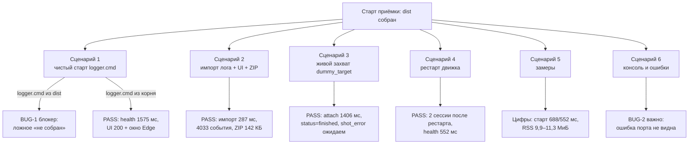
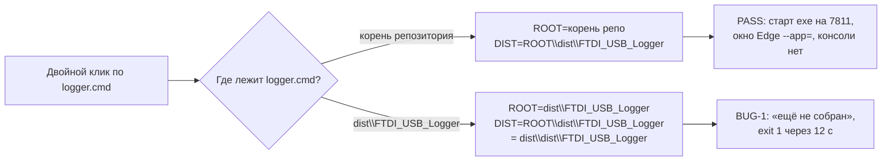
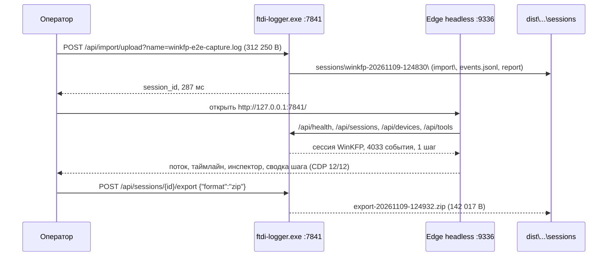
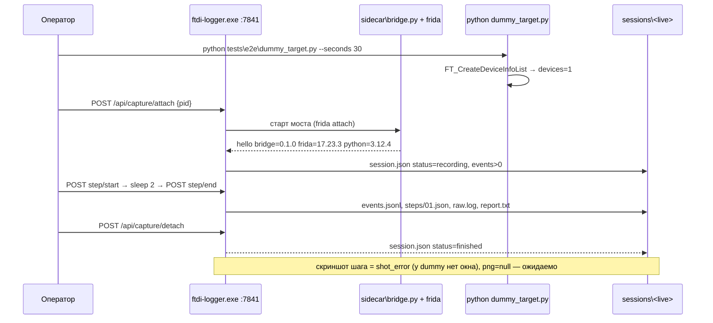
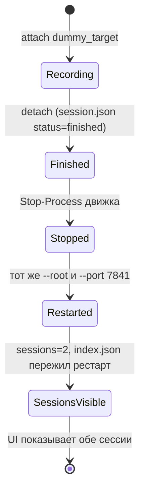
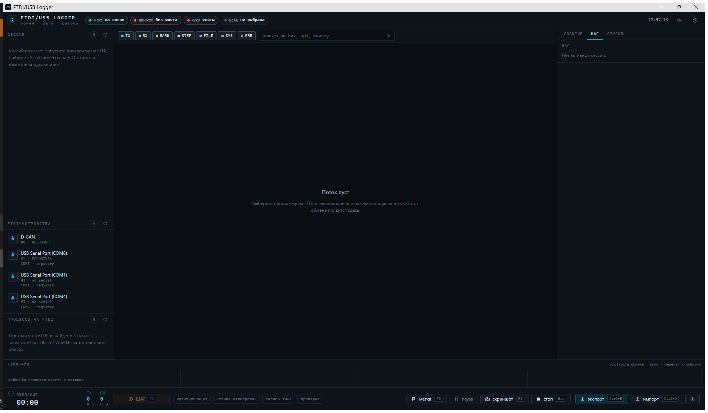
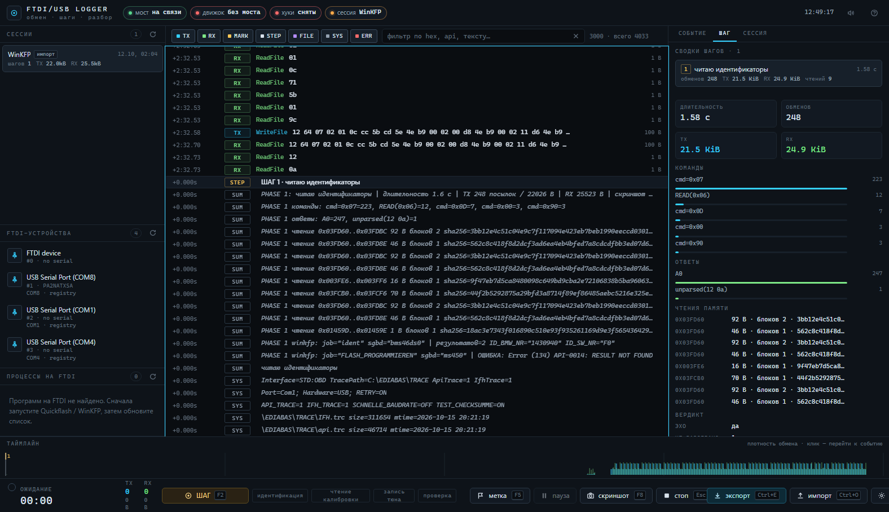
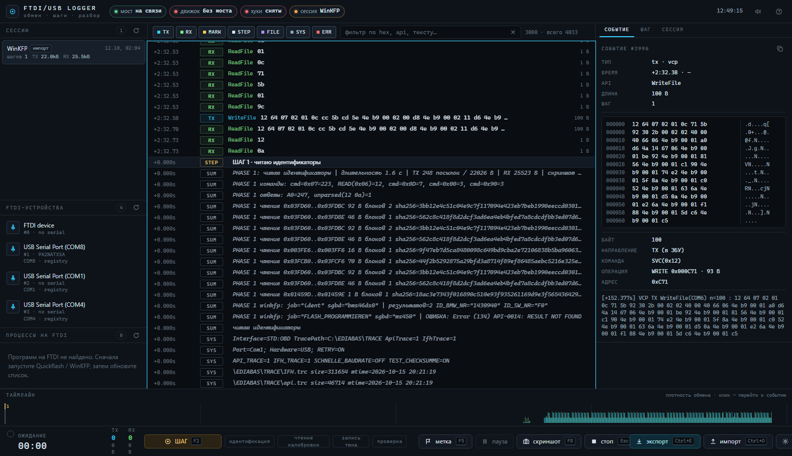
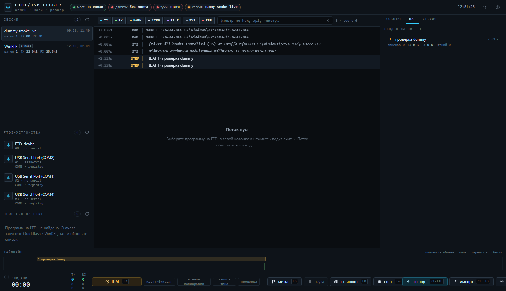
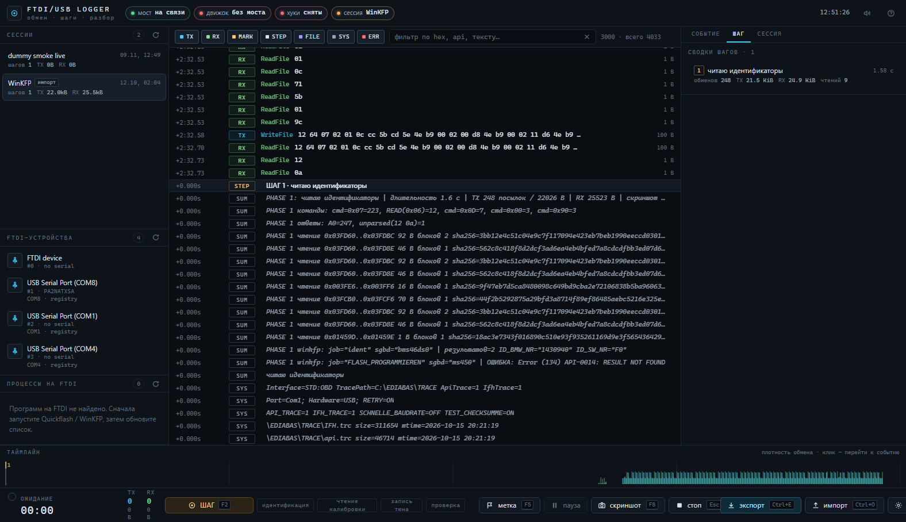

# Смоук-приёмка дистрибутива FTDI/USB Logger

Приёмка «как пользователь» собранного `dist\FTDI_USB_Logger\` от 09.11.2026: чистый старт,
импорт реального лога, живой захват через dummy-цель, рестарт с сохранением сессий, замеры и
проверка отсутствия консоли. Исходники (`engine/src`, `ui/src`, `sidecar`, `scripts`) не правились.

**Итог: 22 проверки PASS, 2 BUG (1 блокер + 1 важно), 4 замечания.** Блокер — `logger.cmd` внутри
`dist` не запускает продукт; важно — при занятом порте/повторном запуске пользователь не видит
ошибку. Основные пользовательские сценарии (импорт, UI, экспорт, живой захват, рестарт) работают.

## Стенд и ограничения

| Параметр | Значение |
|---|---|
| ОС | Windows 10 Pro 10.0.19045 (build 19045), x64, host `DESKTOP-7MECFCS` |
| Дата/время | 2026-11-09, 12:43–13:10 (+05:00) |
| Дистрибутив | `dist\FTDI_USB_Logger\`: 9 файлов, 6 268 130 B (5,98 МиБ); `ftdi-logger.exe` 6 107 648 B |
| Версия продукта | `0.1.0` (поле `version` в `/api/health`) |
| Браузер для UI | Edge 157.0.4341.42, headless, CDP-порт **9336** |
| Python/мост | Python 3.12.4 (`%LOCALAPPDATA%\Programs\Python\Python312`), frida 17.23.3 |
| Node | v24.22.2 (служебные CDP-скрипты во временном каталоге, вне репозитория) |
| Порты | основной тест — **7841**; `logger.cmd` проверялся на штатном 7811, только когда он был свободен |

Ограничения, которые соблюдались:

- [x] Все основные прогоны — только `dist\FTDI_USB_Logger\ftdi-logger.exe` с `--root D:\FTDI_USB_Logger\dist\FTDI_USB_Logger --port 7841 --no-open`.
- [x] Чужие процессы `ftdi-logger.exe` не убивались (в ходе теста в системе работали debug-процессы другого агента из `engine\target\debug` — не трогал).
- [x] После каждого теста закрывались только свои процессы (по PID/пути/командной строке).
- [x] В репозиторий добавлены только `docs\06-smoke.md` и `assets\smoke-*.png`; тестовые скрипты лежали в `%TEMP%\psikh-smoke\`.

> Замеры времени снимались на общей машине, где параллельно работали другие агенты: загрузка CPU
> колебалась ~26–51 %, поэтому замеры UI приведены с разбросом и условиями.

## Карта приёмки



## Сценарий 1. Чистый старт и `logger.cmd`

Каталог `dist\FTDI_USB_Logger\sessions` был пуст; переименован в `sessions.bak`, затем запущен
рабочий `logger.cmd` из корня — движок создал каталог заново (`index.json` = `[]`, `index.md`).
Это же подтвердило, что чистый старт не требует ручной подготовки каталога.



| № | Проверка | Команда/способ | Факт | Вердикт |
|---|---|---|---|---|
| 1.1 | Чистый старт: каталог `sessions` отсутствует | `Rename-Item dist\FTDI_USB_Logger\sessions sessions.bak`; запуск | `sessions\` пересоздан: `index.json`=`[]`, `index.md`; ошибок в логе нет | **PASS** |
| 1.2 | Штатный запуск из `dist` (двойной клик) | `cd dist\FTDI_USB_Logger; cmd /c logger.cmd` | `exit=1`; текст: «FTDI/USB Logger ещё не собран. Нет файла: …\dist\FTDI_USB_Logger\dist\FTDI_USB_Logger\ftdi-logger.exe»; ждёт 12 с; движок не стартует | **BUG-1 (блокер)** |
| 1.3 | Запуск рабочим `logger.cmd` из корня (эквивалент ярлыка) | `Start-Process cmd /c logger.cmd` (cwd = корень репо); опрос `/api/health` на 7811 | `exit=0`; health ok через **1575 мс** (повтор — 1601 мс); `version=0.1.0`, `ui_dist=true`; в логе одна строка «слушает http://127.0.0.1:7811/» | **PASS** |
| 1.4 | UI после чистого старта | `GET http://127.0.0.1:7811/`; перечисление окон | HTTP 200, 1156 B, содержит `FTDI`; окно Edge `--app=http://127.0.0.1:7811/` открылось, заголовок «FTDI/USB Logger»; `smoke-startup.png` | **PASS** |
| 1.5 | Повторный запуск при работающем экземпляре | повторно `cmd /c logger.cmd` | `exit=0` за 447 мс; новый PID появился и завершился; первый экземпляр жив, health ok; второго окна Edge нет | **PASS** (не плодит; но пользователь ничего не видит — см. BUG-2) |
| 1.6 | Отсутствие консоли | `EnumWindows` (класс `ConsoleWindowClass`) до/после; `MainWindowHandle` процесса | новых видимых консолей нет; у `ftdi-logger.exe` `MainWindowHandle=0`; новое окно только Edge | **PASS** |

Фактический вывод сломанного `logger.cmd` из `dist`:

```text
[logger] FTDI/USB Logger ещё не собран.
[logger] Нет файла: "D:\FTDI_USB_Logger\dist\FTDI_USB_Logger\dist\FTDI_USB_Logger\ftdi-logger.exe"

      Соберите продукт:
        powershell -ExecutionPolicy Bypass -File "D:\FTDI_USB_Logger\dist\FTDI_USB_Logger\scripts\build.ps1"
```

## Сценарий 2. Импорт реального лога, UI, экспорт



| № | Проверка | Команда/способ | Факт | Вердикт |
|---|---|---|---|---|
| 2.1 | Старт dist-движка на своём порту | `Start-Process dist\...\ftdi-logger.exe --root … --port 7841 --no-open --log-level info` | health ok через **688 мс**; `version=0.1.0`, `python=…Python312`, `ui_dist=true` | **PASS** |
| 2.2 | UI отдаётся движком | `GET http://127.0.0.1:7841/` | HTTP 200, 1156 B, содержит `FTDI` | **PASS** |
| 2.3 | Импорт реального лога | `POST /api/import/upload?name=winkfp-e2e-capture.log`, `Content-Type: application/octet-stream`, тело = файл 312 250 B | **287 мс**; `session_id=winkfp-20261109-124830`; `status=imported`, `transport=import`, `label=WinKFP`; events=**4033** (TX 248 / RX 3745), steps=1 | **PASS** |
| 2.4 | UI: поток, шаги, таймлайн, инспектор | `node smoke-cdp.mjs http://127.0.0.1:7841/ … 9336` (Edge headless, CDP) | **12/12**: 46 строк потока; активна «WinKFP импорт»; таймлайн canvas 1576×49 отрисован; инспектор: 13 строк HEX, 10 строк декода; сводка шага с «КОМАНДЫ»/«ЧТЕНИЯ ПАМЯТИ»; `smoke-overview.png`, `smoke-inspector.png` | **PASS** |
| 2.5 | Экспорт ZIP и состав архива | `POST /api/sessions/{id}/export {"format":"zip"}`; проверка через `System.IO.Compression.ZipFile` | **202 мс**; `export-20261109-124932.zip` 142 017 B, 9 записей: `report.txt`, `session.json`, `events.jsonl`, `raw.log`, `events.idx`, `state.json`, `steps/01.json`, `import/…log` | **PASS** |
| 2.6 | Время открытия UI до первой строки | CDP `Page.navigate` → первая `.row` (performance.now страницы) | спокойно: **0,54–0,70 с** от навигации, **1,1–1,3 с** от запуска Edge; первый прогон 1,5 с; на загруженной машине (CPU ~50 %) — 3,5–5,4 с | **PASS** (с оговоркой о нагрузке) |

## Сценарий 3. Живой захват через dummy-цель



| № | Проверка | Команда/способ | Факт | Вердикт |
|---|---|---|---|---|
| 3.1 | Поднять dummy-цель | `python tests\e2e\dummy_target.py --seconds 30` (Python312) | `FT_CreateDeviceInfoList status=0 devices=1`; `FT_ListDevices status=6`; процесс жив | **PASS** |
| 3.2 | Attach из dist-движка | `POST /api/capture/attach {"pid":26924,"label":"dummy smoke live"}` | **1406 мс**; сессия `20261109-124946-dummy-smoke-live`; `status=recording`; `bridge=true`, `hooks=on`, `transport=ftd2xx`; в логе `bridge=0.1.0 frida=17.23.3 python=3.12.4`, мост готов через ~2 с | **PASS** |
| 3.3 | Шаг start/end | `POST /sessions/{id}/step/start {"title":"проверка dummy"}`; sleep 2; `POST …/step/end` | шаг idx=1, `dur=2,03 с`, `exchanges=0` (цель после attach только спит), `png=null` | **PASS** |
| 3.4 | Detach и финализация | `POST /api/capture/detach` | `status=finished`, events=**6**, steps=1; sidecar `bye code=0 events=4`; dummy-цель жива (не убита) | **PASS** |
| 3.5 | Файлы живой сессии | `session.json`, `report.txt`, `steps/`, `shots/`, `events.jsonl` | `session.json` status=`finished`; `report.txt` 1654 B («ИТОГО: шагов=1 …»); `steps/01.json`; `events.jsonl` = 6 строк; `shots\` пуст | **PASS** |
| 3.6 | Ожидаемый `shot_error` без окна | лог движка, факты сессии | WARN «скриншот pid=26924: окно целевой программы не найдено или скрыто … все 1 окна невидимы»; факт `# shot 1: FAIL …` в `session.json`/`report.txt`; падения нет | **PASS** (ожидаемо) |

## Сценарий 4. Рестарт после остановки



| № | Проверка | Команда/способ | Факт | Вердикт |
|---|---|---|---|---|
| 4.1 | Остановка движка | `Stop-Process -Id 26836` (только свой PID) | порт 7841 освобождён, health недоступен | **PASS** |
| 4.2 | Рестарт с теми же `--root`/`--port` | повторный запуск dist exe `--port 7841 --no-open` | health через **552 мс**; `sessions=2`; обе сессии в `/api/sessions`; `index.json`/`index.md` на месте | **PASS** |
| 4.3 | UI после рестарта | CDP 9336: список сессий, переключение | в рейле 2 сессии («dummy smoke live», «WinKFP импорт»); активна dummy; переключение на импорт → 46 строк, 1 шаг, таймлайн; 5/5 проверок; `smoke-restart.png` | **PASS** |

## Сценарий 6. Консоль и сообщения об ошибках

| № | Проверка | Команда/способ | Факт | Вердикт |
|---|---|---|---|---|
| 6.1 | Окна консоли от движка | запуск через `logger.cmd`; `EnumWindows` (`ConsoleWindowClass`), `MainWindowHandle` | новых видимых консолей нет; `MainWindowHandle=0`; единственное новое окно — Edge `FTDI/USB Logger` | **PASS** |
| 6.2 | Ошибка «порт занят» глазами пользователя | при работающем экземпляре — повторный `logger.cmd` (и двойной клик через Explorer) | `exit=0`; второй процесс стартует и умирает; ни сообщения, ни окна, ни фокуса существующего окна — **пользователь не понимает, что произошло** | **BUG-2 (важно)** |
| 6.3 | Та же ошибка напрямую (для диагноза) | второй `ftdi-logger.exe --port 7811` со `-RedirectStandardError` | `exit=1`; stderr: `Error: не удалось занять порт 7811 … (os error 10048)`; через `logger.cmd` этот текст скрыт `Start-Process -WindowStyle Hidden` | **PASS** (факт зафиксирован; UX — BUG-2) |

## Сценарий 5. Замеры

| Метрика | Значение | Условия |
|---|---|---|
| Старт dist-движка до health (7841) | **688 мс** первый, **552 мс** после рестарта | `--no-open`, 0–2 сессии, машина под нагрузкой других агентов |
| Старт через `logger.cmd` до health (7811) | **1575 / 1601 мс** | включает cmd + powershell + `Start-Process` |
| Импорт лога 312 250 B | **287 мс** → 4033 события, 1 шаг | POST upload, локальный диск |
| Экспорт ZIP | **202 мс** → 142 017 B | 4033 события, 9 файлов в архиве |
| Размер dist | **6 268 130 B = 5,98 МиБ**, 9 файлов | `ftdi-logger.exe` 6 107 648 B |
| RSS процесса после импорта | **10 354 688 B ≈ 9,9 МиБ** | после навигации UI и экспорта — 11,3 МиБ; после рестарта — 8,5 МиБ; финально (2 сессии, idle) — 10,4 МиБ |
| Open UI → первая строка | **0,54–0,70 с** от навигации; **1,1–1,3 с** от запуска Edge | спокойная машина; первый прогон 1,5 с; при CPU ~50 % — 3,5–5,4 с |
| Attach (Frida) | **1406 мс**; мост готов ~2 с | Python 3.12.4 + frida 17.23.3, dummy_target |
| `/api/tools`, `/api/devices`, `/api/sessions` | ~290 / 16–26 / 3–82 мс | тайминги UI-загрузки |

## Баги

### BUG-1 — блокер: `logger.cmd` в `dist` не запускает продукт

**Воспроизведение:** двойной клик по `D:\FTDI_USB_Logger\dist\FTDI_USB_Logger\logger.cmd`
(или `cmd /c logger.cmd` в этом каталоге).

**Ожидание:** стартует `ftdi-logger.exe` на 7811, открывается окно UI.

**Факт:** `exit=1` через ~12 с, сообщение «FTDI/USB Logger ещё не собран» и ложный путь
`…\dist\FTDI_USB_Logger\dist\FTDI_USB_Logger\ftdi-logger.exe`; движок не стартует, каталог
`sessions` не создаётся. При этом `logger.cmd` из корня репозитория работает.

**Причина (по коду, без правок):** в `logger.cmd` `ROOT=%~dp0`, затем
`DIST=%ROOT%dist\FTDI_USB_Logger`. В копии, лежащей в `dist\FTDI_USB_Logger\`, `%~dp0` уже
указывает на dist, поэтому получается двойной `dist\dist\…`.

**Чем грозит:** в `docs/03-runbook.md` §3 обещан запуск «в корне или в `dist\FTDI_USB_Logger\`»;
пользователь, открывший папку продукта, получает ложное «не собран» и совет собирать проект.

**Куда смотреть:** `logger.cmd` (строки с `ROOT`/`DIST`) и `scripts/build.ps1` (копирование
`logger.cmd` в dist). Идея фикса: определять раскладку — если рядом с `logger.cmd` есть
`ftdi-logger.exe`, то `DIST=%~dp0`, `ROOT=родитель dist`; иначе — как сейчас. Либо класть в dist
отдельный launcher.

### BUG-2 — важно: ошибка «порт занят» не видна пользователю

**Воспроизведение:** запустить `logger.cmd` (корень) — движок занял 7811; затем ещё раз
дважды кликнуть `logger.cmd` при работающем экземпляре.

**Ожидание:** понятное сообщение «уже запущено, откройте http://127.0.0.1:7811/» или фокус
существующего окна; при чужом занятом порте — осмысленная ошибка с логом.

**Факт:** `logger.cmd` завершается `exit=0` за ~0,45 с; второй `ftdi-logger.exe` стартует и сразу
умирает; новых окон нет, первое окно не поднимается. Прямой запуск второго exe показывает причину
только в stderr: `Error: не удалось занять порт 7811 … (os error 10048)`, но `Start-Process
-WindowStyle Hidden` прячет её в никуда.

**Чем грозит:** пользователь считает, что программа не запустилась/сломалась; нет подсказки, что
делать (а это штатная ситуация «уже запущено»).

**Куда смотреть:** `logger.cmd` (`:run_dist`), `engine/src/lib.rs` (текст ошибки bind).
Идея фикса: проверять health/порт перед стартом и открывать существующий UI; при старте нового
процесса — редирект stderr/stdout в `sessions\engine.log` и показ сообщения (или `MessageBox`),
если процесс умер или порт занят.

### Замечания (не блокируют выпуск)

1. **UX статуса моста.** При чистом старте UI показывает оранжевое «движок · без моста» /
   «мост: не поднят». Это нормально до первого attach (мост поднимается при подключении), но
   выглядит как неисправность. Лучше формулировка «мост: ожидает подключения».
2. **Даты импортированной сессии.** В UI «НАЧАЛО 12.10, 02:04», «КОНЕЦ 09.11, 12:48»: начало из
   шапки лога (`wall(start)`), конец = время импорта. Для разборов может путать; стоит подписывать
   конец как «импортировано» либо брать конец из лога, если он там есть.
3. **Документация.** В примере вывода `build.ps1` указано «(2.6 МБ)», фактический dist — 5,98 МиБ;
   расхождение только в `docs/03-runbook.md`.
4. **Парсинг вывода `timeout`.** При запуске `logger.cmd` с перенаправлённым stdin (как в
   автотестах) после сообщения об ошибке появляется `ERROR: Input redirection is not supported` —
   это поведение `timeout.exe`, при обычном двойном клике не проявляется.

## Скриншоты

| Файл | Что видно |
|---|---|
| [`smoke-startup.png`](../assets/smoke-startup.png) | чистый старт через `logger.cmd` (корень): UI на 7811, «на связи», FTDI-устройства найдены |
| [`smoke-overview.png`](../assets/smoke-overview.png) | импорт WinKFP: поток, сводка шага, таймлайн, счётчики 4033 события |
| [`smoke-inspector.png`](../assets/smoke-inspector.png) | инспектор события: HEX/ASCII, декод KWP, команда/адрес |
| [`smoke-live.png`](../assets/smoke-live.png) | живой захват dummy: MODULE FTD2XX.DLL, hooks installed (36), step 1 «проверка dummy» |
| [`smoke-restart.png`](../assets/smoke-restart.png) | после рестарта: 2 сессии в рейле, импортированная открыта |











## Что не проверялось

- Реальный обмен с ЭБУ через WinKFP/Quickflash на FTDI-шнурке (в стенде была только dummy-цель и
  перечисление устройств; сами FT-чтения/записи не гонялись).
- Права администратора (attach к WinKFP/EDIABAS от админа), работа с настоящим окном целевой
  программы и реальный скриншот шага (`F8`/закрытие шага) — только ожидаемый `shot_error`.
- Отправка на сервер (`/share`), экспорт CSV/Markdown, переразбор `reparse`, восстановление
  аварийно оборванных сессий (`recover_stale`), горячие клавиши UI.
- Долговременная стабильность (часы работы), утечки памяти, поведение при заполнении диска.

## Итоговый чек-лист выпуска

- [x] Чистый старт с пустым `sessions` — работает (через рабочий `logger.cmd` корня)
- [x] health/UI 200/FTDI, окно Edge открывается, консоль не висит
- [x] Импорт реального лога 312 КБ — 287 мс, 4033 события, шаг собирается
- [x] UI: поток, шаги, таймлайн, инспектор — 12/12 проверок CDP
- [x] Экспорт ZIP содержит `report.txt`, `session.json`, `events.jsonl`
- [x] Живой захват: attach → step → detach, `status=finished`, events>0, отчёт на диске
- [x] Рестарт: сессии и `index.json` переживают остановку/запуск
- [x] Замеры сняты, RSS и размер dist зафиксированы
- [ ] **BUG-1:** починить `logger.cmd` в `dist` (блокер для запуска из папки продукта)
- [ ] **BUG-2:** показывать пользователю «уже запущено / порт занят» и путь к логу
- [ ] Замечания 1–3 — по желанию, перед публикацией
