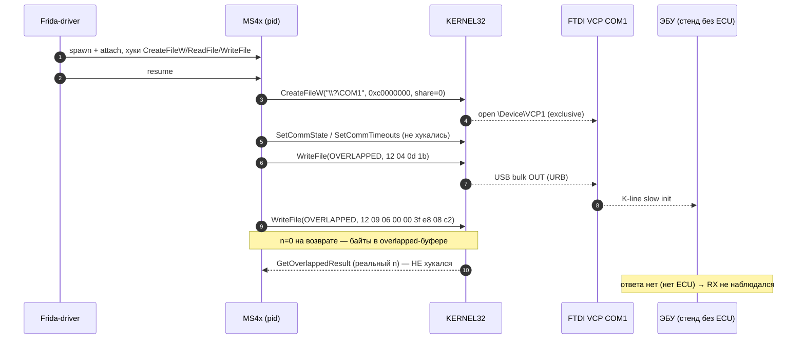
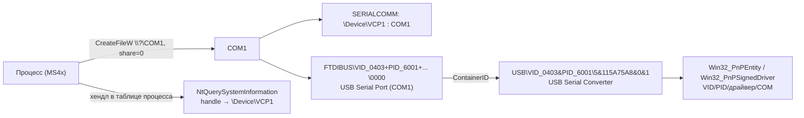

# Универсальный захват: как MS4x, J2534 и USB-стек общаются с адаптером

Разведка под новый движок логгера: чем реально общается MS4x Flasher, какой J2534-стек стоит на машине, какие USB-устройства подключены и что даёт USBPcap. Главный вывод: **MS4x 1.6.0 работает через .NET `System.IO.Ports` / VCP (`\\?\COM1`), а не через D2XX, WinUSB или J2534** — это подтверждено живым спавном под Frida. Старый `procscan`, фильтрующий процессы по загруженному `ftd2xx.dll`, поэтому MS4x не видит; для универсального захвата нужен другой признак (COM-хендл/порт/окно), плюс корректная обработка overlapped-I/O и, для USB-уровня, USBPcap (не установлен).

## 1. Ключевые факты

| № | Факт | Доказательство |
|---:|---|---|
| 1 | MS4x 1.6.0 общается с адаптером как с **COM-портом** (FTDI VCP, COM1), путь `\\?\COM1`, `GENERIC_READ\|GENERIC_WRITE`, `share=0` | Frida-spawn: `CreateFileW path=\\?\COM1 access=0xc0000000 share=0x0`; далее `COM_TX 12 04 0d 1b` |
| 2 | На проводе — **K-line/DS2-телеграммы того же семейства**, что у Quickflash: `12 04 0d 1b` (slow init) и `12 09 06 00 00 3f e8 08 c2` (чтение 8 байт по адресу `0x3FE8`) | перехват `WriteFile` под Frida, §4.3 |
| 3 | **D2XX/J2534/HID/WinUSB не используются**: в exe нет ни одного вхождения `ftd2xx`, `j2534`, `winusb`, `hid.dll`, `passthru`; в бандле нет их файлов; в процессе не появляется ни один такой модуль | байтовый скан exe, список модулей процесса (§3.2, §4.1) |
| 4 | Старый `procscan` (`ModuleName -like "ftd2xx*"`) MS4x не найдёт — у него этот модуль не грузится. Признак для дискавери: **открытый COM-хендл** (A/B-тест: COM1 занят, пока MS4x жив) | §4.4 |
| 5 | .NET `SerialPort` использует **overlapped I/O**: `WriteFile`/`ReadFile` возвращают `n=0`, реальные счётчики приходят позже. Без хука `GetOverlappedResult(Ex)` RX-байты теряются | §4.5 |
| 6 | J2534 на машине: **11 регистраций в 32-битной ветке, 1 в 64-битной**; работоспособны **7** (Scanmatik SM2/SM3, CHIPSOFT, Tactrix, VXDIAG, EVC-32, OpenSource), **4 битых** (Bosch MDI, Bosch Opel-VCI, FC200, UCDS — нет DLL/ключ пуст) | §5.1–§5.3 |
| 7 | **USBPcap не установлен** (ни службы, ни драйвера, ни файлов). Формат снят по официальной спецификации; установка потребует прав администратора и перезагрузки | §7 |

## 2. Стенд и методика

| Параметр | Значение |
|---|---|
| ОС | Windows 10 Pro 22H2, build 19045 |
| Целевое приложение | `C:\Program Files\MS4x Flasher\MS4x Flasher.exe`, 45 581 378 Б, sha256 `961678679e11ce0cf1d230a08638e1820df1ec4782e9ef8347bc5343037b6dcb`, FileVersion 1.6.0.0, ProductVersion 1.6.0+0ce66390df98b32dff9546e6d15c80d388731eb0 |
| Инструменты | Frida 17.23.3 (spawn+attach, JS-хуки `CreateFileW/A`, `LoadLibrary*W/A`, `ReadFile`, `WriteFile`), Python 3.12.4, REA (`inspect_pe_imports`, `inspect_native_exports`), PowerShell UIAutomation, 32-битный PowerShell для J2534-probe |
| Что НЕ делалось | запись/прошивка ЭБУ не запускалась; USBPcap не устанавливался; системные настройки не менялись |

Основные команды:

```powershell
# процессы и порты
Get-CimInstance Win32_Process -Filter "Name='MS4x Flasher.exe'"
Get-CimInstance Win32_SerialPort; Get-ItemProperty HKLM:\HARDWARE\DEVICEMAP\SERIALCOMM

# J2534
Get-ChildItem HKLM:\SOFTWARE\WOW6432Node\PassThruSupport.04.04 | ForEach-Object { Get-ItemProperty $_.PSPath }
Get-ChildItem HKLM:\SOFTWARE\PassThruSupport.04.04

# USB
Get-PnpDevice -PresentOnly | Where-Object { $_.InstanceId -like 'USB\*' -and $_.Status -eq 'OK' }
Get-CimInstance Win32_PnPSignedDriver | Where-Object DeviceID -match 'FTDI|VID_0403'

# USBPcap
Get-Service *usbpcap*; Get-ChildItem C:\Windows\System32\drivers\*usbpcap*
```

## 3. MS4x Flasher 1.6.0 — статика

### 3.1. Артефакт и состав single-file бандла

`.NET 10` single-file (проверено по строкам `coreclr`, `hostpolicy`, `clrjit` и по манифесту бандла). Манифест хранится в хвосте exe **без сжатия**, поэтому список встроенных файлов и зависимости читаются напрямую:

| Зависимость (из deps-манифеста) | Файл в бандле | Комментарий |
|---|---|---|
| `MS4x Flasher/1.6.0` | `MS4x Flasher.dll`, `MS4x Flasher.r2r.dll`, `MS4x Flasher.deps.json` | приложение, ReadyToRun |
| `System.IO.Ports/10.0.3` | `runtimes/win/lib/net10.0/System.IO.Ports.dll` | **COM-порты через .NET** |
| `Avalonia/11.3.12` (+ Skia, Desktop, Win32, Themes.Fluent, Fonts.Inter, DiagnosticSupport) | `Avalonia.*.dll` | UI |
| `SkiaSharp/2.88.9`, `Avalonia.Angle.Windows.Natives/2.1.25547.20250602` | `libSkiaSharp.dll`, `av_libglesv2.dll`, `libHarfBuzzSharp.dll` | нативные рендер-зависимости |
| `ReactiveUI.Avalonia/11.4.3`, `Xaml.Behaviors.Avalonia/11.3.9.5` | `ReactiveUI.Avalonia.dll`, `Xaml.Behaviors.Avalonia.dll` | MVVM |

**Ни `ftd2xx.dll`, ни `j2534*.dll`, ни `hid*.dll`, ни `winusb*.dll` в бандле нет** — в списке файлов только перечисленное выше.

### 3.2. Импорты хоста и строки

| Проверка | Результат |
|---|---|
| PE-импорты (REA `inspect_pe_imports`) | `KERNEL32.dll`: `CreateFileW`, `CreateFileA`, `ReadFile`, `WriteFile`, `GetOverlappedResult`, `CancelIoEx`, `CreateProcessW`, `LoadLibraryExW/A`, `GetProcAddress`; `ADVAPI32.dll` (реестр), `USER32.dll`, `SHELL32.dll`, CRT. **Нет** `ftd2xx.dll`, `hid.dll`, `winusb.dll` в таблице импорта |
| Байтовый скан 45 МБ exe (ASCII + UTF-16LE) | `j2534` = 0, `ftd2xx` = 0, `serialport` = 0, `hid.dll` = 0, `winusb` = 0, `passthru` = 0, `scanmatik/chipsoft/openport/vxdiag` = 0; `system.io.ports` = 8 (манифест/deps), `avalonia` = 182, `coreclr` = 18 |
| `%TEMP%\.net\MS4x Flasher\<hash>\` | извлечены только нативные `libSkiaSharp.dll`, `libHarfBuzzSharp.dll`, `av_libglesV2.dll` (управляемые сборки грузятся из памяти бандла) |

### 3.3. Сравнение с прошлой версией 1.2.7

| Версия | Признак D2XX | Вывод |
|---|---|---|
| 1.2.7 (2021, `D:\Quickflash_MS42\MS4X_Dev_Flasher_v1.2.7\MS4x Flasher 1.2.7.exe`, 51 359 379 Б) | в `%TEMP%\.net\MS4x Flasher 1.2.7\<hash>\Serial\Ftdi\ftd2xx.dll` (392 128 Б, x86, 93 экспорта `FT_*`) | старая ветка грузила **D2XX** и работала через `FT_*` |
| 1.6.0 (текущая) | `ftd2xx` отсутствует и в exe, и в извлечении | переход на **VCP/.NET SerialPort** |

> Практический вывод: хуки `FT_*` для MS4x 1.6.0 бесполезны, а `CreateFileW/ReadFile/WriteFile` — работают (если успели прицепиться до открытия порта, см. §4.4).

## 4. MS4x — живой прогон (Frida spawn)

Метод: `device.spawn([exe])` → `attach` → загрузка JS-хуков → `resume`. Так ловятся вызовы, которые приложение делает **на старте** (обычный attach после запуска их пропускает).

### 4.1. Что загрузилось в процесс

| Момент | Модули, относящиеся к транспорту |
|---|---|
| Запуск, простой | Среди ~69–80 модулей: `KERNEL32`, `WINMM`, `WS2_32`, `DNSAPI`, `IPHLPAPI`, `NSI`, `PSAPI`, `UIAutomationCore` (от UIA), `libSkiaSharp`, `libHarfBuzzSharp`, `av_libGLESv2`. **Нет** `ftd2xx*`, `hid*`, `winusb*`, `j2534*` |
| После клика Identify/Partial Read | новых транспортных модулей не появилось (только сетевые/UI) |

### 4.2. Открытие порта

```text
[hook] CreateFileW path=\\?\COM1 access=0xc0000000 share=0x0 ret=2208
[hook] COM_TX \\?\COM1 rc=0 n=0 len=4 : 12 04 0d 1b 
[hook] COM_TX \\?\COM1 rc=0 n=0 len=9 : 12 09 06 00 00 3f e8 08 c2 
```

- `access=0xc0000000` = `GENERIC_READ | GENERIC_WRITE`; `share=0` — **монопольное** открытие (пока MS4x жив, `SerialPort("COM1").Open()` из другого процесса даёт Access denied — проверено A/B, §4.4).
- `\\?\`-префикс и `share=0` — характерная подпись `System.IO.Ports.SerialPort` (Win32-путь без разбора DOS-имён). Старый JS-хук VCP ловит такой путь регэкспом `/com\d+/i` — то есть VCP-хуки применимы к MS4x без изменений (вопрос только в моменте attach и в overlapped-счётчиках).
- `SetCommState/SetCommTimeouts` в кадр не попали (не хукались); скорость в UI выставлена `125000` (K-line, как у Quickflash-семейства).

### 4.3. Что за телеграммы (совместимость с `parse_family`)

| Байты | Разбор по правилам `parse_family.py` (docs/01) |
|---|---|
| `12 04 0d 1b` | DS2/K-line «slow init»: `12` = маркер, `04` = длина, `0d` = команда, `1b` = чек-сумма; эхо в старом логе — `A0` |
| `12 09 06 00 00 3f e8 08 c2` | семейное чтение: `tx[2] == 0x06`, адрес `int.from_bytes(tx[3:7],"big")` = **0x003FE8**, длина `tx[7]` = **8**, `tx[8]` = `0xC2` (чек-сумма) |

Значит MS4x использует **тот же DS2/K-line протокол**, что Quickflash/BMS46, и старый текстовый парсер подходит без изменений — меняется только транспорт (VCP вместо D2XX).

### 4.4. Почему старый procscan не видит MS4x и как это исправить

A/B-тест на COM1:

| Состояние | Попытка открыть `COM1` из PowerShell |
|---|---|
| MS4x запущен | `Access to the path 'COM1' is denied` — порт занят приложением |
| MS4x убит | `OPEN OK` — порт свободен |

То есть **признак работающего адаптер-приложения — открытый COM-порт**, а не `ftd2xx.dll`. Для дискавери нужны: `NtQuerySystemInformation(SystemExtendedHandleInformation)` + имена объектов (`\Device\VCP1`, `\Device\COMx`) → PID; либо PnP-цепочка COM→устройство + перебор процессов; плюс окно/allowlist как fallback. Старый подход «модуль ftd2xx» ловит Quickflash/WinKFP (D2XX/легаси), но не .NET-VCP приложения.

### 4.5. Overlapped I/O — важная ловушка

В перехвате `n=0` у обеих записей: `WriteFile` вернулся с `rc=0`, но `lpNumberOfBytesWritten = 0` — данные ушли асинхронно, реальный счётчик придёт при завершении. `ReadFile` для overlapped-чтения вообще не дал `n>0` в нашем прогоне, поэтому **RX не виден**. Для универсального захвата:

- хукать `GetOverlappedResult` и `GetOverlappedResultEx` (по `OVERLAPPED*` из `ReadFile/WriteFile`) — там реальные `n` и данные;
- сохранять «запрошенный» размер из `ReadFile` как верхнюю границу и помечать кадр `ovl=1` (старый логгер это делал, но старый `parse_family` такие RX отбрасывает как недостоверные);
- при отсутствии ответа ЭБУ (наш стенд без ECU) RX может не быть вовсе — это не ошибка хука.

### 4.6. UI-инвентарь MS4x (UIAutomation)

| Элемент | AutomationId | Значение/поведение |
|---|---|---|
| Окно | — | `MainWindow`, класс `MainWindow`, заголовок `MS4x Flasher` (Avalonia) |
| Индикатор/кнопка порта | `SerialPortIndicator` | без `InvokePattern`; подпись-иконка; справа внизу |
| Выбор порта | `SerialPortSelection` | `ComboBox`, значение **`COM1`** (первый найденный VCP) |
| Кнопка | — | `Identify`, `Partial Read`, `Full Read`, `ECU`-комбо (`ECU`/`TCU`), `Baudrate = 125000`, поле `MS43` |
| Разделы | — | элементы списка: `Flasher.Ui.Avalonia.ViewModels.*` (Read Binary, Write Binary, EWS Sync, Reset Adaptations, Diagnostic Codes, Checksum Correction, Command Sender, Settings) |
| Прочее | — | приложение держит COM1 с момента старта, до нажатия Identify |



## 5. J2534: инвентарь и формат

### 5.1. Реестр `PassThruSupport.04.04`

32-битная ветка (`HKLM\SOFTWARE\WOW6432Node\PassThruSupport.04.04`) — **11 ключей**; 64-битная (`HKLM\SOFTWARE\PassThruSupport.04.04`) — **1 ключ**.

| Ключ (32-bit) | Vendor / Name | FunctionLibrary | DLL есть? | Битность | Статус |
|---|---|---|---|---|---|
| Scanmatik - SM2 USB | Scanmatik / SM2 USB | `C:\Program Files (x86)\Scanmatik\smj2534.dll` | да, 4 110 904 Б | x86 | рабочий |
| Scanmatik - SM3 USB | Scanmatik / SM3 USB | `C:\Program Files (x86)\Scanmatik\smj2534_0404_usb_sm3.dll` | да, 29 008 Б (тонкая обёртка) | x86 | рабочий (обёртка) |
| CHIPSOFT - J2534 ISO/CAN | CHIPSOFT | `C:\Program Files (x86)\CHIPSOFT_J2534_Lite_Driver\j2534_interface.dll` | да, 1 111 600 Б | x86 | рабочий |
| Tactrix Inc. - OpenPort 2.0 | Tactrix | `C:\Windows\SysWOW64\op20pt32.dll` | да, 1 801 864 Б | x86 | рабочий |
| VXDIAG - J2534 | ALLScanner / VXDIAG | `C:\ProgramData\VCX\Apps\PASSTHRU\VCXPT32.dll` | да, 109 568 Б | x86 | рабочий |
| EVC electronic - UCM Tool (32) | EVC / UCM100/200 | `C:\Windows\SysWOW64\EvcUcm32.DLL` | да, 1 822 672 Б | x86 | рабочий (EVC-стек) |
| Bosch - MDI | Bosch / MDI | **отсутствует** | — | — | битый ключ |
| Bosch - Opel-Vauxhall-VCI | Bosch | **отсутствует** | — | — | битый ключ |
| FC200-J2534 | — | **ключ пустой** | — | — | битый ключ |
| UCDS J2534 | UCDS Team | `C:\UCDS\ucdsj2534.dll` | **нет файла** | — | битый ключ |
| Open Source J2534 - j2534-tool | Open Source J2534 | `C:\Program Files (x86)\Open Source J2534\J2534\j2534-logger\ptshim32.dll` | да, 2 352 640 Б | x86 | рабочий; `NeedConfigApp.exe` отсутствует |

| Ключ (64-bit) | FunctionLibrary | DLL есть? | Битность |
|---|---|---|---|
| EVC electronic GmbH - UCM Tool | `C:\Windows\system32\EvcUcm64.DLL` | да, 1 438 560 Б | x64 |

> Следствие: **большинство J2534-драйверов только 32-битные**. 64-битный клиент (в т.ч. .NET-приложение x64) не сможет загрузить `smj2534.dll`/`j2534_interface.dll`/`op20pt32.dll`/`VCXPT32.dll` — нужен 32-битный процесс-посредник либо 64-битные сборки драйверов (в реестре их нет, кроме EVC).

### 5.2. Экспорты (проверено REA `inspect_native_exports`)

| DLL | Экспортов | Набор | Особенности |
|---|---:|---|---|
| `smj2534.dll` (Scanmatik SM2) | 17 | стандартные 14: `PassThruOpen/Close/Connect/Disconnect/ReadMsgs/WriteMsgs/StartPeriodicMsg/StopPeriodicMsg/StartMsgFilter/StopMsgFilter/SetProgrammingVoltage/ReadVersion/GetLastError/Ioctl` | плюс 3 безымянных ординала (1377–1379) |
| `j2534_interface.dll` (CHIPSOFT) | 14 | стандартные 14 | без расширений |
| `op20pt32.dll` (Tactrix) | 14 | стандартные 14 | без расширений |
| `VCXPT32.dll` (VXDIAG) | 15 | стандартные 14 + **`PassThruReset`** | единственный с `PassThruReset` в наборе |

### 5.3. Живая проверка загрузки (32-битный PowerShell)

```text
LoadLibrary=... err=0
PassThruOpen rc=8 id=0 msg=SMSTATUS_DEVICE_NOT_FOUND
```

`PassThruOpen` вернул `8` (`SMSTATUS_DEVICE_NOT_FOUND`) — DLL грузится и API отвечает; Scanmatik-адаптера на шине нет (совпадает с §6). Проверка выполнена из **32-битного** процесса — иначе x86-DLL не загрузится.

### 5.4. Формат `PASSTHRU_MSG` (SAE J2534-1)

| Поле | Тип | Смысл |
|---|---|---|
| `ProtocolID` | `unsigned long` (u32) | протокол канала: `CAN` (0x05), `ISO15765` (0x06), `ISO9141` (0x03), `ISO14230` (0x04), `J1850VPW/PWM` (0x01/0x02), `SCI_*` |
| `RxStatus` | u32 | статус приёма (флаги: `START_OF_MESSAGE`, `TX_MSG_TYPE`, `TX_DONE`, `RX_BREAK`, …) |
| `TxFlags` | u32 | флаги передачи: `CAN_29BIT_ID`, `ISO15765_FRAME_PAD`, `ISO15765_ADDR_TYPE`, `WAIT_FOR_TX_ACK` и др. |
| `Timestamp` | u32 | мкс, заполняется устройством на приёме |
| `DataSize` | u32 | число значимых байт в `Data` |
| `ExtraDataIndex` | u32 | смещение в `Data`, с которого начинаются «extra» байты (CRC/checksum и т.п.). Нет extra → равно `DataSize`; `0` → все байты extra |
| `Data[4128]` | `unsigned char[4128]` | заголовок протокола + данные |

Практика по CAN/ISO15765 (сверять с §7.2.3 SAE J2534-1):

- для CAN-протоколов первые 4 байта `Data` — **32-битный CAN ID в big-endian** (`Data[0]` — старший; для 11-битного ID верхние байты нули), далее данные; 29-битный режим включается `TxFlags.CAN_29BIT_ID`;
- для ISO15765 первые 4 байта `Data` — CAN ID (с учётом приоритета/адресации), далее ISO-TP (PCI + данные); при включённом extended addressing между ними идёт адресный байт; PCI-байт добавляет/снимает PassThru-устройство;
- `ExtraDataIndex` — единственный корректный способ отделить сообщение от служебных байт (чек-сумм и пр.) при разборе.

Для нового движка J2534-уровень удобнее USB-уровня: хук на `PassThruWriteMsgs/ReadMsgs` даёт уже готовые `PASSTHRU_MSG` (протокол + ID + payload), а не URB-поток.

## 6. Подключённые USB-устройства

Все устройства со статусом OK (Windows 10 19045), с классификацией «адаптер/не адаптер»:

| VID:PID | Устройство / PnP-класс | Драйвер / COM | Это адаптер? |
|---|---|---|---|
| `0403:6001` REV_0600 | FTDI FT232R: `USB Serial Converter` (USB) + `USB Serial Port (COM1)` (Ports), instance `USB\VID_0403&PID_6001\5&115A75A8&0&1`, ContainerID `{5128a742-6b0b-11f1-93f1-4c1d96b9a4cf}` | `FTDIBUS` / `FTSER2K`; драйвер **2.12.36.20** (28.10.2024), COM1; EEPROM-serial пуст (в id устройства bus-серийник) | **да** (K-line/D-CAN через VCP) |
| `8087:0029` | Intel Wireless Bluetooth | Bluetooth | нет |
| `0E6A:02C0` (MI_00/MI_01) | HID/составное (клавиатура/мышь) | HIDClass | нет |
| `1EA7:0066` | составное USB + HID | USB/HIDClass | нет |
| `0B0E:0300` | Jabra EVOLVE 20 MS (аудио) | MEDIA | нет |
| `0408:A061` | HD User Facing (камера) | Camera | нет |
| `ROOT\USB\0000` | VirtualHere USB 3 eXtensible Host Controller | USB | нет (виртуальный USB-хост) |

**Других адаптеров на шине нет**: отсутствуют `0403:B470`, устройства Scanmatik, CHIPSOFT, OpenPort, VXDIAG — поэтому J2534-probe закономерно вернул `SMSTATUS_DEVICE_NOT_FOUND` (§5.3).

Порт виден и без PnP-обхода: `HKLM\HARDWARE\DEVICEMAP\SERIALCOMM` → `\Device\VCP1 : COM1`, а приложение открывает именно `\\?\COM1`.

### 6.1. Как связать устройство с процессом



| Метод | Что даёт | Статус/ограничение |
|---|---|---|
| Реестр `SERIALCOMM` + `Win32_SerialPort` | список COM и их device-путей | В этой системе `Win32_SerialPort` пуст, а `SERIALCOMM` даёт `COM1` — использовать оба источника |
| PnP-цепочка + `ContainerID` | VID/PID/серийник/драйвер ↔ COM ↔ физический USB-порт | Надёжно для FTDI VCP (`FTDIBUS\COMPORT&VID_0403&PID_6001`), работает без открытия устройства |
| Перечисление хендлов процесса (`NtQuerySystemInformation(SystemExtendedHandleInformation)` → `DuplicateHandle` → `NtQueryObject`) | PID ↔ `\Device\VCP1`/`\Device\COM*`; кто держит порт | Требует прав/аккуратности; `handle.exe` в системе не найден — реализовывать самостоятельно |
| Поведенческий A/B (использован) | факт «порт занят процессом» без парсинга хендлов | Эксклюзивное открытие `COM1` из второго процесса: `Access denied` пока MS4x жив, `OK` после kill |

Практический вывод: **дискавери процессов строить на нескольких признаках** — открытый COM-хендл, загруженный `ftd2xx/ftdibus`, загруженный J2534-DLL из реестра, загруженный `winusb/hid`, окно с заголовком; фильтр «только по ftd2xx» оставить как один из бейджей, а не как условие.

## 7. USBPcap: статус и формат

### 7.1. Статус на машине

| Проверка | Результат |
|---|---|
| Служба `USBPcap*` | не найдена |
| `C:\Windows\System32\drivers\*usbpcap*` | файлов нет |
| `C:\Program Files\USBPcap` / `(x86)` | каталога нет |
| `pnputil /enum-drivers` | совпадений нет |

USBPcap **не установлен**. Установка в рамках этой задачи не выполнялась (нужно разрешение Lead): по официальной странице проекта установщик требует **перезагрузку** компьютера, драйвер ставится с правами администратора.

### 7.2. Формат USBPcap pcap

Файл — обычный pcap/libpcap с `LINKTYPE_USBPCAP = 249` (значение выделено для USBPcap в 2013 г., поддерживается Wireshark с 1.10.0). Каждый пакет = **базовый заголовок USBPcap** + (для некоторых transfer) специфический заголовок + данные URB. Все многобайтовые поля — little-endian.

| Поле базового заголовка | Смещение | Размер | Смысл |
|---|---:|---:|---|
| `headerLen` | 0 | 2 | длина всего заголовка (вкл. специфический) |
| `irpId` | 2 | 8 | ID IRP (позволяет сопоставить request/response) |
| `status` | 10 | 4 | `USBD_STATUS` (валиден на возврате) |
| `function` | 14 | 2 | `_URB_HEADER.Function` |
| `info` | 16 | 1 | бит0 `PDO_TO_FDO` (направление IRP), остальные зарезервированы |
| `bus` | 17 | 2 | номер root hub |
| `device` | 19 | 2 | адрес USB-устройства (16 бит, как в Windows) |
| `endpoint` | 21 | 1 | номер эндпоинта + бит направления |
| `transfer` | 22 | 1 | тип трансфера |
| `dataLength` | 23 | 4 | длина данных после заголовка |

| `transfer` | Тип | Доп. заголовок | Данные |
|---:|---|---|---|
| 0 | Isochronous | `startFrame`, `numberOfPackets`, `errorCount`, массив `{offset,length,status}` | как в USB-пакетах |
| 1 | Interrupt | нет | payload |
| 2 | Control | байт `stage`: 0 SETUP, 1 DATA, 2 STATUS, 3 COMPLETE (с USBPcap 1.5.0 control пишется двумя пакетами) | SETUP/DATA |
| 3 | Bulk | нет | payload |

Для FTDI VCP обмен идёт **bulk**-трансферами (`transfer=3`): в pcap видно `endpoint` (OUT 0x01/IN 0x81 и т.п.), `dataLength` и сами байты — то есть USBPcap даёт поток «сырых» USB-байт, из которого можно собрать K-line телеграммы даже без знания, каким API их отправило приложение.

### 7.3. Ограничения и требования

| Ограничение | Следствие для движка |
|---|---|
| Установка драйвера + **перезагрузка**, права администратора | нельзя включать «по умолчанию»; только по явному согласию; UI должен объяснять |
| Официально Windows 7/8/10 | на Windows 11 работоспособность не гарантирована документацией проекта |
| Захват привязан к **root hub** (`\\.\USBPcapN`), а не к процессу/приложению | нет PID и семантики: нужна корреляция по `bus/device/endpoint` и PnP |
| Огромный объём (все USB-устройства и все URB) | обязательны фильтры по устройству/эндпоинту и ротация файла |
| URB-уровень: нет разметки «это K-line», «это D2XX» | K-line/DS2 собирать своим парсером по bulk-потоку; J2534-сообщения восстанавливать сложнее |
| Не даёт имён файлов/шагов/приложения | хуки уровня API остаются основным источником семантики; USBPcap — fallback |
| Шифрование/сжатие payload на стороне устройства | payload останется нечитаемым (для K-line не актуально) |

### 7.4. Как встроить в движок (предложение)

1. Sidecar (Python) запускает `USBPcapCMD` (или Wireshark dumpcap с extcap) на нужном root hub, пишет pcap в папку сессии.
2. Отдельный парсер читает pcap (Python `dpkt`/`scapy` или собственный разбор 27-байтного заголовка) и складывает bulk-байты по `(bus, device, endpoint, direction)`.
3. Байтовый поток по `device` сопоставляется с PnP-устройством (VID/PID/COM) на старте сессии; в UI — бейдж «USB (USBPcap)».
4. Дубли с API-хуками склеивать по времени/длине (USBPcap — первичный источник при отсутствии хуков, API-хуки — приоритетный при наличии).

> Альтернатива без установки — встроенный USB ETW (провайдеры `Microsoft-Windows-USB-USBPORT/UCX` через `wpr`/`logman`); разбор сложнее, в этой разведке не проверялся, требует отдельной проработки.

## 8. Матрица «API/устройство → хуки → что не поймается»

| Транспорт | Что перехватывать | Ловится | Не ловится / риск |
|---|---|---|---|
| **FTDI D2XX** (`ftd2xx.dll`, Quickflash, ms41-studio) | `Interceptor.attach` на экспорты `FT_Open/OpenEx/Write/Read/SetBaudRate/SetDataCharacteristics/GetQueueStatus`; наблюдатель загрузки модуля | все байты TX/RX на уровне API, параметры линии, EEPROM | если хук поставлен после `LoadLibrary`/открытия — можно пропустить старт; 32/64-битность DLL; прямой `DeviceIoControl` в обход D2XX |
| **VCP sync** (WinKFP, EDIABAS, старые C-приложения) | `CreateFileA/W` + `ReadFile/WriteFile` (kernel32) | байты и длины, COM-имя | `SetCommState/Timeouts` (если не хукать), `ClearCommError`, IOCTL-путь `DeviceIoControl` |
| **VCP overlapped** (.NET `SerialPort`, **MS4x**) | то же + `GetOverlappedResult`/`GetOverlappedResultEx` (обязательно!), `CancelIoEx` | TX-буферы сразу; RX/длины — только через overlapped-результат | без хука `GetOverlappedResult` RX теряется (`n=0`); `DeviceIoControl(IOCTL_SERIAL_*)` |
| **WinUSB** | `WinUsb_Initialize/ReadPipe/WritePipe/ControlTransfer`, наблюдатель `winusb.dll` | байты и pipe-идентификаторы | приложение может звать `DeviceIoControl` напрямую на usb-хендле |
| **HID** (`hid.dll`) | `HidD_*`, `ReadFile/WriteFile` на HID-хендле | репорты (с учётом overlapped-ловушки) | `HidD_SetOutputReport`/feature-репорты надо хукать отдельно |
| **J2534** (Scanmatik/CHIPSOFT/Tactrix/VXDIAG/EVC) | `LoadLibrary*` (пути из реестра `PassThruSupport.04.04`) + `Interceptor.attach` на `PassThruOpen/Connect/WriteMsgs/ReadMsgs/Ioctl` | готовые `PASSTHRU_MSG`: протокол, CAN ID, payload, флаги — лучший семантический уровень | внутренний USB-трафик DLL скрыт; 32-битные DLL требуют 32-битного target-процесса; вендорные расширения (ординалы) |
| **Проприетарный kernel-драйвер USB** (нет WinUSB/HID/FTDI/J2534) | `DeviceIoControl` (коды + буферы) как слабый признак | факт I/O и, возможно, буферы | семантика IOCTL неизвестна, байты могут быть разбиты/переупакованы → нужен **USBPcap** |
| **USBPcap (fallback)** | внешний захват pcap (не Frida) | все bulk/interrupt/control URB на выбранном root hub, независимо от API | нет PID/семантики; объём; установка+ребута; iso-специфика; Windows 11 не гарантирован |
| **Сеть (DoIP/ENET), Bluetooth** | `WS2_32`/`BluetoothAPIs` (не USB) | байты на сокетах | вне USBPcap и USB-хуков; отдельная ветка |

## 9. Что нужно в UI/дискавери

| Блок UI | Требование | Зачем (по фактам разведки) |
|---|---|---|
| Список процессов | **все** процессы, а не только с `ftd2xx`; бейджи: `FTDI` (модуль `ftd2xx/ftdibus`), `COM` (открытый COM-хендл/порт), `J2534` (загружен DLL из реестра), `USB` (`winusb/hid`), `окно` (заголовок) | MS4x держит COM1 без `ftd2xx` — старый фильтр его пропускает |
| Ручной attach | ввод/выбор PID, обновление списка, предупреждение о разнице прав (admin/elevation) | Frida не аттачится к процессу с большими правами; MS4x может быть запущен иначе |
| USB-устройства | таблица: VID/PID, серийник, COM, драйвер/версия, ContainerID, PnP-путь; фильтр «похоже на адаптер» (FTDI, Scanmatik, CHIPSOFT, OpenPort, VXDIAG) | на машине реально один адаптер — FT232R/COM1; нужно отличать его от камеры/аудио/HID |
| J2534-драйверы | обе ветки реестра (32/64), статус `OK/MISSING/BROKEN`, битность, `FunctionLibrary`, протоколы, наличие `ConfigApplication` | 11 ключей, из них 4 битых; 64-битная ветка только EVC; 32-битные DLL не загрузить в x64-клиент |
| Индикатор транспорта сессии | `D2XX` / `VCP` / `J2534` / `USB` / `сеть` + источник (API-хук или USBPcap) | разные протоколы и разные ограничения захвата |
| Предупреждения | «порт занят другим процессом», «overlapped RX не подтверждён», «J2534 DLL 32-bit vs процесс 64-bit», «USBPcap не установлен» | иначе пользователь видит пустой RX и не понимает причину |
| Ручной выбор COM | показывать порт + PnP-устройство + кто держит | MS4x открывает COM1 эксклюзивно; второй логгер не должен ломать сценарий |
| Шаги/сводка | прежние `# MARK/# PHASE/# PHASE-JSON` (docs/01) без изменений | протокол тот же (DS2/K-line), меняется только транспорт |

## 10. Ограничения этой разведки (честно)

| Что | Ограничение |
|---|---|
| MS4x, живой прогон | ЭБУ на стенде отсутствует: отправлены только TX (init + чтение), ответов нет; RX-байты не подтверждены |
| MS4x, overlapped | Набор хуков не включал `GetOverlappedResult(Ex)`, поэтому RX-длины не получены; это зафиксировано как обязательный хук, а не как «RX нет» |
| MS4x, статика | Управляемые сборки в бандле сжаты (кроме единичных), IL не дизассемблировался; выводы — по манифесту зависимостей, импортам хоста и строкам |
| MS4x, UI | Identify не переоткрыл порт (он уже открыт на старте), а без выбранного ECU операция не пошла дальше; клики UIA ограничены |
| J2534 | Адаптеров нет; проверена только загрузка `smj2534.dll` и ответ `PassThruOpen`; реальный обмен сообщениями не снимался |
| USBPcap | Не установлен; формат описан по официальной спецификации, живого pcap-а с этой машины нет |
| `ftd2xx`-ветка | Проверена косвенно: ms41-studio/QF используют `ftd2xx` (старый код), но текущий живой прогон — только MS4x |

## 11. Дальше

- [ ] Добавить в sidecar хуки `GetOverlappedResult`/`GetOverlappedResultEx` и повторить прогон MS4x: TX/RX байты должны совпасть с K-line обменом.
- [ ] Реализовать дискавери процессов по COM-хендлам (`NtQuerySystemInformation`) + PnP-карте; оставить `ftd2xx` как один из бейджей.
- [ ] Добавить перехват J2534: `LoadLibrary` по путям реестра + `PassThruOpen/Connect/WriteMsgs/ReadMsgs` (тест — на Scanmatik при подключённом SM2/SM3, target обязан быть 32-bit).
- [ ] Запросить у Lead разрешение на установку USBPcap; после перезагрузки снять pcap MS4x↔FT232R и сверить bulk-байты с VCP-хуками.
- [ ] Проверить сценарий «64-битный клиент + 32-битный J2534» и отобразить предупреждение в UI.
- [ ] Проверить J2534 на реальном адаптере: `PassThruConnect(ISO15765, 500000)`, `PassThruStartMsgFilter`, `WriteMsgs/ReadMsgs`, формат `PASSTHRU_MSG` (CAN ID в `Data[0..3]`, `ExtraDataIndex`).

## 12. Источники

- USBPcap capture format specification — [desowin.org/usbpcap/captureformat.html](https://desowin.org/usbpcap/captureformat.html)
- USBPcap project page (установка, Wireshark) — [desowin.org/usbpcap/](https://desowin.org/usbpcap/)
- Присвоение `LINKTYPE_USBPCAP = 249` — [seclists.org/tcpdump/2013/q1/115](https://seclists.org/tcpdump/2013/q1/115), поддержка в Wireshark — [wireshark-bugs #8503](https://lists.wireshark.org/archives/wireshark-bugs/201303/msg01356.html)
- SAE J2534-1 (Pass-Thru API) — [sae.org/standards/content/j2534/1/](https://www.sae.org/standards/content/j2534/1/)
- Структура `PASSTHRU_MSG` (Rust-биндинг) — [docs.rs/j2534_rust/…/struct.PASSTHRU_MSG.html](https://docs.rs/j2534_rust/1.5.0/j2534_rust/struct.PASSTHRU_MSG.html)
- PassThru API manual (DrewTech), таблицы CAN/ISO15765 в `Data` — [tunertools.com/…/PassThru_API-1.pdf](http://tunertools.com/prodimages/DrewTech/Manuals/PassThru_API-1.pdf)
- Внутренние контракты старого логера (грамматика, `parse_family`) — [01-original-contracts.md](01-original-contracts.md), [02-architecture.md](02-architecture.md)
