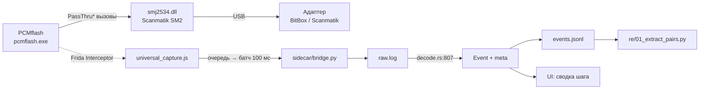
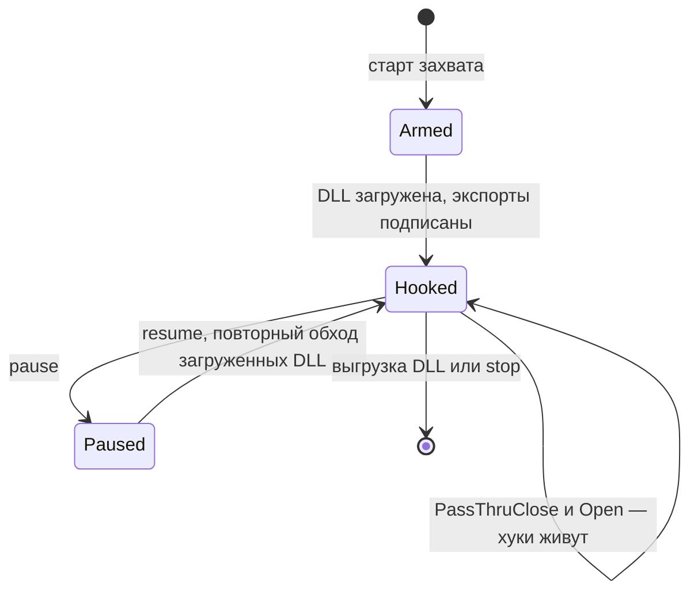
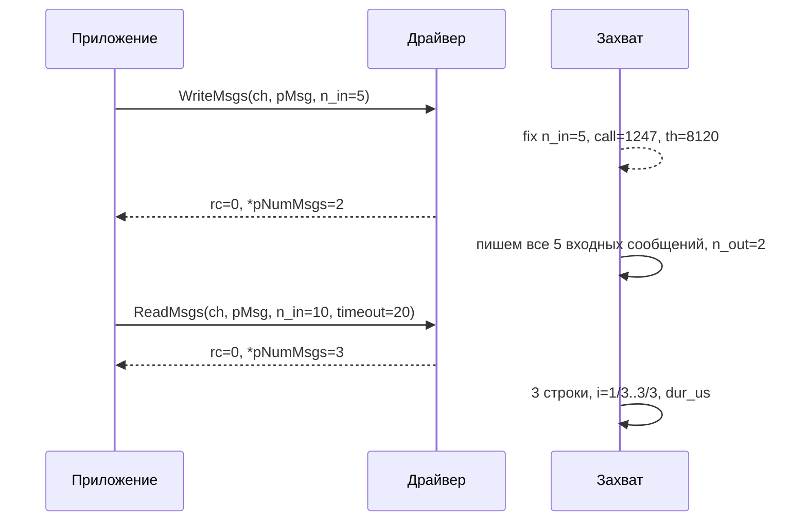

# ТЗ: доработка захвата J2534 в FTDI_USB_Logger (версия 2)

Документ для исполнителя, который вносит правки в логгер. Версия 2 учитывает ревью второго агента: часть требований версии 1 отменена как ошибочная, часть уточнена, добавлен раздел о полноте захвата и режимах сбора. Репозиторий `D:\FTDI_USB_Logger`, ветка `master`, HEAD `8e14067`.

Главная мысль не изменилась: **байты в логе есть, контекста нет**. Но версия 1 обещала это исправить в одном сценарии (PCMflash + Scanmatik SM2) и в двух местах была просто неправа: `FAST_INIT` принимает не 4 байта, а `PASSTHRU_MSG`, а хуки нельзя снимать по `PassThruClose`.

## Что изменилось относительно версии 1

| Пункт v1 | Решение | Почему |
|---|---|---|
| D4: `FAST_INIT` — «in/out по 4 байта» | **Отменено.** `pInput`/`pOutput` указывают на `PASSTHRU_MSG`, читаем `Data[DataSize]` | в 04.04 `FAST_INIT` определён через `PASSTHRU_MSG` |
| D1: снимать хуки по `PassThruClose` | **Отменено.** `Close` закрывает экземпляр устройства, DLL остаётся загруженной | иначе после `Close → Open` теряется вся следующая сессия |
| D1: «две строки с одним `base` = перезагрузка DLL» | **Отменено как доказательство.** Признак перезагрузки — `onRemoved` наблюдателя или `findModuleByName == null` | повторный проход по тому же модулю даёт ту же строку |
| D2: `sof=1` и одновременно «−40 % размера» | **Противоречие снято.** SOF остаётся в полном режиме отдельной короткой строкой без hex и считается отдельным счётчиком | отметка добавляет байты, а не убирает строки |
| Приёмка `RX ≈ TX` | **Отменено как инвариант.** Полнота считается по `n_in`/`n_out` каждого вызова | широковещательные кадры, запросы без ответа, несколько ответов на один запрос |
| 05.00 и логические каналы | **Отложено, но не вычеркнуто.** В 05.00 регистрируем вызовы, структуры не декодируем и помечаем это в логе | на стенде только 04.04; неизвестные `PassThru*` уже ловятся общим циклом |
| — | **Добавлено:** полнота вызова (`call_id`, `n_in`, `n_out`, `msg_index`, `thread_id`), два режима сбора, счётчики потерь, критерии полноты | без этого «универсальный логгер» остаётся логгером одного драйвера |

Правки после второго ревью (внесены в текст ниже):

- приёмка разделена по направлениям: `ReadMsgs` сверяется с `n_out`, `WriteMsgs` — по всем `n_in` при `n_out` от драйвера;
- в ключе канала `base DLL` заменён на `module_load_id`, `gen` растёт только после успешного `Connect`;
- `FAST_INIT`: проверка `DataSize ≤ 4128`, требование «каждый фактически вызванный вызов», а не «все девять»;
- добавлено поведение при неопределённом ABI — `dec=0`;
- регресс проверяется прогоном старого `raw.log` через новый декодер, а не запуском скрипта на старом экспорте;
- формулировка про `connect-enter` ослаблена: отсутствие выхода не доказывает дефект `onLeave`.

## Обзор



Правятся три звена: агент захвата (`sidecar/agents/universal_capture.js`), парсер (`engine/src/decode.rs`), перечисление драйверов (`engine/src/j2534.rs`). Мост и запись `raw.log` по формату строки не меняются.

## 0. Факты о текущем состоянии

Сессия `C:\Users\User\AppData\Local\FTDI_USB_Logger\sessions\20261119-130610-pcmflash\raw.log`: 102 789 строк, 23.7 МБ, 11 минут, ЭБУ MEVD17.2.x, Scanmatik SM2 (`smj2534.dll 1.0.0.120`, `api=04.04`, `FW:1060 HW:02 SN:A62122`).

| Строка | Кол-во | Что не так |
|---|---:|---|
| `J2534 open` | 4 | нет `dev`, нет связи с `connect` |
| `J2534 connect` | **0** | создание канала не записано ни разу |
| `J2534 disconnect` | 8 | все `ch=1`, `rc=0` — канал существовал |
| `J2534 filter` | 8 | только `type`, без `mask`/`pattern`/`flow` |
| `J2534 ioctl` | 498 | только `id` и `rc`, буферы не читаются |
| `J2534 TX` / `RX` | 33 777 / 67 554 | ровно 2 × TX: на каждый ответ пустой `rxs=0x2 len=0` |
| `J2534 rx-error` / `tx-error` | 0 | `ERR_TIMEOUT` и `ERR_BUFFER_EMPTY` глушатся |
| `FILE open` / `close` | 335 / 334 | ни одной строки чтения файла |

Распределение `ioctl` — ключ к инициализации линии:

| `id` | Имя (04.04) | Кол-во | Значение |
|---|---|---:|---|
| `0x0002` | `SET_CONFIG` | 25 | смена скорости 57600 → 250000 |
| `0x0003` | `READ_VBATT` | 440 | постоянный опрос бортсети |
| `0x0005` | `FAST_INIT` | 9 | **инициализация линии; содержимое не записано ни разу** |
| `0x0007` | `CLEAR_TX_BUFFER` | 8 | сброс очереди |
| `0x0008` | `CLEAR_RX_BUFFER` | 8 | сброс очереди |
| `0x000A` | `CLEAR_MSG_FILTERS` | 8 | снятие фильтров |

Девять вызовов `FAST_INIT` — единственное место в логе, где видно, что PCMflash передал драйверу и что получил в ответ перед первым кадром. Сейчас потеряны все девять.

## 1. Границы захвата

Универсальный логгер видит три слоя, и путать их нельзя.

| Слой | Что видно | Чего не видно |
|---|---|---|
| J2534 API | вызовы приложения, сообщения, флаги, тайминги, ошибки, настройки канала | что драйвер сделал с кадром дальше |
| USBPcap (`engine/src/usbpcap.rs`) | обмен ПК ↔ адаптер | формат полезной нагрузки производителя |
| Сниффер CAN/K-Line (вне логгера) | физический обмен на линии | намерения приложения |

Отсюда правило: **логгер отвечает за то, что прошло через API**, и не обязан объяснять то, что драйвер отфильтровал внутри себя. В ТЗ это фиксируется, чтобы требования не расползлись на физический уровень.

## 2. Дефекты P0

### D1. Хуки: жизненный цикл и пропавший `connect`



Правила:

- Хуки снимаются **только** при выгрузке модуля (наблюдатель `onRemoved` или `findModuleByName == null`), при остановке захвата и при `pause`. `PassThruClose` хуки не снимает.
- При `resume` заново обходить уже загруженные DLL и помечать каналы как `chan-possibly-open` — они могли быть открыты во время паузы.
- Ключ канала: `pid | module_load_id | ch | gen`. `module_load_id` — счётчик загрузок модуля, а не адрес базы: база может повториться после выгрузки. `gen` растёт **после успешного** `Connect` этого канала. `DeviceID` и `ChannelID` переиспользуются драйвером, без `gen` события разных сессий склеятся.
- Диагностика установки: одна строка на модуль
  `# hooks mod="smj2534.dll" base=0x6d830000 exports=14 attached=14 dup=0 failed=0` плюс `# hooks-names …` со списком имён. Счётчик `attached` инкрементируется **только** при реально установленном хуке.
- Внутри обработчика `PassThruConnect` — две строки: на входе `J2534 connect-enter dev=… proto=… flags=… baud=…`, на выходе `J2534 connect … rc=…`. `connect-enter` без строки результата доказывает только то, что **вход зафиксирован, а выхода в логе нет**. Причины равноправны: сбой в `onLeave`, незавершённый вызов, остановка захвата, потеря записи при сбросе очереди — различаются по таблице установки хуков и итоговым счётчикам. Отсутствие обеих строк означает, что хук на функцию не встал.
- Детектор: если для канала пришёл `filter`/`ioctl`/`RX`/`disconnect`, а `connect` этого поколения не наблюдался, — одна строка `J2534 chan-miss ch=1 gen=2 first_op=filter t=+31.907s`. При захвате с запуска процесса это **дефект**; при позднем подключении — предупреждение, и в шапке лога стоит `# attach: late`.

Причина пропажи `connect` в сессии 19.11 не установлена: `smj2534.dll` экспортирует `PassThruConnect` (ordinal 3, RVA `0x5d120`), общий цикл подписывается на все 14 экспортов, при этом `disconnect`, `filter`, `ioctl`, `version`, `RX` пишутся. Диагностика выше закрывает вопрос одним прогоном, а не догадкой.

### D2. Пустые SOF-кадры

`RX` = 67 554 при 33 777 передачах: драйвер отдаёт нулевой кадр `rxs=0x2` (START_OF_MESSAGE) и следом кадр с данными. Маркер не должен считаться полезным сообщением, но и терять его нельзя — в ISO15765 он несёт смысл.

- Полный режим: `J2534 RX ch=1 call=1247 i=1/2 sof=1 proto=0x8003 rxs=0x2 ts=0 len=0` — **без** секции `: hex`.
- Компактный режим: маркеры агрегируются в `rx_sof` по каналу.
- Счётчик полезных сообщений SOF не включает; в сводке шага и гистограммах он тоже не участвует.
- `meta.sof = "1"` в парсере; тест `summarize_j2534_histograms_and_no_reads` обновить.

### D3. Заглушённые таймауты

`rc=0x10` (`ERR_BUFFER_EMPTY`) и `rc=0x11` (`ERR_TIMEOUT`) сейчас отбрасываются молча — в логе физически нет ответа «сколько раз драйвер не отдал кадр». Считать, не печатая каждую попытку:

- `J2534 rx-empty ch=1 call=1247 n=1420 timeout_ms=20 last_rc=0x11` — раз в 5 с и при `disconnect`;
- `J2534 tx-err-stat ch=1 n=3 last_rc=0x10`;
- оба значения входят в блок счётчиков.

### D4. `ioctl` без полезной нагрузки

`PassThruIoctl(ChannelID, IoctlID, pInput, pOutput)`. Читать `args[2]` и `args[3]` по типу, а не «до 16 байт».

| `id` | Имя | `pInput` | `pOutput` |
|---|---|---|---|
| `0x01` | `GET_CONFIG` | `SCONFIG_LIST` | `SCONFIG_LIST` |
| `0x02` | `SET_CONFIG` | `SCONFIG_LIST` | — |
| `0x03` | `READ_VBATT` | — | `unsigned long` (4 Б) |
| `0x05` | `FAST_INIT` | `PASSTHRU_MSG` | `PASSTHRU_MSG` |
| `0x07`…`0x0B` | `CLEAR_*` | — | — |
| прочее | неизвестный | не читать | не читать |

- `FAST_INIT`: декодировать оба `PASSTHRU_MSG` — `ProtocolID`, `RxStatus`, `TxFlags`, `Timestamp`, `DataSize`, `ExtraDataIndex`, далее `Data[DataSize]`. Требование «ровно 4 байта» отменено: длина берётся из `DataSize`.
- Вход копировать до вызова, выход читать после возврата, когда он валиден по контракту API; связывать одним `call_id`. Для 04.04 проверять `DataSize ≤ 4128`: при выходе за границу писать `len_invalid=1` и `Data` не читать.
- Неизвестный `id`: писать `id`, `rc`, `in_ptr=0|1`, `out_ptr=0|1`, содержимое не читать.
- Формат: `J2534 ioctl ch=1 call=88 id=0x0005 (FAST_INIT) rc=0 in=<hex> out=<hex>`.
- Таблица имён — рядом с `PT_CFG_NAMES`, не хардкод в форматтере.

### D5. Фильтры без маски и паттерна

`J2534 filter ch=1 type=0x0001 rc=0` — доказать, что драйвер не режет кадры, нельзя. Читать `pMaskMsg`, `pPatternMsg`, `pFlowControlMsg`, `pFilterID` как `PASSTHRU_MSG` и писать их данные, `ProtocolID` и флаги:

`J2534 filter ch=1 call=90 type=0x0001 (PASS_FILTER) mask=… pattern=… flow=- proto=0x8003 flags=0x0 id=0x1 rc=0`

`PassThruStopMsgFilter` и `PassThruStart/StopPeriodicMsg` — именованные обработчики (у периодических сохранять сообщение, интервал и ID), а не общая ветка «неизвестный экспорт».

### D6. Нет ни одной строки чтения файла

335 `open`, 334 `close`, один `write`. Чем PCMflash читает входной `.bin` и какими блоками — неизвестно. Хукать `ReadFile`/`WriteFile` для дескрипторов на `.bin`:

`FILE read h=0xe10 off=0x1F0000 len=0x1000 total=0x400000`

Не более 4096 строк на сессию, дальше — только агрегат в счётчиках.

## 3. Полнота вызова

Сейчас вызов API неотличим от отдельного сообщения: `WriteMsgs` пишет payload на входе, `ReadMsgs` — по строке на сообщение, и сколько сообщений вернул драйвер, из лога не следует.



Обязательные поля на строке сообщения:

| Поле | Смысл |
|---|---|
| `call` | сквозной номер вызова, монотонный по процессу |
| `th` | `thread_id` — приложение многопоточное |
| `i=<k>/<n>` | индекс сообщения внутри вызова |
| `n_in` / `n_out` | сколько запрошено / сколько вернул драйвер |
| `ts` | `Timestamp` из `PASSTHRU_MSG`, **всегда**, включая нулевой |
| `dur` | длительность вызова в мкс по QPC, ставится на строке вызова |
| `rc` | код возврата |

Правила объёма (согласованы с ревью):

| Случай | Как писать |
|---|---|
| Одно сообщение, `rc=0`, счётчики сошлись | одна строка сообщения с `call`, `th`, `n_in`, `n_out`, `rc`, `dur` — даже если вызов длился больше 1 мс |
| Несколько сообщений | отдельная строка вызова с общими полями, на строках сообщений — только `call` и `i` |
| Ноль сообщений, ошибка, частичная обработка | отдельная строка вызова; в компактном режиме повторяющиеся пустые опросы агрегируются |

Порог «долгий вызов» — фильтр в интерфейсе, **не** фильтр записи: штатные блокирующие чтения иначе снова раздуют лог.

Полнота по направлениям:

- `ReadMsgs`: число сохранённых сообщений (включая SOF) равно валидному `n_out`.
- `WriteMsgs`: сохранены **все** `n_in` входных сообщений, `n_out` хранится как ответ драйвера. Приложение передало 5, драйвер обработал 2 — в полном логе пять сообщений и `n_out=2`.
- `rc != 0`: если контракт вызова допускает обработанные сообщения, сохранять их вместе с ошибкой и обоими счётчиками.

## 4. Режимы сбора и потери

| | Полный | Компактный |
|---|---|---|
| Вызовы | каждый, включая пустые опросы | пустые опросы агрегируются по `ch`, `rc`, `timeout` |
| Сообщения | каждый элемент массива | каждый полезный кадр |
| SOF | отдельная короткая строка | счётчик `rx_sof` |
| Назначение | разбор протокола | длинный прогон, «что вообще было» |

- Запись через очередь, батч 100 мс или 512 строк, сброс при `disconnect`, смене фазы и завершении.
- Счётчики `dropped_events`, `truncated_payloads`, `decode_errors` пишутся в блок `# counters`.
- При переполнении очереди сессия помечается `# session incomplete: reason=queue_overflow dropped=N`, и это же попадает в экспорт: неполный лог нельзя выдавать за полный.

## 5. Версии API, разрядность, драйверы

- Реестр: обе ветки для `PassThruSupport.04.04` **и** `PassThruSupport.05.00`, обе разрядности. Сейчас `engine/src/j2534.rs:12` знает только 04.04.
- Захват привязывается к DLL, загруженной в целевой процесс, а не к записи в реестре.
- В шапке лога: `# api: 04.04 dll="smj2534.dll" ver="1.0.0.120" path="…" pid=8120 bits=32`.
- `PT_MSG_SIZE = 4152` (24 + `Data[4128]`) действителен **только** для 04.04. В 05.00 модель сообщения другая (`MsgHandle`, полезная нагрузка через указатель с `DataLength`/`DataBufferSize`), поэтому:
  - 05.00 — регистрируем вызовы и сырые указатели, структуру **не** декодируем, в строке ставим `dec=0`;
  - смешивать декодеры нельзя: `dec=0` в логе означает «аргументы не разобраны», и это осознанное состояние, а не ошибка.
- Если ABI не определён — версия не прочитана, `PassThruReadVersion` вернул ошибку, или одна DLL зарегистрирована одновременно в ветках 04.04 и 05.00 и по записи реестра используемый ABI не установить — до подтверждения пишем `dec=0`, сохраняя факт вызова, указатели и `rc`. Угадывать раскладку нельзя.
- `ProtocolID` хранится числом; имя берётся из таблицы выбранной версии API и профиля драйвера. `0x8003` без подтверждённого соответствия выводится числом: `proto=0x8003`.

## 6. Поля строк (F-список)

Изменения аддитивные: новые пары `ключ=значение` добавляются в конец строки, старые регулярки не рвутся, парсер игнорирует неизвестные ключи.

| # | Строка | Было | Станет |
|---|---|---|---|
| F1 | `J2534 connect` | `dev ch proto flags baud rc` | без изменений + `D1` |
| F2 | `J2534 ioctl` | `ch id rc` | `+ (ИМЯ) call= in= out=` |
| F3 | `J2534 filter` | `ch type rc` | `+ (ИМЯ) mask pattern flow proto flags id` |
| F4 | `J2534 TX/RX` | `ch proto [id] [flags\|rxs] [svc] len : hex` | `+ call i/k n_in n_out ts sof` |
| F5 | `J2534 RX` пустой | `len=0` | `+ sof=1`, без `: hex` |
| F6 | `J2534 open` | `name vendor dll rc` | `+ dev=` |
| F7 | метка времени | `[+95.628s]` | `[+95.628431s]` — QPC, 6 знаков |
| F8 | `J2534 rx-empty` / `tx-err-stat` | нет | новые строки из D3 |
| F9 | `proto` | `0x8003` | `0x8003` (имя только при подтверждении) |
| F10 | `FILE read` | нет | `h off len total` из D6 |

`Timestamp` берётся по смещению 12 (`ProtocolID` 0, `RxStatus` 4, `TxFlags` 8, `Timestamp` 12, `DataSize` 16, `ExtraDataIndex` 20, `Data` 24) — это раскладка 04.04. `host_enter`/`host_leave` считаются по QPC, частота читается один раз за процесс; разность даёт `dur`. Время адаптера и время ПК в логе не смешиваются: `ts` — как сообщил драйвер, `dur` — как измерили мы.

## 7. Контракты

| Контракт | Где | Требование |
|---|---|---|
| Префикс | `raw.log` | `[+<число>s] ` сохраняется, 3 или 6 знаков |
| Баннер | `capture.rs:2016` | первая строка `# capture start: label=…`; добавляются `# api:`, `# agent:`, `# attach:` |
| Грамматика | `docs/02-architecture.md` §11.3 | обновить таблицу строк |
| Парсер | `decode.rs:807` | неизвестные `ключ=значение` не ломают разбор; новые ключи в `meta` |
| Экспорт | `events.jsonl` | `api` (`"J2534 TX"`/`"J2534 RX"`) и `hex` обязаны сохраниться — на них `re/01_extract_pairs.py` |
| Тесты | `engine/tests/decode_universal.rs` | кейс на каждый новый формат; старые не удалять |
| UI | `ui/src/i18n.ts`, `inspector.ts` | подписи `call`, `i`, `n_in`, `n_out`, `duration` на русском и английском |
| Совместимость | старый `raw.log` | разбирается новой сборкой без ошибок |

## 8. Бюджет и производительность

- Полный режим: допускается рост на 20 % относительно текущих 23.7 МБ на тот же сценарий (добавляются поля вызова и `ioctl`-буферы, убираются 33 777 hex-секций SOF).
- Компактный режим: целевой ориентир — не более 50 % от текущего файла; уточняется после первого прогона. Старый лог уже подавлял пустые опросы, а SOF-строки не несли полезной нагрузки, поэтому экономия зависит от того, сколько байт занимают именно эти строки. Для ZIP нужен отдельный исходный замер.
- Проверять и на `raw.log`, и на ZIP-экспорте — бюджет задаётся по режиму, а не «вообще».
- Горячий путь: при `len == 0` не вызывать `hexDump`; форматировать hex только для непустых буферов.
- Все колбэки остаются в `enterSafe`/`leaveSafe`; ошибка хука не роняет цель.

## 9. Порядок работ

```mermaid
gantt
    dateFormat  YYYY-MM-DD
    axisFormat  %d.%m
    title Порядок правок
    section P0
    FAST_INIT и таблица ioctl            :a1, 2026-11-20, 2d
    Lifecycle хуков и диагностика Connect :a2, after a1, 2d
    section P1
    Пакетный Read/WriteMsgs, QPC          :b1, after a2, 3d
    Режимы сбора, очередь, счётчики       :b2, after b1, 2d
    section P2
    Фильтры, периодические, файлы         :c1, after b2, 2d
    Реестр 05.00, dec=0                   :c2, after c1, 1d
    section Проверка
    Тесты, docs, UI                       :d1, after c2, 1d
    Стенд: два драйвера, повторный вход    :d2, after d1, 1d
```

`QPC` закладывается уже в пакетный захват: буферизация и агрегация должны получать готовые метки входа и выхода, а не считать их постфактум.

## 10. Приёмка

- [ ] `J2534 connect` > 0 и `chan-miss` = 0 при захвате с запуска процесса.
- [ ] `# hooks` содержит `exports=14 attached=14 failed=0` для `smj2534.dll`.
- [ ] `Close → Open` без выгрузки DLL: вторая сессия видна целиком, хуки на месте.
- [ ] Второй драйвер другого производителя (CHIPSOFT / OpenPort): `connect`, `ioctl`, `filter` пишутся.
- [ ] `FAST_INIT`: каждый **фактически вызванный** вызов записан с входом, `rc` и валидным выходом в виде `PASSTHRU_MSG`, либо с явным статусом отсутствия выхода (`out=none reason=…`). Девять — число из предыдущего прогона, а не требование.
- [ ] Пакетный `ReadMsgs` (`n_in=10`, `n_out=2`): в логе **2 RX**, сверка с `n_out`; в компактном режиме — с учётом агрегированных SOF.
- [ ] Пакетный `WriteMsgs` (`n_in=5`, `n_out=2`): в логе **все 5 входных TX** и результат драйвера `n_out=2`.
- [ ] Позднее подключение: `# attach: late`, канал помечен `chan-possibly-open`, `chan-miss` не считается дефектом.
- [ ] `pause → открытие канала → resume`: канал помечается `chan-possibly-open`, статус показывает разрыв захвата, а не «канал не открывался».
- [ ] `dropped_events = 0`, `truncated_payloads = 0`, `decode_errors = 0`.
- [ ] Полнота: `Σ n_out` (RX) и `Σ n_in` (TX) равны числу записанных сообщений.
- [ ] `cargo test --manifest-path engine\Cargo.toml` — зелёный.
- [ ] Регресс декодера: старый `raw.log` (23.7 МБ) разбирается новым `decode.rs` без ошибок, а новый `events.jsonl` совпадает с эталоном по числу событий, `api` и `hex`. Прогон скрипта на готовом старом `events.jsonl` проверяет только скрипт, а не изменение логгера.

Проверка готового лога:

```powershell
$p = '<новый raw.log>'
$sr = [System.IO.StreamReader]::new($p); $c = @{}
while (($l = $sr.ReadLine()) -ne $null) {
  if ($l -notmatch '^\[\+') { continue }
  $b = $l.Substring($l.IndexOf('] ') + 2).Split(' ')
  $k = if ($b[0] -in 'J2534','LAN','USB','FILE','PROC') { "$($b[0]) $($b[1])" } else { $b[0] }
  $c[$k] = 1 + [int]$c[$k]
}
$sr.Close(); $c.GetEnumerator() | Sort-Object Value -Descending | Select-Object -First 20
```

## 11. Вне объёма

| Тема | Почему |
|---|---|
| Декодирование структур 05.00 | другая модель сообщения; до появления такого драйвера достаточно `dec=0` |
| Логические каналы `PassThruLogicalConnect` | нет стенда, отдельный этап |
| Алгоритм `seed → tag` Guardant | считается внутри `.grd0006`/`.grd0009`, на шине только результат |
| Таблица «пад-байт» | работа по анализу в `D:\BitBox_MSD8X_analysis\MEVD17.2.x` |
| Boot mode / BSL TC1797 | другой транспорт |
| Физический уровень (осциллограф) | вне логгера; форма импульсов K-линии подтверждается отдельно |
