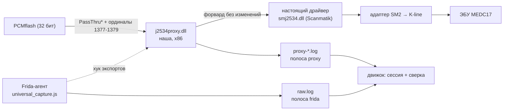
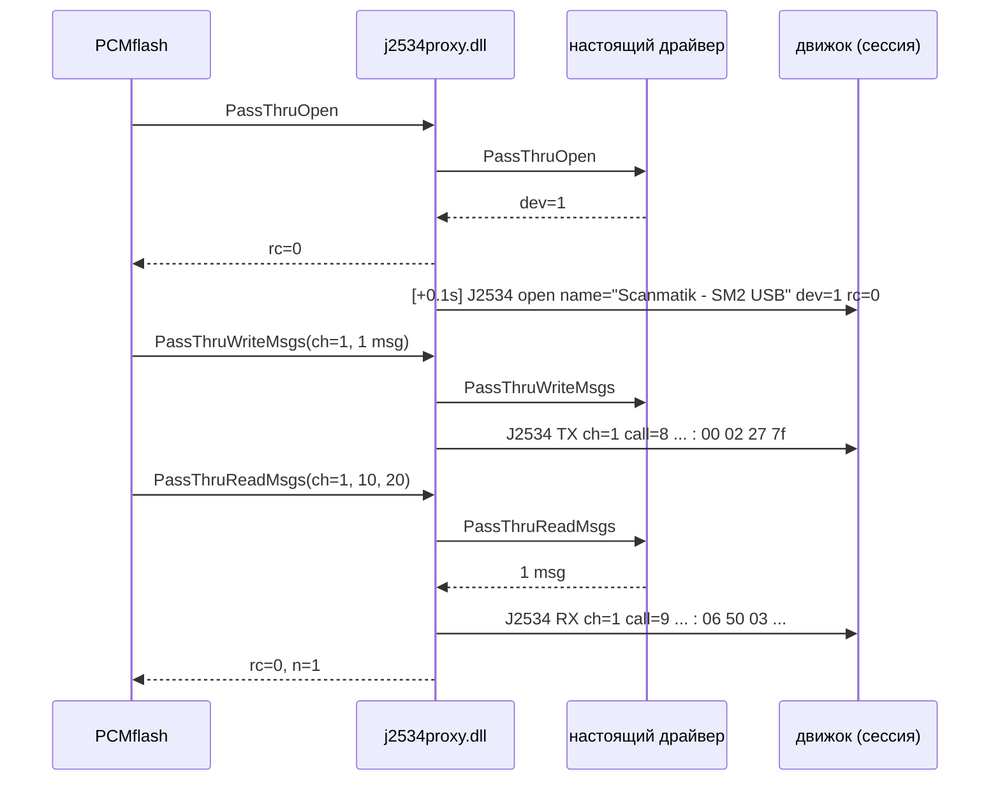
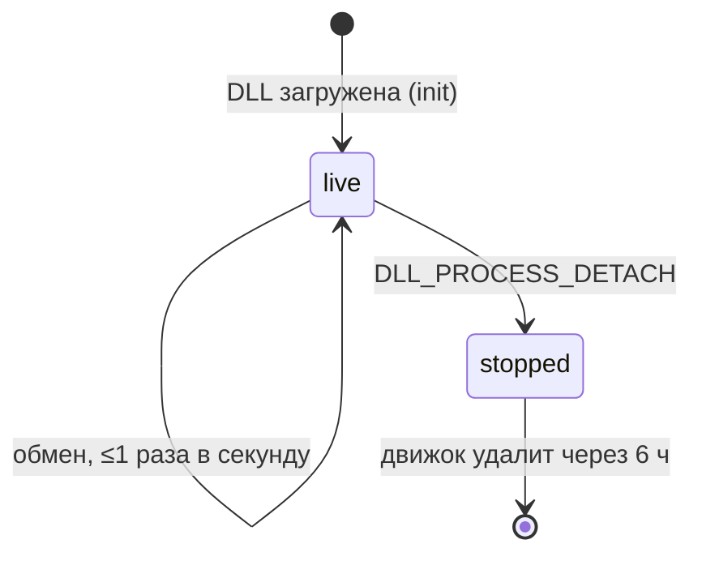
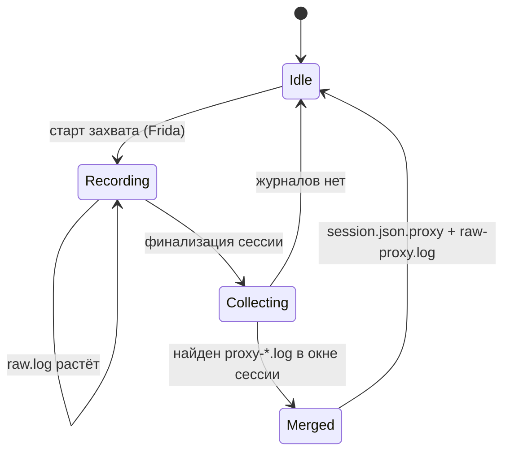
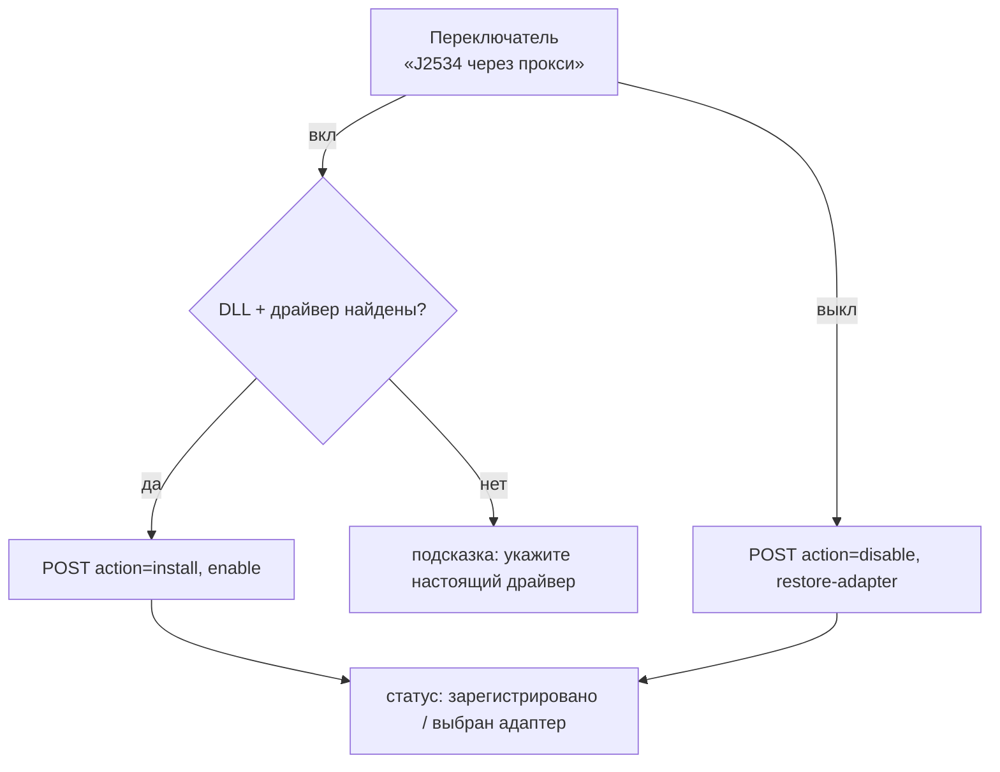

# J2534-прокси: второй канал захвата и его поставка

Документ фиксирует контракт фичи «J2534 через прокси»: что кладётся в установщик, как
регистрируется устройство, в каком виде прокси пишет журнал и как движок сводит его с
обычным (Frida) захватом. Любое расхождение реализации с этим файлом — дефект.

## 1. Зачем

Сейчас обмен J2534 снимается Frida-агентом **внутри** процесса: агент хукает экспорты
загруженной библиотеки адаптера. Это даёт максимум контекста (ABI, каналы, фильтры), но
зависит от возможности внедриться в процесс.

Прокси-DLL — независимый канал: приложение грузит **нашу** библиотеку как обычный
J2534-драйвер, а она форвардит вызовы в настоящий драйвер и пишет журнал **вне** процесса
приложения, своим файловым дескриптором. Отсюда три свойства:

| Свойство | Frida-канал | Прокси-канал |
|---|---|---|
| Точка съёма | внутри процесса, на экспортах | на границе «приложение → драйвер» |
| Зависит от инъекции | да | нет |
| Видит вендорные ординалы 1377–1379 | да (хук экспорта) | да (прозрачный форвард) |
| Переживает падение агента | нет | да |
| Записывает до первого вызова | после attach | с момента загрузки DLL |

Поэтому режим «оба канала»: Frida пишет как обычно, прокси пишет свой журнал, движок
складывает второй журнал в ту же сессию отдельной полосой и **сверяет** кадры.

> Прокси не заменяет настоящий драйвер: он регистрируется **отдельным** J2534-устройством
> и работает только если приложение выбрало именно его.

## 2. Как это устроено





## 3. Состав поставки

Всё лежит в каталоге приложения, рядом с `ftdi-logger.exe`:

| Путь | Что это |
|---|---|
| `j2534proxy\j2534proxy.dll` | прокси, **x86** (PCMflash и драйверы 04.04 — 32-битные) |
| `j2534proxy\j2534proxy.ini` | настройки: настоящая библиотека, каталог журналов, имя устройства |
| `j2534proxy\real_dll.txt` | резервный способ задать настоящую библиотеку (первая непустая строка) |
| `j2534proxy\README.txt` | как включить/выключить руками, как откатить |
| `ftdi-j2534proxy-setup.exe` | установка/снятие записи в реестре и ini (нужны права администратора) |

Имя файла `j2534proxy.dll` содержит `j2534` намеренно: по этому признаку Frida-агент
относит модуль к J2534 (см. `docs/11`, `# api:`), и полоса frida продолжает работать,
когда приложение грузит прокси вместо настоящего драйвера.

## 4. Конфигурация

`j2534proxy.ini` (кодировка ASCII/UTF-8 без BOM, INI-синтаксис Windows):

```ini
[proxy]
Enabled=1
RealLibrary=C:\Program Files (x86)\Scanmatik\smj2534.dll
LogDir=C:\Users\User\AppData\Local\FTDI_USB_Logger\j2534proxy
MaxDataBytes=4128

[device]
Name=Scanmatik - SM2 Proxy
Vendor=DaVinci Cyber Engineering
```

Приоритет источников (первый победивший):

| Параметр | 1 | 2 | 3 |
|---|---|---|---|
| настоящая библиотека | `FTDI_J2534_REAL_DLL` | `RealLibrary` в ini | `real_dll.txt` рядом с DLL |
| файл журнала | `FTDI_J2534_PROXY_LOG` (точный путь) | `LogDir` + имя по шаблону | `%LOCALAPPDATA%\FTDI_USB_Logger\j2534proxy` |
| выключение | `FTDI_J2534_PROXY_OFF=1` | `Enabled=0` | — |

`RealLibrary` подставляется установщиком из **уже зарегистрированного** драйвера
(`FunctionLibrary` того устройства, что выбрано в `HKCU\Software\PCMFlash\Adapter`,
иначе первого, у которого файл существует). Так прокси работает с любым адаптером
(Scanmatik, CHIPSOFT, OpenPort, VXDIAG), а не только со SM2.

Порядок выбора при установке (важен при обновлении, когда PCMflash уже переключён
на наше устройство — тогда «что было до нас» знает только бэкап):

| Шаг | Источник | Когда срабатывает |
|---|---|---|
| 1 | явный `--real` | пользователь указал драйвер сам |
| 2 | бэкап `pcmflash-adapter.bak` | адаптер PCMflash уже наше устройство |
| 3 | `RealLibrary` в ini | файл существует и адаптер не наш |
| 4 | бэкап / выбранный адаптер / первый | всё остальное; «первый из многих» попадает в `notes` |

## 4.1 Выбор «шнурка» из интерфейса

`RealLibrary` не обязан быть загадкой в ini. Движок отдаёт список зарегистрированных
J2534-драйверов и принимает выбор обратно — и то и другое без прав администратора,
потому что ini принадлежит пользователю.

| Метод | Что делает |
|---|---|
| `GET /api/j2534/proxy` → `devices[]` | варианты: `name`, `vendor`, `dll`, `present`, `api`, `current`, `is_proxy` |
| `POST /api/j2534/proxy` `{"action":"set-real","path":"…\\smj2534.dll"}` | записать путь в `RealLibrary` |
| `POST /api/j2534/proxy` `{"action":"set-real","device":"SM2 USB"}` | то же по имени зарегистрированного устройства |

Правила, которые проверяются **до** записи (иначе прокси молча ушёл бы в никуда):

- файл существует — иначе `файл драйвера не найден: …`;
- это не наша DLL — иначе `нельзя проксировать самого себя` (форвард в себя = рекурсия);
- `device` ищется по `Name` и по ключу реестра, без учёта регистра; незнакомое имя —
  `драйвер «…» не зарегистрирован`;
- `Enabled` не меняется: выбор шнурка не включает и не выключает прокси;
- в интерфейсе собственное устройство (`is_proxy`) не показывается вовсе.

Драйвер из ini может быть **не зарегистрирован** в `PassThruSupport` (свой путь, драйвер
с флешки). Тогда он показывается отдельной первой строкой «сейчас в ini · <файл>», чтобы
список не молчал о текущем выборе.

Изменение применяется при следующем запуске программы: DLL читает ini один раз, при
загрузке. В `notes` ответа это сказано прямым текстом.

## 5. Реестр

Регистрируется **отдельное** устройство, штатная запись не трогается:

```
HKLM\SOFTWARE\WOW6432Node\PassThruSupport.04.04\<device.Name>
    Name                       = Scanmatik - SM2 Proxy
    Vendor                     = DaVinci Cyber Engineering
    FunctionLibrary            = <app>\j2534proxy\j2534proxy.dll
    ConfigApplication          = ""
    ConfigApplicationArguments = ""
```

`FunctionLibrary` пишется **полным путём**: J2534-приложения не раскрывают `%…%` и не ищут
DLL в PATH.

| Действие | Права | Что меняется |
|---|---|---|
| установка | администратор | запись `PassThruSupport.04.04\<name>` + `j2534proxy.ini` (`Enabled=1`), PCMflash **не трогается** |
| включение | администратор | `Enabled=1` + переключение `HKCU\Software\PCMFlash\Adapter` (с бэкапом) |
| выключение | пользователь | `Enabled=0`, восстановление `Adapter` из бэкапа |
| снятие | администратор | удаление записи реестра, восстановление `Adapter`, ini остаётся |

Разделение важно: установщик делает только «установку» — он не имеет права молча
переключать адаптер в чужой программе. Переключение всегда осознанное действие
пользователя (галка в настройках или `--select-adapter`).

Выбор адаптера в PCMflash: `J2534: <device.Name>`. Прежнее значение сохраняется в
`<LogDir>\pcmflash-adapter.bak` и восстанавливается при выключении.

## 6. Формат журнала

Файл: `<LogDir>\proxy-YYYYMMDD-HHMMSS-pid<PID>.log`, создаётся при первом вызове,
дописывается, сбрасывается на диск после каждой строки (`FlushFileBuffers`), чтобы журнал
был жив при падении приложения.

Шапка (до первой строки обмена):

```
# capture start: label=J2534 proxy
# proxy: dll="C:\...\j2534proxy.dll" real="C:\Program Files (x86)\Scanmatik\smj2534.dll" pid=8120 bits=32
# wall(start)=2026-11-19 18:56:10.123
# api: 04.04 dll="j2534proxy.dll" ver="1.0.0.120" path="C:\...\j2534proxy.dll" pid=8120 bits=32 dec=1
# agent: j2534proxy.dll mode=proxy
# device: name="Scanmatik - SM2 Proxy" vendor="DaVinci Cyber Engineering"
```

Строки обмена — та же грамматика, что `docs/11` (движок разбирает их тем же
`decode::parse_capture_line`, поэтому журнал прокси можно открыть и как обычную сессию):

| Событие | Строка |
|---|---|
| открытие | `[+0.100000s] J2534 open name="Scanmatik - SM2 USB" dev=1 rc=0 th=8120` |
| канал | `[+0.200000s] J2534 connect dev=1 ch=1 proto=0x8003 flags=0x1000 baud=57600 rc=0 gen=1 th=8120 dur=57431` |
| вызов | `[+0.300000s] J2534 call ch=1 call=7 op=PassThruIoctl ioctl=0x05(FAST_INIT) rc=0 th=8120 dur=812` |
| TX | `[+0.400000s] J2534 TX ch=1 call=8 i=1/1 n_in=1 n_out=1 th=8120 ts=0 flags=0x0 proto=0x8003 svc=0x27 len=4 dur=812 rc=0 : 00 02 27 7f` |
| RX | `[+0.500000s] J2534 RX ch=1 call=9 i=1/1 n_in=10 n_out=1 th=8120 ts=0 rxs=0x0 proto=0x8003 svc=0x50 len=8 dur=20134 rc=0 : 06 50 03 00 00 00 00 00` |
| вендор | `[+0.600000s] J2534 vendor ord=1377 op=0x0 rc=0 th=8120 dur=31` |
| стоп | `# proxy stop: calls=2876 tx=1959 rx=3917 errors=0` |

Правила:

- `[+<секунды>s]` — от загрузки DLL, 6 знаков после точки (как `QPC` в агенте);
- `hex` — строчными, через пробел, ровно `DataSize` байт (обрезается до `MaxDataBytes`);
- `svc=` — только когда он однозначен: для вендорных протоколов (`proto>=0x8000`) это
  `Data[2]`, для `ISO15765` — `Data[0]`; иначе ключ не пишется;
- `dur=` — микросекунды (как у агента), `th=` — `GetCurrentThreadId()`;
- `call=` — сквозной счётчик вызовов процесса, начинается с 1;
- ошибки форвардинга: `[+…] J2534 err op=PassThruConnect rc=0x08` — и та же строка
  дублируется в `# proxy warn:` при невозможности загрузить настоящую библиотеку.

## 6.1 Файл живого состояния: «подхватился или нет»

Журнал отвечает на вопрос «что было в обмене». На вопрос «а прокси вообще загрузился
в эту программу?» он отвечает плохо: чтобы это понять, надо знать каталог, найти файл
и посмотреть шапку. Поэтому рядом с журналом DLL пишет второй, крошечный файл:

```
<LogDir>\proxy-live-<pid>.state
```



| Свойство | Как сделано и почему |
|---|---|
| имя | `proxy-live-<pid>.state`; расширение **не** `.log` — сборщик полосы берёт все `proxy-*.log` как строки обмена |
| запись | `pid`, `state`, `exe`, `dll`, `real`, `log`, `device`, `started`, `updated`, `calls`, `tx`, `rx`, `errors`, `gen`, `bits`, `fatal`, `version` — по строке `ключ=значение` |
| атомарность | пишется в `<path>.tmp` и переименовывается поверх: движок читает файл в любой момент и не должен увидеть половину строки |
| частота | при загрузке и затем не чаще раза в секунду, по факту вызова (`LogLine` → `MaybeWriteLive`); простаивающая программа не переписывает файл 60 раз в минуту |
| завершение | `DLL_PROCESS_DETACH` пишет `state=stopped` и оставляет файл: после выхода программы интерфейс сразу показывает «последний прогон» с его счётчиками |
| поток-пульс | **не используется** намеренно: поток внутри DLL пришлось бы останавливать до `FreeLibrary`, а драйвер, падающий при выгрузке, хуже чуть устаревших счётчиков |
| уборка | движок удаляет файлы старше 6 часов (и `stopped`, и «живые»): каталог не растёт |

Живость определяет **движок**, а не файл: `state=live` означает лишь «DLL не выгружалась»,
а файл остаётся и после аварийного завершения программы.

| Проверка | Результат |
|---|---|
| `state=live`, процесс с этим pid существует и его `exe` совпадает с записанным | `alive=true` → `live.state="loaded"` |
| процесс существует, но путь прочитать не дали (`ERROR_ACCESS_DENIED`) | `alive=true` — живость подтверждена, имя неизвестно |
| pid переиспользован другим процессом (`exe` не совпал) или процесса нет | `alive=false` → `"recent"` |
| файлов нет | `"idle"`: ни одна программа не загрузила прокси-устройство |

`"idle"` — не ошибка, а самая частая причина: в программе выбран другой адаптер. Поэтому
в `live.notes` уходит прямая подсказка, а интерфейс показывает её без раскрытия журналов.

## 7. Ограничения, которые обязаны быть явными

| Ситуация | Поведение |
|---|---|
| `RealLibrary` не задана или файла нет | в журнал `# proxy fatal: real library not found`, все вызовы → `ERR_DEVICE_NOT_CONNECTED` (0x08) |
| `RealLibrary` указывает на саму прокси | отказ загружать (`# proxy fatal: real == self`), чтобы не было рекурсии |
| вызов пришёл до инициализации | `EnsureInit` под критической секцией, единственная загрузка |
| `DataSize > MaxDataBytes` | в журнал `truncated=1`, hex обрезан |
| 64-битное приложение | прокси 32-битная: J2534-приложения 04.04 32-битные, для 64-битных предусмотрен `-Arch x64` в сборке (без вендорных ординалов) |
| журналы копятся | файлы `proxy-*.log` не удаляются автоматически: каждый запуск приложения — новый файл. Чистка — вручную или будущим «хранить N дней»; в сессию попадают только файлы окна сессии (§8). Файлы состояния `proxy-live-*.state` движок удаляет сам через 6 часов (§6.1) |

## 8. Движок: полоса прокси в сессии



Сбор журналов: движок берёт из `LogDir` файлы с `mtime >= started_at - 5 c`, склеивает их
по времени в `<session>\raw-proxy.log`, разбирает `decode::parse_capture_line` и пишет
`<session>\proxy.json`. Сверка — мультимножество кадров `(dir, hex)`:

| Поле | Смысл |
|---|---|
| `files`, `bytes` | сколько журналов и байт подхвачено |
| `tx`, `rx` | кадры в полосе прокси |
| `calls` | вызовов PassThru за сессию |
| `errors` | вызовы с `rc != 0` **включая штатные** `0x10 BUFFER_EMPTY` / `0x11 BUFFER_FULL`: это нормальный результат опроса, а не сбой. В отчёте так и подписано |
| `cross.tx_matched` / `cross.rx_matched` | сколько кадров полосы frida нашлось в прокси |
| `cross.tx_missing` / `cross.rx_missing` | есть в frida, нет в прокси (потеря второго канала) |
| `cross.extra` | есть в прокси, нет в frida (потеря frida) |
| `first_t`, `last_t` | границы по времени прокси |

HTTP (движок, `127.0.0.1:7811`, все пути под `/api` — как у остальных ручек):

| Метод | Путь | Тело / ответ |
|---|---|---|
| `GET` | `/api/j2534/proxy` | состояние + `live` (§6.1) + `devices[]` (§4.1) |
| `POST` | `/api/j2534/proxy` | `{"action":"install"\|"remove"\|"enable"\|"disable"\|"select-adapter"\|"restore-adapter"\|"set-real"}`; для `set-real` — `path` или `device` |
| `POST` | `/api/sessions/:id/proxy/collect` | `{"lane":…}` — подхватить журналы сейчас |

```json
{
  "ok": true,
  "elevated": true,
  "install_dir": "C:\\Users\\User\\AppData\\Local\\FTDI_USB_Logger\\j2534proxy",
  "dll": {"path": "…\\j2534proxy.dll", "present": true, "version": "1.0.0.121"},
  "ini": {"path": "…\\j2534proxy.ini", "present": true, "enabled": true},
  "registry": {"registered": true, "key": "HKLM\\SOFTWARE\\WOW6432Node\\PassThruSupport.04.04\\Scanmatik - SM2 Proxy",
               "device_name": "Scanmatik - SM2 Proxy", "function_library": "…\\j2534proxy.dll"},
  "real": {"path": "C:\\Program Files (x86)\\Scanmatik\\smj2534.dll", "present": true, "from": "registry"},
  "log_dir": "C:\\Users\\User\\AppData\\Local\\FTDI_USB_Logger\\j2534proxy",
  "log_files": 2,
  "pcmflash": {"adapter": "J2534: Scanmatik - SM2 Proxy", "proxy_selected": true,
               "backup": "J2534: Scanmatik - SM2 USB"},
  "live": {
    "state": "loaded",
    "files": 1,
    "items": [{
      "pid": 8120, "state": "live", "alive": true,
      "exe": "C:\\PCMFlash\\PCMflash.exe", "exe_name": "PCMflash.exe",
      "dll": "…\\j2534proxy.dll", "real": "C:\\Program Files (x86)\\Scanmatik\\smj2534.dll",
      "log": "…\\proxy-20261120-142031-pid8120.log", "device": "Scanmatik - SM2 Proxy",
      "started": "2026-11-20 14:20:31.285", "age_s": 3,
      "calls": 2876, "tx": 1959, "rx": 3917, "errors": 0, "gen": 1,
      "bits": 32, "fatal": false, "version": "1.0.0.121"
    }],
    "notes": []
  },
  "devices": [
    {"name": "SM2 USB", "vendor": "Scanmatik", "dll": "C:\\Program Files (x86)\\Scanmatik\\smj2534.dll",
     "present": true, "api": "04.04", "current": true, "is_proxy": false},
    {"name": "Scanmatik - SM2 Proxy", "vendor": "DaVinci Cyber Engineering", "dll": "…\\j2534proxy.dll",
     "present": true, "api": "04.04", "current": false, "is_proxy": true}
  ],
  "notes": []
}
```

Без администратора `POST install/enable` возвращает `ok:false` и `notes:["требуются права администратора"]`,
состояние при этом остаётся согласованным (частичных записей нет).

## 9. Интерфейс

В настройках — раздел «J2534»:



- переключатель выключен по умолчанию; состояние читается из `Enabled` в ini;
- **живой индикатор** сразу под переключателем: «подхвачен: PCMflash.exe» (зелёный),
  «был подхвачен: …» (серый) или «не подхвачен» (жёлтый) плюс строка счётчиков
  «2876 вызовов · TX 1959 / RX 3917 · обмен 3 с назад» и причина, если прокси никто
  не загрузил. Источник — `live` из §6.1, опрос раз в 2 с, пока диалог открыт;
- **выбор «какой шнурок проксировать»** — список зарегистрированных драйверов (§4.1),
  выбран текущий; смена пишет `RealLibrary` и применяется при следующем запуске программы;
- под переключателем — строки статуса: DLL (есть/нет, версия), настоящий драйвер (путь),
  запись в реестре, выбранный адаптер PCMflash;
- кнопка «Подхватить журналы сейчас» — `POST /sessions/:id/proxy/collect` для открытой сессии;
- в шапке приложения — пилюля `прокси`: зелёная «подхвачен: PCMflash.exe», серая «был
  подхвачен: …», жёлтая «не подхвачен»; клик открывает эти же настройки. Пилюля
  появляется только если прокси установлен, и обновляется опросом `/j2534/proxy` (4 с);
- в карточке сессии: бейдж `proxy` и счётчики `TX/RX`, при расхождении — предупреждение.

## 10. Установщик

| Место | Что добавляется |
|---|---|
| `[Files]` | каталог `j2534proxy\` приезжает вместе с payload (без отдельных строк) |
| `[Tasks]` | задача `j2534proxy`, отмечена по умолчанию: «Установить J2534-прокси (второй канал захвата)» |
| `[Run]` | `ftdi-j2534proxy-setup.exe install --app "{app}"` с `runascurrentuser` + `runhidden` + `unchecked`-логика через задачу |
| `[UninstallRun]` | `ftdi-j2534proxy-setup.exe remove --app "{app}"` (молча, без UAC-запроса при удалении — если прав нет, запись останется, это фиксируется в логе) |

Установка per-user (`PrivilegesRequired=lowest`), поэтому регистрация в `HKLM` идёт
отдельным elevated-шагом: если пользователь отменит UAC, установка **не падает**, а
показывает в финале «прокси не зарегистрирован, включите вручную в настройках».

`ftdi-j2534proxy-setup.exe` возвращает `0` при успехе, `2` — если не хватило прав
(установщик по этому коду отличает отменённый UAC от настоящей поломки), `1` — прочее.
Вызовы: `install --app <dir> [--real <dll>]`, `remove --app <dir>`, `enable|disable --app <dir>`,
`status --app <dir> [--json]`.

## 11. Сборка

```powershell
# только прокси (x86 для поставки, x64 для тестов)
powershell -ExecutionPolicy Bypass -File proxy\build.ps1

# вся поставка: dist → portable → Setup.exe
powershell -ExecutionPolicy Bypass -File scripts\build.ps1
powershell -ExecutionPolicy Bypass -File scripts\build-portable.ps1 -SkipBuild
powershell -ExecutionPolicy Bypass -File scripts\build-installer.ps1
```

`scripts\build.ps1` вызывает `proxy\build.ps1` и копирует `proxy\out\x86\` в
`dist\FTDI_USB_Logger\j2534proxy\`; отсутствие компилятора VS — предупреждение, не ошибка
(сборка без прокси остаётся рабочей).

## 12. Проверка

| Уровень | Что проверяется |
|---|---|
| `proxy\tests\smoke.c` | 64-битная сборка прокси над `tests\e2e\fake_j2534\target\release\fake_j2534.dll`: форвард всех 14 функций, журнал разбирается движком |
| `engine\tests\proxy_lane.rs` | разбор журнала, счётчики, сверка, устойчивость к битым строкам |
| `tests\e2e\universal.ps1` | сессия с двумя полосами: `raw.log` + `raw-proxy.log`, отчёт содержит раздел прокси |
| вручную | PCMflash → `Scanmatik - SM2 Proxy`, чтение ЭБУ, в сессии обе полосы |

## 13. Откат

```powershell
# снять регистрацию и вернуть адаптер PCMflash
& "$env:LOCALAPPDATA\FTDI_USB_Logger\ftdi-j2534proxy-setup.exe" remove --app "$env:LOCALAPPDATA\FTDI_USB_Logger"
# или в интерфейсе: Настройки → J2534 → выключить
```

Штатная запись `PassThruSupport.04.04\Scanmatik - SM2 USB` не изменяется ни на одном шаге,
поэтому откат сводится к удалению нашей записи и восстановлению `HKCU\Software\PCMFlash\Adapter`.

## 14. Чек-лист приёмки

- [ ] `proxy\build.ps1` собирает x86 и x64 без предупреждений компилятора
- [ ] `j2534proxy.dll` экспортирует 14 именованных функций **и** ординалы 1377–1379
- [ ] журнал прокси разбирается `decode::parse_capture_line` без `decode_errors`
- [ ] рядом с журналом появляется `proxy-live-<pid>.state`: `state=live` при загрузке,
  `state=stopped` после выгрузки, счётчики растут, файл переписывается атомарно
- [ ] `GET /j2534/proxy` различает `loaded` / `recent` / `idle`, а `alive` падает, когда
  процесса с этим pid уже нет
- [ ] `POST action=set-real` пишет `RealLibrary`, отказывает своей DLL и несуществующему файлу
- [ ] в интерфейсе видно «подхвачен/не подхвачен» без похода в журналы, и список шнурков
  показывает текущий драйвер
- [ ] установщик ставит каталог, регистрирует устройство, снимает запись при удалении
- [ ] переключатель в интерфейсе включает/выключает и переключает адаптер PCMflash
- [ ] сессия с двумя каналами: `session.json.proxy` заполнен, отчёт содержит раздел
- [ ] без администратора включение даёт понятную ошибку, а не полусостояние
