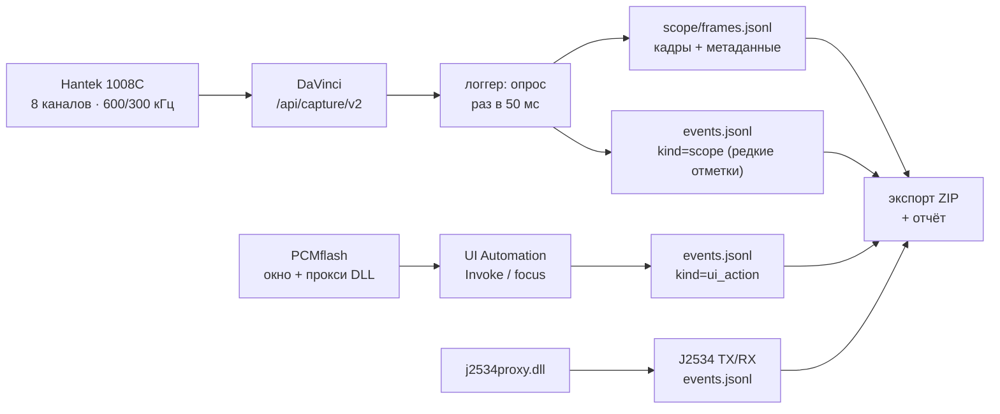
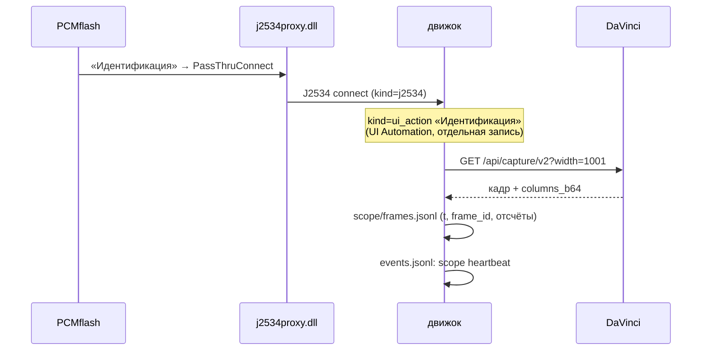

# Осциллограф в логгере: кадры, действия, общий таймлайн

Документ описывает интеграцию FTDI/USB Logger с восьмиканальным осциллографом
«Хелтег да Винчи» (`C:\Users\User\hantek-da-vinci`, служба `http://127.0.0.1:7411`):
как включается, откуда берутся отсчёты, что именно попадает в файлы сессии и какие
утверждения об этих данных допустимы.

Проверки и числа приёмки — `docs/15-scope-acceptance.md`.



## 1. Как включается

| Где | Что | Где хранится |
|---|---|---|
| Настройки → «Осциллограф» | чекбокс «Использовать осциллограф» | `prefs.json`, ключ `scope.enabled` |
| Шапка → кнопка «Осциллограф» | компактный диалог: переключатель, адрес, проверка связи, CH1–CH8, ссылка на веб-интерфейс | `prefs.json`, ключ `scope` |
| `GET/POST /api/scope/config` | то же по HTTP | `prefs.json` |
| `GET /api/scope/status` | живое состояние записи | память движка (счётчики сессии) |
| `POST /api/scope/test` | проверка связи: страница + валидный кадр | ничего не пишет |

`prefs.json` один на установку, поэтому галка переживает перезапуск движка и не
зависит от профиля браузера:

```json
{
  "lang": "ru",
  "scope": {
    "enabled": true,
    "url": "http://127.0.0.1:7411",
    "interval_ms": 50,
    "width": 500,
    "max_mb": 512
  }
}
```

* `interval_ms` — период опроса, 20…1000 мс. Меньше 55 мс смысла нет: служба
  публикует ~13–18 кадров/с.
* `width` — **нижняя граница** ширины кадра. Опросчик поднимает её до
  `window_samples` (см. §3), чтобы каждый столбец был одним отсчётом.
* `max_mb` — предел объёма `frames.jsonl` на сессию; `0` — без предела.

Смена режима во время записи применяется **со следующей сессии**: писатель сессии
читает настройки один раз при старте. В диалоге это написано явно.

## 2. Почему опрос, а не «поток»

Служба DaVinci отдаёт не поток, а **последний кадр** (`/api/capture/v2`) и
непрерывный лог `.dav` на своей стороне. Второй репозиторий в этой версии **не
менялся**: используется существующий интерфейс кадров. Следствия, которые нельзя
скрывать:

* логгер видит только те кадры, которые попали в момент опроса; кадр, целиком
  прошедший между двумя опросами, в архив не попадает;
* один кадр — это окно одного блока АЦП (`n_block`) длиной `window_s` (при 3 каналах 1000 отсчётов и 600 кГц, при 8 — 500 и 300 кГц), а не
  непрерывная запись: между кадрами сигнал не наблюдался (скважность ~2 %);
* время кадра — **время приёма на логгере**, часов источника в ответе нет.

Поэтому в каждой строке записи стоят `time_source: "delivery"` и
`accuracy_ms = interval_ms`: точнее интервала опроса утверждать нельзя.

## 3. Кадр, столбцы и точность выборок

`columns_b64` — base64 от little-endian `i16` **милливольт**, пара `(lo, hi)` на
столбец, столбцы подряд по каналам из `channels`.

| Условие | `representation` | Что в столбце |
|---|---|---|
| `width >= window_samples` | `samples` | ровно один отсчёт: `lo == hi` (точные выборки) |
| `width < window_samples` | `envelope` | min и max нескольких отсчётов (пики сохранены, форма между ними — нет) |

Опросчик начинает с `width = max(настройка, 1200)` и после первого ответа
поднимает ширину до `ceil(window_samples) + 2`. На живой машине это 999+2 столбца
для трёх каналов и 499+2 для восьми — то есть запись идёт **точными отсчётами**,
а не огибающей.

Пустой столбец кодируется как `lo > hi` (в i16 это `32767`/`-32768`) и
напряжением не является: потребитель обязан отбросить его до любой статистики.
Квантование — 1 мВ.

Метаданные кадра (`channel_meta`, `stats`) считаются службой по **сырым**
отсчётам кадра, поэтому `vmin/vmax/vpp/mean/rms/freq/duty` верны и при
`envelope`.

## 4. Файлы сессии

```
sessions/<id>/
  events.jsonl          общий журнал: DLL + actions + редкие отметки scope
  scope/
    meta.json           схема, адрес, интервал, ширина, версия движка
    channels.json       паспорт всех CH1–CH8, включая выключенные (enabled=false)
    frames.jsonl        по строке на принятый кадр
    summary.json        итог записи (кадры, байты, пропуски, сегменты)
    errors.log          ошибки записи кадров (если были)
```

`frames.jsonl`, одна строка (сокращённо):

```json
{"format":"scope-frame/1","t":3.412,"wall":"2026-11-22T07:40:12.318Z",
 "rcv_epoch":1763797212.318,"time_source":"delivery","accuracy_ms":50,
 "frame_id":91234,"generation":0,"dt_s":1.6667e-6,"sample_rate":600000.0,
 "n_block":1000,"window_s":0.001665,"window_samples":999.0,"start_sample":0.0,
 "state":"free","held":false,"width":1001,"representation":"samples",
 "samples_per_column":0.998,"exact":true,"unit":"mV","quantization_mv":1,
 "empty":"lo>hi","blocks_total":91235,"segment":0,
 "channels":[1,2,3],"channel_meta":[…],"stats":[…],"trigger":{…},
 "columns_b64":"…","columns_bytes":12012,"gap_blocks":2,"first":true}
```

| Поле | Смысл |
|---|---|
| `t` | монотонное время сессии, с (общая шкала с DLL и действиями) |
| `wall`, `rcv_epoch` | UTC приёма: для сопоставления с внешними логами |
| `frame_id` | номер **публикации** кадра службой |
| `blocks_total` | номер блока АЦП из `/api/info` — по нему считаются настоящие пропуски блоков |
| `gap_blocks` | сколько публикаций пропущено между принятыми кадрами (`frame_id`), 0 опускается |
| `segment` | растёт при перезапуске службы; через границу сегмента ничего не склеивается |
| `restart` | первый кадр нового сегмента |
| `held` | кадр удержан (Normal/Single/Hold) |
| `channel_meta` | `ch` 1…8, `range`, `full_scale_v`, `center_v`, `saturated`, `dropouts`, пики |
| `stats` | измерения кадра по сырым отсчётам: `vmin/vmax/vpp/mean/rms/freq/duty/n/aliased` |
| `exact` | `true` — в столбце один отсчёт |

Выключенный канал обозначен явно: в `frames.jsonl` его нет (служба не отдаёт
отсчёты), а `scope/channels.json` перечисляет все восемь с `enabled=false`,
диапазоном и шкалой на момент старта записи.

Дедупликация: кадр с тем же `frame_id` второй раз не пишется (в hold служба
отдаёт один и тот же кадр десятки раз). Поэтому в файле меньше строк, чем
опросов, — это норма, а не потеря.

Лимит объёма: после `max_mb` строки пишутся без `columns_b64`
(`degraded: true`), ещё через 8 МБ запись останавливается совсем. Оба факта
видны в `summary.json` и отдельным событием в журнале.

## 5. Отметки в общем журнале

Сами отсчёты в `events.jsonl` не идут: там только редкие события `kind=scope`
(подключение, потеря связи, пропуск, деградация, пульс раз в 5 с, итог).
Пульс несёт `frames/bytes/gaps/gap_blocks/last_frame_id` — по нему видно, что
запись жива между кадрами.



Три записи — нажатие, вызов DLL, сигнал — **не склеиваются**: по ТЗ это разные
факты, и связывает их только общая шкала времени `t`.

## 6. Действия пользователя (UI Automation)

Подписка ставится на главное окно целевого процесса при старте сессии:

| Канал | Что ловит | Когда работает |
|---|---|---|
| `UIA_Invoke_InvokedEventId` | нажатие кнопок/пунктов меню, у которых есть Invoke-провайдер | нативные Win32-приложения, часть VCL/MFC |
| `UIA_AutomationFocusChangedEventId` | смена фокуса на кнопке/вкладке/пункте меню | резерв: legacy-провайдеры (MSAA), Delphi/VCL |

Событие `focus` принимается только для «действенных» типов элементов
(Button, MenuItem, TabItem, CheckBox, RadioButton, ListItem), поэтому фокус в
поле ввода не засоряет журнал. События других процессов отбрасываются по
`ProcessId` до чтения остальных свойств.

В журнал попадает:

```json
{"kind":"ui_action","api":"UIA","t":12.44,"text":"Идентификация",
 "meta":{"action":"identify","automation_id":"btnIdentify","control_type":"Button",
         "window":"PCMflash [1.2.0]","process":"pcmflash.exe","pid":16504,
         "source":"uia","event":"invoke","rect":[812,540,120,32]}}
```

* `action` — нормализованное действие: `identify`, `read`, `write`, `erase`,
  `verify`, `errors`, `reset`, `other`. Исходное название сохраняется в `text`.
* один клик даёт до двух событий (`invoke` + `focus`) — они склеиваются в одну
  запись по имени, `AutomationId` и типу элемента (окно 250 мс);
* быстрые повторные нажатия (интервал больше 250 мс) сохраняются;
* ввод текста, пароли и события из чужих окон не собираются.

Если у программы нет ни Invoke-, ни focus-событий для кнопок (например, чистое
WinForms-приложение через MSAA-мост), движок пишет при старте сессии
`kind=sys, api=UIA` с числом найденных кнопок и `events: false` — это сигнал,
что автоматическая регистрация недоступна, и остаётся ручная метка (`F2`,
`source=manual`).

## 7. Состояния и отказы

| `state` | Когда |
|---|---|
| `off` | галка выключена |
| `connecting` | галка включена, сессия идёт, первый кадр ещё не пришёл |
| `recording` | кадры пишутся |
| `idle` | галка включена, сессии нет |
| `no_link` | служба не отвечает; запись DLL продолжается |
| `stopped` | сессия завершена, итог записан |

Разрыв связи: событие `kind=scope, phase=lost` и продолжение захвата DLL. После
восстановления — `phase=link`, запись продолжается в той же сессии; пропущенные
публикации видны по `gap_blocks` у следующего кадра.

Перезапуск службы: `frame_id`/`blocks_total` уходят назад → `segment += 1`,
`restart: true`; через границу пропуски не считаются.

Старая конфигурация и старые сессии открываются: поле `scope` в `prefs.json` и
поля счётчиков в `session.json` имеют значения по умолчанию, а `scope/`
отсутствует — отчёт просто не печатает раздел осциллографа.

## 8. Экспорт

`POST /api/sessions/{id}/export {"format":"zip"}` упаковывает каталог сессии
целиком, поэтому `scope/frames.jsonl`, `scope/meta.json` и `scope/summary.json`
попадают в архив без отдельного шага. `report.md`/`report.txt` получают раздел
«Осциллограф» с числом кадров, объёмом, пропусками и ограничениями (§2, §3).
CSV-экспорт событий содержит `kind=scope` и `kind=ui_action` на общей шкале `t`.

## 9. Границы

* Точность привязки к сигналу — ±интервал опроса (50 мс по умолчанию) плюс
  задержка HTTP; часов источника в API нет.
* Кадры не непрерывны: между ними сигнал не наблюдался.
* При `envelope` форма внутри пары `(lo, hi)` не сохраняется — только пики.
* Порог `max_mb` по умолчанию 512 МБ; при 8 каналах и 13 кадрах/с это ~40 минут.
* Опрос идёт с той машины, где запущен движок; адрес осциллографа можно указать
  только `http://` (служба не умеет TLS).
* UI Automation видит только то, что программа отдаёт через UIA/MSAA; для
  приложений без провайдера автоматическая регистрация невозможна и это
  фиксируется, а не замалчивается.
