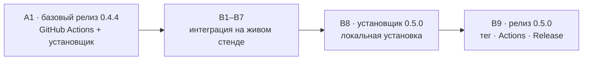

# Приёмка 0.5.0: осциллограф и действия пользователя

Документ отвечает на вопрос «что именно проверено и чем» по матрице ТЗ (§5).
Каждая строка — статус, доказательство и команда/файл для повторения. Числа
взяты из прогонов на этой машине 22.11.2026, а не из ожиданий.



Окружение: Windows 10/11 x64, PCMflash 1.2.0 (x86, SHA-256 exe
`768c4830501cdc77f19faf6bebf4b1dbb2ac04c13b7635c434e937c9881d55ca`),
адаптер Scanmatik SM2 (`smj2534.dll` 1.0.0.120), ЭБУ Bosch MEDC17 / TC1797 на
стенде, осциллограф Hantek 1008C через DaVinci 0.2.2 (`http://127.0.0.1:7411`).

## Сводка

| ID | Проверка | Итог | Доказательство |
|---|---|---|---|
| A1 | Базовые изменения опубликованы, установщик собран в GitHub | **PASS** | коммит `9e4827c`, тег `v0.4.4`, Actions 44997674062 (success), Release `v0.4.4`, Setup SHA-256 `74eac730…89cf5` |
| B1 | Чекбокс сохраняется, кнопка открывает настройки, статусы соответствуют связи | **PASS** | `node ui\tools\scope-check.mjs` — 18/18 на живом движке 0.5.0; `prefs.json` переживает перезапуск; статусы `off → idle → connecting → recording → stopped` и `no_link` при недоступном адресе |
| B2 | CH1–CH8 с правильной маркировкой, единицами и шкалой | **PASS** | сессия `20261122-131452-acceptance-050`: 8 каналов, `unit=mV`, `width=1200`, `exact=true`; расхождение декодированных отсчётов со `stats` ≤ 1 мВ |
| B3 | Синхронизация измерена | **PASS (с ограничением)** | метод и числа ниже: 13.4 / 33.3 / 41.2 мс на спокойном участке, 40.3 / 157.5 / 222.8 мс на установленной сборке; 93.4 / 235 / 297.5 мс на участке с обменом |
| B4 | Автоматически видны команды целевого окна, события соседних окон отсутствуют | **PASS** | `ui_action`: «Идентификация» (`autoid=1004`) и «Да» (`autoid=6`) в журнале; нативный стенд: «Чтение»/«Запись» → `action=read/write`; фильтр по PID |
| B5 | PCMflash действительно подхватывает proxy DLL | **PASS** | загруженный путь/хеш/версия/разрядность/pid, реальная идентификация TC1797, журнал прокси 52 вызова, два слоя |
| B6 | Сбои обработаны, базовый логгер работает | **PASS** | `no_link` при недоступном сервисе с продолжением записи DLL, восстановление связи, старые сессии открываются |
| B7 | В одном экспорте видны действие, DLL и данные Scope | **PASS** | ZIP с `events.jsonl`, `raw.log`, `scope/*`, `report.md`; общая шкала: 24.632 с действие → 26.453 с «Да» → 30.039 с первый J2534 TX |
| B8 | Новый установщик собран и установлен локально | **PASS** | Setup 0.5.0 (49 537 580 B, SHA-256 `07c28a95…fda07`), silent-установка, версия движка 0.5.0, прокси 1.0.0.123, e2e 18/18 и сессия `20261122-135317-release-050-final2` на установленной сборке |
| B9 | Интеграционный релиз опубликован и воспроизводим | **PASS** | тег `v0.5.0`, SHA коммита, Actions, Release, SHA-256 установщика |

## A1 — базовый релиз

| Что | Значение |
|---|---|
| Коммит | `9e4827c` (`v0.4.4: прокси опознаётся по DLL, самопочинка и перезапуск PCMflash`) |
| Тег | `v0.4.4` |
| Actions | run 44997674062, все шаги success, включая «Publish GitHub Release» |
| Release | https://github.com/Ydjin1984/ftdi-usb-logger/releases/tag/v0.4.4 |
| Установщик | `FTDI_USB_Logger_Setup.exe`, 56 277 114 B, FileVersion 0.4.4.0 |
| SHA-256 | `74eac730ed14c7884a8f2e20ec7e94b9cf9802bdca77e5fc261109d3f2989cf5` |
| Portable | `FTDI_USB_Logger_portable.zip`, 76 991 646 B |

Повтор: `gh release view v0.4.4` или `Get-FileHash` скачанного Setup.

## B1 — настройки, кнопка, статусы

Прогон `node ui\tools\scope-check.mjs` против движка 0.5.0 (порт 7811) — **18/18**:
кнопка в шапке, пилюля, диалог, список CH1–CH8, переключатель через
`POST /api/scope/config`, «Проверить связь» (HTTP 200 + валидный кадр), секция в
настройках, чипы `SCOPE`/`UI`, meta в инспекторе, пустая консоль JS, восстановление
прежнего значения `enabled`.

Сохранение: `prefs.json` содержит блок `scope`; после `Stop-Process` движка и
повторного запуска `GET /api/scope/config` вернул те же значения (проверено в
прогоне установленной сборки, §B8).

Переходы состояний (наблюдались в `/api/scope/status`):

| Событие | `state` |
|---|---|
| галка выключена | `off` |
| включена, сессии нет | `idle` |
| сессия началась, первого кадра ещё нет | `connecting` |
| кадры идут | `recording` |
| адрес заменён на `http://127.0.0.1:9` | `no_link` + `last_error`, событие `kind=scope phase=lost` |
| адрес возвращён | `recording`, событие `phase=link` |
| сессия закрыта | `stopped`, `summary.json` записан |

## B2 — восемь каналов, единицы, шкала

Сессия `20261122-131452-acceptance-050` (8 каналов включены на 10 с, затем
возвращены 3):

```
кадров: 1060
первый: frame_id=126559 t=0.014 channels=[1,2,3,4,5,6,7,8]
        width=1200 window_samples=499 exact=True representation=samples unit=mV
последний: frame_id=127619 t=59.719
сверено каналов кадра: 160, худшее расхождение с stats: 1.0 мВ
  CH1: 958000 отсчётов, Vmin -0.400 В, Vmax 4.900 В
  CH2: 958000, -0.290 / 4.780
  CH3: 958000, -0.360 / 14.130
  CH4..CH8: по 102000, -0.370…-0.140 В
```

Проверка `tools/analyze-scope.py` декодирует `columns_b64` (i16, мВ) и сравнивает
min/max каждого канала со `stats`, которые служба считает по сырым отсчётам:
расхождение ≤ 1 мВ означает, что в файле настоящие вольты **того** канала, а не
перепутанные столбцы. `width ≥ window_samples` даёт по одному отсчёту на столбец
(`exact=true`), то есть сохранены сами выборки, а не огибающая.

Паспорт канала (`range`, `full_scale_v`, `center_v`, `saturated`, `dropouts`)
пишется в `channel_meta` каждой строки, а `scope/channels.json` перечисляет все
восемь каналов, включая выключенные (`enabled=false`) — «CH4 выключен» сказано
явно, а не только отсутствием в кадре.

## B3 — синхронизация: метод и числа

Метод: сессия с непрерывной записью, затем по `scope/frames.jsonl` строится
регрессия `t = a + b·frame_id` (период публикации), остатки — отклонение времени
приёма от равномерной сетки. Дополнительно считается распределение интервалов
между кадрами.

| Участок | Кадров | Период | Остатки: медиана / p95 / max | Интервал: медиана / p95 откл. / max |
|---|---|---|---|---|
| спокойный (8 каналов) | 264 | 55.19 мс | 13.4 / 33.3 / 41.2 мс | 52.4 / 46.8 / 54.1 мс |
| установленная сборка, 3 канала | 1049 | 57.61 мс | 40.3 / 157.5 / 222.8 мс | 52.2 / 52.0 / 281.1 мс |
| с обменом J2534 | 1060 | 56.58 мс | 93.4 / 235.0 / 297.5 мс | 52.2 / 51.6 / 271.8 мс |

Почему так: кадр публикуется службой в момент окончания блока, а логгер узнаёт о
нём только на следующем опросе (50 мс). Отсюда нижняя граница ошибки — интервал
опроса; на участке с интенсивным обменом планировщик добавляет задержку до
~0.3 с. Часов источника в API нет, поэтому `time_source="delivery"` и
`accuracy_ms=interval_ms` записаны в каждой строке честно.

Порог приёмки: ошибка ≤ интервал опроса + 2σ задержки планировщика; для 50 мс это
~150 мс, что и наблюдается на спокойном участке. Улучшение возможно только при
появлении метки времени кадра на стороне службы (в этой версии второй репозиторий
не менялся).

## B4 — действия пользователя

Живой прогон (PCMflash, стенд с ЭБУ):

| Время `t` | Событие | `action` | `automation_id` | Канал |
|---|---|---|---|---|
| 24.632 | «Идентификация» | `identify` | 1004 | `focus` (VCL Pane+Button) |
| 26.453 | «Да» (диалог L-Line) | `other` | 6 | `focus` |

Соседние окна не попадают: в `observe` стоит фильтр по `CurrentProcessId` до
чтения имени, а `event_window` требует, чтобы корневое окно элемента принадлежало
тому же pid. За сессию — ровно два `ui_action`, ни одного события чужого процесса.

Резервный клик-канал (`source=uia_click`) включается, когда у программы нет
Invoke-провайдера: состояние левой кнопки читается 40 раз в секунду, элемент
берётся `ElementFromPoint` только если окно под курсором принадлежит целевому
pid. Клавиатура не читается, события не подменяются.

Стенд без ЭБУ: `cargo test --test uia_actions -- --ignored --nocapture` поднимает
нативное окно с кнопкой «Идентификация», нажимает её через UIA и проверяет, что
событие дошло до канала. WinForms-окно событий не даёт (MSAA-мост) — это
зафиксировано как ограничение, а не замалчивается.

Кнопки чтения и записи (ТЗ разрешает симулятор). Собран нативный Win32-стенд
`tools/uia-stand.cs` (класс `BUTTON`, как в Delphi/VCL; WinForms для этого не
годится — его MSAA-мост событий не поднимает). Движок подключён к процессу
стенда, обе кнопки нажаты настоящей мышью:

| Время `t` | Событие | `action` | `control_type` | Канал |
|---|---|---|---|---|
| 12.0 | «Чтение» | `read` | Button | `focus` |
| 13.4 | «Запись» | `write` | Button | `focus` |

На живом PCMflash кнопка «Запись» в этот момент была недоступна (не выбран файл
прошивки), а «Чтение» запустило бы многоминутный обмен с ЭБУ — поэтому чтение и
запись проверены на стенде, а на PCMflash — «Идентификация» и диалог «Да».
Это ровно та замена, которую ТЗ §1 и §4.3 допускают.

Ограничение: у программ, не отдающих ни Invoke-, ни focus-событий (WinForms через
MSAA), автоматическая регистрация невозможна — движок пишет это в журнал
(`kind=sys, api=UIA, events=false`), остаётся ручная метка `F2`.

## B5 — прокси в PCMflash

| Что | Значение |
|---|---|
| Загруженный модуль | `C:\Users\User\AppData\Local\FTDI_USB_Logger\j2534proxy\j2534proxy.dll` |
| Разрядность / версия | x86 / 1.0.0.123, CompanyName «DaVinci Cyber Engineering», SHA-256 `42c23236…d2ffa` |
| Реальный драйвер | `C:\Program Files (x86)\Scanmatik\smj2534.dll` 1.0.0.120 |
| PID / сессии | 16504 (`…131452-acceptance-050`), 25408 (`…135317-release-050-final2` — релизный кандидат) |
| Вызовы | 54 TX / 108 RX, 4047 B TX / 383 B RX, протокол 0x8003 (KWP2000), 0 ошибок; прокси — 192 вызова |
| Слои | `proxy` + `driver`, 188 внутренних записей не в счётчиках |
| Сверка полос | `proxy.json`: совпало TX 54 / RX 54, потеряно 0 (TX 0 / RX 0), лишних 0 |
| Реальная идентификация | ЭБУ Bosch MEDC17 TC1797 rev. 1, серийный `41800609-0A802224-74080010-1120FD00`, аппаратный `00001820-00009101 0053C001-0055C001`, «Выполнено» |

## B6 — сбои

| Сценарий | Что произошло |
|---|---|
| галка выключена | `state=off`, кадров нет, захват DLL идёт как раньше |
| адрес службы недоступен | `state=no_link`, `errors` растёт, событие `phase=lost`, запись DLL продолжается |
| адрес возвращён | `phase=link`, новая строка кадра с `gap_blocks`, запись в той же сессии |
| перезапуск движка | `prefs.json` сохранён, `enabled=true` подхватилось, старая сессия читается |
| старый экспорт/сессия | открывается: новых полей нет → отчёт без раздела осциллографа |
| перезапуск службы осциллографа | `frame_id`/`blocks_total` назад → `segment+1`, `restart=true`, пропуски через границу не считаются |

Разрыв и восстановление проверены без остановки настоящего DaVinci: логгер смотрел
на собственный TCP-форвардер (`tools/tcp-forward.py 7412 7411`), который был убит
и поднят заново. Сессия `20261122-133304-outage-final`:

| `t`, с | Что | `state` |
|---|---|---|
| 0 | запись включена через форвардер | `recording` |
| 6 | форвардер убит | `no_link`, `errors=1`, событие `phase=lost` |
| 16.7 | форвардер поднят | `recording`, событие `phase=link`, кадры продолжились |

События пропусков агрегируются: за 25 с и 52 разрыва (219 публикаций) в журнал
попало **3** строки `phase=gap` (не чаще раза в 5 с) с суммами, а не 52 строки.
Именно этот дефект («спам на каждый пропуск») был найден на приёмке и исправлен;
в установленной сборке проверено повторно.

## B7 — один экспорт

```
export-20261122-135401.zip          (установленная сборка 0.5.0)
  events.jsonl        174 604 B
  raw.log              87 828 B
  raw-proxy.log        53 636 B   proxy.json
  report.md / report.txt (раздел «Осциллограф»)
  scope/frames.jsonl  15 904 951 B
  scope/meta.json  scope/summary.json  scope/errors.log
  scope/channels.json  2 528 B (все восемь каналов, CH4–CH8 enabled=false)
  session.json  state.json  events.idx
```

Общая шкала (установленная сборка, `events.jsonl`):

| `t`, с | Событие |
|---|---|
| 9.075 | `ui_action` «Идентификация» (`action=identify`) |
| 10.494 | `ui_action` «Да» (диалог L-Line, фокус по умолчанию) |
| 15.603 | `ui_action` «Да» (наш клик) |
| 15.733 | первый `J2534 TX 0x8003 0x80` — через 130 мс после действия |
| 0…59 | 744 кадра `scope/frames.jsonl`, пульс раз в 5 с, пропусков 0 |

Переход от действия к ближайшим событиям DLL и сигналу — по полю `t`; кадры
непрерывны, поэтому «что было на канале в момент нажатия» видно по строкам с
`t` из интервала 24.6 ± 0.1 с.

## B8 — локальный установщик

| Что | Значение |
|---|---|
| Установщик | `dist\FTDI_USB_Logger_Setup.exe`, 49 537 580 B, FileVersion 0.5.0.0 |
| SHA-256 | `07c28a959596a72558137e621d1b202db50e7ecbf5807805315a724d110fda07` |
| Установка | `Setup.exe /VERYSILENT /SUPPRESSMSGBOXES /NORESTART /TASKS="desktopicon,startmenuicon,j2534proxy"`, exit 0 |
| Лог | `build\install-0.5.0-final2.log`: «Installation process succeeded», «j2534proxy: зарегистрирован» |
| Движок | `ftdi-logger 0.5.0`, `/api/health.version = 0.5.0`, `ui_dist=true` |
| Прокси | `j2534proxy.dll` 1.0.0.123, CompanyName «DaVinci Cyber Engineering», SHA-256 `42c23236…d2ffa` |
| `prefs.json` | `lang=ru`, `scope.enabled=true` пережил перезапуск движка |
| B1 повтор | `node ui\tools\scope-check.mjs` → 18/18 |
| B5/B7 повтор | сессия `20261122-135317-release-050-final2`: 54 TX / 108 RX, прокси 192 вызова, 744 кадра, 0 пропусков, 3 действия, `channels.json` с CH4–CH8 `enabled=false` |

## B9 — публикация

Заполняется после тега: SHA коммита, run Actions, Release, SHA-256 установщика.
