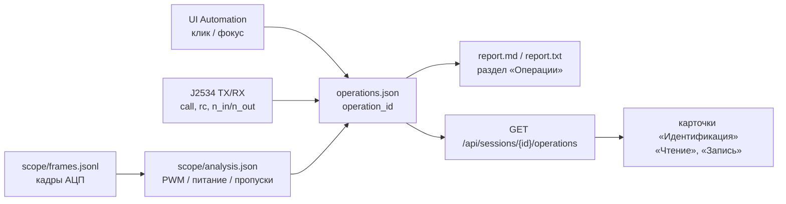

# Операции: клик → вызовы J2534 → сигналы → итог

Документ описывает слой, который связывает подтверждённое действие пользователя,
обмен с ЭБУ, вызовы драйвера, сигналы стенда и результат в одну карточку с
устойчивым `operation_id`. Файлы слоя: `operations.json`, `seedkeys.jsonl`,
`scope/analysis.json`. Проверка на живом ZIP — §8.



## 1. Что считается операцией

Операцию открывает **только подтверждённое действие**: `kind=ui_action`,
`confirmed=true`, `activation=invoke|click`. Фокус (`activation=focus`)
операций не создаёт — он остаётся уликой и виден в журнале.

| Поле | Значение |
|---|---|
| `id` | `op-<N>-<action>`, стабилен при переразборе тех же событий |
| `action` | `identify`, `read`, `write`, `erase`, `verify`, `errors`, `reset` |
| `origin` | `confirmed` — открыта кликом; `derived` — границы выведены из обмена |
| `start_confidence` | `confirmed_click` или `derived` |
| `end_confidence` | `exchange_stop`, `disconnect`, `dialog`, `derived` |
| `t0`, `t1` | начало и конец по общей шкале сессии `t` |
| `segments` | участки непрерывного обмена внутри операции (пауза > 1 с делит) |
| `milestones` | отметки для шкалы: клик, диалоги, сигналы, TX/RX, авторизация, вызовы, disconnect |

Если подтверждённых кликов нет вовсе (импорт чужого лога, программа без UIA),
операции строятся по отрезкам обмена: `origin=derived`, в `notes` прямо сказано
«границы выведены из обмена — предположительно». Это не выдается за действие
пользователя.

### Диалоги

| Действие диалога | Куда привязывается |
|---|---|
| `Сохранить` | назад — результат уже сделанной операции |
| `Да` / `ОК` / `OK` | назад — подтверждение текущего окна |
| `Открыть` / обзор файла (`...`) | вперёд — подготовка следующей операции |
| прочее | к ближайшей операции, если до неё ≤ 60 с, иначе назад |

Привязка диалога — эвристика; в карточке и отчёте она так и названа. В `notes` документа
одна строка на операцию: «привязка диалогов — эвристика по типу действия и времени».

## 2. Порядок «клик ↔ фронт сигнала»

Сигнал известен только интервалом между двумя соседними кадрами: кадр — окно
блока АЦП (~1.66 мс), между кадрами сигнал не писался. Время клика — момент
регистрации UI Automation (опрос мыши 25 мс + чтение свойств элемента), а не
физическое нажатие; задержка не измерялась.

Поэтому у каждого сигнала в карточке есть `order`:

| `order` | Когда | Что пишется |
|---|---|---|
| `before` | фронт заведомо раньше клика | «до клика на X» |
| `after` | фронт заведомо позже клика | «после клика на X (фронт — в интервале Y мс)» |
| `ambiguous` | разница ≤ 200 мс или клик внутри интервала кадров | «порядок с кликом неразличим: разница X при допуске 200 мс» |
| `unknown` | подтверждённого клика нет | «порядок не с чем сравнивать» |

Допуск 200 мс — константа `CLICK_ORDER_TOL_S` в `engine/src/operations.rs`.
Он не «точность», а граница, ниже которой утверждать порядок нельзя.

Ближайший клик выбирается среди старта операции и привязанных диалогов. Если
ближайший диалог дальше 5 с (например, «Сохранить» через 22 с после конца
обмена), якорем становится старт операции: далёкий диалог фронт не объясняет.

## 3. Сигналы стенда

`scope/analysis.json` (`format: scope-analysis/1`) собирается проходом по
`scope/frames.jsonl`; `columns_b64` не читается — нужны только `t`, `frame_id`,
`stats` и `gap_blocks`.

### Профиль каналов

| Профиль | Роли |
|---|---|
| `bench-gpt` (по умолчанию) | CH1 — GPT1, CH2 — GPT2, CH3 — питание |
| пусто | ролей нет, события сигналов не строятся |

Профиль пишется в `scope/meta.json` и `scope/channels.json` при захвате
(`role`, `name` у каждого канала). Для старых сессий без ролей применяется
`bench-gpt`, и `profile_assumed=true` — в отчёте это названо предположением.

### События

| `kind` | Условие | Что означает |
|---|---|---|
| `pwm_on` | размах ≥ 1.0 В | появился PWM на GPT1/GPT2 |
| `pwm_off` | размах < 0.6 В (гистерезис) | PWM пропал |
| `amp_rise` / `amp_fall` | уровень сменился при живом PWM | рост/падение амплитуды |
| `power_on` | пик ≥ 6 В или среднее ≥ 3 В | питание подано |
| `power_off` | пик < 2 В и среднее < 1 В | питание снято |

Уровни амплитуды: `low` < 2.6 В (ранний PWM 1.7–2.1 В), `mid` 2.6–4.2 В,
`high` ≥ 4.2 В (после подачи питания 4.6–5 В). Границы — эвристика по живому
стенду, зависят от щупов и делителей; в отчёте это сказано.

Шум не даёт событий: одиночный «частотный» отсчёт 75 кГц при размахе 0.1 В
остаётся шумом — `pwm` включается только от 1.0 В.

### Покрытие и пропуски

`coverage`: `frames`, `signal_s` (сумма окон кадров), `session_s`, `pct`,
`interval_p50/p95/max_ms`. `gaps` — интервалы, где кадров не было:
`interval_ms > max(3·p50, 150)` или `gap_blocks > 0`; соседние интервалы
сливаются в один пропуск. Это **не** пропуск сигнала: между кадрами его и так
не было (покрытие на стенде ~3 %).

## 4. Вызовы J2534

В карточке операции — `calls` и `notable_calls`.

| Поле | Смысл |
|---|---|
| `write_calls` / `read_calls` | вызовы `PassThruWriteMsgs` / результативные `PassThruReadMsgs` |
| `empty_polls` | `ReadMsgs` с `rc=16`, `n_out=0`, с учётом `n` из сводки `rx-empty` |
| `driver_errors` | `rc` вне `{0, 16}` — ошибка драйвера/адаптера |
| `rc_values` | гистограмма: `0x00×6666`, `0x10×24` |
| `requested` / `returned` | сумма `n_in` / `n_out` |
| `rx_empty` | RX без данных: подтверждение чтения, не ответ ЭБУ |

Классификация важна: `rc=16` при пустом опросе — **штатный таймаут**, а не
ошибка; ошибка драйвера — только `rc` вне `{0, 16}`. В `notable_calls` попадают
вызовы с `rc≠0` или `n_out≠n_in`, плюс первый и последний результативные, чтобы
у карточки были начало и конец обмена. Для каждого: `op`, `call`, `t0`, `t1`,
`dur_ms`, `rc`, канал, `n_in→n_out`, `outcome` (`ok`/`empty`/`timeout`/`error`).

`RX в events.jsonl` вдвое больше числа ответов: на каждый обмен пишутся
нулевой `ReadMsgs` (подтверждение) и кадр с данными. В отчёте это объяснено
отдельной строкой, а сверка с полосой прокси показывает `TX/RX` по операциям
против `proxy.json`.

### Пометки в журнале прокси

DLL пишет их в часть `ключ=значение` строки, **до** `" : "`, поэтому
грамматика `docs/11` и существующие парсеры не меняются:

```
[+3.876183s] J2534 TX ... svc=0x27 len=4 mark=SEED? dur=1263 rc=0 : 00 02 27 7f
[+3.880343s] J2534 RX ... svc=0x67 len=15 mark=SEED seed=b5c4be2f... dur=1555 rc=0 : …
[+4.006567s] J2534 TX ... svc=0x27 len=132 mark=KEY key8=0000000000000000.. dur=24765 rc=0 : …
[+4.010000s] J2534 RX ... svc=0x67 len=5 mark=ACCESS_OK mark=PAIR#1 dur=… rc=0 : …
[+5.000000s] J2534 RX ... svc=0x7f len=3 mark=ACCESS_DENIED nrc=0x33 dur=… rc=0 : …
```

`proxy-live-<pid>.state` получает `pairs=`, `seed=`, `key=`, `denied=` — по
ним видно, дошла ли сессия до ключа, не открывая журнал.

## 5. Авторизация

Сканируются только внешние кадры обмена (`parent` отсутствует), порядок — по `t`.
Состояния в `auth`:

| `kind` | Кадр | Текст |
|---|---|---|
| `seed_request` | TX `27 7F` (KWP) / `27 01` (UDS) | «запрос seed» |
| `seed` | RX `67 7F` / `67 01` + seed | «seed получен: 11 байт» |
| `key` | TX `27 80` + ≥128 байт / `27 02` + ключ | «ключ отправлен: 128 байт» |
| `access_ok` | RX `67 80` / `67 02` | «ключ принят (67 80)» |
| `denied` | RX `7F 27 <NRC>` | «ключ отклонён: 7F 27 33 (invalidKey)» |
| `timeout` | запрос без ответа до конца операции | «результат не установлен» |

Правило подадреса общее для KWP2000 и UDS: **нечётный** подадрес — запрос
seed, **чётный** — отправка ключа; положительный ответ `67 xx` повторяет
подадрес. Для `27 80` тело ключа должно быть ровно 130 байт (`27 80` + 128);
у UDS (`27 02`) длина зависит от ЭБУ и сохраняется фактической.

`auth_status` операции: `granted`, `denied`, `timeout`, `seed_only`, `none`.
`result.status`: `answer`, `denied`, `timeout`, `unknown`, `driver_error`,
`no_exchange`; `result.nrc` — код отказа, `result.text` — готовая строка.

**Содержимое скрыто.** В `operations.json` у seed и ключа только длина, время,
`seq` и `value_hash` (первые 8 hex SHA-256) — по ним можно сопоставить событие,
не раскрывая значение. Полные пары — отдельный `seedkeys.jsonl`:

```json
{"seed":"738d811773f54422156b34","key":"0000…","seed_seq":102,"key_seq":122,
 "seed_t":22.97,"key_t":23.80,"accepted":true}
```

Правило пары: ключ привязывается к **последнему** полученному seed. Если
инструмент запросил seed повторно и не отправил ключ, предыдущий seed остаётся
в списке `seeds` с `key_seq=null` — в отчёте это «seed без ключа: N».
Файл перезаписывается при переразборе и удаляется, если пар нет.

## 6. Файлы сессии

```
sessions/<id>/
  operations.json          операции, вызовы, авторизация, отметки (без значений)
  seedkeys.jsonl           полные пары seed→key (чувствительно)
  scope/analysis.json      события сигналов, покрытие, пропуски
  report.md / report.txt   разделы «Операции» и «Сигналы стенда»
```

`operations.json` пишется при финализации захвата, при `POST /reparse` и лениво
при первом `GET /api/sessions/{id}/operations` (старые сессии/импорт). Ленивый
путь пересобирает и `report.*`, чтобы отчёт не остался без раздела.

## 7. Ограничения

* Переразбор читает `frames.jsonl` целиком. В release на ZIP 129 МБ это
  ~2 с (события 0.7 с + кадры 0.8 с + сборка 0.3 с); дальше читается готовый
  `scope/analysis.json`. Это осознанный размен: результат не зависит от того,
  был ли жив захват.
* Время клика — момент регистрации, задержка UI Automation не измерялась.
  Поэтому `ambiguous` — не осторожность, а единственное честное утверждение.
* Фронт сигнала точнее интервала между кадрами не известен; `width_ms` — это
  ширина интервала, а не погрешность.
* Часов источника у осциллографа нет (`time_source=delivery`); кадры привязаны
  к приёму логгером.
* Привязка диалогов — эвристика по типу действия и близости; в отчёте помечена.
* `auth` разбирает KWP2000 (`27 7F`/`27 80`) и UDS SecurityAccess
  (`27 01`/`27 02`, далее 03/04…) при стандартном заголовке кадра (vendor
  `00 len svc…` или ISO-TP single frame). Нестандартная упаковка не угадывается.

## 8. Проверка на ZIP 20261122-183516-pcmflash

| Что | Результат |
|---|---|
| Операций | 3: «Идентификация» (18.29–24.48 с), «Чтение» (28.28–221.91 с), «Запись» (237.34–311.02 с) |
| Участков записи | 3 (251.04–254.11, 257.42–284.64, 287.96–301.60) |
| Подтверждённых кликов | 13; фокус операций не создал (22 события) |
| Сигналов | 32: PWM 1.65–1.84 В, рост до 4.50–4.95 В, питание −0.35 → 13.06–14.17 В |
| Покрытие | 9.91 с из 317.78 с (3.1 %), медиана интервала 52 мс, максимум 429 мс |
| Пропусков | 162 интервала без наблюдения; 164 пропущенных публикации |
| Пар seed→key | 3 (по одной в каждой операции; в записи 2 seed без ключа) |
| Сверка с прокси | TX 14379 = 54+10992+3333, RX с данными 14379 — совпало |
| Пустые опросы | 24, все в «Записи», `rc=0x10`, `n_out=0` — не ошибки драйвера |

Команды:

```bat
ftdi-logger.exe --root . --port 7811 --no-open --no-bridge
:: ZIP-экспорт — это готовая сессия: импорт распаковывает events.jsonl,
:: scope/frames.jsonl и журналы прокси, повторный импорт даёт id-2
curl -X POST http://127.0.0.1:7811/api/import -H "content-type: application/json" ^
     -d "{\"path\":\"C:\Users\User\Desktop\MEVD17x\export-20261122-184042.zip\"}"
curl -X POST http://127.0.0.1:7811/api/sessions/20261122-183516-pcmflash/reparse
curl http://127.0.0.1:7811/api/sessions/20261122-183516-pcmflash/operations
```

Без движка: `cargo run --example analyze_session -- <каталог сессии>`.
