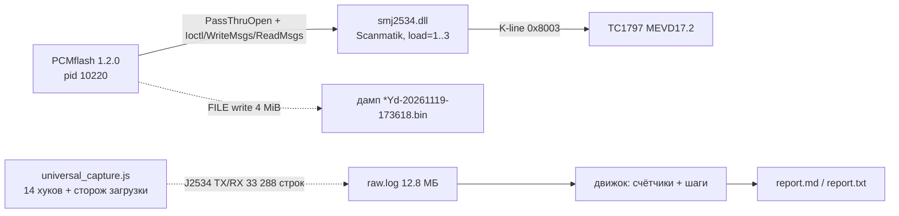
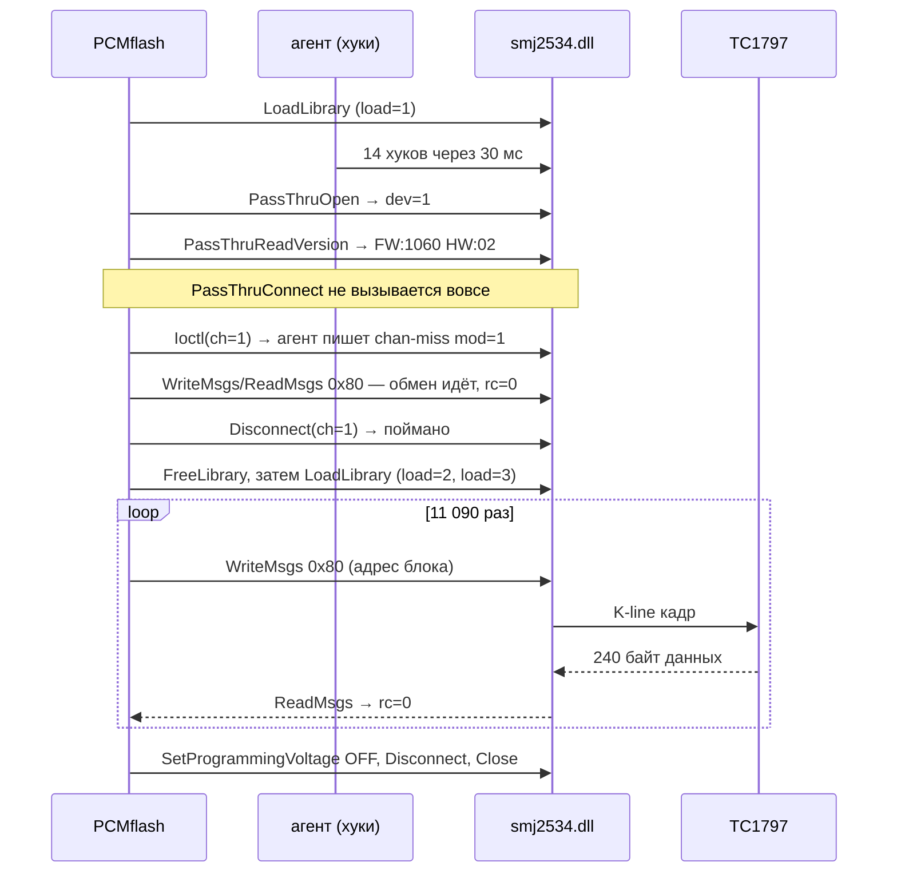

# Разбор лога 20261119-173309 (PCMflash, чтение флеша TC1797)

Сессия 4 мин 11 с: PCMflash снял дамп TC1797 MEVD17.2 по K-line через Scanmatik.
Главный вывод: **захват полный и точный** — потерь, обрезок и искажений нет ни в
одном из 33 588 обменов. Все дефекты, найденные в этом логе, были не в захвате, а
в отчёте: он обнулял объём и считал ошибкой штатное поведение драйвера.

## Обзор

## Что заявлено и что сверено по `raw.log`

Сверял не по отчёту, а по строкам: сумму `len=` считал отдельно, длину тела
сравнивал с `len=` в каждой строке.

| Показатель | В `session.json` | Пересчёт по `raw.log` |
|---|---|---|
| TX | 11 096 / 132 492 B | 11 096 строк, сумма `len=` = **132 492** |
| RX | 22 192 / 2 662 699 B | 11 096 SOF (`len=0`) + 11 096 с данными, сумма = **2 662 699** |
| Длины тел | — | у всех 22 192 строк с телом число байт в `hex` равно `len=` (0 расхождений) |
| `calls` | 33 288 | 11 096 `WriteMsgs` + 22 192 `ReadMsgs` (по одному сообщению на вызов) |
| Потери | `dropped_events=0 truncated_payloads=0 decode_errors=0 evicted_events=0` | подтверждено: `partial_results=0 contract_violations=0` |
| `rc` | — | ни одного `rc != 0` за всю сессию |
| Файл | — | `FILE write n=4194304 total=4194304` — дамп записан целиком |

Идентификация при этом тоже прошла: `0x10 → 0x50`, два `0x27 → 0x67` (сиды),
далее 11 090 обменов `0x80` (загрузка лоадера + чтение блоков).

## Три дефекта отчёта (закрыты в 0.3.6)

| Дефект | Как выглядел | Причина | Исправление |
|---|---|---|---|
| «Итоги» обнулялись | «Посылок 0 / TX 0 B / RX 0 B» при 132 492 B в шапке того же файла | объём суммировался только по распознанным «шагам», а bulk-обмен их не даёт | без шагов объём берётся из счётчиков сессии + строка «по счётчикам сессии (шаги не распознаны)» |
| `chan-miss` считался ошибкой | «Ошибок: 3» в успешной сессии с полностью снятым дампом | приложение не зовёт `PassThruConnect`, канал открывает драйвер | отдельный счётчик `untracked_channels`, в отчёте «Каналов без Connect» |
| протокол не виден | отчёт вообще не говорил, по какой шине шёл обмен | сводки не было, хотя `proto=0x8003` есть в каждом событии | `counts.protocols` по TX, строка «Протокол: `0x8003` (ISO 14230 KWP2000) · 11 096 из 11 096» |

## Почему `chan-miss` — не наша потеря

За сессию `smj2534.dll` загрузилась **трижды**, и на каждой загрузке первый вызов
канала — `ioctl` без наблюдаемого `PassThruConnect`.

Доказательства того, что это не промах хука:

- на load 2 и 3 хуки вешались **до** первого обращения к каналу — за 145 мс и
  238 мс соответственно (load 1 — за 150 мс);
- `disconnect` из того же списка 14 экспортов ловится стабильно;
- тот же `universal_capture.js` на этой же DLL в 32-битном пробнике ловит
  `connect-enter` и `connect` и при `spawn`, и при позднем `attach`.

Вывод: канал открывает сам драйвер, а приложение работает через `ioctl`/`WriteMsgs`
сразу с `ch=1`. Поэтому `chan-miss` остался в логе как факт (полезный: он же несёт
`mod=` — номер загрузки DLL), но перестал попадать в «Ошибки».

## Чего в логе принципиально нет

| Пробел | Природа | Что даёт |
|---|---|---|
| `PassThruConnect` | приложение его не зовёт (см. выше) | канал виден с первого `ioctl`, протокол восстанавливается по `proto=` в TX |
| 3 безымянных экспорта DLL (ординалы 1377–1379: `LogicalConnect`/`Select`/`QueueMsgs`) | `Module.enumerateExports()` не отдаёт записи без имени | если приложение пойдёт через J2534-2, эти вызовы в лог не попадут — лечится только хуком по адресу |
| чтение файлов | `FILE read` = 0 событий: приложение только проверяло наличие файлов (`bytes=0`) | дамп — единственный файловый след, он записан и учтён (4 194 304 B) |

## Наблюдения по самой сессии (не дефекты)

- **Дамп 4 МиБ при 2.66 МБ по шине.** По K-line пришло 2 662 699 B полезных
  данных, а файл записан на 4 194 304 B — незаполненные области флеша
  дополнены, это штатно для полного образа TC1797.
- **`# license-gate`: прокси-активатор выключен.** Сервер активации (Cloudflare)
  недоступен; чтение это не задело, но прошивка может не пойти.
- **`smj2534.dll` выгружалась и грузилась трижды** (8.0 с, 30.5 с, 43.4 с, финал
  на 246.5 с). В окнах между выгрузкой и следующей загрузкой обмена нет — 0 строк
  TX/RX, слепой зоны не возникло.
- **`hook: handle resolve fail … \Device\USBPDO-8`** — не ошибка: путь к
  устройству не разрешился у события `kind=raw`, к J2534 отношения не имеет.
- **`# api` печатается дважды на каждую загрузку** (сначала `ver=""`, потом с
  версией). Движок берёт последнюю строку, на данные не влияет — косметика.
- **`wall` у событий — время прихода в движок**, поэтому расходится с `t` (в этой
  сессии до ~2 с у серии `ioctl`). Авторитетно `t`, у `# MARK` свой `wall`.

## Итоги

- [x] Захват сверен побайтово: 11 096 запросов, 2 662 699 B, 0 расхождений длин
- [x] Найдено и закрыто 3 дефекта отчёта (объём, `chan-miss`, протокол)
- [x] `chan-miss` объяснён и понижен до предупреждения с доказательствами
- [x] Тесты: 148 passed, 0 failed; стенд fake J2534 — full и compact по 10/10
- [ ] Проверить отчёт на логе **записи** флеша (там ожидаются `steps > 0`)
