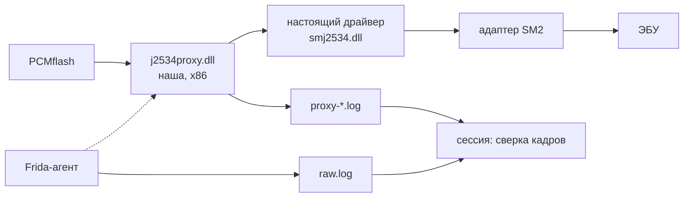

# FTDI/USB Logger 0.4.0

Новый канал захвата: **J2534 через прокси**. Обмен теперь можно снимать двумя
способами одновременно — Frida-агентом изнутри процесса и собственной 32-битной
DLL, которая стоит между программой и настоящим драйвером. Второй канал не
зависит от инъекции: он пишет журнал своим дескриптором и переживает то, во что
агент не пускают.

## Что нового

* **Прокси-DLL** (`j2534proxy\j2534proxy.dll`, x86): 14 функций PassThru и три
  безымянных ординала 1377–1379, без которых Scanmatik отказывается работать.
  Форвард прозрачный, журнал — в грамматике `docs/11`, поэтому движок читает его
  тем же парсером, что и обычный `raw.log`.
* **Установщик ставит прокси вместе с приложением** и регистрирует отдельное
  J2534-устройство «Scanmatik - SM2 Proxy» (галка в мастере, отдельный запрос
  UAC; отмена не валит установку). Штатная запись драйвера не меняется ни на
  одном шаге.
* **Переключатель в интерфейсе** (Настройки → J2534): включает прокси, при
  желании переключает PCMflash на прокси-устройство и возвращает прежний выбор
  при выключении. Состояние показывает, что найдено, а чего не хватает.
* **Вторая полоса в сессии**: `raw-proxy.log` + `proxy.json`, раздел
  «J2534 прокси» в отчётах и сверка кадр-в-кадр с основным каналом.
* **Агент не дублирует кадры.** Когда прокси работает, настоящий драйвер
  загружен ею же, и хук на нём дал бы каждый кадр дважды. Признак работы —
  именованный мьютекс `Local\FTDI_J2534_PROXY_<pid>`, который прокси создаёт до
  загрузки драйвера; без него поведение прежнее.

## Найдено и исправлено по дороге

* Прототип прокси форвардил `PassThruReadVersion` в неверном порядке
  аргументов (`api, dll, fw` вместо `fw, dll, api`): строка версии прошивки
  попадала в буфер API. Тест проверяет, что `api="04.04"`.
* Сверка полос считала кадрами чужой транспорт: 44 кадра HTTP-пробы лицензии
  (Winsock) выглядели как «потеряно в прокси 22.5 %». Теперь сверяются только
  J2534-кадры.
* Установка могла молча взять «первый попавшийся» драйвер: на машине с 12
  J2534-устройствами прокси уезжал на CHIPSOFT вместо Scanmatik. Теперь порядок
  — явный аргумент → бэкап адаптера PCMflash → ini → выбранный адаптер, а
  автовыбор всегда попадает в `notes`.

## Проверено

| Что | Результат |
|---|---|
| Тесты движка | 169 passed, 0 failed, 12 ignored (13 новых) |
| Дымовой тест прокси | 36 проверок: экспорты, форвард 14 функций, дописывание журнала |
| dumpbin | 14 именованных экспортов + NONAME 1377–1379, зависимость только `KERNEL32.dll` |
| Живой цикл на этой машине | регистрация → включение → переключение PCMflash → возврат адаптера → снятие; после снятия 12 устройств, как было |
| Импорт настоящего лога PCMflash | 110/110 TX, 110/110 RX, потеряно 0, лишних 0 |

Подробности, формат журнала, коды возврата и откат — `docs/13-j2534-proxy.md`.

# FTDI/USB Logger 0.3.7

Патч по итогам лога «Прошивка, две попытки» (PCMflash: 110 посылок K-line,
8101 B TX, 47 с). Обмен с ЭБУ записан полностью — ни одного `rc != 0`, ни одного
отрицательного ответа, — но в отчёте четыре показателя не соответствовали логу.

## Что исправлено

* **Сеть больше не считается обменом шины.** В шапке стояло `RX 1706 B`, хотя
  через адаптер прошло 784 B: остальные 922 B — HTTP-проба лицензии
  (`10.0.0.118 → 45.132.18.119:80`), которая пишется в тот же лог. Теперь
  `tx`/`rx` и байты считают только адаптер, сеть — отдельные
  `net_tx`/`net_rx`/`net_bytes` и строка «Сеть (не шина), байт» в отчётах.
* **Транспорт перестал врать.** Захват шёл через J2534 (`smj2534.dll`,
  `PassThruWriteMsgs`), а в отчёте стояло `Транспорт: vcp` — догадка
  «`ftd2xx` не загружен». Пересчёт по событиям жил только в API-detach, поэтому
  сессия, закончившаяся выходом приложения, отчёт не переписывала. Теперь
  `transport_summary` считается в `finalize`, до записи отчёта.
* **841 байт «принятых» из чужой памяти.** Одно событие `LAN RX len=841`
  содержало обрывки UTF-16-путей и сотни нулей: счётчик брался из
  `OVERLAPPED.InternalHigh` без проверки статуса, а там осталось значение
  прошлой передачи. Теперь статус обязан быть успешным, а счётчик больше
  буфера отбрасывается со строкой `LAN WARN …` — лучше потерять событие, чем
  записать чужую память под видом трафика.
* **Вместо пустой схемы — отрезки обмена.** При `Шагов 0` в отчёте рисовалась
  Mermaid-схема `Start → End`, из которой нельзя было понять, что попыток было
  две и между ними 22.5 с простоя. Теперь раздел «Обмен» и факты `# обмен …`:
  `# обмен 1: 3.64–4.11 с (0.47 с) · 52 посылок · TX 4040 B / RX 365 B ·
  0x80×49, 0x27×2, 0x10×1`; `# обмен 2: … · перед ним пауза 22.5 с`.
* **«Потерь нет» больше не выдаётся за факт, когда счётчиков нет.** В этом логе
  не было строки `# agent-counters`, и `# counters` показывала `calls=0` при
  330 вызовах J2534. Теперь в строке есть `agent_counters=0/1`, а в фактах —
  предупреждение, что `dropped/truncated = 0` означает «неизвестно».

Импорт старого `raw.log` даёт тот же отчёт: отрезки обмена пересчитываются из
`events.jsonl`, `transport` остаётся меткой `import` для UI.

# FTDI/USB Logger 0.3.6

Патч по итогам лога «Чтение флеша» (PCMflash снял дамп TC1797: 11 096 запросов,
132 492 B TX, 2 662 699 B RX). Захват сверен побайтово — потерь и искажений нет,
но отчёт искажал картину успешной сессии.

## Что исправлено

* **«Итоги» больше не обнуляются.** Объём считался только по распознанным
  «шагам», а bulk-обмен флеша шагов не даёт — в отчёте стояло «Посылок 0 /
  TX 0 B / RX 0 B» при 132 492 B в шапке того же файла. Теперь без шагов объём
  берётся из счётчиков сессии, и источник назван явно («по счётчикам сессии»).
* **`chan-miss` — не ошибка.** Сессия с успешным дампом показывала
  «Ошибок: 3». За сессию `smj2534.dll` загружалась трижды, хуки вешались
  за 30–238 мс до первого обращения к каналу, `disconnect` ловится — значит
  приложение `PassThruConnect` не зовёт вовсе, канал открывает драйвер.
  Теперь это отдельный счётчик `untracked_channels` и строка «Каналов без
  Connect» в отчёте; в `errors` остаются только настоящие сбои обмена.
* **Протокол виден в отчёте.** Он есть в каждом событии (`proto=0x8003`), но
  сводки не было: в bulk-сессии без шагов отчёт вообще не говорил, по какой
  шине шёл обмен. Теперь `counts.protocols` (по TX) и строка
  «Протокол: `0x8003` (ISO 14230 KWP2000) · 11 096 из 11 096».

# FTDI/USB Logger 0.3.5

Патч по итогам проверки живого лога «Идентификация» (52 посылки K-line):
счётчики сверены побайтово и верны, но отчёт не объяснял единственную ошибку
сессии, а `chan-miss` нельзя было сопоставить с загрузкой DLL.

## Что исправлено

* **Ошибка сессии теперь названа.** Первые 10 ошибок пишутся в
  `session.json` (`counts.error_samples`) и печатаются в отчётах: `ошибки (1):`
  в `report.txt`, раздел `## Ошибки (N)` в `report.md`. Раньше стояло голое
  «Ошибок: 1», и что именно попало в счётчик, можно было узнать только из
  `events.jsonl`. Регресс-тест — `engine/tests/error_samples.rs`.
* **`chan-miss` несёт `mod=`.** Идентификатор загрузки DLL, как у `rx-empty`:
  без него нельзя отличить «канал не открывался» от «открылся при другой
  загрузке модуля».
* **Документировано ограничение экспортов J2534-2.** У `smj2534.dll` 17
  экспортов, 3 из них (ординалы 1377-1379 — `LogicalConnect`/`Select`/
  `QueueMsgs`) без имени; `Module.enumerateExports()` их не отдаёт, они не
  хукаются и в логе не видны (`docs/12`).

# FTDI/USB Logger 0.3.4

Версия закрывает дефекты, найденные при разборе живого лога PCMflash + Scanmatik
и при ревизии кода 0.3.3: потерю сообщений при `rc != 0`, обрезку крупных
буферов, счётчики, которые врали, мусор в отчёте и двойной объём
`events.jsonl`.

## Что исправлено

* **`ReadMsgs` больше не теряет сообщения при ошибке.** Если драйвер снял
  сообщения с очереди и вернул `rc != 0` (контракт это допускает), они
  записываются, а строка вызова получает `partial=1`. Сообщения при
  `ERR_TIMEOUT`/`ERR_BUFFER_EMPTY` с ненулевым счётчиком тоже не теряются.
* **Ёмкость входного массива соблюдается.** `n_out > n_in` больше не читается
  за границу буфера: чтение ограничено `min(n_out, n_in, 256)`, факт нарушения
  виден строкой `J2534 msgs-overflow … read=N` и `contract=n_out_gt_n_in`,
  счётчик — `contract_violations`.
* **Исходные байты CAN не теряются.** Первые 4 байта `Data` по-прежнему
  декодируются в `id=`, но `hex` теперь содержит все `Data[DataSize]`, `len`
  равен их числу, длина идентификатора — `idlen=`. Добавлен `ExtraDataIndex`:
  `xdi=9` в строке, `meta.xdi` в парсере.
* **SOF с данными сохраняет данные.** Короткая строка без `: hex` осталась
  только для SOF с `DataSize=0`.
* **Крупные буферы не обрезаются молча.** FTDI/VCP пишут большие операции
  частями `part=i/n`; при превышении предохранителя появляется явная отметка
  `truncated=1 len=… logged=…` и счётчик `truncated_payloads`.
* **Счётчики потерь разделены.** `dropped_events` — потери захвата (агент +
  мост), `evicted_events` — вытеснение из сводки шага (строки в `raw.log` уже
  записаны), `partial_results`/`contract_violations` — поведение драйвера.
  Мост пишет события батчами 32 КиБ / 20 мс и отдаёт `bridge_events`,
  `bridge_batches`, `bridge_backlog_max`. Строка агента теперь называется
  `# agent-counters`, итог движка — `# counters`.
* **`timeout_ms` в строке вызова**, а агрегат пустых опросов ключуется по
  `module_load_id + gen + rc + timeout_ms` — разные таймауты и коды больше не
  сливаются в одну строку.
* **Сеть не попадает в ответы шага.** TCP/UDP процесса (лицензионный сервер
  PCMflash) идёт в отдельную `net_hist` с `net_tx`/`net_rx`, в отчёте — строка
  «Сеть (не протокол ЭБУ)».
* **Адаптер определяется по логу.** `J2534 open`/`J2534 version` дают
  `vendor`, `serial`, `firmware`, `dll_version`, `api`; работает и при импорте
  готового лога.
* **`errors` больше не считает холостые опросы.** `rx-empty` — это `kind=sys` и
  отдельный `empty_polls` (по сумме `n`); в `errors` остаются только настоящие
  потери (`chan-miss`, ошибки записи).
* **`reads`/`filehash` шага.** Пустые массивы не сериализуются; файл, в который
  шёл `FILE write/close`, хэшируется по факту (до 64 МиБ, `mode=written`,
  `gone`, `too-big`).
* **`events.jsonl` стал на 41 % меньше**: поле `raw` было байт-в-байт копией
  строки `raw.log`. На реальном логе 30.9 МБ: 84.0 МБ → 47.2 МБ.

## Чем проверено

142 теста, стенд на поддельном драйвере (40 проверок `full` / 38 `compact`),
интеграционный прогон движка (10 проверок) и импорт реального лога 29.5 МБ.
Подробности — `docs/12-capture-acceptance.md`.
# FTDI/USB Logger 0.3.3

В этой версии лог J2534 стал полным по вызову, а не только по полезной нагрузке:
у каждого вызова есть номер, размеры входа и выхода, поток и длительность в
микросекундах. Заодно исправлены три дефекта, из-за которых записанный обмен
расходился с тем, что программа реально делала.

## Что нового

* **Полнота вызова.** Каждый вызов `PassThru*` несёт `call` — сквозной номер в
  сессии, `n_in` (сколько запрошено), `n_out` (сколько вернул драйвер), `th`
  (поток) и `dur` (длительность в микросекундах). Если сообщений нет, их
  несколько или вызов завершился ошибкой, пишется отдельная строка
  `J2534 call ch=1 call=1247 op=ReadMsgs n_in=10 n_out=3 rc=0 th=8120 dur=20134`,
  а сообщения ссылаются на неё через `call` и `i=1/3`. Одиночное сообщение
  по-прежнему несёт все общие поля на своей строке.
* **FAST_INIT и таблица ioctl с буферами.** `ioctl` пишет имя операции из
  таблицы `PT_IOCTL_NAMES` — `id=0x0005 (FAST_INIT)`, `0x0003 (READ_VBATT)`,
  `0x0002 (SET_CONFIG)` — и оба буфера целиком: `in=`/`out=` слитным hex. Для
  `FAST_INIT` вход и выход разложены как `PASSTHRU_MSG` (04.04), поэтому в
  строке видны и заголовок (`in_proto`, `in_rxs`, `in_flags`, `in_ts`,
  `in_edi`, `in_size`), и `Data`. Неизвестный `id` и недоступный выход дают
  `in_ptr`/`out_ptr` и `dec=0` без выдуманного содержимого.
* **Фильтры с маской и паттерном.** Строка `J2534 filter` содержит
  `type=0x0001 (PASS_FILTER)`, `mask=` и `pattern=` слитным hex, `flow=-` при
  `pFlowControlMsg = NULL`, а также `proto`/`flags` из `pPatternMsg`.
  `filter-stop`, `periodic-start`, `periodic-stop` несут общий `call`.
* **Подавленные таймауты в счётчиках.** Штатные `ERR_BUFFER_EMPTY 0x10` и
  `ERR_TIMEOUT 0x11` — это опрос, а не сбой, поэтому построчно они не пишутся
  (иначе поток забивается). Теперь они не теряются: агрегат
  `rx-empty ch=1 n=10 timeout_ms=20 last_rc=0x11` и `tx-err-stat` раз в 5 с и на
  `disconnect`, плюс `calls` в `# counters`.
* **FILE read.** Операция чтения файла пишется короткой формой
  `FILE read h=0xe10 off=0x1F0000 len=0x1000 total=0x400000` — дескриптор,
  смещение, длина и размер файла. Не более 4096 строк на сессию, дальше только
  агрегат в `# counters`.
* **Два режима сбора: `full` и `compact`.** `full` пишет каждый вызов, каждый
  элемент массива сообщений и каждый SOF отдельной строкой — это режим разбора
  протокола. `compact` агрегирует пустые опросы по `ch`/`rc`/`timeout`, полезные
  кадры пишет поштучно, а SOF сворачивает в счётчик `rx_sof` — это режим
  длинного прогона. Режим виден в баннере `# agent: … mode=…`.
* **Диагностика хуков.** Шапка лога содержит `# api:` (`api`, `dll`, `ver`,
  `path`, `pid`, `bits`, `dec`) и `# hooks` (`mod`, `base`, `load`, `exports`,
  `attached`, `dup`, `failed`) на каждый модуль. `attached` растёт только при
  реально установленном хуке, поэтому `exports=14 attached=13 failed=1` сразу
  показывает дырку в захвате.
* **Диагностика канала.** `chan-miss ch=1 gen=2 first_op=filter th=8120` —
  операция пришла на канал, который агент не видел открытым (attach после
  `Connect`, пауза захвата). `chan-possibly-open … reason=resume` помечает
  канал, который мог открыться, пока хуков не было; такие события не выдаются
  за новую сессию.
* **PassThruSupport 05.00.** Драйверы 05.00 регистрируются и хукаются, вызовы и
  сырые указатели попадают в лог, но структуры `PASSTHRU_MSG` не декодируются:
  `PT_MSG_SIZE = 4152` верен только для 04.04. В таких строках стоит `dec=0`,
  и по нему видно, что `in=`/`out=` читать нельзя. То же — если DLL
  зарегистрирована в обеих ветках и версия API не прочитана.
* **QPC-метки с микросекундами.** Отметка времени в начале строки берётся с
  QPC и пишется с шестью знаками после точки (`[+31.907431s]`). Старые
  трёхзнаковые метки читаются как раньше. Вместе с `dur` это позволяет мерить
  задержки вызовов внутри одного обмена.

## Исправления

* **Пропавший `J2534 connect`.** Вызов `PassThruConnect` в некоторых сборках не
  попадал в лог вовсе: вход и выход писались одной веткой, которая не срабатывала
  при успешном открытии канала. Теперь вход пишется до вызова
  (`J2534 connect-enter dev=1 proto=0x8003 flags=0x0 baud=250000 th=8120`), исход —
  после (`J2534 connect … rc=0 gen=1 dur=57431`), и по `dur` видно, сколько
  заняло открытие канала.
* **Потеря второй сессии после Close→Open.** Канал ключевался только по номеру
  `ch`, а `PassThruClose`/`PassThruOpen` (и повторная загрузка DLL по тому же
  адресу) не меняли ключ — события второй сессии склеивались с первой или
  попадали в «неизвестный канал». Теперь ключ канала —
  `pid | module_load_id | ch | gen`: `module_load_id` считает загрузки имени
  модуля (адрес базы после выгрузки повторяется), `gen` растёт только после
  успешного `Connect`. Разрыв виден по `chan-miss`/`chan-possibly-open`, а не
  теряется молча.
* **SOF-кадры больше не считаются ответами и не печатают hex.**
  `rxs=0x2 START_OF_MESSAGE` с `DataSize=0` — служебный маркер, а не ответ.
  Раньше такой кадр попадал в счётчик ответов (один ответ считался дважды) и
  писал пустую секцию `: `. Теперь это короткая строка с `sof=1`, без hex, вне
  счётчика полезных сообщений; в `compact` — только агрегат
  `rx-sof-stat ch=1 n=33777`.

## Совместимость

* Старые логи читаются без ошибок: трёхзнаковые метки времени, `J2534 rx-error`
  / `tx-error`, прежняя форма `FILE read <path> offset=… n=… len=…` и
  `FILE write <path> …` остаются рабочими.
* Старые сессии (`session.json`, шаги, отчёты, `events.jsonl`) читаются и
  переразбираются новой сборкой; переселения каталога `sessions\` не требуется.
* `events.jsonl` сохраняет поля `api` (`"J2534 TX"`/`"J2534 RX"`) и `hex` — на
  них опирается `re/01_extract_pairs.py`; новые поля идут в `meta` и старым
  скриптам не мешают.
* Незнакомые ключи в строке лога парсер по-прежнему принимает и складывает в
  `meta`, а не отбрасывает строку.

## Установка

* **Установщик** `FTDI_USB_Logger_Setup.exe` (≈43 МБ): per-user установка в
  `%LOCALAPPDATA%\FTDI_USB_Logger`, ярлыки на рабочем столе и в меню «Пуск»,
  запись в «Установка и удаление программ», штатный uninstall. При первом
  запуске нужен UAC: движку требуются права для Frida-хуков и чтения чужих
  процессов. Само окно интерфейса открывается уже без администратора.
* **Portable ZIP** `FTDI_USB_Logger_portable.zip` (≈64 МБ): распаковать и
  запустить `FTDI_USB_Logger.exe`; Python и Frida встроены, ничего доустанавливать
  не нужно.
* Сессии и логи лежат в каталоге установки (`sessions\`); при удалении их можно
  сохранить. Установщик не подписан — SmartScreen может показать «Неизвестный
  издатель», нужен пункт «Подробнее» → «Выполнить всё равно».
* Смена версии совместима с предыдущей: существующие сессии открываются, а новый
  захват сразу пишет расширенный формат.
