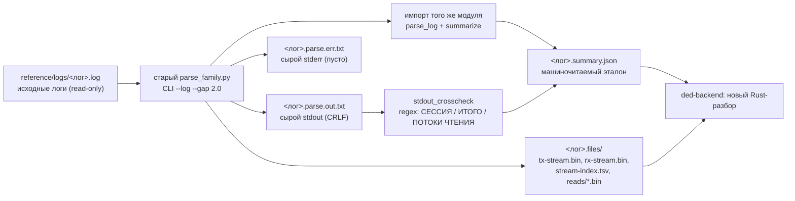
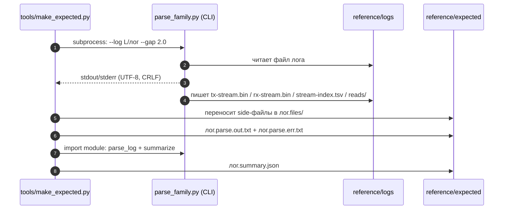

# Эталоны старого разбора логов (golden для сверки нового движка)

Каталог содержит **воспроизводимый эталон** вывода старого питон-парсера `parse_family.py` на пяти ссылочных логах. `ded-backend` (Rust) сравнивает свой разбор с этими артефактами: числа, гистограммы, потоки чтения и побайтовые `tx/rx-stream.bin`/`reads/*.bin`.

> Источник истины — старый инструмент, а не переписанный: `E:\Replica\work\orig-capture\parse_family.py`, sha256 `fdbc6f2beed0e38197384633c327ebdc3e74e07f3365883cbbcc6f5eafd5965b`, Python 3.12.4, режим `--gap 2.0`.
>
> Каталог `reference/logs/` — read-only (логи не изменялись). `engine/`, `ui/`, `sidecar/` в рамках этой работы не трогались.

## 1. Как устроен golden и что с ним делает новый движок



Уровни сверки:

| Уровень | Артефакт | Строгость |
|---|---|---|
| Машиночитаемый | `<лог>.summary.json` | **строго**: сессии, `exchanges`, `tx_bytes`, `rx_bytes`, `cmd_hist`, `resp_hist`, `reads[]` (start/len/blocks/sha256), `filehash[]` |
| Бинарный | `<лог>.files/tx-stream.bin`, `rx-stream.bin`, `reads/*.bin` | **байт-в-байт** |
| Табличный | `<лог>.files/stream-index.tsv` | значения и порядок строк (LN-разделитель, CRLF) |
| Текстовый (справочный) | `<лог>.parse.out.txt` | не для байтового diff нового движка; используется для чтения человеком и как источник `stdout_crosscheck` |

## 2. Состав каталога

| Путь | Что это |
|---|---|
| `README.md` | этот документ |
| `manifest.json` | роли, размеры и sha256 всех golden-артефактов + sha256 входных логов и парсера |
| `tools/make_expected.py` | генератор: гоняет старый CLI, переносит side-файлы, собирает `summary.json` |
| `tools/make_manifest.py` | генератор `manifest.json` |
| `<лог>.parse.out.txt` | сырой stdout старого CLI (UTF-8, CRLF, байты как есть) |
| `<лог>.parse.err.txt` | сырой stderr (у всех пяти логов пустой, 0 Б) |
| `<лог>.summary.json` | машиночитаемая выжимка (`schema: old-parse-family-golden/v1`) |
| `<лог>.files/` | только для двух трафиковых логов: `tx-stream.bin`, `rx-stream.bin`, `stream-index.tsv`, `reads/` |

Итого 32 golden-файла (`manifest.json` → `artifacts_count: 32`).

## 3. Команды воспроизведения

Каноническая команда для одного лога (именно она записана в `parser.command` каждого `summary.json`):

```bat
"C:\Users\User\AppData\Local\Programs\Python\Python312\python.exe" ^
  "E:\Replica\work\orig-capture\parse_family.py" ^
  --log "D:\FTDI_USB_Logger\reference\logs\winkfp-e2e-capture.log" ^
  --gap 2.0
```

Полная перегенерация всего каталога (5 логов, side-файлы раскладываются в `*.files/`):

```bat
"C:\Users\User\AppData\Local\Programs\Python\Python312\python.exe" ^
  "D:\FTDI_USB_Logger\reference\expected\tools\make_expected.py"

"C:\Users\User\AppData\Local\Programs\Python\Python312\python.exe" ^
  "D:\FTDI_USB_Logger\reference\expected\tools\make_manifest.py"
```



Важно про поведение старого парсера:

- `parse_family.py` **пишет side-файлы рядом с логом** (`dirname(--log)`): `tx-stream.bin`, `rx-stream.bin`, `stream-index.tsv`, `reads/`. Генератор сразу переносит их в `<лог>.files/`, поэтому `reference/logs/` остаётся неизменным (проверяется в конце работы генератора: `LEFTOVERS: none`).
- Запускать CLI повторно на исходном логе вручную нежелательно: появятся файлы в `reference/logs/`. Если запускаете — сразу переносите/удаляйте их.
- `tools/make_expected.py` идемпотентен: перезаписывает `*.out.txt`/`*.err.txt`/`*.summary.json`, а side-файлы переносит с заменой.

## 4. Входные логи

| Лог | Байт | Строк | sha256 | Формат |
|---|---:|---:|---|---|
| `winkfp-e2e-capture.log` | 312 250 | 4 033 | `29fce2e38d9d311fad60b406a39adf9b008b214d1115cd462c4b345c8495fe01` | `capture.log`-грамматика, VCP-байты WinKFP, есть `# PHASE`/`# MARK` |
| `winkfp-e2e-logger.out` | 194 351 | 847 | `702cd8bcd498b778b495237b0650c43e6a3f2beb6cc1628cb00b1f1783868508` | **консольный** формат логера, **без** `# capture start` |
| `ftd2xx-bms46-session.log` | 239 307 | 4 581 | `9f67dcaa19b4acbf90b9b188ad26252feefea510e032b11939c2489e822da7a0` | `capture.log`-грамматика, D2XX `FT_Write/FT_Read` |
| `python-capture-empty.log` | 3 207 | 45 | `f2e1cfd28bfcb44f67d98bed7030e5edb1e7e53df7a61c0a552de83e203e4b46` | `capture.log`, шапка + 4 `# PHASE`, трафика нет |
| `bms46-no-traffic.log` | 364 | 7 | `9d13ee87e3baa86d957fede54a0af9c9073c2dff77da44b063b87d9350cb40ca` | легаси-шапка (`# capture start` без label), трафика нет |

## 5. Ожидаемые числа (главная таблица)

| Лог | Что проверяем | Сессий | Телеграмм (TX) | TX байт | RX байт | RX-чанков | Чтений | Filehash | Mark | Ошибок | Side-файлы |
|---|---|---:|---:|---:|---:|---:|---:|---:|---:|---:|---|
| `winkfp-e2e-capture.log` | WinKFP/VCP: побайтовые RX, KWP-обмен, 9 потоков чтения | 1 | **248** | **22 026** | **25 523** | 3 745 | **9** | 0 | 0 | 0 | да |
| `ftd2xx-bms46-session.log` | D2XX: `FT_Write/FT_Read`, массовые `A2-denied` | 1 | **201** | **1 789** | **2 834** | 402 | **2** | 0 | 0 | 0 | да |
| `python-capture-empty.log` | Пустая сессия с `PHASE/MARK`, без обмена | 1 | 0 | 0 | 0 | 0 | 0 | 0 | 0 | 0 | нет |
| `bms46-no-traffic.log` | Легаси-шапка, без обмена | 1 | 0 | 0 | 0 | 0 | 0 | 0 | 0 | 0 | нет |
| `winkfp-e2e-logger.out` | Консольный формат — **старый парсер не разбирает** | **0** | 0 | 0 | 0 | 0 | 0 | 0 | 0 | 0 | нет |

«Телеграмма» здесь — это `Exchange` старого парсера, то есть одна **TX-посылка** (`exchanges`); RX-чанки (`rx_chunks`) считаются отдельно. Это же значение лежит в `totals.telegrams` и `sessions[].telegrams` (алиас `exchanges`).

### 5.1. `winkfp-e2e-capture.log`

Сессия: `label = "WinKFP"`, `stamp = "=2026-10-12 02:04:20"` (ведущий `=` — см. §8), `preamble_lines = 1`, `ovl_zero = 0`.

Гистограммы (ключи в `summary.json` отсортированы):

| `cmd_hist` | Кол-во | | `resp_hist` | Кол-во |
|---|---:|---|---|---:|
| `cmd=0x07` | 223 | | `A0` | 247 |
| `READ(0x06)` | 12 | | `unparsed(12 0a)` | 1 |
| `cmd=0x0D` | 7 | | | |
| `cmd=0x00` | 3 | | | |
| `cmd=0x90` | 3 | | | |

Потоки чтения (`reads[]`, порядок — как в JSON; sha256 сокращён до 16 символов, полный — в `summary.json`):

| # | start | len | blocks | sha256 (16) |
|---:|---|---:|---:|---|
| 1 | `0x03FD60` | 92 | 2 | `3bb12e4c51c04e9c` |
| 2 | `0x03FD60` | 46 | 1 | `562c8c418f8d2dcf` |
| 3 | `0x03FD60` | 92 | 2 | `3bb12e4c51c04e9c` |
| 4 | `0x03FD60` | 46 | 1 | `562c8c418f8d2dcf` |
| 5 | `0x003FE6` | 16 | 1 | `9f47eb7d5ca84800` |
| 6 | `0x03FCB0` | 70 | 1 | `44f2b5292875a29b` |
| 7 | `0x03FD60` | 92 | 2 | `3bb12e4c51c04e9c` |
| 8 | `0x03FD60` | 46 | 1 | `562c8c418f8d2dcf` |
| 9 | `0x01459D` | 1 | 1 | `18ac3e7343f01689` |

Повторы диапазонов (1/3/7, 2/4/8) — **ожидаемы**: старый парсер не схлопывает повторные проходы чтения, а начинает новый поток, если адрес не стыкуется с концом предыдущего.

Паузы при `--gap 2.0` (только текстовый блок `ПАУЗЫ >= 2.00s`, в JSON не входит): **2 шт.** — `71.265s..100.675s (29.41 s)` и `104.642s..107.620s (2.98 s)`.

### 5.2. `ftd2xx-bms46-session.log`

Сессия: `label = "?"` (в легаси-шапке `# capture start` без label), `stamp = "2026-10-12 00:22:30"`, `preamble_lines = 0`, `ovl_zero = 0`.

| `cmd_hist` | Кол-во | | `resp_hist` | Кол-во |
|---|---:|---|---|---:|
| `cmd=0x07` | 195 | | `A2-denied` | 194 |
| `READ(0x06)` | 2 | | `A0` | 6 |
| `cmd=0x00` | 2 | | `no-answer` | 1 |
| `cmd=0x0D` | 2 | | | |

Потоки чтения: 2 одинаковых диапазона **`0x03FD60`, len 13, blocks 1, sha256 `773cdf4f076c4a36…`** (полный — в JSON). Это ценный эталон на «два одинаковых чтения = два потока».

Паузы `--gap 2.0`: **2 шт.** — `94.384s..142.794s (48.41 s)` и `196.518s..198.680s (2.16 s)`.

### 5.3. `python-capture-empty.log` и `bms46-no-traffic.log`

- Оба содержат по одной сессии (`python` и `bms46-orig-live`), но **нулевой обмен**: `exchanges=0`, `tx_bytes=0`, `rx_bytes=0`, гистограммы пусты, `reads=[]`, `filehash=[]`.
- Старый CLI **не печатает по ним секцию `СЕССИЯ`**: в `main()` есть `if not sess.exchanges and not sess.files: continue`. Поэтому `stdout` содержит только `Лог: …` и преамбулу (199 Б и 191 Б соответственно), а `summary.json` — полноценную сессию с нулями.
- `python-capture-empty.log` содержит 2 строки `# MARK … START/END` без `rel=`, поэтому `marks=0` (см. §8) — это ожидаемый эталон, а не ошибка.

### 5.4. `winkfp-e2e-logger.out` — старый парсер НЕ работает на этом формате

Это **консольный вывод логера** (баннер «ЛОГЕР — блок: WinKFP», живой поток, `[шаг N]`, `# PHASE`, `# PHASE-JSON`), а не канонический `capture.log`. Результат прогона:

| Показатель | Значение |
|---|---|
| Код возврата | 0 (парсер не падает) |
| Сессий | **0** |
| `preamble_lines` | **842** (весь файл ушёл в преамбулу) |
| Строк в stdout | только `Лог:` + «Преамбула (842 строк, первые 20):» + 20 первых строк (2 205 Б) |
| Side-файлы | не создаются |

Причина: `parse_log()` начинает сессию только по строке, матчащей `START_RE = ^# capture start…`. В `logger.out` такой строки нет → всё содержимое становится преамбулой, `# PHASE`/`# MARK`/VCP-строки не разбираются.

**Вывод для импорта:** новый движок должен ориентироваться на **`capture.log`-грамматику** (`# capture start` + `[+Xs] TX/RX…`); консольный `logger.out` — производный человекочитаемый формат, а не вход парсера. `# PHASE`/`# PHASE-JSON` из него можно разбирать отдельным проходом (JSON-строки), но это не входит в golden старого `parse_family.py`.

## 6. Формат `<лог>.summary.json`

Парсер **не умеет JSON** (`--help`: только `--log/--gap/--all/--no-dump/--no-reads`). Поэтому `summary.json` собран **импортом того же модуля**: `parse_family.parse_log(path)` + `parse_family.summarize(session)` — те же функции, что использует CLI. Корректность подтверждается независимой проверкой `stdout_crosscheck`: регулярки по тексту CLI (`СЕССИЯ …`, `ИТОГО: посылок=…`, строки `ПОТОКИ ЧТЕНИЯ`) сверяются с JSON. У всех пяти логов `match: true`, `mismatches: []`.

| Поле | Откуда / смысл |
|---|---|
| `schema` | `"old-parse-family-golden/v1"` |
| `log.file/path/bytes/lines/sha256` | метаданные входа; `lines` — число строк UTF-8 |
| `parser.path/sha256/command/gap_seconds` | фиксация версии старого инструмента и точной команды |
| `preamble_lines` | строки до первого `# capture start` |
| `sessions[]` | по объекту на сессию старого парсера |
| `sessions[].index` | порядковый номер сессии в логе (с 0) |
| `sessions[].label` | `label` из шапки; `"?"` для легаси-шапки без label; `" (attach)"` — если лог помечен как attach |
| `sessions[].stamp` | `# wall(start)=`/`# time=` **как распознал старый парсер** (см. §8 про ведущий `=`) |
| `sessions[].telegrams` = `sessions[].exchanges` | число TX-посылок |
| `sessions[].tx_bytes` / `rx_bytes` | суммы длин TX / RX (RX — все чанки) |
| `sessions[].rx_chunks` | число RX-строк, привязанных к TX (расширение golden; старый `summarize()` этого поля не отдаёт) |
| `sessions[].cmd_hist` / `resp_hist` | точные гистограммы классов (ключи отсортированы) |
| `sessions[].reads[]` | `{start, len, blocks, sha256}` — собранные потоки чтения |
| `sessions[].filehash[]` | `{path, size, sha256}` из строк `# filehash` (в этих логах пусто) |
| `sessions[].marks` | число меток, распознанных `MARK_RE` (требует `rel=`) — в логах логера всегда 0 |
| `sessions[].files` | число файловых `open/close`-событий, распознанных парсером |
| `sessions[].errors` | строки с `script-error`, `<read-error` или со словами `frame`, `parity`, `overrun` |
| `sessions[].ovl_zero` | VCP-чтения `n=0` (overlapped) — здесь 0 |
| `totals` | суммы по сессиям (`sessions, telegrams, tx_bytes, rx_bytes, reads, filehash, marks, files, errors`) |
| `side_artifacts` | какие side-файлы создал CLI на этом логе |
| `cli.exit_code/stdout_file/stderr_file` | код возврата и имена golden-файлов |
| `stdout_crosscheck` | метод, извлечённые из stdout значения, `match` и список расхождений |

Технические детали: `summary.json` — UTF-8 **без BOM**, окончания строк **LF**; `*.parse.out.txt`/`*.parse.err.txt` — сырые байты stdout/stderr, окончания строк **CRLF** (так печатает Python 3.12 на Windows).

## 7. Побочные артефакты (`*.files/`)

Создаются только для двух трафиковых логов. Полные sha256 — в `manifest.json`.

| Артефакт | `winkfp-e2e-capture.log` | `ftd2xx-bms46-session.log` |
|---|---|---|
| `tx-stream.bin` | 22 026 Б (`37e61c6c5409190f…`) | 1 789 Б (`50f19e5a4853bda2…`) |
| `rx-stream.bin` | 25 523 Б (`9fb9e6524b82922c…`) | 2 834 Б (`84e8e829f9547b64…`) |
| `stream-index.tsv` | 89 119 Б, 3 994 строки (`3b27e90768dc0209…`) | 13 050 Б, 604 строки (`bdbfbb342d85caa4…`) |
| `reads/` | 9 файлов (`0x03FD60..` ×3+3, `0x003FE6..`, `0x03FCB0..`, `0x01459D..`; суффиксы `-s2/-s3` при повторах) | 2 файла `03FD60-03FD6D.bin`, `03FD60-03FD6D-s2.bin` |
| Сумма `reads/*.bin` | 92+46+92+46+16+70+92+46+1 = **501 Б** | 13+13 = **26 Б** |

`stream-index.tsv` — TSV с шапкой `dir\trel_time\tchunk_len\tstream_offset\ttruncated`, по строке на TX/RX-чанк в порядке лога; `rel_time` — `+%0.3f`, `truncated` — `0/1`. Этот файл — эталон порядка склейки TX↔RX и усечений.

## 8. Известные ловушки старого парсера (сохранять в эталоне!)

| Ловушка | Проявление | Что делать новому движку |
|---|---|---|
| `MARK_RE` требует `rel=` | MARK-строки логера (`# MARK wall=… START 1: …`) не распознаются: `marks=0`, в отчёте `mark=0`, метки в блоке `ОБМЕН` не печатаются | Считать метки по обоим формам, но в golden-сверке `marks` у этих логов **обязан** остаться 0 (или сравнение с допуском — см. §9) |
| `stamp` с ведущим `=` | `TIME_RE` захватывает `=2026-10-12 02:04:20` для `# wall(start)=…`; легаси `# time=…` даёт чистую строку | Либо воспроизвести как есть, либо нормализовать и зафиксировать это как разрешённое расхождение |
| `label = "?"` | Легаси `# capture start` без `label=` | Не падать; `"?"` — валидный эталон |
| Сессии с нулевым обменом не печатаются CLI | `python-capture-empty.log`, `bms46-no-traffic.log`: stdout 199/191 Б, но в JSON сессия есть | В сверке «stdout vs JSON» учитывать только сессии, которые старый CLI печатал (`exchanges>0 или files>0`) |
| `# PHASE`-строки только эхом | Отчёт печатает их как есть в начале секции `СЕССИЯ`, не интерпретируя `PHASE-JSON` | Не ожидать счётчиков из PHASE; `PHASE-JSON` парсить отдельно (вне golden) |
| `--gap` влияет только на текстовый блок | `ПАУЗЫ >= 2.00s` — 2 строки у `winkfp-e2e-capture.log` и 2 у `ftd2xx-bms46-session.log` | Если новый движок считает паузы, сверять эти окна; в JSON их нет |
| `unparsed(12 0a)` | Одна TX-посылка не распознана как кадр (winkfp) | Сохранить как класс ответа, не «чинить» молча |
| `A2-denied=194` | Массовые отказы в ftd2xx-логе — норма для эталона | Не отбрасывать отказы при разборе |
| Повторные потоки чтения | Одинаковые `start/len/sha256` не схлопываются | Сохранять повторы (новый поток = новая запись `reads[]`) |

## 9. Расхождения, которые допустимы

| Что | Строгость |
|---|---|
| `parse.out.txt` нового движка | **Не сравнивать байтово**: старый отчёт содержит русские заголовки, `=`-линейки 96 символов, пробельное форматирование `%10.3f`, `xN`-склейку и обрезку преамбулы до 20 строк |
| Порядок ключей в `summary.json` и `cmd_hist/resp_hist` | Можно нормализовать (сравнивать как объекты/словари) |
| `stamp`: ведущий `=` у `wall(start)`-логов | Можно нормализовать; фиксировать как известное расхождение |
| `marks` для логер-логов | Старый = 0. Новый движок может вернуть 2 (MARK без `rel=`); это **улучшение**, а не регрессия — сравнивать с допуском `expected_marks ∈ {0, реальное число MARK}` или явно игнорировать |
| Формат `rel_time` в `stream-index.tsv` | Значения сравнивать численно с точностью 3 знака; CRLF/LF и наличие BOM — не сравнивать |
| `wall=`/локальное время | Не сравнивать как строку: часовой пояс/локаль машины могут отличаться |
| Имена и порядок side-файлов | `reads/*.bin` — сравнивать по содержимому; имена `AAAAAA-RRRRRR(-sN)` — по правилу §7 |
| `label` | Регистр/пробелы сохранять; `"?"` и `(attach)` — допустимые значения |
| `filehash` | В этих логах пусто (0); если новый движок начнёт заполнять — это расширение, не расхождение |
| `tx-stream.bin`/`rx-stream.bin`/`reads/*.bin` | **Строго байт-в-байт** (это и есть проверка склейки) |

## 10. Контроль качества

- [x] Все 5 логов прогнаны старым CLI (`exit_code = 0`), stderr пуст.
- [x] `stdout_crosscheck.match = true` у всех пяти: числа из текста CLI совпали с JSON из импорта модуля.
- [x] `reference/logs/` после генерации содержит только исходные 5 логов + `ediabas/` (генератор печатает `LEFTOVERS: none`).
- [x] sha256 всех golden-файлов зафиксированы в `manifest.json`; sha256 входных логов и парсера — там же.
- [x] Битые и неоднозначные места зафиксированы как ловушки (§8), а не «исправлены» в эталоне.

## 11. Что в golden не входит

- Разбор `PHASE-JSON`/`PHASE`-сводок, `# filehash` (в логах отсутствуют), WinKFP job-уровень (`TraceWatcher`/`api.trc`) — это новые контракты, старый `parse_family.py` их не покрывает.
- Консольный формат `logger.out` как вход парсера (§5.4).
- Поведение на не-Windows и на других кодировках логов.
