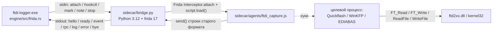
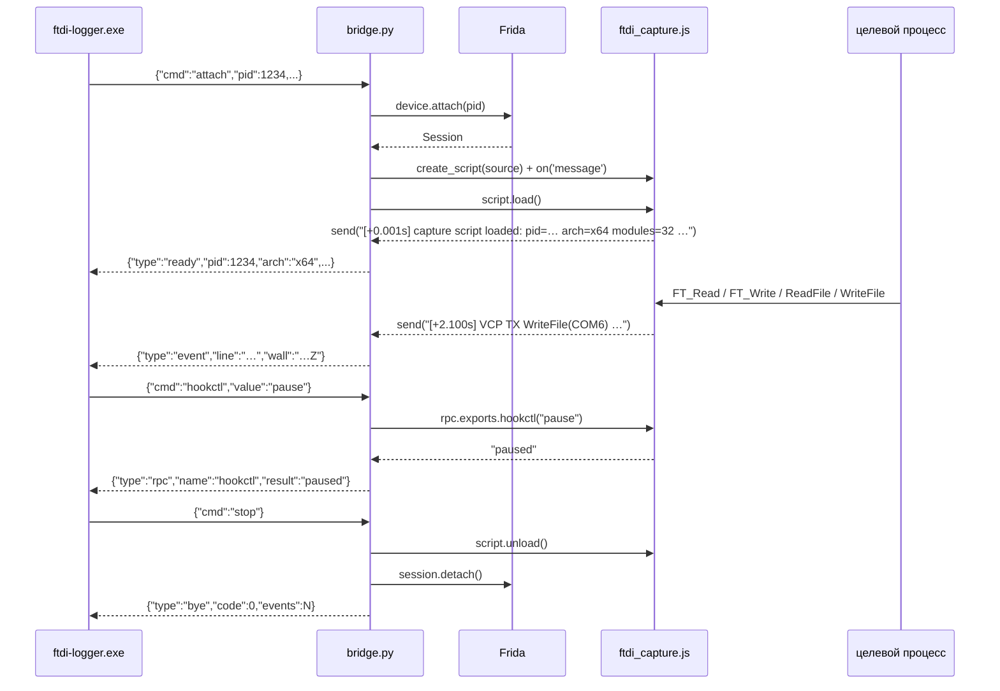

# Sidecar: мост «движок Rust ↔ Frida»

Тонкий Python-слой между движком `ftdi-logger.exe` и целевым процессом на FTDI-шнурке.
Вся логика разбора — в Rust (`engine/src/decode.rs`); здесь только: прицепиться к процессу,
загрузить JS-агент, гонять строки захвата в движок и принимать команды `pause`/`resume`.

> Контракт протокола зафиксирован в [docs/02-architecture.md §5](../docs/02-architecture.md):
> JSON Lines через stdin/stdout, UTF-8 без BOM. Типы сообщений — `engine/src/models.rs`, `enum BridgeMsg`.

## Как это устроено



## Файлы

| Файл | Назначение |
|---|---|
| `bridge.py` | сам мост: JSON Lines протокол, attach/stop, `hookctl`, вывод событий |
| `agents/ftdi_capture.js` | Frida-агент: полный порт `ftdi_capture_blocks.js` (все хуки и формат строк байт-в-байт) |
| `requirements.txt` | зависимость `frida>=17,<18` |

## Установка

```powershell
# тот же python.exe, что указан движку (по умолчанию — Python312)
C:\Users\User\AppData\Local\Programs\Python\Python312\python.exe -m pip install -r sidecar\requirements.txt
```

Проверка, что мост и Frida живы (устройство не нужно):

```powershell
python sidecar\bridge.py --self-test
```

Печатает `hello`, `ready`, 20 синтетических `event`-строк валидной грамматики старого лога
(TX/RX/VCP/FILE/MARK) и `bye`, затем выходит с кодом 0. Строки парсятся тем же Rust-разбором,
что и живой захват, — это смоук без станка.

## Протокол: команды движка

| Команда (stdin) | Что делает мост | Ответы (stdout) |
|---|---|---|
| `{"cmd":"attach","pid":1234,"script":"sidecar/agents/ftdi_capture.js","label":"BMS46"}` | `device.attach(pid)` → `create_script` → `script.load()` | `ready` (+ `log`), далее поток `event` |
| `{"cmd":"hookctl","value":"pause"}` | `rpc.exports.hookctl("pause")` — снять все хуки | `rpc` `{"name":"hookctl","result":"paused"}` |
| `{"cmd":"hookctl","value":"resume"}` | `rpc.exports.hookctl("resume")` — поставить хуки заново | `rpc` `{"name":"hookctl","result":"resumed"}` |
| `{"cmd":"mark","action":"start","title":"…","ts":1234.5}` | разметку ведёт движок; мост только пишет `log` | `log` |
| `{"cmd":"note","text":"…"}` | заметка к сессии; мост только пишет `log` | `log` |
| `{"cmd":"stop"}` | `script.unload()` → `session.detach()` | `bye` `{"code":0,"events":N}`, выход 0 |
| EOF на stdin | грациозная остановка (родитель умер/закрыл пайп) | `bye`, выход 0 |
| любая неизвестная | — | `error` `{"fatal":false}`, мост продолжает работу |

## Протокол: сообщения в движок

| `type` | Поля (как в `BridgeMsg`) | Когда |
|---|---|---|
| `hello` | `bridge`, `frida`, `python` | сразу при старте, до чтения stdin |
| `ready` | `pid`, `arch`, `modules`, `script` | после успешного `script.load()` |
| `event` | `line`, `wall` (RFC3339 UTC, мс) | каждое `send()` из JS-агента |
| `rpc` | `name`, `result` | результат `rpc.exports` |
| `log` | `level`, `msg` | служебные сообщения моста |
| `error` | `msg`, `fatal` | `fatal:false` — ошибка команды; `fatal:true` — выход с кодом 2 |
| `bye` | `code`, `events` | грациозная остановка |

Правила, которые важно не сломать:

* `event.line` — **ровно та строка**, что отдал агент, без перевода строки и без переформатирования:
  на грамматику завязаны `engine/src/decode.rs`, импорт старых логов и `tools/legacy/parse_family.py`.
* `send()` со строкой → `line` = строка; `send()` с JSON-объектом → `line` = компактный JSON-текст.
* ошибка внутри JS-агента (`script.on('message')` c `type:"error"`) → `error` c `fatal:false`.
* в Frida 17 `recv()` одноразовый, поэтому управление — только через `rpc.exports`
  (`hookctl`, `ping`), а не через `send/recv`.



## Агент `agents/ftdi_capture.js`

Полный порт исторического `ftdi_capture_blocks.js` (эталон — `tools/legacy/`), сохранены все хуки:

| Группа | Что логируется |
|---|---|
| module observer | `MODULE(now)` / `MODULE +` для `ftd2xx`, `ftdibus`, `ftser`, `clr*` и т.п. |
| D2XX | `FT_Open/OpenEx/Close/Read/Write`, `FT_SetBaudRate/…`, `FT_EE_*`, `FT_GetDeviceInfo*`, `FT_Purge`, `FT_GetQueueStatus`, … (36 экспортов) |
| VCP (kernel32) | `CreateFileA/W` (COM и файлы), `ReadFile/WriteFile` с `ovl=0/1`, `CloseHandle` |
| файловые операции | `FILE open/write/close` для `.bin/.csv/.cal/.hex`, `.0pa/.0da/.0ka` и др. |
| управление | `rpc.exports.hookctl("pause"|"resume")`, `rpc.exports.ping() → "pong"` |

## Диагностика

| Симптом | Причина и что делать |
|---|---|
| `error: frida не установлена` | поставить `requirements.txt` в тот python.exe, который видит движок (`--python`) |
| `error: attach pid=… ProcessNotFound` | процесс закрылся/не тот pid; обновите список процессов в UI |
| `error: attach pid=… PermissionDenied` | цель запущена от администратора, а мост — нет: перезапустите логер от админа |
| `ready` есть, `event` нет | цель ещё не загрузила `ftd2xx.dll`; ждите `MODULE + FTD2XX.DLL` или включите хуки после операции |
| `hookctl: мост не подключён` | `pause/resume` до `attach`; сначала подключитесь к процессу |
| события идут, но разбор пустой | проверьте, что `line` не переформатирован: грамматика — `engine/src/decode.rs`, эталон — `tools/legacy/parse_family.py` |
