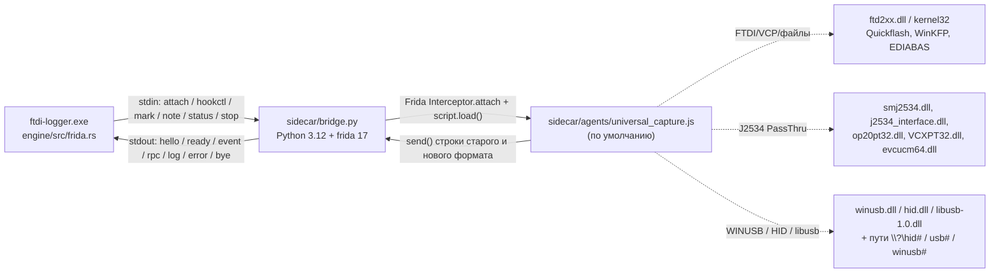
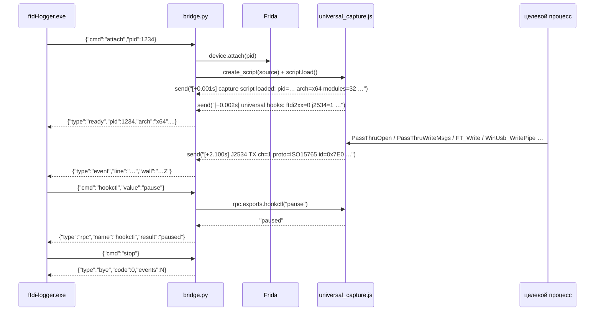

# Sidecar: мост «движок Rust ↔ Frida»

Тонкий Python-слой между движком `ftdi-logger.exe` и целевым процессом. Вся логика разбора —
в Rust (`engine/src/decode.rs`); здесь только: прицепиться к процессу, загрузить JS-агент,
гонять строки захвата в движок и принимать команды `pause`/`resume`/`status`.

> Контракт протокола — [docs/02-architecture.md §5](../docs/02-architecture.md);
> грамматика строк универсального захвата — [docs/02-architecture.md §11.3](../docs/02-architecture.md);
> типы сообщений — `engine/src/models.rs`, `enum BridgeMsg`.

## Как это устроено



## Файлы

| Файл | Назначение |
|---|---|
| `bridge.py` | мост: JSON Lines протокол, attach/stop, `hookctl`, `status`, вывод событий |
| `agents/universal_capture.js` | **агент по умолчанию**: старые хуки FTDI/VCP/файлы + J2534/WinUSB/HID/libusb/USB-пути |
| `agents/ftdi_capture.js` | старый FTDI-агент (эталон поведения; выбирается полем `script`) |
| `agents/ftdi_capture_blocks.js` | исторический агент Quickflash-семейства (не тронут) |
| `requirements.txt` | зависимость `frida>=17,<18` |

## Установка и смоук

```powershell
C:\Users\User\AppData\Local\Programs\Python\Python312\python.exe -m pip install -r sidecar\requirements.txt
python sidecar\bridge.py --self-test
```

`--self-test` печатает `hello`, `ready`, **34** синтетических `event`-строки и `bye`, код 0:
20 старых (TX/RX/VCP/FILE/MARK — совместимость с `tools/legacy/parse_family.py`), 10 новых
по §11.3 (J2534 open/connect/TX/RX/ioctl/disconnect, USB open, WINUSB, HID, LIBUSB) и
4 overlapped-I/O (`VCP attach-existing COMx`, `VCP TX/RX … ovl=1`, `WriteFileEx`).
Каждая строка — валидный JSON и валидная грамматика; это смоук без устройства и без Frida.

## Протокол: команды движка

| Команда (stdin) | Что делает мост | Ответы (stdout) |
|---|---|---|
| `{"cmd":"attach","pid":1234,"label":"BMS46"}` | attach → `script.load()` универсального агента | `ready` (+ `log`), далее поток `event` |
| `{"cmd":"attach","pid":1234,"script":"sidecar/agents/ftdi_capture.js"}` | то же, но старым FTDI-агентом | `ready`, `event` |
| `{"cmd":"hookctl","value":"pause"}` | `rpc.exports.hookctl("pause")` — снять ВСЕ хуки (FTDI + J2534 + USB) | `rpc` `{"name":"hookctl","result":"paused"}` |
| `{"cmd":"hookctl","value":"resume"}` | поставить все хуки заново (модули пересканируются) | `rpc` `{"name":"hookctl","result":"resumed"}` |
| `{"cmd":"status"}` | `rpc.exports.status()` — какие семейства хуков активны | `rpc` `{"name":"status","result":"{…json…}"}` |
| `{"cmd":"mark","action":"start","title":"…","ts":1234.5}` | разметку ведёт движок; мост пишет `log` | `log` |
| `{"cmd":"note","text":"…"}` | заметка к сессии; мост пишет `log` | `log` |
| `{"cmd":"stop"}` | `script.unload()` → `session.detach()` | `bye` `{"code":0,"events":N}`, выход 0 |
| EOF на stdin | грациозная остановка (родитель умер/закрыл пайп) | `bye`, выход 0 |
| любая неизвестная | — | `error` `{"fatal":false}`, мост продолжает работу |

## Протокол: сообщения в движок

| `type` | Поля (как в `BridgeMsg`) | Когда |
|---|---|---|
| `hello` | `bridge`, `frida`, `python` | сразу при старте |
| `ready` | `pid`, `arch`, `modules`, `script` | после успешного `script.load()` |
| `event` | `line`, `wall` (RFC3339 UTC, мс) | каждое `send()` из JS-агента |
| `rpc` | `name`, `result` | результат `rpc.exports` |
| `log` | `level`, `msg` | служебные сообщения моста |
| `error` | `msg`, `fatal` | `fatal:false` — ошибка команды; `fatal:true` — выход с кодом 2 |
| `bye` | `code`, `events` | грациозная остановка |

Правила, которые важно не сломать:

* `event.line` — **ровно та строка**, что отдал агент: на грамматику завязаны
  `engine/src/decode.rs`, импорт старых логов и `tools/legacy/parse_family.py`;
* `send()` со строкой → `line` = строка; `send()` с JSON-объектом → компактный JSON-текст;
* ошибка внутри JS-агента (`type:"error"`) → `error` c `fatal:false`;
* в Frida 17 `recv()` одноразовый — управление только через `rpc.exports`
  (`hookctl`, `status`, `ping`).



## Агент `agents/universal_capture.js`

Сохраняет **всё** из `ftdi_capture.js` (формат старых строк не изменён) и добавляет
универсальный транспорт. Все колбэки в `try/catch`; один сломанный хук не роняет цель.

| Группа | Хуки / что логируется |
|---|---|
| module observer (старое) | `MODULE(now)` / `MODULE +` для `ftd2xx`, `ftdibus`, `ftser`, `clr*` |
| D2XX | `FT_Open/OpenEx/Close/Read/Write/Set*/Get*/EE_*` и др. (36 экспортов), строки `FT_*` / `TX ftd2xx` / `RX ftd2xx` |
| VCP/файлы (старое) | `CreateFileW/A`, `ReadFile/WriteFile` c `ovl=`, `FILE open/write/close`, `VCP …` |
| **J2534** | динамический observer модулей по шаблонам `j2534`, `passthru`, `pass-thru`, `ptshim`, `op20pt`, `smj2534`, `vcxpt`, `evcucm`, `ucdsj2534`, `tactrix`, `scanmatik`, `chipsoft`; хуки `PassThruOpen/Connect/Disconnect/ReadMsgs/WriteMsgs/StartMsgFilter/Ioctl/Close/GetLastError` |
| **WinUSB** | `winusb.dll`: `WinUsb_ReadPipe/WritePipe/ControlTransfer` |
| **HID** | `hid.dll`: `HidD_GetFeature/SetFeature/GetInputReport/SetOutputReport` + `ReadFile/WriteFile` по путям `\\?\hid#…` + `DeviceIoControl` |
| **libusb-1.0** | `libusb_bulk_transfer`, `libusb_interrupt_transfer`, `libusb_control_transfer` |
| **USB-пути** | `CreateFileW/A` + `CloseHandle` для `\\?\hid#`, `\\?\usb#`, `\\?\winusb#` |
| управление | `rpc.exports.hookctl("pause"|"resume")`, `status()`, `ping()` |

Пауза снимает **все** Interceptor-хуки (старые и новые); `resume` пересканирует загруженные
модули и ставит их заново (J2534 DLL могла загрузиться во время паузы).

### Формат новых строк (docs/02 §11.3)

```
[+1.234s] J2534 open name="Scanmatik - SM2 USB" vendor="Scanmatik" dll="smj2534.dll" rc=0
[+1.300s] J2534 connect dev=1 ch=1 proto=ISO15765 flags=0x0 baud=500000 rc=0
[+2.100s] J2534 TX ch=1 proto=ISO15765 id=0x7E0 flags=0x0 len=8 : 02 10 03 00 00 00 00 00
[+2.150s] J2534 RX ch=1 proto=ISO15765 id=0x7E8 rxs=0x0 len=8 : 06 50 03 00 00 00 00 00
[+3.000s] J2534 ioctl ch=1 id=0x0701 rc=0
[+3.100s] J2534 disconnect ch=1 rc=0
[+4.000s] USB open path="\\?\hid#vid_046d&pid_c52b" kind=hid handle=0x2b4
[+4.100s] USB close path="\\?\hid#vid_046d&pid_c52b" bytes=64 writes=3
[+4.200s] WINUSB TX pipe=0x01 len=8 : 12 04 0d 1b
[+4.250s] WINUSB RX pipe=0x81 len=64 : 12 04 4d 1b
[+4.300s] HID TX report=0x02 len=9 : 02 12 04 0d 1b 00 00 00 00
[+4.350s] HID RX report=0x01 len=9 : 01 12 04 4d 1b 00 00 00 00
[+4.400s] LIBUSB TX ep=0x01 len=8 : 12 04 0d 1b
[+4.450s] LIBUSB RX ep=0x81 len=8 : 12 04 4d 1b
```

Детали J2534:

* `PASSTHRU_MSG` (x86 и x64): `ProtocolID RxStatus TxFlags Timestamp DataSize ExtraDataIndex`
  — по 4 байта, `Data[4128]` с офсета 24; структура не копируется, читается `readU32`;
* для `ISO15765` (proto=6) и `CAN` (proto=5) `Data[0..3]` — CAN ID **big-endian**; в строке
  `id=0x…` — он, а `len`/hex — payload после 4 байт (ISO-TP с PCI);
* `TX` дампится на входе `PassThruWriteMsgs` (до 16 сообщений), `RX` — на выходе
  `PassThruReadMsgs` при `rc=0` (до 32 сообщений), дамп ≤ 16 КиБ на сообщение.

Дополнительные строки (расширения, в §11.3 их нет — разбор в `decode.rs` должен их
игнорировать/помечать `sys`, пока ded их не поддержит):

```
[+5.0s] J2534 close dev=1 rc=0
[+5.1s] J2534 filter ch=1 type=0x1 rc=0
[+5.2s] J2534 error text="ERR_TIMEOUT" rc=0
[+5.3s] WINUSB CTL dir=in len=8 : 12 04 0d 1b
[+5.4s] HID ioctl code=0xb019 rc=0 in=8 out=2 : 01 0a 00 00 00 00 00 00
[+5.5s] LIBUSB CTL dir=in len=8 : 12 04 0d 1b
```

## Overlapped I/O и хендлы, открытые до attach

`System.IO.Ports` (.NET SerialPort — так работает MS4x Flasher) открывает COM **до** нашего
attach и работает overlapped-I/O: `ReadFile/WriteFile` возвращают `n=0`/`ERROR_IO_PENDING`,
реальные счётчики и данные появляются позже. Ключевая тонкость: .NET передаёт в
`GetOverlappedResult/GetOverlappedResultEx` **другую копию** `NativeOverlapped` (указатель
и `hEvent` не совпадают с исходным), поэтому сопоставлять по указателю/hEvent нельзя.

| Механизм | Что делает |
|---|---|
| ленивая классификация | при первом `ReadFile/WriteFile/DeviceIoControl` с неизвестным хендлом: `GetFinalPathNameByHandleW` → `NtQueryObject` → `QueryDosDevice` → в `comHandles`/`fileHandles`/`usbHandles`; один раз `VCP attach-existing COM1 handle=0x…` |
| pending-map | каждая операция с `lpOverlapped != NULL` запоминается: handle, **исходный** `OVERLAPPED*`, буфер, запрошенный len, направление |
| ключ сопоставления | ядро пишет статус и число байт в **исходный** `OVERLAPPED`: `Internal` (`0x103` = `STATUS_PENDING`) и `InternalHigh` (= n). Завершённые операции забираются по этому признаку; при переиспользовании указателя `OVERLAPPED` (бывает у .NET) завершённая запись забирается **до** перезаписи |
| TX (overlapped) | печатается **на входе** `WriteFile` с полными байтами — ровно один раз: `VCP TX WriteFile(COM1) rc=0 n=4 ovl=1 : 12 04 0d 1b`; completion TX не дублирует, `tx_bytes` сходится |
| RX | на `onLeave` при `n=0` — короткая строка без hex, реальные байты — только из завершённой операции: `VCP RX ReadFile(COM1) rc=0 n=12 ovl=1 : …` |
| sweep (250 мс) | забирает завершённые по `OVERLAPPED` даже без вызова `GetOverlappedResult`, иначе fallback `VCP RX … ovl=pending` без hex (RX) / запись удаляется (TX уже отдан) |
| ReadFileEx/WriteFileEx | APC-завершение не хукается; логируется запрос: `VCP TX WriteFileEx(COM1) len=N ovl=1 : …` |
| чужие хендлы | pipe/прочее не дампятся; максимум одна debug-строка `hook: handle resolve fail …` на процесс |

Живой MS4x (UIA Identify, e2e `tests/e2e/universal.ps1` — 10/10, counts **tx=2/13**, rx>0):

```
[+2.223s] VCP attach-existing COM1 handle=0x814
[+2.223s] VCP TX WriteFile(COM1) rc=0 n=4 ovl=1 : 12 04 0d 1b
[+2.331s] VCP RX ReadFile(COM1) rc=0 n=1 ovl=1 : 12
[+2.331s] VCP RX ReadFile(COM1) rc=0 n=1 ovl=1 : 4c
[+2.331s] VCP RX ReadFile(COM1) rc=0 n=1 ovl=1 : a0
[+2.331s] VCP RX ReadFile(COM1) rc=0 n=12 ovl=1 : ff ff ff ff ff ff ff ff ff ff ff ff
[+2.457s] VCP TX WriteFile(COM1) rc=0 n=9 ovl=1 : 12 09 06 00 00 3f e8 08 c2
```

Ограничения:

* `GetLastError()` после Frida-хука обычно уже сброшен — pending-строки пишутся с `rc=0`;
* TX overlapped фиксируется как запрос на входе `WriteFile` (так гарантируется ровно одна
  строка с полными байтами); если вызов сразу вернул ошибку, строка всё равно означает
  «приложение пыталось отправить эти байты»;
* имя COM для хендла, открытого до attach, восстанавливается эвристикой; если не удалось —
  `VCP … (handle=0x…)`, грамматика VCP при этом сохраняется.

## Диагностика

| Симптом | Причина и что делать |
|---|---|
| `error: frida не установлена` | поставить `requirements.txt` в тот python.exe, который видит движок (`--python`) |
| `error: attach pid=… ProcessNotFound` | процесс закрылся/не тот pid; обновите список процессов |
| `error: attach pid=… PermissionDenied` | цель от администратора → логер тоже от администратора |
| `ready` есть, `event` нет | цель ещё не загрузила драйвер: ждите `MODULE + FTD2XX.DLL` / `J2534 module:` |
| нет `J2534 open` | DLL загружена позже: observer поставит хуки при загрузке; проверьте `status` (`j2534:true`) |
| `status` → `j2534:false` | ни одна J2534 DLL не загружена в процесс — приложение ходит через свой драйвер |
| `hookctl: мост не подключён` | `pause/resume/status` до `attach` |
| события идут, но разбор пустой | строка переформатирована или неизвестный префикс: грамматика — §11.3 |
| 32-битная цель | Frida ставит 32-битный агент; `unsigned long` в J2534-структурах по 4 байта, офсеты те же |

## Риски

* J2534 DLL могут грузиться **позже** старта захвата — отсюда module observer; если драйвер
  грузится в дочерний процесс, хуки туда не попадут.
* Некоторые вендорские DLL при `PassThruOpen` без железа возвращают ошибку — это нормально,
  строка с `rc=…` всё равно пишется.
* Античит/защищённые процессы: Frida не сможет attach (`PermissionDenied`) или процесс умрёт —
  лечится правами администратора; для неизвестных инструментов сначала смоук `status`.
* Дампы `PassThruReadMsgs` читают память в момент возврата; при агрессивном переиспользовании
  буфера приложением возможны «рваные» сообщения — это лучше, чем потерять поток.
