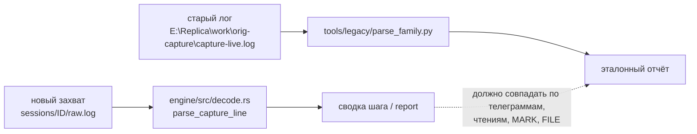

# tools/legacy — исторические инструменты старого логера

ИСТОРИЧЕСКОЕ. Это копии скриптов из `E:\Replica\work\orig-capture\` (старый консольный логер),
сохранённые как **эталон поведения и грамматики**. Из нового UI они **не запускаются** и в сборку
`dist\` не попадают — только для сверки и ручной археологии.

> Правило: если новый движок расходится со старым парсером по формату строки — права старая
> грамматика (на неё завязаны уже отснятые логи), а не новый код.

## Что здесь лежит

| Файл | Роль в старом логере | Зачем храним |
|---|---|---|
| `parse_family.py` | разбор `capture.log` Quickflash-семейства: телеграммы, эхо, READ, MARK, FILE, `PHASE` | эталон грамматики строк и семантики разбора; `engine/src/decode.rs` обязан её повторять |
| `attach_capture.py` | Frida-attach/spawn + запись канонического лога + `state.json`/`stop.flag` | эталон поведения моста: что и как пишется в лог, обработка `script.on('message')` |
| `winkfp.py` | запуск WinKFP/EDIABAS и разбор `api.trc` (job/sgbd/results/errors) | эталон разбора трасс EDIABAS (`engine/src/ediabas.rs`) |
| `snap.ps1` | снимок окна/экрана | эталон скриншотов шага (`engine/src/screenshot.rs`) |

Сам Frida-агент (`ftdi_capture_blocks.js`) перенесён в рабочую сборку:
[`sidecar/agents/ftdi_capture.js`](../../sidecar/agents/ftdi_capture.js) — полный порт с сохранением
всех хуков и формата строк. В `tools/legacy/` его копии нет намеренно: рабочая версия должна быть
единственной.

## Как использовать

```powershell
# эталонный разбор уже отснятого лога (ничего не запускает, устройство не нужно)
C:\Users\User\AppData\Local\Programs\Python\Python312\python.exe tools\legacy\parse_family.py `
    --log E:\Replica\work\orig-capture\capture-live.log --no-dump --no-reads
```

Сверка нового продукта со старым эталоном:



## Чего здесь нет и почему

* `logger.py` (49 КБ консольного логера) — не копируем: его функции закрывают новый движок и UI,
  а как эталон он избыточен; при необходимости он остаётся в `E:\Replica\work\orig-capture\`.
* `ftdi_capture_blocks.js` — перенесён в `sidecar/agents/ftdi_capture.js` (рабочая версия).
* Старые логи (`capture-live.log` и др.) — не копируем в репозиторий (большие, 100+ МБ);
  импортируйте их новым UI, исходник сохранится в `sessions/<id>/import/`.

## Статус

| | |
|---|---|
| запускается из нового UI | нет |
| попадает в `dist\` | нет |
| используется новым движком | нет (только как эталон) |
| зависимости | Python 3 + stdlib; `attach_capture.py` — ещё и `frida` |
